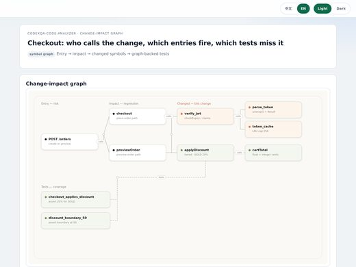
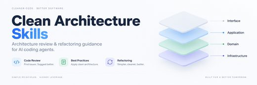

# Awesome Claude Code Skills Collections

[中文](README.zh-CN.md)

Open-source **collections of Claude Code skills**: repositories that hold many skills, plugins or subagents you install together. General collections, single-domain packs, vendor directories and the best-known awesome lists. 793 repos, each one read and security-graded by [Agent Skills Hub (agentskillshub.top)](https://agentskillshub.top).

Live page with filters: **[https://agentskillshub.top/best/claude-code-skills/](https://agentskillshub.top/best/claude-code-skills/)** · refreshed every 8 hours

## Which one to install

We counted every skill file in 39 of these collections. This is what we would pick; the [full audit](#tested) is below.

- 🥇 **To start: [anthropics/skills](https://github.com/anthropics/skills)**  
  Anthropic's own set and the reference for the format: 20 skills, small enough that every one keeps its description when installed together. Its sibling, claude-plugins-official, is the vendor's plugin directory.
- 🥈 **For everyday engineering: [mattpocock/skills](https://github.com/mattpocock/skills)**  
  The most-starred collection here and one of the leanest: 38 skills, all 38 meet the format, about 1,500 tokens of names and descriptions in total.
- 🥉 **For one field, done cleanly: [marketingskills](https://github.com/coreyhaines31/marketingskills)**  
  50 marketing skills, all valid, none over 500 lines, none shipping scripts; its descriptions are long, so installed whole a few may lose theirs. For security work the same shape is trailofbits/skills (85 of 85 valid).

**Pick from these by name; do not install them whole:** agentic-awesome-skills (2,675 distinct skills; Claude Code would show a description for a few dozen and Codex would hide most of the rest); claude-code-templates (886 skills, 140 of them over 500 lines); Anthropic-Cybersecurity-Skills (818 skills, every one with scripts to read first).

Whichever you pick: size is the thing to watch. Of the 36 collections we counted, 8 are so big that Claude Code would list most of their skills by name only, and Codex with 512 skills installed opened the right one 17 times of 36.

*Listed by GitHub stars, as on the page: this is a count of what each collection holds, not a ranking of how good its skills are. Counted from the files at the commit on each evidence page; no skill was run.*

## What is in these collections

<table>
<tr>
<td align="center" valign="top" width="33%"><b>🧰 General collections</b> 355 repos   Skills for many kinds of work in one repository. <a href="#type-general"><b>View the list →</b></a></td>
<td align="center" valign="top" width="33%"><b>🎯 Single-domain packs</b> 365 repos   Skills for one field: marketing, security, research, game development, one stack. <a href="#type-domain"><b>View the list →</b></a></td>
<td align="center" valign="top" width="33%"><b>🏛 Official & vendor</b> 70 repos   Published by a company or project for its own product. <a href="#type-official"><b>View the list →</b></a></td>
</tr>
<tr>
<td align="center" valign="top" width="33%"><b>🔗 Awesome lists</b> 3 repos  Curated lists of links to skills kept elsewhere. <a href="#type-list"><b>View the list →</b></a></td>
</tr>
</table>

## Contents

- [🧪 Tested end to end](#tested)
- [🧰 General collections](#type-general) (355)
- [🎯 Single-domain packs](#type-domain) (365)
- [🏛 Official & vendor](#type-official) (70)
- [🔗 Awesome lists](#type-list) (3)

## How a repo gets on the list

1. It is a collection of skills for Claude Code: many skills in one repository, or a vendor's directory of skills or plugins. One skill, one MCP server, or a tool that only installs skills is not a collection. Three well-known awesome lists are included by the maintainer's choice.
2. It is software someone can install or run, not a list of links or a placeholder.
3. It has a README. Without one it cannot be graded.
4. At 50 stars or more it is listed on topic alone. Under 50 it must also clear a README quality bar (shows it working, one-command start, a concrete outcome, complete docs), and have 5 stars.

The questions are answered by a decision model reading each README, not by hand. A repo near a cut-off can land on either side; open an issue if one is misfiled.

## 🧪 Collection audit

On 2026-10-11 we opened the 39 most-starred collections on this page and counted, from the files alone: how many skills each holds, how many are distinct, how many meet the Agent Skills format (a name of at most 64 lowercase letters, digits and hyphens; a description of 1 to 1,024 characters), how many ship scripts, and how long all their names and descriptions are together (at four characters per token). Then we measured what Claude Code does with a large install: session size with 12, 112 and 512 skills installed.

**What we found:** 36 of the 39 hold skills in the SKILL.md format; the other 3 are link lists or subagent sets. They range from 5 skills to 2,675. Of 14,477 skill files, 6,352 are copies of a skill already in the same repository, and 8 collections are so big that Claude Code would list most of their skills by name only. Claude Code does not pay the full price for a big install: a session started at 17,781 tokens with 12 skills, 24,499 with 112 and 25,289 with 512, because past a budget it lists skills by name only (about 47 of 512 kept a description, by its own count).  Crowded: with 500 other skills installed beside 12 test skills, Claude Code still opened the right one 35 times of 36, while Codex managed 17 of 36 after dropping every description and hiding 134 skills.

| # | Collection | ★ | Distinct skills | Meet the format | Ship scripts | Names and descriptions, in tokens (estimate) | If you install all of it |  |
|---|---|---|---|---|---|---|---|---|
| 1 | [skills](https://github.com/mattpocock/skills) | 265,786 | 38 | 100% | 2 | 1,468 | All keep a description | [evidence](https://agentskillshub.top/best-runs/collections/mattpocock__skills.html) |
| 2 | [skills](https://github.com/anthropics/skills) | 180,369 | 20 | 95% | 8 | 2,415 | All keep a description | [evidence](https://agentskillshub.top/best-runs/collections/anthropics__skills.html) |
| 3 | [agent-skills](https://github.com/addyosmani/agent-skills) | 104,575 | 25 | 100% | 1 | 2,316 | All keep a description | [evidence](https://agentskillshub.top/best-runs/collections/addyosmani__agent-skills.html) |
| 4 | [awesome-claude-skills](https://github.com/ComposioHQ/awesome-claude-skills) | 76,829 | 864 | 89% | 8 | 27,922 | Most listed by name only | [evidence](https://agentskillshub.top/best-runs/collections/ComposioHQ__awesome-claude-skills.html) |
| 5 | [marketingskills](https://github.com/coreyhaines31/marketingskills) | 54,098 | 50 | 100% | 0 | 9,696 | Some lose their description | [evidence](https://agentskillshub.top/best-runs/collections/coreyhaines31__marketingskills.html) |
| 6 | [academic-research-skills](https://github.com/Imbad0202/academic-research-skills) | 51,227 | 5 | 100% | 1 | 1,194 | All keep a description | [evidence](https://agentskillshub.top/best-runs/collections/Imbad0202__academic-research-skills.html) |
| 7 | [obsidian-skills](https://github.com/kepano/obsidian-skills) | 49,365 | 6 | 100% | 0 | 388 | All keep a description | [evidence](https://agentskillshub.top/best-runs/collections/kepano__obsidian-skills.html) |
| 8 | [scientific-agent-skills](https://github.com/K-Dense-AI/scientific-agent-skills) | 48,309 | 177 | 100% | 121 | 17,732 | Most listed by name only | [evidence](https://agentskillshub.top/best-runs/collections/K-Dense-AI__scientific-agent-skills.html) |
| 9 | [agentic-awesome-skills](https://github.com/sickn33/agentic-awesome-skills) | 47,439 | 2,675 | 100% | 371 | 112,112 | Most listed by name only | [evidence](https://agentskillshub.top/best-runs/collections/sickn33__agentic-awesome-skills.html) |
| 10 | [claude-plugins-official](https://github.com/anthropics/claude-plugins-official) | 37,641 | 29 | 100% | 7 | 2,868 | All keep a description | [evidence](https://agentskillshub.top/best-runs/collections/anthropics__claude-plugins-official.html) |
| 11 | [Anthropic-Cybersecurity-Skills](https://github.com/mukul975/Anthropic-Cybersecurity-Skills) | 34,195 | 818 | 100% | 818 | 88,994 | Most listed by name only | [evidence](https://agentskillshub.top/best-runs/collections/mukul975__Anthropic-Cybersecurity-Skills.html) |
| 12 | [claude-code-templates](https://github.com/davila7/claude-code-templates) | 32,541 | 886 | 94% | 185 | 65,240 | Most listed by name only | [evidence](https://agentskillshub.top/best-runs/collections/davila7__claude-code-templates.html) |
| 13 | [claude-skills](https://github.com/alirezarezvani/claude-skills) | 27,982 | 443 | 98% | 256 | 48,851 | Most listed by name only | [evidence](https://agentskillshub.top/best-runs/collections/alirezarezvani__claude-skills.html) |
| 14 | [Claude-Code-Game-Studios](https://github.com/Donchitos/Claude-Code-Game-Studios) | 26,097 | 74 | 100% | 0 | 2,488 | All keep a description | [evidence](https://agentskillshub.top/best-runs/collections/Donchitos__Claude-Code-Game-Studios.html) |
| 15 | [khazix-skills](https://github.com/KKKKhazix/khazix-skills) | 21,289 | 6 | 100% | 3 | 637 | All keep a description | [evidence](https://agentskillshub.top/best-runs/collections/KKKKhazix__khazix-skills.html) |
| 16 | [Auto-claude-code-research-in-sleep](https://github.com/wanshuiyin/Auto-claude-code-research-in-sleep) | 17,250 | 84 | 100% | 7 | 6,485 | All keep a description | [evidence](https://agentskillshub.top/best-runs/collections/wanshuiyin__Auto-claude-code-research-in-sleep.html) |
| 17 | [claude-skills](https://github.com/Jeffallan/claude-skills) | 11,815 | 67 | 100% | 0 | 7,594 | Some lose their description | [evidence](https://agentskillshub.top/best-runs/collections/Jeffallan__claude-skills.html) |
| 18 | [skills](https://github.com/slavingia/skills) | 10,461 | 10 | 100% | 0 | 518 | All keep a description | [evidence](https://agentskillshub.top/best-runs/collections/slavingia__skills.html) |
| 19 | [superpowers-zh](https://github.com/jnMetaCode/superpowers-zh) | 8,291 | 21 | 100% | 3 | 465 | All keep a description | [evidence](https://agentskillshub.top/best-runs/collections/jnMetaCode__superpowers-zh.html) |
| 20 | [skills](https://github.com/jakubkrehel/skills) | 7,725 | 13 | 100% | 0 | 487 | All keep a description | [evidence](https://agentskillshub.top/best-runs/collections/jakubkrehel__skills.html) |
| 21 | [skills](https://github.com/trailofbits/skills) | 7,469 | 85 | 100% | 14 | 8,966 | Some lose their description | [evidence](https://agentskillshub.top/best-runs/collections/trailofbits__skills.html) |
| 22 | [oh-story-claudecode](https://github.com/zenstory-ai/oh-story-claudecode) | 7,421 | 13 | 100% | 11 | 592 | All keep a description | [evidence](https://agentskillshub.top/best-runs/collections/zenstory-ai__oh-story-claudecode.html) |
| 23 | [Claude-Red](https://github.com/SnailSploit/Claude-Red) | 7,399 | 79 | 42% | 0 | 10,166 | Some lose their description | [evidence](https://agentskillshub.top/best-runs/collections/SnailSploit__Claude-Red.html) |
| 24 | [Product-Manager-Skills](https://github.com/deanpeters/Product-Manager-Skills) | 7,228 | 77 | 100% | 2 | 3,570 | All keep a description | [evidence](https://agentskillshub.top/best-runs/collections/deanpeters__Product-Manager-Skills.html) |
| 25 | [agent-skills](https://github.com/tech-leads-club/agent-skills) | 7,046 | 92 | 100% | 17 | 12,276 | Some lose their description | [evidence](https://agentskillshub.top/best-runs/collections/tech-leads-club__agent-skills.html) |
| 26 | [Skills](https://github.com/MengTo/Skills) | 6,706 | 176 | 97% | 30 | 18,302 | Most listed by name only | [evidence](https://agentskillshub.top/best-runs/collections/MengTo__Skills.html) |
| 27 | [n8n-skills](https://github.com/czlonkowski/n8n-skills) | 6,402 | 15 | 100% | 0 | 2,684 | All keep a description | [evidence](https://agentskillshub.top/best-runs/collections/czlonkowski__n8n-skills.html) |
| 28 | [skills](https://github.com/AlphaGBM/skills) | 6,249 | 27 | 100% | 15 | 1,495 | All keep a description | [evidence](https://agentskillshub.top/best-runs/collections/AlphaGBM__skills.html) |
| 29 | [skills](https://github.com/remotion-dev/skills) | 5,005 | 12 | 100% | 0 | 147 | All keep a description | [evidence](https://agentskillshub.top/best-runs/collections/remotion-dev__skills.html) |
| 30 | [Claude-BugHunter](https://github.com/elementalsouls/Claude-BugHunter) | 4,865 | 83 | 96% | 1 | 13,020 | Some lose their description | [evidence](https://agentskillshub.top/best-runs/collections/elementalsouls__Claude-BugHunter.html) |
| 31 | [codex-claude-academic-skills](https://github.com/zLanqing/codex-claude-academic-skills) | 4,725 | 24 | 100% | 13 | 2,651 | All keep a description | [evidence](https://agentskillshub.top/best-runs/collections/zLanqing__codex-claude-academic-skills.html) |
| 32 | [open-seo-mcp-skills](https://github.com/Ryze-AI-Adgent/open-seo-mcp-skills) | 4,724 | 8 | 100% | 0 | 536 | All keep a description | [evidence](https://agentskillshub.top/best-runs/collections/Ryze-AI-Adgent__open-seo-mcp-skills.html) |
| 33 | [Auto-Empirical-Research-Skills](https://github.com/brycewang-stanford/Auto-Empirical-Research-Skills) | 4,569 | 1,024 | 97% | 39 | 56,439 | Most listed by name only | [evidence](https://agentskillshub.top/best-runs/collections/brycewang-stanford__Auto-Empirical-Research-Skills.html) |
| 34 | [linkedin-skills](https://github.com/sergebulaev/linkedin-skills) | 4,461 | 13 | 100% | 4 | 1,434 | All keep a description | [evidence](https://agentskillshub.top/best-runs/collections/sergebulaev__linkedin-skills.html) |
| 35 | [everything-claude-code](https://github.com/WorldFlowAI/everything-claude-code) | 4,441 | 11 | 73% | 0 | 330 | All keep a description | [evidence](https://agentskillshub.top/best-runs/collections/WorldFlowAI__everything-claude-code.html) |
| 36 | [awesome-gamedev-agent-skills](https://github.com/gamedev-skills/awesome-gamedev-agent-skills) | 1,404 | 75 | 100% | 1 | 7,354 | Some lose their description | [evidence](https://agentskillshub.top/best-runs/collections/gamedev-skills__awesome-gamedev-agent-skills.html) |

**No SKILL.md files to count:** awesome-claude-code (A list of links to Claude Code resources kept elsewhere: there is no skill in it to install.); awesome-claude-code-subagents (A collection of subagent files, not skills: it has no SKILL.md to count.); awesome-claude-skills (A list of links to skills kept elsewhere: there is no skill in it to install.)

[All results, prompts and scripts](https://github.com/zhuyansen/agent-skills-hub/blob/main/ops/collections-audit/RESULTS.md) · [https://agentskillshub.top/best/claude-code-skills/#test-results](https://agentskillshub.top/best/claude-code-skills/#test-results)

## 🧰 General collections

[Open this type on the live page, sorted by stars →](https://agentskillshub.top/best/claude-code-skills/#type-general)

<table><tr>
<td align="center" valign="top"> <a href="https://github.com/nathankim0/clean-architecture-skills">nathankim0/clean-architecture-skills</a></td>
</tr></table>

| Repo | Stars | What it does | Security |
|---|---:|---|---|
| [mattpocock/skills](https://github.com/mattpocock/skills) | 324.2k | Skills for Real Engineers. Straight from my .agents directory. | [SAFE](https://agentskillshub.top/skill/mattpocock/skills/) |
| [anthropics/skills](https://github.com/anthropics/skills) | 194.4k | Public repository for Agent Skills | [SAFE](https://agentskillshub.top/skill/anthropics/skills/) |
| [addyosmani/agent-skills](https://github.com/addyosmani/agent-skills) | 117.4k | Production-grade engineering skills for AI coding agents. | [SAFE](https://agentskillshub.top/skill/addyosmani/agent-skills/) |
| [K-Dense-AI/scientific-agent-skills](https://github.com/K-Dense-AI/scientific-agent-skills) | 57.2k | Turn any AI agent into an AI Scientist. The #1 Agent Skills library for science, used by 250,000+ scientists worldwide. 177 ready-to-use validated sk… | [SAFE](https://agentskillshub.top/skill/K-Dense-AI/scientific-agent-skills/) |
| [obsidianmd/obsidian-skills](https://github.com/obsidianmd/obsidian-skills) | 52.4k | Agent skills for Obsidian. Teach your agent to use Obsidian CLI and open formats including Markdown, Bases, JSON Canvas. | [SAFE](https://agentskillshub.top/skill/obsidianmd/obsidian-skills/) |
| [sickn33/agentic-awesome-skills](https://github.com/sickn33/agentic-awesome-skills) | 49.7k | 2,955+ reusable AI agent skills for Claude Code, Codex, Cursor and Gemini CLI. AAS Core adds local catalog discovery, agent-owned selection and plan… | [SAFE](https://agentskillshub.top/skill/sickn33/agentic-awesome-skills/) |
| [anthropics/claude-plugins-official](https://github.com/anthropics/claude-plugins-official) | 47.3k | Official, Anthropic-managed directory of high quality Claude Code Plugins. | [SAFE](https://agentskillshub.top/skill/anthropics/claude-plugins-official/) |
| [davila7/claude-code-templates](https://github.com/davila7/claude-code-templates) | 33.5k | Open-source registry and CLI for Claude Code components: agents, commands, skills, hooks, MCPs, settings and mods | [SAFE](https://agentskillshub.top/skill/davila7/claude-code-templates/) |
| [alirezarezvani/claude-skills](https://github.com/alirezarezvani/claude-skills) | 29.8k | 410 Claude Code skills & agent skills & plugins (120+ Agents, custom commands, 410+ skills, customizable references, scripts)for Claude Code, Codex,… | [SAFE](https://agentskillshub.top/skill/alirezarezvani/claude-skills/) |
| [VoltAgent/awesome-claude-code-subagents](https://github.com/VoltAgent/awesome-claude-code-subagents) | 26.5k | A collection of 100+ specialized Claude Code subagents covering a wide range of development use cases | [SAFE](https://agentskillshub.top/skill/VoltAgent/awesome-claude-code-subagents/) |
| [KKKKhazix/khazix-skills](https://github.com/KKKKhazix/khazix-skills) | 22.2k | 数字生命卡兹克开源的 AI Skills 合集 \| Agent Skills: leader（帮你定义目标）, neat-freak 洁癖, hv-analysis, khazix-writer & more — Claude Code, Codex & 40+ agents | [SAFE](https://agentskillshub.top/skill/KKKKhazix/khazix-skills/) |
| [Jeffallan/claude-skills](https://github.com/Jeffallan/claude-skills) | 12.4k | 67 Specialized Skills for Full-Stack Developers. Transform Claude Code into your expert pair programmer. | [SAFE](https://agentskillshub.top/skill/Jeffallan/claude-skills/) |
| [slavingia/skills](https://github.com/slavingia/skills) | 11.2k | Based on The Minimalist Entrepreneur by Sahil Lavingia | [SAFE](https://agentskillshub.top/skill/slavingia/skills/) |
| [SnailSploit/Claude-Red](https://github.com/SnailSploit/Claude-Red) | 10.8k | claude-red is a curated library of offensive security skills designed for the Claude skills system. Each skill is a structured SKILL.md file that pri… | [SAFE](https://agentskillshub.top/skill/SnailSploit/Claude-Red/) |
| [Jakeschincariol/replica-skill](https://github.com/Jakeschincariol/replica-skill) | 9.3k | Eleven free Claude skills that clone any app: reverse-engineer it, rebuild it, test it for bugs, then fix what its users hate. Free, MIT. | [SAFE](https://agentskillshub.top/skill/Jakeschincariol/replica-skill/) |
| [trailofbits/skills](https://github.com/trailofbits/skills) | 8.2k | Trail of Bits skills for security research, vulnerability detection, and audit workflows | [SAFE](https://agentskillshub.top/skill/trailofbits/skills/) |
| [MengTo/Skills](https://github.com/MengTo/Skills) | 7.5k | Agent skills for designers and builders using Codex, Claude, Cursor, and other AI coding agents | [SAFE](https://agentskillshub.top/skill/MengTo/Skills/) |
| [tech-leads-club/agent-skills](https://github.com/tech-leads-club/agent-skills) | 7.2k | The secure, validated skill registry for professional AI coding agents. Extend Antigravity, Claude Code, Cursor, Copilot and more with absolute confi… | [SAFE](https://agentskillshub.top/skill/tech-leads-club/agent-skills/) |
| [WorldFlowAI/everything-claude-code](https://github.com/WorldFlowAI/everything-claude-code) | 6.4k | Claude Code toolkit - agents, commands, skills, rules, and hooks for productive AI-assisted development | [SAFE](https://agentskillshub.top/skill/WorldFlowAI/everything-claude-code/) |
| [NVIDIA/skills](https://github.com/NVIDIA/skills) | 4.0k | Agent Skills for NVIDIA products — install into Claude Code, Codex, and other coding agents to run Physical AI, robotics, simulation, CUDA, and RAG w… | [SAFE](https://agentskillshub.top/skill/NVIDIA/skills/) |
| [browserbase/skills](https://github.com/browserbase/skills) | 3.8k | Browserbase's official collection of agent skills to access the web. | [CAUTION](https://agentskillshub.top/skill/browserbase/skills/) |
| [davepoon/buildwithclaude](https://github.com/davepoon/buildwithclaude) | 3.7k | A single hub to find Claude Skills, Agents, Commands, Hooks, Plugins, and Marketplace collections to extend Claude Code, Claude Desktop, Agent SDK an… | [SAFE](https://agentskillshub.top/skill/davepoon/buildwithclaude/) |
| [ciembor/agent-rules-books](https://github.com/ciembor/agent-rules-books) | 3.3k | AGENTS.md rules / skills for AI coding agents: Codex, Cursor & Claude Code. Inspired by Clean Code, Refactoring, DDD, Clean Architecture and DDIA pro… | [SAFE](https://agentskillshub.top/skill/ciembor/agent-rules-books/) |
| [Paramchoudhary/ResumeSkills](https://github.com/Paramchoudhary/ResumeSkills) | 3.2k | A collection of AI agent skills focused on resume optimization, job applications, and career development. Built for job seekers, career changers, and… | [SAFE](https://agentskillshub.top/skill/Paramchoudhary/ResumeSkills/) |
| [addyosmani/web-quality-skills](https://github.com/addyosmani/web-quality-skills) | 3.1k | Agent Skills for optimizing web quality based on Lighthouse and Core Web Vitals. | [SAFE](https://agentskillshub.top/skill/addyosmani/web-quality-skills/) |
| [rohitg00/pro-workflow](https://github.com/rohitg00/pro-workflow) | 3.0k | Claude Code learns from your corrections: self-correcting memory that compounds over 50+ sessions. Context engineering, parallel worktrees, agent tea… | [SAFE](https://agentskillshub.top/skill/rohitg00/pro-workflow/) |
| [jeremylongshore/tons-of-skills-marketplace](https://github.com/jeremylongshore/tons-of-skills-marketplace) | 2.9k | Model-agnostic agent-skills platform with a harness-free canonical layer, verified adapters, and the ccpi package manager. Explore at tonsofskills.co… | [SAFE](https://agentskillshub.top/skill/jeremylongshore/tons-of-skills-marketplace/) |
| [rohitg00/awesome-claude-code-toolkit](https://github.com/rohitg00/awesome-claude-code-toolkit) | 2.8k | The most comprehensive toolkit for Claude Code -- 135 agents, 35 curated skills, 42 commands, 176+ plugins, 20 hooks, 15 rules, 7 templates, 14 MCP c… | [SAFE](https://agentskillshub.top/skill/rohitg00/awesome-claude-code-toolkit/) |
| [arjun988/blender-skills](https://github.com/arjun988/blender-skills) | 2.8k | 94 specialist Blender skills for Cursor, Claude Code, Kiro & Codex -> MCP-powered production pipeline from blockout to engine export. | [SAFE](https://agentskillshub.top/skill/arjun988/blender-skills/) |
| [wondelai/skills](https://github.com/wondelai/skills) | 2.7k | Wondel.ai Agent Skills — Business, Marketing, UX & Coding Frameworks from Bestselling Books. 50 skills + 12 guided journeys for Claude Code, Codex, C… | [SAFE](https://agentskillshub.top/skill/wondelai/skills/) |
| [badlogic/pi-skills](https://github.com/badlogic/pi-skills) | 2.7k | Skills for pi coding agent (compatible with Claude Code and Codex CLI) | [SAFE](https://agentskillshub.top/skill/badlogic/pi-skills/) |
| [alchaincyf/huashu-skills](https://github.com/alchaincyf/huashu-skills) | 2.3k | 花叔全部开源 Agent Skills 总目录：16 旗舰 + 14 人物视角 + 22 内置共 52 个 skill，分层分类 + AI Agent 安装协议 + 机器可读 skills.json + 更新检查机制 | [SAFE](https://agentskillshub.top/skill/alchaincyf/huashu-skills/) |
| [mrgoonie/claudekit-skills](https://github.com/mrgoonie/claudekit-skills) | 2.2k | All powerful skills of ClaudeKit.cc! | [SAFE](https://agentskillshub.top/skill/mrgoonie/claudekit-skills/) |
| [Leanmcp/gateway-skills](https://github.com/Leanmcp/gateway-skills) | 2.1k | See your claude code logs in clear details in your dashboard | [SAFE](https://agentskillshub.top/skill/Leanmcp/gateway-skills/) |
| [xu-xiang/everything-claude-code-zh](https://github.com/xu-xiang/everything-claude-code-zh) | 2.0k | everything-claude-code 中文翻译项目：完整的 Claude Code 配置集合（agents, skills, hooks, commands, rules, MCPs）。源自 Anthropic 黑客松获胜者的实战配置，助力中文工程师高效理解与使用 Claude Code。 | [SAFE](https://agentskillshub.top/skill/xu-xiang/everything-claude-code-zh/) |
| [ReScienceLab/opc-skills](https://github.com/ReScienceLab/opc-skills) | 1.9k | Agent Skills for Solopreneurs | [SAFE](https://agentskillshub.top/skill/ReScienceLab/opc-skills/) |
| [NeoLabHQ/context-engineering-kit](https://github.com/NeoLabHQ/context-engineering-kit) | 1.8k | Hand-crafted Claude Code Skills focused on improving agent results quality. Compatible with OpenCode, Cursor, Antigravity, Gemini CLI, and others. In… | [SAFE](https://agentskillshub.top/skill/NeoLabHQ/context-engineering-kit/) |
| [Pluviobyte/rnskill](https://github.com/Pluviobyte/rnskill) | 1.7k | 雪踏乌云的 AI Agent Skills 集合 | [SAFE](https://agentskillshub.top/skill/Pluviobyte/rnskill/) |
| [tjboudreaux/cc-thinking-skills](https://github.com/tjboudreaux/cc-thinking-skills) | 1.7k | 28 eval-informed mental models and critical-thinking skills for Claude Code, GitHub Copilot, Codex, Cursor, and other Agent Skills-compatible tools | [SAFE](https://agentskillshub.top/skill/tjboudreaux/cc-thinking-skills/) |
| [lst97/claude-code-sub-agents](https://github.com/lst97/claude-code-sub-agents) | 1.7k | Collection of specialized AI subagents for Claude Code for personal use (full-stack development). | [SAFE](https://agentskillshub.top/skill/lst97/claude-code-sub-agents/) |
| [feiskyer/claude-code-settings](https://github.com/feiskyer/claude-code-settings) | 1.7k | Curated skills, sub-agents, and config templates that supercharge Claude Code — research, image gen, GitHub automation & more. | [SAFE](https://agentskillshub.top/skill/feiskyer/claude-code-settings/) |
| [vibe-motion/skills](https://github.com/vibe-motion/skills) | 1.7k | agent skills for vibe motion | [SAFE](https://agentskillshub.top/skill/vibe-motion/skills/) |
| [michaelshimeles/rstack](https://github.com/michaelshimeles/rstack) | 1.5k | Agent skills and an AGENTS.md workflow template — isolate in worktrees, build to a service layer, prove with evidence, ship with before/after proof a… | [SAFE](https://agentskillshub.top/skill/michaelshimeles/rstack/) |
| [dzhng/skills](https://github.com/dzhng/skills) | 1.5k | Reusable AI agent skills for growing software farms: explore ideas, write specs, let agents build unattended, then curate what grew — weed, prune, an… | [SAFE](https://agentskillshub.top/skill/dzhng/skills/) |
| [rjs/shaping-skills](https://github.com/rjs/shaping-skills) | 1.4k | Skills I use with Claude for shaping | [SAFE](https://agentskillshub.top/skill/rjs/shaping-skills/) |
| [huytieu/COG-second-brain](https://github.com/huytieu/COG-second-brain) | 1.4k | Self-evolving second brain with 35 AI skills, 10 agents, and people CRM. Closed-loop harness: a V-model verification lifecycle where the worker never… | [SAFE](https://agentskillshub.top/skill/huytieu/COG-second-brain/) |
| [CloudAI-X/claude-workflow-v2](https://github.com/CloudAI-X/claude-workflow-v2) | 1.4k | Universal Claude Code workflow plugin with agents, skills, hooks, and commands | [SAFE](https://agentskillshub.top/skill/CloudAI-X/claude-workflow-v2/) |
| [fivetaku/gptaku_plugins](https://github.com/fivetaku/gptaku_plugins) | 1.3k | A Claude Code plugin marketplace for people who want to become AI Native | [SAFE](https://agentskillshub.top/skill/fivetaku/gptaku_plugins/) |
| [kharmanskyi/open-steps](https://github.com/kharmanskyi/open-steps) | 1.3k | Plain-language agent skills for Claude Code, Codex, Cursor and Gemini CLI: honest session reports, straight verdicts, steps you can follow. MIT. | [SAFE](https://agentskillshub.top/skill/kharmanskyi/open-steps/) |
| [fcakyon/claude-codex-settings](https://github.com/fcakyon/claude-codex-settings) | 1.2k | Battle-tested Claude Code, OpenAI Codex, Cursor configs, plugins, hooks and agents with Kimi, MiniMax and GLM API support. | [SAFE](https://agentskillshub.top/skill/fcakyon/claude-codex-settings/) |
| [BagelHole/DevOps-Security-Agent-Skills](https://github.com/BagelHole/DevOps-Security-Agent-Skills) | 1.2k | Agent-ready DevOps, security, infrastructure, and compliance knowledge base with 80+ skills across Kubernetes, Terraform, AWS/Azure/GCP, AI platform… | [SAFE](https://agentskillshub.top/skill/BagelHole/DevOps-Security-Agent-Skills/) |
| [getsentry/skills](https://github.com/getsentry/skills) | 1.2k | Agent Skills used by the Sentry team for development. | [SAFE](https://agentskillshub.top/skill/getsentry/skills/) |
| [forcedotcom/sf-skills](https://github.com/forcedotcom/sf-skills) | 1.2k | Salesforce's curated collection of agent skills for building applications. Optimized for Agentforce Vibes, compatible with all AI tools. | [SAFE](https://agentskillshub.top/skill/forcedotcom/sf-skills/) |
| [openclaw/agent-skills](https://github.com/openclaw/agent-skills) | 1.1k | Useful skills for agents and claws. | [SAFE](https://agentskillshub.top/skill/openclaw/agent-skills/) |
| [borghei/Claude-Skills](https://github.com/borghei/Claude-Skills) | 1.1k | 403 AI skills, 76 expert agents, and 973 stdlib Python tools for every team: engineering, UI/UX design, PM, marketing, C-level, compliance, business… | [SAFE](https://agentskillshub.top/skill/borghei/Claude-Skills/) |
| [jezweb/claude-skills](https://github.com/jezweb/claude-skills) | 1.1k | Skills for Claude Code CLI such as full stack dev Cloudflare, React, Tailwind v4, and AI integrations. | [SAFE](https://agentskillshub.top/skill/jezweb/claude-skills/) |
| [rampstackco/claude-skills](https://github.com/rampstackco/claude-skills) | 1.1k | Stack-agnostic Claude Skills covering the full website lifecycle: brand, design, content, SEO, dev, ops, growth, and research. Build, ship, audit, op… | [SAFE](https://agentskillshub.top/skill/rampstackco/claude-skills/) |
| [numman-ali/n-skills](https://github.com/numman-ali/n-skills) | 1.1k | Curated plugin marketplace for AI agents - works with Claude Code, Codex, and openskills | [SAFE](https://agentskillshub.top/skill/numman-ali/n-skills/) |
| [LeonChaoX/qinyan-academic-skills](https://github.com/LeonChaoX/qinyan-academic-skills) | 1.0k | A curated, multilingual library of 182 installable AI agent skills for end-to-end academic research—spanning literature discovery, scientific writing… | [SAFE](https://agentskillshub.top/skill/LeonChaoX/qinyan-academic-skills/) |
| [0xfurai/claude-code-subagents](https://github.com/0xfurai/claude-code-subagents) | 1.0k | A comprehensive collection of 100+ production-ready development subagents for Claude Code | [SAFE](https://agentskillshub.top/skill/0xfurai/claude-code-subagents/) |
| [coreyhaines31/makerskills](https://github.com/coreyhaines31/makerskills) | 912 | AI agent skills for the personal operator's craft — decisions, research, second-brain, content rotation, scenario modeling, and meta-skills to author… | [SAFE](https://agentskillshub.top/skill/coreyhaines31/makerskills/) |
| [laolaoshiren/claude-code-skills-zh](https://github.com/laolaoshiren/claude-code-skills-zh) | 909 | 面向中文开发者的 Claude Code Skills / Agents / Plugins 精选与原创技能库｜按场景分类｜复制即装｜持续更新 | [SAFE](https://agentskillshub.top/skill/laolaoshiren/claude-code-skills-zh/) |
| [sangrokjung/claude-forge](https://github.com/sangrokjung/claude-forge) | 881 | oh-my-zsh for Claude Code — 16 agents, 35 commands, 32 skills, 21 safety hooks in one install. v4.0 adds an adversarial review loop: a second agent t… | [SAFE](https://agentskillshub.top/skill/sangrokjung/claude-forge/) |
| [coleam00/second-brain-skills](https://github.com/coleam00/second-brain-skills) | 846 | A collection of Claude Skills to turn Claude Code into a Second Brain | [SAFE](https://agentskillshub.top/skill/coleam00/second-brain-skills/) |
| [team-attention/plugins-for-claude-natives](https://github.com/team-attention/plugins-for-claude-natives) | 831 | Claude Code plugins for power users | [SAFE](https://agentskillshub.top/skill/team-attention/plugins-for-claude-natives/) |
| [inference-sh/skills](https://github.com/inference-sh/skills) | 808 | inference.sh Agent skills for using our API to give your agents access to hundreds of apps and other agents | [SAFE](https://agentskillshub.top/skill/inference-sh/skills/) |
| [DannyMac180/skills](https://github.com/DannyMac180/skills) | 805 | AI agent skills created by me: Dan McAteer | [SAFE](https://agentskillshub.top/skill/DannyMac180/skills/) |
| [AThevon/genjutsu](https://github.com/AThevon/genjutsu) | 796 | Creative coding skills for Claude Code, claude.ai and Cowork. Motion, micro-interactions and design systems across Web (GSAP, Motion, Three.js, CSS),… | [SAFE](https://agentskillshub.top/skill/AThevon/genjutsu/) |
| [yunshu0909/yunshu_skillshub](https://github.com/yunshu0909/yunshu_skillshub) | 791 | 云舒精选的 Claude Code Skills 集合，提升开发和产品管理效率 | [SAFE](https://agentskillshub.top/skill/yunshu0909/yunshu_skillshub/) |
| [alirezarezvani/claude-code-tresor](https://github.com/alirezarezvani/claude-code-tresor) | 787 | A world-class collection of Claude Code utilities: autonomous skills, expert agents, slash commands, and prompts that supercharge your development wo… | [SAFE](https://agentskillshub.top/skill/alirezarezvani/claude-code-tresor/) |
| [obra/superpowers-skills](https://github.com/obra/superpowers-skills) | 760 | Community-editable skills for Claude Code's superpowers plugin | [SAFE](https://agentskillshub.top/skill/obra/superpowers-skills/) |
| [Archive228/loopkit](https://github.com/Archive228/loopkit) | 759 | 33 battle-tested skills + minimal .claude harness for any coding agent (Claude Code, Cursor, Codex, Gemini CLI). | [SAFE](https://agentskillshub.top/skill/Archive228/loopkit/) |
| [chujianyun/skills](https://github.com/chujianyun/skills) | 754 | WuMing's Claude Skills | [SAFE](https://agentskillshub.top/skill/chujianyun/skills/) |
| [kangarooking/kangarooking-skills](https://github.com/kangarooking/kangarooking-skills) | 750 | My custom AI Agent skills | [SAFE](https://agentskillshub.top/skill/kangarooking/kangarooking-skills/) |
| [staruhub/ClaudeSkills](https://github.com/staruhub/ClaudeSkills) | 737 | 13 curated Agent Skills for research, product decisions, decks, publishing, audits, and more — portable across skills-compatible agents. | [SAFE](https://agentskillshub.top/skill/staruhub/ClaudeSkills/) |
| [coleam00/skills](https://github.com/coleam00/skills) | 736 | The agent skills I actually use to build software with coding agents. The PIV loop, planning, worktrees, and the meta-skills for building your own AI… | [SAFE](https://agentskillshub.top/skill/coleam00/skills/) |
| [suleimanodetoro/skills](https://github.com/suleimanodetoro/skills) | 710 | Agent skills for interface design, React, React Native, and software security. | [SAFE](https://agentskillshub.top/skill/suleimanodetoro/skills/) |
| [mhattingpete/claude-skills-marketplace](https://github.com/mhattingpete/claude-skills-marketplace) | 695 | Claude Code Skills for software engineering workflows - Git automation, testing, and code review | [SAFE](https://agentskillshub.top/skill/mhattingpete/claude-skills-marketplace/) |
| [ananddtyagi/cc-marketplace](https://github.com/ananddtyagi/cc-marketplace) | 688 | Marketplace repo for Claude Code Plugins | [SAFE](https://agentskillshub.top/skill/ananddtyagi/cc-marketplace/) |
| [ognjengt/founder-skills](https://github.com/ognjengt/founder-skills) | 678 | Claude skills for founders | [SAFE](https://agentskillshub.top/skill/ognjengt/founder-skills/) |
| [Gentleman-Programming/Gentleman-Skills](https://github.com/Gentleman-Programming/Gentleman-Skills) | 674 | Community-driven AI agent skills for Claude Code, OpenCode, and other AI assistants. Curated patterns and community contributions. | [SAFE](https://agentskillshub.top/skill/Gentleman-Programming/Gentleman-Skills/) |
| [LeastBit/Claude_skills_zh-CN](https://github.com/LeastBit/Claude_skills_zh-CN) | 613 | Anthropics/skills中文学习版本 来自：https://github.com/anthropics/skills | [SAFE](https://agentskillshub.top/skill/LeastBit/Claude_skills_zh-CN/) |
| [levnikolaevich/claude-code-skills](https://github.com/levnikolaevich/claude-code-skills) | 596 | Standalone skills for Claude Code and Codex: product discovery, architecture, implementation, technical foundations, reviews and delivery, with expli… | [SAFE](https://agentskillshub.top/skill/levnikolaevich/claude-code-skills/) |
| [michalparkola/tapestry-skills](https://github.com/michalparkola/tapestry-skills) | 581 | Claude Code skills to download sources (articles, PDFs, YouTube video transcripts) | [SAFE](https://agentskillshub.top/skill/michalparkola/tapestry-skills/) |
| [rsmdt/the-startup](https://github.com/rsmdt/the-startup) | 580 | The Agentic Startup - A collection of Claude Code commands, skills, and agents. | [SAFE](https://agentskillshub.top/skill/rsmdt/the-startup/) |
| [claude-office-skills/skills](https://github.com/claude-office-skills/skills) | 575 | A curated collection of practical Claude Skills for real-world office tasks | [SAFE](https://agentskillshub.top/skill/claude-office-skills/skills/) |
| [yanliudesign/offer-toolkit-skill](https://github.com/yanliudesign/offer-toolkit-skill) | 574 | Full job-hunt Claude skill bundle — Job Description decoder + Resume builder (11 templates) + Behavioral Interview / story bank. Three self-contained… | [SAFE](https://agentskillshub.top/skill/yanliudesign/offer-toolkit-skill/) |
| [posit-dev/skills](https://github.com/posit-dev/skills) | 565 | A collection of Claude Skills from Posit | [SAFE](https://agentskillshub.top/skill/posit-dev/skills/) |
| [ArtemXTech/personal-os-skills](https://github.com/ArtemXTech/personal-os-skills) | 553 | Claude Code skills for Obsidian \| Claude Code x Obsidian Lab, 4 weeks live, starts Nov 10 | [SAFE](https://agentskillshub.top/skill/ArtemXTech/personal-os-skills/) |
| [Lifecycle-Innovations-Limited/claude-ops](https://github.com/Lifecycle-Innovations-Limited/claude-ops) | 553 | Business operating system for Claude Code — 57 skills, 21 agents, smart daemon. Unified inbox (WhatsApp/Email/Slack/Telegram), autonomous PR merge, f… | [SAFE](https://agentskillshub.top/skill/Lifecycle-Innovations-Limited/claude-ops/) |
| [vibeeval/vibecosystem](https://github.com/vibeeval/vibecosystem) | 549 | Profile-based coding runtime for Claude Code and Codex. Lean core; opt-in quality, context, memory, orchestration and dashboard. | [SAFE](https://agentskillshub.top/skill/vibeeval/vibecosystem/) |
| [trailofbits/skills-curated](https://github.com/trailofbits/skills-curated) | 536 | Curated, community-vetted Claude Code plugin marketplace | [SAFE](https://agentskillshub.top/skill/trailofbits/skills-curated/) |
| [ancoleman/ai-design-components](https://github.com/ancoleman/ai-design-components) | 533 | Comprehensive UI/UX and Backend component design skills for AI-assisted development with Claude | [SAFE](https://agentskillshub.top/skill/ancoleman/ai-design-components/) |
| [briiirussell/cybersecurity-skills](https://github.com/briiirussell/cybersecurity-skills) | 517 | Cybersecurity skills for AI coding agents (Claude Code, Cursor, Codex) | [SAFE](https://agentskillshub.top/skill/briiirussell/cybersecurity-skills/) |
| [mxyhi/ok-skills](https://github.com/mxyhi/ok-skills) | 516 | Curated AI coding agent skills and AGENTS.md playbooks for Codex, Claude Code, Cursor, OpenClaw, and other SKILL.md-compatible tools. | [SAFE](https://agentskillshub.top/skill/mxyhi/ok-skills/) |
| [tryproduck/produck-skills](https://github.com/tryproduck/produck-skills) | 508 | Agent skills to help you build products your users love. | [SAFE](https://agentskillshub.top/skill/tryproduck/produck-skills/) |
| [ooiyeefei/ccc](https://github.com/ooiyeefei/ccc) | 501 | Claude Code Custom Plugins - Custom plugins for Claude Code CLI | [SAFE](https://agentskillshub.top/skill/ooiyeefei/ccc/) |
| [bencium/bencium-marketplace](https://github.com/bencium/bencium-marketplace) | 499 | comprehensive skills based on the Anthropic Skills guide and our design and development philosophy | [SAFE](https://agentskillshub.top/skill/bencium/bencium-marketplace/) |
| [cosmicstack-labs/mercury-agent-skills](https://github.com/cosmicstack-labs/mercury-agent-skills) | 491 | A curated registry of reusable Mercury Agent, Open Claw or Hermes Agent skills designed for real developer workflows, persistent memory, and token-ef… | [SAFE](https://agentskillshub.top/skill/cosmicstack-labs/mercury-agent-skills/) |
| [QuZhan51496/paper2anything](https://github.com/QuZhan51496/paper2anything) | 485 | An agent skills pack that turns an academic paper PDF into slides, a poster, a webpage, a Xiaohongshu post, or a WeChat article (paper2slides/poster/… | [SAFE](https://agentskillshub.top/skill/QuZhan51496/paper2anything/) |
| [aiskillstore/marketplace](https://github.com/aiskillstore/marketplace) | 482 | Security-audited skills for Claude, Codex & Claude Code. One-click install, quality verified. | [SAFE](https://agentskillshub.top/skill/aiskillstore/marketplace/) |
| [hamzafer/claude-code-mods](https://github.com/hamzafer/claude-code-mods) | 477 | Claude Code mods: plugins built on hooks that add live lines above the prompt, guards, panes and games. Context bar, usage meter, Codex review watch,… | [SAFE](https://agentskillshub.top/skill/hamzafer/claude-code-mods/) |
| [boraoztunc/skills](https://github.com/boraoztunc/skills) | 472 | Claude Code skills for copywriting, SEO, design, and more | [SAFE](https://agentskillshub.top/skill/boraoztunc/skills/) |
| [ailabs-393/ai-labs-claude-skills](https://github.com/ailabs-393/ai-labs-claude-skills) | 470 | This package is use to remove the hustle of finding claudeskills and shift them into any of the user project. This project become a bridge between us… | [SAFE](https://agentskillshub.top/skill/ailabs-393/ai-labs-claude-skills/) |
| [quodsoler/unreal-engine-skills](https://github.com/quodsoler/unreal-engine-skills) | 455 | Unreal Engine C++ skills for AI coding agents. 27 skills covering gameplay, rendering, networking, animation, and more. Works with Claude Code, Curso… | [SAFE](https://agentskillshub.top/skill/quodsoler/unreal-engine-skills/) |
| [sanjay3290/ai-skills](https://github.com/sanjay3290/ai-skills) | 454 | 24 cross-platform agent skills for Claude Code, Cursor, Codex & Gemini CLI — databases, messaging, research, TTS, DevOps, and Google Workspace | [SAFE](https://agentskillshub.top/skill/sanjay3290/ai-skills/) |
| [scaccogatto/okf-skills](https://github.com/scaccogatto/okf-skills) | 452 | The OKF toolkit for Claude Code — author, maintain, validate & visualize Open Knowledge Format bundles. Plugin, agent skills, and a GitHub Action. | [SAFE](https://agentskillshub.top/skill/scaccogatto/okf-skills/) |
| [obra/superpowers-lab](https://github.com/obra/superpowers-lab) | 438 | Experimental skills for Claude Code Superpowers - new techniques and tools | [SAFE](https://agentskillshub.top/skill/obra/superpowers-lab/) |
| [chenxiachan/xhs-claude-skills](https://github.com/chenxiachan/xhs-claude-skills) | 434 | Claude Code slash commands for extracting Xiaohongshu posts into Obsidian notes | [SAFE](https://agentskillshub.top/skill/chenxiachan/xhs-claude-skills/) |
| [cwinvestments/memstack](https://github.com/cwinvestments/memstack) | 433 | Persistent memory and skill framework for Claude Code: session diary, fact recall, 87 free skills, MCP skill loader | [SAFE](https://agentskillshub.top/skill/cwinvestments/memstack/) |
| [owainlewis/blueprint](https://github.com/owainlewis/blueprint) | 432 | The best agent skills in the world for software development. | [SAFE](https://agentskillshub.top/skill/owainlewis/blueprint/) |
| [OneWave-AI/claude-skills](https://github.com/OneWave-AI/claude-skills) | 430 | 200+ production-ready Claude Code skills for sales, marketing, design, engineering, and AI agent architecture. Built and maintained by OneWave AI. | [SAFE](https://agentskillshub.top/skill/OneWave-AI/claude-skills/) |
| [mizchi/skills](https://github.com/mizchi/skills) | 422 | Agent skills by mizchi, distributed via APM | [SAFE](https://agentskillshub.top/skill/mizchi/skills/) |
| [evanklem/evanflow](https://github.com/evanklem/evanflow) | 419 | A TDD-driven iterative feedback loop for software development. 16 cohesive Claude Code skills walk an idea from brainstorm → plan → execute → iterate… | [SAFE](https://agentskillshub.top/skill/evanklem/evanflow/) |
| [glebis/claude-skills](https://github.com/glebis/claude-skills) | 414 | Collection of Agent skills for enhanced AI workflows | [SAFE](https://agentskillshub.top/skill/glebis/claude-skills/) |
| [databricks/databricks-agent-skills](https://github.com/databricks/databricks-agent-skills) | 401 | Databricks AI Tools: skills and plugins for building on Databricks with Claude Code, Cursor, Codex, GitHub Copilot, and other AI coding agents. | [SAFE](https://agentskillshub.top/skill/databricks/databricks-agent-skills/) |
| [JetBrains/skills](https://github.com/JetBrains/skills) | 394 | Curated agent skills collection verified by JetBrains | [SAFE](https://agentskillshub.top/skill/JetBrains/skills/) |
| [oaustegard/claude-skills](https://github.com/oaustegard/claude-skills) | 394 | My collection of Claude skills | [SAFE](https://agentskillshub.top/skill/oaustegard/claude-skills/) |
| [imraywang/rayskills](https://github.com/imraywang/rayskills) | 391 | Ray 制作的中文 AI Skills：写长文和口播稿、做封面和解说视频、存公众号和 X 草稿。支持 Claude Code、Codex、WorkBuddy。 | [SAFE](https://agentskillshub.top/skill/imraywang/rayskills/) |
| [JohnnyVizz/claude-kit](https://github.com/JohnnyVizz/claude-kit) | 386 | Public Claude Code skills and mods | [SAFE](https://agentskillshub.top/skill/JohnnyVizz/claude-kit/) |
| [Neeeophytee/finding-unknowns-skills](https://github.com/Neeeophytee/finding-unknowns-skills) | 372 | 14 installable skills for Claude Code, OpenAI Codex, and Hermes: find unknowns, clarify requirements, manage context, test assumptions, and verify bu… | [SAFE](https://agentskillshub.top/skill/Neeeophytee/finding-unknowns-skills/) |
| [giuseppe-trisciuoglio/developer-kit](https://github.com/giuseppe-trisciuoglio/developer-kit) | 371 | Modular plugin marketplace for Claude Code and agentic CLIs, with validated, spec-driven skills, agents, commands, and workflows for Java, TypeScript… | [SAFE](https://agentskillshub.top/skill/giuseppe-trisciuoglio/developer-kit/) |
| [NTCoding/claude-skillz](https://github.com/NTCoding/claude-skillz) | 364 | Random Claude skills for common, simple programming tasks | [SAFE](https://agentskillshub.top/skill/NTCoding/claude-skillz/) |
| [athola/claude-night-market](https://github.com/athola/claude-night-market) | 350 | 23 Claude Code plugins: TDD enforcement hooks, git/PR workflows, spec-driven development, code review, project lifecycle, fix-from-error, maintenance… | [SAFE](https://agentskillshub.top/skill/athola/claude-night-market/) |
| [fleurytian/awesome-claude-skills](https://github.com/fleurytian/awesome-claude-skills) | 329 | Claude Skills developed for brain-workers. Dev by Fleury, an Ex-McKinsey and now AI product manager. 小红书/RedNote@如宝｜AI&Anlalytics. Email me @fleuryti… | [SAFE](https://agentskillshub.top/skill/fleurytian/awesome-claude-skills/) |
| [w95/awesome-claude-corporate-skills](https://github.com/w95/awesome-claude-corporate-skills) | 318 | 166 production-ready Claude AI skills organized by corporate role — executive leadership, finance, HR, marketing, sales, legal, operations, engineeri… | [SAFE](https://agentskillshub.top/skill/w95/awesome-claude-corporate-skills/) |
| [modu-ai/cowork-plugins](https://github.com/modu-ai/cowork-plugins) | 316 | 비개발자를 위한 한국 실무 AI 코워커 패밀리 — Claude Cowork·ChatGPT Work에서 /project 한 번으로 시작 | [SAFE](https://agentskillshub.top/skill/modu-ai/cowork-plugins/) |
| [Mindrally/skills](https://github.com/Mindrally/skills) | 306 | 265+ Claude Code skills for every major framework and language. Install with: npx skills add Mindrally/skills | [SAFE](https://agentskillshub.top/skill/Mindrally/skills/) |
| [yan-labs/yan-skills](https://github.com/yan-labs/yan-skills) | 305 | Yan's agent skills collection — Google Trends SEO workflows, AI news, autopilot, and more. For Claude Code / Codex / Cursor. | [SAFE](https://agentskillshub.top/skill/yan-labs/yan-skills/) |
| [pavel-molyanov/molyanov-ai-dev](https://github.com/pavel-molyanov/molyanov-ai-dev) | 303 | Intent-driven AI-First development methodology for Claude Code and Codex — Project Knowledge, user-spec planning, focused execution, and evidence-gat… | [SAFE](https://agentskillshub.top/skill/pavel-molyanov/molyanov-ai-dev/) |
| [intellectronica/agent-skills](https://github.com/intellectronica/agent-skills) | 302 | @intellectronica's agent skills | [SAFE](https://agentskillshub.top/skill/intellectronica/agent-skills/) |
| [yonatangross/orchestkit](https://github.com/yonatangross/orchestkit) | 302 | The Complete AI Development Toolkit for Claude Code. 115 skills, 36 agents, 163 hooks. Install `ork` for stable (v10.x). | [SAFE](https://agentskillshub.top/skill/yonatangross/orchestkit/) |
| [hoodini/ai-agents-skills](https://github.com/hoodini/ai-agents-skills) | 297 | 🧠 AI Agent Skills Repository - A curated collection of specialized skills for AI coding agents (Claude Code, GitHub Copilot, Cursor, Windsurf). Creat… | [SAFE](https://agentskillshub.top/skill/hoodini/ai-agents-skills/) |
| [apify/awesome-skills](https://github.com/apify/awesome-skills) | 296 | Community collection of Apify agent skills for AI coding assistants | [SAFE](https://agentskillshub.top/skill/apify/awesome-skills/) |
| [wwwzhouhui/skills_collection](https://github.com/wwwzhouhui/skills_collection) | 296 | 本项目是个人开发的 Claude Code Skills 集合，提供实用的技能工具，助力提升开发效率和内容创作。 分享一些好用的 Claude Code Skills，自用、学习两相宜，适用于 Claude Code v2.0 及以上版本。 | [SAFE](https://agentskillshub.top/skill/wwwzhouhui/skills_collection/) |
| [nicepkg/ai-workflow](https://github.com/nicepkg/ai-workflow) | 292 | 🚀 170+ pre-built skills for Claude Code, Cursor, Codex & 14+ AI tools. Stop re-teaching your AI the same things. One command → instant domain experti… | [SAFE](https://agentskillshub.top/skill/nicepkg/ai-workflow/) |
| [majiayu000/spellbook](https://github.com/majiayu000/spellbook) | 291 | Cross-runtime skills for Claude Code, Codex, and multi-agent workflows. | [SAFE](https://agentskillshub.top/skill/majiayu000/spellbook/) |
| [YYH211/Claude-meta-skill](https://github.com/YYH211/Claude-meta-skill) | 286 | A curated collection of reusable skills for Claude Code. Enhance Claude's capabilities with ready-to-use skill modules including comprehensive guides… | [SAFE](https://agentskillshub.top/skill/YYH211/Claude-meta-skill/) |
| [Eigenwise/eigenwise-toolshed](https://github.com/Eigenwise/eigenwise-toolshed) | 285 | Claude Code plugins for the work that keeps coming back: repo maps, conditional rules, ticketed parallel work, extra subscription models, local usage… | [SAFE](https://agentskillshub.top/skill/Eigenwise/eigenwise-toolshed/) |
| [bidah/skill-set](https://github.com/bidah/skill-set) | 279 | Collection of Claude Code skills | [SAFE](https://agentskillshub.top/skill/bidah/skill-set/) |
| [intercom/2x-skills](https://github.com/intercom/2x-skills) | 278 | A collection of claude skills we think are generic enough to be useful to everyone | [SAFE](https://agentskillshub.top/skill/intercom/2x-skills/) |
| [gupsammy/Claudest](https://github.com/gupsammy/Claudest) | 276 | A highly opinionated plugin marketplace for augmenting your Claude Code. Battle-tested skills and tools that actually work. | [UNSAFE](https://agentskillshub.top/skill/gupsammy/Claudest/) |
| [curiositech/some_claude_skills](https://github.com/curiositech/some_claude_skills) | 271 | Claude skills that make my life easier. | [SAFE](https://agentskillshub.top/skill/curiositech/some_claude_skills/) |
| [twhsi/skills](https://github.com/twhsi/skills) | 259 | AI Agent Skills for Chinese Knowledge Workers: iMandalArt, FIRE, planning, and publishing workflows for Claude Code, Codex, and LLM agents. | [SAFE](https://agentskillshub.top/skill/twhsi/skills/) |
| [seb1n/awesome-ai-agent-skills](https://github.com/seb1n/awesome-ai-agent-skills) | 254 | 103 ready-to-use AI agent skills for Claude Code, OpenAI Codex, Gemini CLI, Cursor, GitHub Copilot, Windsurf, and other Agent Skills-compatible tools… | [SAFE](https://agentskillshub.top/skill/seb1n/awesome-ai-agent-skills/) |
| [ed3dai/ed3d-plugins](https://github.com/ed3dai/ed3d-plugins) | 253 | Ed's repo of Claude Code plugins, centered around a research-plan-implement workflow. Only a tiny bit cursed. If you're lucky. | [SAFE](https://agentskillshub.top/skill/ed3dai/ed3d-plugins/) |
| [secondsky/claude-skills](https://github.com/secondsky/claude-skills) | 248 | Production-ready skills for Claude Code CLI - Cloudflare, React, Tailwind v4, and AI integrations | [SAFE](https://agentskillshub.top/skill/secondsky/claude-skills/) |
| [asgard-ai-platform/skills](https://github.com/asgard-ai-platform/skills) | 247 | 301 open-source coding agent skills across 22 domains — methodology, judgment & gotchas packaged as Claude Agent Skills for the Asgard AI Platform. | [SAFE](https://agentskillshub.top/skill/asgard-ai-platform/skills/) |
| [serejaris/personal-corp-skills](https://github.com/serejaris/personal-corp-skills) | 244 | Personal Corp OS — управление личной компанией через AI-агентов: задачи вне головы, отделы вместо памяти, недельное ретро. Открытые скиллы для Claude… | [SAFE](https://agentskillshub.top/skill/serejaris/personal-corp-skills/) |
| [telagod/code-abyss](https://github.com/telagod/code-abyss) | 244 | Give your AI coding agent a personality. Composable persona + style + skills for Claude Code, Codex, Gemini CLI & OpenClaw. Ships Tech Persona Card v… | [SAFE](https://agentskillshub.top/skill/telagod/code-abyss/) |
| [calesthio/generative-media-skills](https://github.com/calesthio/generative-media-skills) | 243 | Research-backed agent skills and tools for premium image, video, audio, voice, and generative media production across AI coding assistants. | [SAFE](https://agentskillshub.top/skill/calesthio/generative-media-skills/) |
| [human-avatar/skills-for-humanity](https://github.com/human-avatar/skills-for-humanity) | 242 | Structured reasoning methodologies from history's most rigorous thinkers, packaged as Claude Code skills. | [SAFE](https://agentskillshub.top/skill/human-avatar/skills-for-humanity/) |
| [jdrhyne/agent-skills](https://github.com/jdrhyne/agent-skills) | 240 | A collection of AI agent skills for Clawdbot, Claude Code, Codex | [SAFE](https://agentskillshub.top/skill/jdrhyne/agent-skills/) |
| [artwist-polyakov/polyakov-claude-skills](https://github.com/artwist-polyakov/polyakov-claude-skills) | 234 | Набор скиллов для ИИ-агентов | [SAFE](https://agentskillshub.top/skill/artwist-polyakov/polyakov-claude-skills/) |
| [jamesrochabrun/skills](https://github.com/jamesrochabrun/skills) | 233 | Claude Code Skills | [SAFE](https://agentskillshub.top/skill/jamesrochabrun/skills/) |
| [scarletkc/agents](https://github.com/scarletkc/agents) | 227 | Shared standards and reusable skills for Claude Code, Codex CLI, and other AI coding agents. | [SAFE](https://agentskillshub.top/skill/scarletkc/agents/) |
| [pproenca/dot-skills](https://github.com/pproenca/dot-skills) | 226 | A collection of AI agent skills following the Agent Skills open format | [SAFE](https://agentskillshub.top/skill/pproenca/dot-skills/) |
| [AbsolutelySkilled/AbsolutelySkilled](https://github.com/AbsolutelySkilled/AbsolutelySkilled) | 223 | Absolute Skills to 10x your Development Lifecycle | [SAFE](https://agentskillshub.top/skill/AbsolutelySkilled/AbsolutelySkilled/) |
| [Lynnouo/yushio](https://github.com/Lynnouo/yushio) | 223 | Yushio (夕潮) — An AI collaborator persona for Claude Code and beyond. Three layered skills: base + art director + code auditor. Distilled from months… | [SAFE](https://agentskillshub.top/skill/Lynnouo/yushio/) |
| [maddhruv/AbsolutelySkilled](https://github.com/maddhruv/AbsolutelySkilled) | 223 | Absolute Skills to 10x your Development Lifecycle | [SAFE](https://agentskillshub.top/skill/maddhruv/AbsolutelySkilled/) |
| [julianromli/ai-skills](https://github.com/julianromli/ai-skills) | 221 | Claude Code, Droid, etc. Skills Ability | [SAFE](https://agentskillshub.top/skill/julianromli/ai-skills/) |
| [BioTender-max/awesome-bio-agent-skills](https://github.com/BioTender-max/awesome-bio-agent-skills) | 220 | A curated collection of AI agent skills for biomedical research, covering genomics, proteomics, single-cell analysis, clinical AI, and protein design. | [SAFE](https://agentskillshub.top/skill/BioTender-max/awesome-bio-agent-skills/) |
| [DevelopersGlobal/ai-agent-skills](https://github.com/DevelopersGlobal/ai-agent-skills) | 217 | AI agent skills for production grade applications | [SAFE](https://agentskillshub.top/skill/DevelopersGlobal/ai-agent-skills/) |
| [NicholasSpisak/claude-code-subagents](https://github.com/NicholasSpisak/claude-code-subagents) | 213 |  | [SAFE](https://agentskillshub.top/skill/NicholasSpisak/claude-code-subagents/) |
| [sandbaseai/sandbase-skills](https://github.com/sandbaseai/sandbase-skills) | 211 | 88 installable open-source Agent Skills for research, social intelligence, marketing, and business workflows—compatible with Codex, Claude Code, Curs… | [SAFE](https://agentskillshub.top/skill/sandbaseai/sandbase-skills/) |
| [SkyworkAI/Skywork-Skills](https://github.com/SkyworkAI/Skywork-Skills) | 207 | Skywork Agent Skills for AI office suites, including AI PPT, AI Document, AI Excel, AI Image, AI Search/DeepResearch and AI Music. These skills can b… | [SAFE](https://agentskillshub.top/skill/SkyworkAI/Skywork-Skills/) |
| [genkovich/sdd](https://github.com/genkovich/sdd) | 207 | Spec-Driven Development for Claude Code: 12 atomic Socratic skills + a TDD implement engine (agent-team & dynamic-workflow modes) | [SAFE](https://agentskillshub.top/skill/genkovich/sdd/) |
| [TerminalSkills/skills](https://github.com/TerminalSkills/skills) | 203 | Open-source library of AI agent skills — SKILL.md files for Claude Code, Codex, Gemini CLI, Cursor | [SAFE](https://agentskillshub.top/skill/TerminalSkills/skills/) |
| [mblode/agent-skills](https://github.com/mblode/agent-skills) | 202 | Nobody ships AI slop on purpose. These skills make sure you don’t. | [SAFE](https://agentskillshub.top/skill/mblode/agent-skills/) |
| [Jahrome907/minecraft-agent-skills](https://github.com/Jahrome907/minecraft-agent-skills) | 201 | Minecraft AI agent skills and dual-target plugin bundle for Codex and Claude Code. | [SAFE](https://agentskillshub.top/skill/Jahrome907/minecraft-agent-skills/) |
| [swyxio/skills](https://github.com/swyxio/skills) | 199 | Agent skills for Claude Code and other AI agents | [SAFE](https://agentskillshub.top/skill/swyxio/skills/) |
| [mathbullet/skills](https://github.com/mathbullet/skills) | 197 | mathbullet Agent Skills | [SAFE](https://agentskillshub.top/skill/mathbullet/skills/) |
| [lyndonkl/claude](https://github.com/lyndonkl/claude) | 196 | Agents, skills and anything else to use with claude | [SAFE](https://agentskillshub.top/skill/lyndonkl/claude/) |
| [kid-sid/claude-spellbook](https://github.com/kid-sid/claude-spellbook) | 194 | A curated collection of skills, prompts, and workflows that extend Claude's capabilities — your personal grimoire for AI-powered development. | [SAFE](https://agentskillshub.top/skill/kid-sid/claude-spellbook/) |
| [littleben/awesomeAgentskills](https://github.com/littleben/awesomeAgentskills) | 194 | A curated collection of skills for Claude Code and other AI agents \| 精选的 Claude Code 和其他 AI 智能体技能集合 | [SAFE](https://agentskillshub.top/skill/littleben/awesomeAgentskills/) |
| [treylom/prompt-engineering-skills](https://github.com/treylom/prompt-engineering-skills) | 194 | Comprehensive AI prompt engineering skills for Claude Code, ChatGPT (GPTs & Codex CLI plugin), and Gemini Gems. Model-specific patterns for Claude Op… | [SAFE](https://agentskillshub.top/skill/treylom/prompt-engineering-skills/) |
| [ZhanlinCui/Agent-Skills-Hunter](https://github.com/ZhanlinCui/Agent-Skills-Hunter) | 193 | Agent Skills 终极集合地，一站式装载，“让每一寸上下文都发挥到极致”🚀 The Ultimate Collection of 400+ High-Quality Agent Skills for Claude AI — Creative, Technical & Enterprise… | [SAFE](https://agentskillshub.top/skill/ZhanlinCui/Agent-Skills-Hunter/) |
| [boostvolt/claude-code-lsps](https://github.com/boostvolt/claude-code-lsps) | 193 | LSP plugins for Claude Code — Astro, Bash/Shell, C/C++/Objective-C, C#, Clojure, Dart/Flutter, Elixir, Gleam, Go, Java, Kotlin, Lua, Nix, OCaml, PHP,… | [SAFE](https://agentskillshub.top/skill/boostvolt/claude-code-lsps/) |
| [trilwu/secskills](https://github.com/trilwu/secskills) | 193 | Transform Claude Code into your personal security engineer | [SAFE](https://agentskillshub.top/skill/trilwu/secskills/) |
| [agent37-platform/agent37-skills-collection](https://github.com/agent37-platform/agent37-skills-collection) | 192 | Collection of useful Claude AI skills and commands | [SAFE](https://agentskillshub.top/skill/agent37-platform/agent37-skills-collection/) |
| [SpaceZephyr/design-buddy](https://github.com/SpaceZephyr/design-buddy) | 189 | Design Buddy: visual production Agent Skills for brand design systems, GPT-image-2 images, diagrams, infographics, logos, slide decks, WeChat layouts… | [SAFE](https://agentskillshub.top/skill/SpaceZephyr/design-buddy/) |
| [kfchou/wiki-skills](https://github.com/kfchou/wiki-skills) | 189 | LLM-maintained personal wiki skills for Claude Code — implements Karpathy's LLM Wiki pattern | [SAFE](https://agentskillshub.top/skill/kfchou/wiki-skills/) |
| [rand/cc-polymath](https://github.com/rand/cc-polymath) | 189 | Claude Code skills and workflows, optimized for context-efficiency and skill quality. Skills ranging from cloud infrastructure to design to advanced… | [SAFE](https://agentskillshub.top/skill/rand/cc-polymath/) |
| [apple-ouyang/book-to-skill](https://github.com/apple-ouyang/book-to-skill) | 188 | 把书拆成 AI Agent 可执行的 Skill，让书中的智慧变成你的决策副驾驶 \| Turn books into executable AI Agent Skills | [SAFE](https://agentskillshub.top/skill/apple-ouyang/book-to-skill/) |
| [appautomaton/document-SKILLs](https://github.com/appautomaton/document-SKILLs) | 186 | Claude Code and Codex SKILLs for PDF, Excel, Word, and PowerPoint manipulation — extraction, forms, formulas, tracked changes, adapted from Anthropic… | [SAFE](https://agentskillshub.top/skill/appautomaton/document-SKILLs/) |
| [datadog-labs/agent-skills](https://github.com/datadog-labs/agent-skills) | 185 | Public repository for Datadog Agent Skills | [SAFE](https://agentskillshub.top/skill/datadog-labs/agent-skills/) |
| [ascend-ai-coding/awesome-ascend-skills](https://github.com/ascend-ai-coding/awesome-ascend-skills) | 184 | A comprehensive knowledge base for Huawei Ascend NPU development, structured as distributed Agent Skills. https://ascend-ai-coding.github.io/awesome-… | [SAFE](https://agentskillshub.top/skill/ascend-ai-coding/awesome-ascend-skills/) |
| [gaasher/Agent-Loop-Skills](https://github.com/gaasher/Agent-Loop-Skills) | 182 | Loop until it's better — drop-in agentic loops (autoresearch, scientific writing, data analysis, code/SQL/prompt optimization, red-teaming) as open-s… | [SAFE](https://agentskillshub.top/skill/gaasher/Agent-Loop-Skills/) |
| [dylanfeltus/skills](https://github.com/dylanfeltus/skills) | 180 | A library of AI agent skills for research and design | [SAFE](https://agentskillshub.top/skill/dylanfeltus/skills/) |
| [nagisanzenin/production-grade](https://github.com/nagisanzenin/production-grade) | 180 | Claude Code Plugin: Fully autonomous production-grade SaaS pipeline — 14 bundled skills, CEO/CTO command-driven, single install | [SAFE](https://agentskillshub.top/skill/nagisanzenin/production-grade/) |
| [liigoQi/defficiency-skills](https://github.com/liigoQi/defficiency-skills) | 175 | 降效插件集合，降低 Claude Code Agent 工作效率的行为艺术插件。目前支持 ADHD 及 ASD 模式。A collection of anti-productivity skills for Claude Code. Currently ships with ADHD and AS… | [SAFE](https://agentskillshub.top/skill/liigoQi/defficiency-skills/) |
| [TheCraigHewitt/skills](https://github.com/TheCraigHewitt/skills) | 174 | AI skills for founders, sales teams, and creators. 47 skills across CEO, Sales, YouTube, and General categories. Works with Claude Code, Cursor, Code… | [SAFE](https://agentskillshub.top/skill/TheCraigHewitt/skills/) |
| [atelier-fashion/adlc-toolkit](https://github.com/atelier-fashion/adlc-toolkit) | 174 | Shared SDLC skills and templates for Claude Code | [SAFE](https://agentskillshub.top/skill/atelier-fashion/adlc-toolkit/) |
| [ravila4/claude-adhd-skills](https://github.com/ravila4/claude-adhd-skills) | 173 | Claude Code skills and hooks for staying organized with AI agents. | [SAFE](https://agentskillshub.top/skill/ravila4/claude-adhd-skills/) |
| [JayZeeDesign/awesome-claude-skills](https://github.com/JayZeeDesign/awesome-claude-skills) | 172 |  | [SAFE](https://agentskillshub.top/skill/JayZeeDesign/awesome-claude-skills/) |
| [diegosouzapw/awesome-omni-skills](https://github.com/diegosouzapw/awesome-omni-skills) | 172 | Public repository of AI coding skills, curated improved best-practice skills, and runtime surfaces for CLI, API, MCP, and A2A. | [SAFE](https://agentskillshub.top/skill/diegosouzapw/awesome-omni-skills/) |
| [will-ness-ai/skills](https://github.com/will-ness-ai/skills) | 170 | Skills for building high quality software. | [SAFE](https://agentskillshub.top/skill/will-ness-ai/skills/) |
| [NVIDIA-AI-IOT/jetson-device-skills](https://github.com/NVIDIA-AI-IOT/jetson-device-skills) | 169 | Foundational Agent Skills for NVIDIA Jetson Device | [SAFE](https://agentskillshub.top/skill/NVIDIA-AI-IOT/jetson-device-skills/) |
| [aahl/skills](https://github.com/aahl/skills) | 166 | AAHL's Agent Skills. 汇集了多种实用的智能体技能，涵盖Home Assistant智能家居控制、微软Edge TTS和智谱GLM-TTS文本转语音、DuckDuckGo搜索、DeepWiki文档检索、加密货币行情、天气预报、Lark/飞书、影视搜索、商品比价等功能 | [SAFE](https://agentskillshub.top/skill/aahl/skills/) |
| [alexknowshtml/claude-skills](https://github.com/alexknowshtml/claude-skills) | 163 | Curated Claude Code slash commands for professional AI-assisted workflows | [SAFE](https://agentskillshub.top/skill/alexknowshtml/claude-skills/) |
| [ash1794/vibe-engineering](https://github.com/ash1794/vibe-engineering) | 163 | 33 engineering discipline skills for Claude Code, OpenAI Codex & Gemini CLI + a CLI for CI/CD enforcement. Extracted from real-world multi-agent syst… | [SAFE](https://agentskillshub.top/skill/ash1794/vibe-engineering/) |
| [JoasASantos/ClaudeAdvancedPlugins](https://github.com/JoasASantos/ClaudeAdvancedPlugins) | 160 | Claude Code Advanced Plugins | [SAFE](https://agentskillshub.top/skill/JoasASantos/ClaudeAdvancedPlugins/) |
| [sruthir28/enterprise-ai-skills](https://github.com/sruthir28/enterprise-ai-skills) | 160 | Open-source AI skills for enterprise professionals. McKinsey consulting frameworks, PM workflows, and practical tools. Currently for Claude, expandin… | [SAFE](https://agentskillshub.top/skill/sruthir28/enterprise-ai-skills/) |
| [davidYichengWei/agentic-engineering-framework](https://github.com/davidYichengWei/agentic-engineering-framework) | 159 | 开箱即用、可按项目定制的 AI Coding Agent Skills 框架：提供通用 Workflow、可扩展的项目私有知识、自我学习闭环和问题排查能力，适配任意技术栈和工程场景。兼容主流 Coding Agent。 | [SAFE](https://agentskillshub.top/skill/davidYichengWei/agentic-engineering-framework/) |
| [yzlnew/infra-skills](https://github.com/yzlnew/infra-skills) | 158 | A collection of specialized agent skills for AI infrastructure development, enabling Claude Code to write, optimize, and debug high-performance syste… | [SAFE](https://agentskillshub.top/skill/yzlnew/infra-skills/) |
| [serpro69/claude-toolbox](https://github.com/serpro69/claude-toolbox) | 155 | Minimal by design, explicitly multi-lang, production-ready and battle-tested collection of configs and plugins for your Claude Code agentic developme… | [SAFE](https://agentskillshub.top/skill/serpro69/claude-toolbox/) |
| [tryopendata/skills](https://github.com/tryopendata/skills) | 154 | Official Agent Skills for the OpenData platform | [SAFE](https://agentskillshub.top/skill/tryopendata/skills/) |
| [sundial-org/skills](https://github.com/sundial-org/skills) | 153 | Claude Code Skills by Sundial | [SAFE](https://agentskillshub.top/skill/sundial-org/skills/) |
| [avenoxai/avenoxskills](https://github.com/avenoxai/avenoxskills) | 149 | Production agent skills for Claude Code, Cursor, and any SKILL.md harness — Codex fleets, video pipeline, monorepo review bundles, multi-chain explor… | [SAFE](https://agentskillshub.top/skill/avenoxai/avenoxskills/) |
| [isjiamu/jiamu-skills](https://github.com/isjiamu/jiamu-skills) | 143 | 甲木常用的 Agent Skills 集合，包含日常工作流中积累的高效技能扩展。 / A curated collection of Agent Skills for daily productivity workflows. | [SAFE](https://agentskillshub.top/skill/isjiamu/jiamu-skills/) |
| [techwolf-ai/ai-first-toolkit](https://github.com/techwolf-ai/ai-first-toolkit) | 141 | Open-source Claude Code skills and Codex skills for AI-first work. Audit, re-engineer, and bootstrap projects with AI-first design principles. | [SAFE](https://agentskillshub.top/skill/techwolf-ai/ai-first-toolkit/) |
| [sugarforever/01coder-agent-skills](https://github.com/sugarforever/01coder-agent-skills) | 139 |  | [SAFE](https://agentskillshub.top/skill/sugarforever/01coder-agent-skills/) |
| [happycapy-ai/Happycapy-skills](https://github.com/happycapy-ai/Happycapy-skills) | 138 | A curated collection of high-quality Claude Code skills to enhance your development workflow | [SAFE](https://agentskillshub.top/skill/happycapy-ai/Happycapy-skills/) |
| [robertguss/claude-code-toolkit](https://github.com/robertguss/claude-code-toolkit) | 137 | A collection of custom skills that extend Claude's capabilities with specialized workflows, methods, and domain knowledge. | [SAFE](https://agentskillshub.top/skill/robertguss/claude-code-toolkit/) |
| [AlexAI-MCP/hermes-CCC](https://github.com/AlexAI-MCP/hermes-CCC) | 135 | Hermes Agent ported to Claude Code Channel — 46 native skills, no OAuth, no external process | [SAFE](https://agentskillshub.top/skill/AlexAI-MCP/hermes-CCC/) |
| [fabricioctelles/skills](https://github.com/fabricioctelles/skills) | 134 | A collection of skills for AI agents (Kiro, Cursor, Windsurf, Claude Code, and others). Each skill is a reusable module that teaches the agent to per… | [SAFE](https://agentskillshub.top/skill/fabricioctelles/skills/) |
| [agent-skills-hub/agent-skills-hub](https://github.com/agent-skills-hub/agent-skills-hub) | 133 | Agent Skills Hub is a global library of AI agent skills that work across OpenClaw, Claude Code, Gemini, Cursor, Antigravity, and more. | [SAFE](https://agentskillshub.top/skill/agent-skills-hub/agent-skills-hub/) |
| [appautomaton/agent-designer](https://github.com/appautomaton/agent-designer) | 133 | Portable SKILLs workspace for Claude Code, Codex, and Gemini — issue-driven workflows and cross-agent collaboration via bridge scripts with session c… | [SAFE](https://agentskillshub.top/skill/appautomaton/agent-designer/) |
| [YiShu5/claude-skills](https://github.com/YiShu5/claude-skills) | 130 | Battle-tested coding-agent skills for product, content, writing, presentations, and workflow automation. | [SAFE](https://agentskillshub.top/skill/YiShu5/claude-skills/) |
| [LearnPrompt/andrej-karpathy-skills](https://github.com/LearnPrompt/andrej-karpathy-skills) | 127 | Karpathy-inspired Agent Skills collection | [SAFE](https://agentskillshub.top/skill/LearnPrompt/andrej-karpathy-skills/) |
| [Soul-Brews-Studio/arra-oracle-skills-cli](https://github.com/Soul-Brews-Studio/arra-oracle-skills-cli) | 126 | Install Oracle skills to Claude Code, OpenCode, Cursor, and 12+ AI coding agents | [SAFE](https://agentskillshub.top/skill/Soul-Brews-Studio/arra-oracle-skills-cli/) |
| [JasonColapietro/suede-creator-skills](https://github.com/JasonColapietro/suede-creator-skills) | 124 | Open-source skills for Claude Code and Codex, with an MCP server, a PyPI package and Suede Awesome Everything, a directory that scores AI agent skill… | [SAFE](https://agentskillshub.top/skill/JasonColapietro/suede-creator-skills/) |
| [neurofoo/agent-skills](https://github.com/neurofoo/agent-skills) | 124 | Agent Skills for Claude Code and OpenCode | [SAFE](https://agentskillshub.top/skill/neurofoo/agent-skills/) |
| [Aedelon/claude-code-blueprint](https://github.com/Aedelon/claude-code-blueprint) | 123 | Production-grade Claude Code configuration: skills, agents, hooks, rules, and permissions working as a system. | [SAFE](https://agentskillshub.top/skill/Aedelon/claude-code-blueprint/) |
| [Houseofmvps/ultraship](https://github.com/Houseofmvps/ultraship) | 123 | "ULTRASHIP" Claude Code plugin — 39 skills, 33 tools, 11 agents for ship-ready workflows: planning, review, pentesting, safety guardrails, canary mon… | [SAFE](https://agentskillshub.top/skill/Houseofmvps/ultraship/) |
| [stvlynn/dingtalk-wukong-skills](https://github.com/stvlynn/dingtalk-wukong-skills) | 121 | 钉钉生态与专业文档处理的 Agent 技能精选集。A curated collection of Agent Skills for DingTalk and professional document processing. | [SAFE](https://agentskillshub.top/skill/stvlynn/dingtalk-wukong-skills/) |
| [pawbytes/skill-suites](https://github.com/pawbytes/skill-suites) | 118 | 50+ AI agent skills for Claude, Codex, OpenClaw etc — agentic marketing automation, AI creative agency, and developer productivity tools | [SAFE](https://agentskillshub.top/skill/pawbytes/skill-suites/) |
| [crafter-station/skills](https://github.com/crafter-station/skills) | 115 | Agent skills extracted from real work. Each one shipped something first. | [SAFE](https://agentskillshub.top/skill/crafter-station/skills/) |
| [wdm0006/python-skills](https://github.com/wdm0006/python-skills) | 114 | a set of claude skills for python development (and more) based on mcginniscommawill.com writings. | [SAFE](https://agentskillshub.top/skill/wdm0006/python-skills/) |
| [nathankim0/clean-architecture-skills](https://github.com/nathankim0/clean-architecture-skills) | 113 | Clean Architecture and Kent Beck refactoring skills for Claude Code and OpenAI Codex: code review, architecture design, SOLID, and simple design. | [SAFE](https://agentskillshub.top/skill/nathankim0/clean-architecture-skills/) |
| [EliasOulkadi/shokunin](https://github.com/EliasOulkadi/shokunin) | 112 | 職人 Shokunin 62 AI agent skills for OpenCode, Claude Code, Cursor, Windsurf. ChromaDB memory, MCP servers, declarative self-updates. Multi-model, open… | [CAUTION](https://agentskillshub.top/skill/EliasOulkadi/shokunin/) |
| [tonylofgren/aurora-smart-home](https://github.com/tonylofgren/aurora-smart-home) | 112 | Independent Claude Skills for the whole smart home: Home Assistant, ESPHome, Node-RED, custom integrations, dashboards, and fab-ready hardware design. | [SAFE](https://agentskillshub.top/skill/tonylofgren/aurora-smart-home/) |
| [travisjneuman/.claude](https://github.com/travisjneuman/.claude) | 112 | The Ultimate Claude Code Toolkit: 183 skills, 10 agents, 29 commands, 7 hooks, and 86 marketplace repos (11,300+ community skills). Drop-in ~/.claude… | [SAFE](https://agentskillshub.top/skill/travisjneuman/.claude/) |
| [carson2222/skills](https://github.com/carson2222/skills) | 111 | Agent skills I use in my own coding workflow, published for others to reuse. | [SAFE](https://agentskillshub.top/skill/carson2222/skills/) |
| [dmccreary/claude-skills](https://github.com/dmccreary/claude-skills) | 111 |  | [SAFE](https://agentskillshub.top/skill/dmccreary/claude-skills/) |
| [tronghieu/agent-skills](https://github.com/tronghieu/agent-skills) | 111 | Method-driven agent skills for knowledge work: strategy, research, critical thinking, data analysis, docs, slides. Works with Claude Code, Codex, Cur… | [SAFE](https://agentskillshub.top/skill/tronghieu/agent-skills/) |
| [iurykrieger/claude-bedrock](https://github.com/iurykrieger/claude-bedrock) | 110 | Second Brain automation for Obsidian vaults — entity management, ingestion, compression, and sync via Claude Code skills | [SAFE](https://agentskillshub.top/skill/iurykrieger/claude-bedrock/) |
| [jdevalk/skills](https://github.com/jdevalk/skills) | 110 | Agent skills for GitHub repos and profiles, WordPress and EmDash plugins, Astro SEO, and content readability. | [SAFE](https://agentskillshub.top/skill/jdevalk/skills/) |
| [hardw00t/ai-security-arsenal](https://github.com/hardw00t/ai-security-arsenal) | 109 | A collection of skills, agents, commands, and workflows for security researchers. Compatible with Claude Code, Claude Desktop, OpenCode, and other AI… | [SAFE](https://agentskillshub.top/skill/hardw00t/ai-security-arsenal/) |
| [FAIRY123456789/human-edge-agent-skills](https://github.com/FAIRY123456789/human-edge-agent-skills) | 108 | 18 portable Agent Skills for voice-native AI, human judgment, microbets, social tact, writing, life systems, and safe deployment. | [SAFE](https://agentskillshub.top/skill/FAIRY123456789/human-edge-agent-skills/) |
| [312362115/claude](https://github.com/312362115/claude) | 107 | claude code skills | [SAFE](https://agentskillshub.top/skill/312362115/claude/) |
| [rshah515/claude-code-subagents](https://github.com/rshah515/claude-code-subagents) | 106 | Comprehensive collection of 133+ specialized AI subagents for Claude Code covering the entire software development lifecycle | [SAFE](https://agentskillshub.top/skill/rshah515/claude-code-subagents/) |
| [youdotcom-oss/agent-skills](https://github.com/youdotcom-oss/agent-skills) | 105 | You.com skills and plugins for web search, content extraction, research, finance, and integration discovery, helping AI agents build with up-to-date… | [SAFE](https://agentskillshub.top/skill/youdotcom-oss/agent-skills/) |
| [PaulRBerg/agent-skills](https://github.com/PaulRBerg/agent-skills) | 104 | PRB's collection of agent skills | [SAFE](https://agentskillshub.top/skill/PaulRBerg/agent-skills/) |
| [2389-research/claude-plugins](https://github.com/2389-research/claude-plugins) | 103 | 28 plugins and MCP servers for Claude Code — TDD, multi-agent orchestration, iterative refinement, binary RE, structured decisions. Install any skill… | [SAFE](https://agentskillshub.top/skill/2389-research/claude-plugins/) |
| [AsyrafHussin/agent-skills](https://github.com/AsyrafHussin/agent-skills) | 103 | Skills for AI coding agents — Laravel, PHP, React, TypeScript, testing, security, and code quality. | [SAFE](https://agentskillshub.top/skill/AsyrafHussin/agent-skills/) |
| [trussary/vietnamese-language-skill](https://github.com/trussary/vietnamese-language-skill) | 103 | Agent Skills that make Claude write Vietnamese a Vietnamese professional would actually ship. | [SAFE](https://agentskillshub.top/skill/trussary/vietnamese-language-skill/) |
| [Agents365-ai/365-skills](https://github.com/Agents365-ai/365-skills) | 102 | Agent skills for daily use | [SAFE](https://agentskillshub.top/skill/Agents365-ai/365-skills/) |
| [Job-Yang/jobyang-ai-skills](https://github.com/Job-Yang/jobyang-ai-skills) | 102 | Job Yang's AI Agent Skills: writing, video reading, and reusable agent workflows. | [SAFE](https://agentskillshub.top/skill/Job-Yang/jobyang-ai-skills/) |
| [obie/skills](https://github.com/obie/skills) | 101 | Claude Code skills marketplace - Production-ready skills for enhanced development workflows | [SAFE](https://agentskillshub.top/skill/obie/skills/) |
| [thedesignproject/agent-skills](https://github.com/thedesignproject/agent-skills) | 101 | A community-driven collection of skills, prompts, and workflows to help builders get the most out of Claude Code and other AI agents. | [SAFE](https://agentskillshub.top/skill/thedesignproject/agent-skills/) |
| [thiientv/godmode](https://github.com/thiientv/godmode) | 100 | Production-grade Agent Skills for AI coding agents—composable workflows for planning, TDD, debugging, review, UI/UX, releases, incidents, and evals. | [SAFE](https://agentskillshub.top/skill/thiientv/godmode/) |
| [simota/agent-skills](https://github.com/simota/agent-skills) | 99 | 90 specialist AI agents + 3 project-local extensions for Claude Code / Codex CLI / Antigravity CLI (agy). Anthropic Agent Skills spec-aligned, hub-sp… | [SAFE](https://agentskillshub.top/skill/simota/agent-skills/) |
| [escapeboy/claude-code-kit](https://github.com/escapeboy/claude-code-kit) | 98 | Skills, mods, subagents, hooks, slash commands and guides for Claude Code — installable by your agent (see INSTALL.md) | [SAFE](https://agentskillshub.top/skill/escapeboy/claude-code-kit/) |
| [legioncodeinc/vibe-coding-tools](https://github.com/legioncodeinc/vibe-coding-tools) | 95 | The Wasp Nest: a plugin marketplace of AI coding agents, skills, and workflows for Claude Code, Codex, Cursor, ZCode, and Cowork, with PRDs, shared c… | [SAFE](https://agentskillshub.top/skill/legioncodeinc/vibe-coding-tools/) |
| [GulajavaMinistudio/awesome-copilot-id](https://github.com/GulajavaMinistudio/awesome-copilot-id) | 94 | A curated collection of custom agents, skills, rules, and prompts for GitHub Copilot, Google Antigravity, OpenCode, ChatGPT Codex, and Oh My Pi. Tail… | [SAFE](https://agentskillshub.top/skill/GulajavaMinistudio/awesome-copilot-id/) |
| [ThendCN/ai-team-skills](https://github.com/ThendCN/ai-team-skills) | 94 | AI Team Skills for Claude Code - Gemini (UI design) + Codex (code implementation) | [SAFE](https://agentskillshub.top/skill/ThendCN/ai-team-skills/) |
| [devbrother2024/skills](https://github.com/devbrother2024/skills) | 94 | Reusable Agent Skills for AI coding workflows | [SAFE](https://agentskillshub.top/skill/devbrother2024/skills/) |
| [henkisdabro/wookstar-claude-plugins](https://github.com/henkisdabro/wookstar-claude-plugins) | 94 | An opinionated Claude Code Plugin Pack. Skills, Agents, Hooks, MCPs. Examples: Email draft preview assistance & humanisation. Agents for Codex and Ge… | [SAFE](https://agentskillshub.top/skill/henkisdabro/wookstar-claude-plugins/) |
| [walidboulanouar/Ay-Skills](https://github.com/walidboulanouar/Ay-Skills) | 94 | Open source Claude Code skills by AY Automate | [SAFE](https://agentskillshub.top/skill/walidboulanouar/Ay-Skills/) |
| [wquguru/skills](https://github.com/wquguru/skills) | 94 | Practical Agent Skills. Install with npx skills add. | [SAFE](https://agentskillshub.top/skill/wquguru/skills/) |
| [Rune-kit/rune](https://github.com/Rune-kit/rune) | 93 | Less skills. Deeper connections. A lean, interconnected skill ecosystem for Claude Code. | [SAFE](https://agentskillshub.top/skill/Rune-kit/rune/) |
| [reason-machines/trending-skills](https://github.com/reason-machines/trending-skills) | 93 | Trending Claude Code skills | [SAFE](https://agentskillshub.top/skill/reason-machines/trending-skills/) |
| [Gingiris-1031/gingiris-skills](https://github.com/Gingiris-1031/gingiris-skills) | 91 | Reusable Claude Code skills for AI startup operators. Open source, MIT licensed. | [SAFE](https://agentskillshub.top/skill/Gingiris-1031/gingiris-skills/) |
| [netresearch/claude-code-marketplace](https://github.com/netresearch/claude-code-marketplace) | 91 | Curated Agent Skills collection for AI-assisted development. Open standard — agentskills.io. Portable across Claude Code, Cursor, Copilot, Codex, Gem… | [SAFE](https://agentskillshub.top/skill/netresearch/claude-code-marketplace/) |
| [jparkerweb/ai-assist-skills](https://github.com/jparkerweb/ai-assist-skills) | 90 | 🤖 A collection of AI agent skills that automate recurring engineering workflows that can be installed across multiple AI coding assistants. | [SAFE](https://agentskillshub.top/skill/jparkerweb/ai-assist-skills/) |
| [mfwarren/entrepreneur-claude-skills](https://github.com/mfwarren/entrepreneur-claude-skills) | 90 | Production-ready entrepreneurship skills for Claude Code — marketing, sales, operations, finance, and leadership. 24 skills built by a founder, for f… | [SAFE](https://agentskillshub.top/skill/mfwarren/entrepreneur-claude-skills/) |
| [phaseddd/PhasedddSkill](https://github.com/phaseddd/PhasedddSkill) | 90 | My personal collection of open-source Claude Code skills | [SAFE](https://agentskillshub.top/skill/phaseddd/PhasedddSkill/) |
| [ericgandrade/claude-superskills](https://github.com/ericgandrade/claude-superskills) | 89 | 18 Universal AI Skills for Claude Code, GitHub Copilot & 6 more platforms. Meta/orchestration, planning, research, and content — the focused core of… | [SAFE](https://agentskillshub.top/skill/ericgandrade/claude-superskills/) |
| [existential-birds/beagle](https://github.com/existential-birds/beagle) | 88 | Agent Skills marketplace: framework-aware skills for code review, documentation, test-plan generation, AI-writing detection, architectural analysis,… | [SAFE](https://agentskillshub.top/skill/existential-birds/beagle/) |
| [xiaolai/claude-plugin-marketplace](https://github.com/xiaolai/claude-plugin-marketplace) | 88 | Central marketplace for Claude Code plugins by xiaolai | [SAFE](https://agentskillshub.top/skill/xiaolai/claude-plugin-marketplace/) |
| [AlterLab-IEU/AlterLab-Academic-Skills](https://github.com/AlterLab-IEU/AlterLab-Academic-Skills) | 87 | 241 evaluated academic Claude/agent skills across 18 research domains — bioinformatics, cheminformatics, data science, databases, clinical, social sc… | [SAFE](https://agentskillshub.top/skill/AlterLab-IEU/AlterLab-Academic-Skills/) |
| [jmagar/claude-homelab](https://github.com/jmagar/claude-homelab) | 87 | Comprehensive Agents, Commands, Hooks, and Skills for homelab service management - media automation, infrastructure monitoring, document management,… | [SAFE](https://agentskillshub.top/skill/jmagar/claude-homelab/) |
| [didixuxu/didi-skills](https://github.com/didixuxu/didi-skills) | 86 | Claude Code Skills: competitive analysis, market sizing, and academic paper reading | [SAFE](https://agentskillshub.top/skill/didixuxu/didi-skills/) |
| [SpaceZephyr/read-buddy](https://github.com/SpaceZephyr/read-buddy) | 85 | Read Buddy: Agent Skills for reading webpages, RSS, YouTube, X, Feishu docs, OCR, podcasts, topics and personal knowledge sources | [SAFE](https://agentskillshub.top/skill/SpaceZephyr/read-buddy/) |
| [LOGIN-TB/claude-skills](https://github.com/LOGIN-TB/claude-skills) | 83 | Agent Skills von LOGIN zur freien Nutzung - SKILL.md-Format fuer Claude Code, Claude-App und API | [SAFE](https://agentskillshub.top/skill/LOGIN-TB/claude-skills/) |
| [TestAny-io/testany-agent-skills](https://github.com/TestAny-io/testany-agent-skills) | 82 | Open-source agent skills by Testany: engineering, prompts, content, testing, and SkillDock for visual Codex skill management. | [SAFE](https://agentskillshub.top/skill/TestAny-io/testany-agent-skills/) |
| [ojiudezue/productmind-skills](https://github.com/ojiudezue/productmind-skills) | 82 | Open-source Claude Code skills that blend product thinking with engineering rigor. Built for multi-skilled builders. | [SAFE](https://agentskillshub.top/skill/ojiudezue/productmind-skills/) |
| [0xDarkMatter/claude-mods](https://github.com/0xDarkMatter/claude-mods) | 81 | Expert skills, agents, commands, rules, hooks & output styles for Claude Code — session continuity + modern CLI tooling for real-world dev workflows | [SAFE](https://agentskillshub.top/skill/0xDarkMatter/claude-mods/) |
| [TencentCloudBase/skills](https://github.com/TencentCloudBase/skills) | 81 | Production Ready Backend Development （CloudBase）Agent Skills | [SAFE](https://agentskillshub.top/skill/TencentCloudBase/skills/) |
| [bi-boo/claude-model-fingerprint](https://github.com/bi-boo/claude-model-fingerprint) | 81 | Claude Code Skills 合集：公众号文章、会议方法论提炼、多视角对话素材、文字稿润色等 8 个 Skill | [SAFE](https://agentskillshub.top/skill/bi-boo/claude-model-fingerprint/) |
| [longranger2/claude-gpt-workflow](https://github.com/longranger2/claude-gpt-workflow) | 81 | Claude Code skills for Claude + GPT collaborative workflows. Adversarial plan review + orchestrated code execution with iterative refinement. | [SAFE](https://agentskillshub.top/skill/longranger2/claude-gpt-workflow/) |
| [KerberosClaw/kc_ai_skills](https://github.com/KerberosClaw/kc_ai_skills) | 79 | AI Skills That Actually Do Things — 中文優先的 Claude Code / Codex agent skills 合集 · Reusable bilingual skills for any LLM workflow | [SAFE](https://agentskillshub.top/skill/KerberosClaw/kc_ai_skills/) |
| [bobmatnyc/claude-mpm-skills](https://github.com/bobmatnyc/claude-mpm-skills) | 79 | Curated collection of Claude Code skills for intelligent project development with progressive loading and toolchain detection | [SAFE](https://agentskillshub.top/skill/bobmatnyc/claude-mpm-skills/) |
| [xixu-me/skills](https://github.com/xixu-me/skills) | 79 | Agent Skills maintained by me for practical engineering work | [SAFE](https://agentskillshub.top/skill/xixu-me/skills/) |
| [YouMind-OpenLab/skills](https://github.com/YouMind-OpenLab/skills) | 78 | YouMind skills for Claude Code | [SAFE](https://agentskillshub.top/skill/YouMind-OpenLab/skills/) |
| [dengyie/awesome-skills](https://github.com/dengyie/awesome-skills) | 78 | Production-ready agent skills for engineering, code review, and network tunneling. | [SAFE](https://agentskillshub.top/skill/dengyie/awesome-skills/) |
| [liangdabiao/skill-ten-prompt-generator](https://github.com/liangdabiao/skill-ten-prompt-generator) | 75 | 基于 Claude Code Agent Skills 的 AI 提示词工程系统 - 10个场景化专家，自动路由，精准生成优秀提示词 ## 项目简介 这是一个基于 Claude Code Agent Skills 技术的智能提示词生成系统。通过自然语言请求，系统会自动路由到对应的专业 Skill，… | [SAFE](https://agentskillshub.top/skill/liangdabiao/skill-ten-prompt-generator/) |
| [sneg55/agent-starter](https://github.com/sneg55/agent-starter) | 75 | A toolkit of skills, templates, and guides for bootstrapping AI-agent-friendly projects. Started from Anthropic's Claude Code engineering patterns, e… | [SAFE](https://agentskillshub.top/skill/sneg55/agent-starter/) |
| [richtabor/agent-skills](https://github.com/richtabor/agent-skills) | 74 | Agent skills I use every day. | [SAFE](https://agentskillshub.top/skill/richtabor/agent-skills/) |
| [seaworld008/Commonly-used-high-value-skills](https://github.com/seaworld008/Commonly-used-high-value-skills) | 74 | High-value AI skills repository for Codex, Claude Code, OpenClaw, agents, prompts, and automation workflows. 高价值的 AI 技能库，涵盖 Codex、Claude Code、OpenCla… | [SAFE](https://agentskillshub.top/skill/seaworld008/Commonly-used-high-value-skills/) |
| [mukiwu/muki-ai-plugins](https://github.com/mukiwu/muki-ai-plugins) | 73 | A Claude Code plugin marketplace for quality assurance — visual regression testing and test review. | [SAFE](https://agentskillshub.top/skill/mukiwu/muki-ai-plugins/) |
| [Nimbleway/agent-skills](https://github.com/Nimbleway/agent-skills) | 72 | Agent skills that give AI agents live web data — search, scrape, and extract structured data with Extraction Templates and Web Search Agents, plus on… | [SAFE](https://agentskillshub.top/skill/Nimbleway/agent-skills/) |
| [fvadicamo/dev-agent-skills](https://github.com/fvadicamo/dev-agent-skills) | 72 | Claude Code skills plugin for Git, GitHub, and skill authoring workflows | [SAFE](https://agentskillshub.top/skill/fvadicamo/dev-agent-skills/) |
| [JeredBlu/jeredblu-marketplace](https://github.com/JeredBlu/jeredblu-marketplace) | 71 | Custom Claude Code resources: skills, commands, and tools from JeredBlu's YouTube channel | [SAFE](https://agentskillshub.top/skill/JeredBlu/jeredblu-marketplace/) |
| [devfullcycle/claude-mkt-place](https://github.com/devfullcycle/claude-mkt-place) | 71 | Prompts and Claude Code Plugins | [SAFE](https://agentskillshub.top/skill/devfullcycle/claude-mkt-place/) |
| [duncan-buildroom/freeskills](https://github.com/duncan-buildroom/freeskills) | 71 | Free Claude Code Club skills for builders | [SAFE](https://agentskillshub.top/skill/duncan-buildroom/freeskills/) |
| [ursisterbtw/ccprompts](https://github.com/ursisterbtw/ccprompts) | 70 | practical claude code commands and subagents | [SAFE](https://agentskillshub.top/skill/ursisterbtw/ccprompts/) |
| [Filip-Podstavec/claude-leverage](https://github.com/Filip-Podstavec/claude-leverage) | 69 | Make any repo AI-first - write sustainable code from the start, or refactor a legacy codebase to prepare it for agent-driven development.Building blo… | [SAFE](https://agentskillshub.top/skill/Filip-Podstavec/claude-leverage/) |
| [TaylorHuston/local-life-manager](https://github.com/TaylorHuston/local-life-manager) | 69 | A customizable life management framework for Claude Code - skills, agents, and workflows for personal productivity | [SAFE](https://agentskillshub.top/skill/TaylorHuston/local-life-manager/) |
| [anchildress1/awesome-ai](https://github.com/anchildress1/awesome-ai) | 69 | My ongoing WIP 🏗️ AI prompts, custom agents, skills & instructions - curated by me (and Copilot, ChatGPT, and Claude). | [SAFE](https://agentskillshub.top/skill/anchildress1/awesome-ai/) |
| [bighardperson/computer-science-skills-collection](https://github.com/bighardperson/computer-science-skills-collection) | 69 | 计算机专业 Skills 大合集：610 个 Claude Code / OpenClaw 风格 skills，覆盖编程、前后端、云平台、AI Agent、科研、自动化与安全审计。 | [SAFE](https://agentskillshub.top/skill/bighardperson/computer-science-skills-collection/) |
| [bitsky-tech/AmphiLoop](https://github.com/bitsky-tech/AmphiLoop) | 69 | Public agent skills based on Bridgic | [SAFE](https://agentskillshub.top/skill/bitsky-tech/AmphiLoop/) |
| [thienanblog/awesome-ai-agent-skills](https://github.com/thienanblog/awesome-ai-agent-skills) | 69 | A curated list of essential skills, tools, and resources for building and enhancing advanced AI agents. | [SAFE](https://agentskillshub.top/skill/thienanblog/awesome-ai-agent-skills/) |
| [tommy-ca/notion-skills](https://github.com/tommy-ca/notion-skills) | 69 | Claude Skills marketplace for productive Notion workflows: knowledge capture, meeting intelligence, research documentation, and spec-to-implementatio… | [SAFE](https://agentskillshub.top/skill/tommy-ca/notion-skills/) |
| [GadaaLabs/claude-code-on-steroids](https://github.com/GadaaLabs/claude-code-on-steroids) | 68 | obra/superpowers extended — 14→24 skills, 6 GadaaLabs engineering improvements, override infrastructure, one-command install | [SAFE](https://agentskillshub.top/skill/GadaaLabs/claude-code-on-steroids/) |
| [modu-ai/cc-plugins](https://github.com/modu-ai/cc-plugins) | 68 | Collection of Claude Code plugins for various domains - Auth0 security, MFA, token security, compliance | [SAFE](https://agentskillshub.top/skill/modu-ai/cc-plugins/) |
| [LegalQuants/lq-skills](https://github.com/LegalQuants/lq-skills) | 67 | Legal Quants agent skills — a curated collection of skills built by lawyer-builders across 17+ jurisdictions | [SAFE](https://agentskillshub.top/skill/LegalQuants/lq-skills/) |
| [aparente/claude-skills](https://github.com/aparente/claude-skills) | 66 | Reusable skills for Claude Code | [SAFE](https://agentskillshub.top/skill/aparente/claude-skills/) |
| [jordanrubin/FUTURE_TOKENS](https://github.com/jordanrubin/FUTURE_TOKENS) | 66 | Composable reasoning skills for Claude - antithesize, excavate, metaphorize, synthesize, and more | [SAFE](https://agentskillshub.top/skill/jordanrubin/FUTURE_TOKENS/) |
| [Dianel555/DSkills](https://github.com/Dianel555/DSkills) | 65 | CLI tools skills for AI coding assistants (Claude Code, Codex, Antigravity CLI). | [SAFE](https://agentskillshub.top/skill/Dianel555/DSkills/) |
| [Yrzhe/claude-skills](https://github.com/Yrzhe/claude-skills) | 65 | A collection of Claude Code skills and plugins. Includes intelligent web scraper with self-learning capabilities. | [SAFE](https://agentskillshub.top/skill/Yrzhe/claude-skills/) |
| [paulinevos/claude-stuff](https://github.com/paulinevos/claude-stuff) | 64 | My Claude stuff (skills, agents and whatnot.) | [SAFE](https://agentskillshub.top/skill/paulinevos/claude-stuff/) |
| [ryanthedev/oberskills](https://github.com/ryanthedev/oberskills) | 64 | Discipline plugins for Claude Code — prompt engineering, agent dispatch, writing, and search | [SAFE](https://agentskillshub.top/skill/ryanthedev/oberskills/) |
| [tomascortereal/claude-code-setup](https://github.com/tomascortereal/claude-code-setup) | 64 | My full Claude Code configuration — agents, skills, hooks, plugins, and global instructions | [SAFE](https://agentskillshub.top/skill/tomascortereal/claude-code-setup/) |
| [Boom-Vitt/claude-thai-skills](https://github.com/Boom-Vitt/claude-thai-skills) | 63 | ทักษะ Claude Code สำหรับคนไทย — แปล, แคปชั่น, เรซูเม่, จดหมายราชการ, PDPA, ใบกำกับภาษี, PromptPay, เลขบัตร ปชช., วันที่ พ.ศ. — 12 skills | [SAFE](https://agentskillshub.top/skill/Boom-Vitt/claude-thai-skills/) |
| [joshuadavidthomas/agent-skills](https://github.com/joshuadavidthomas/agent-skills) | 63 | A collection of skills for agentic LLM tools | [SAFE](https://agentskillshub.top/skill/joshuadavidthomas/agent-skills/) |
| [manutej/luxor-claude-marketplace](https://github.com/manutej/luxor-claude-marketplace) | 63 | Professional Claude Code marketplace with 140 development tools: 67 skills, 28 commands, 30 agents, 15 workflows | [SAFE](https://agentskillshub.top/skill/manutej/luxor-claude-marketplace/) |
| [ElliotJLT/Claude-Skill-Potions](https://github.com/ElliotJLT/Claude-Skill-Potions) | 62 | A collection of Claude skills I have concocted to optimise my Ops/Product workflows. | [SAFE](https://agentskillshub.top/skill/ElliotJLT/Claude-Skill-Potions/) |
| [dgriffith/bad-daves-robot-army](https://github.com/dgriffith/bad-daves-robot-army) | 62 | Repository for Claude Code artifacts, including subagents, slash commands, and hooks | [SAFE](https://agentskillshub.top/skill/dgriffith/bad-daves-robot-army/) |
| [hAcKlyc/MyAgents_skills](https://github.com/hAcKlyc/MyAgents_skills) | 62 | Curated open-source skills for AI agents (Claude Code compatible) | [SAFE](https://agentskillshub.top/skill/hAcKlyc/MyAgents_skills/) |
| [agentskillexchange/skills](https://github.com/agentskillexchange/skills) | 61 | Curated, trusted open catalog of AI agent skills for OpenClaw, Claude Code, Codex, GitHub Copilot, Gemini, Cursor, MCP, LangChain, and more. Browse,… | [SAFE](https://agentskillshub.top/skill/agentskillexchange/skills/) |
| [matyasstoch/david-skills](https://github.com/matyasstoch/david-skills) | 61 | Public archive of David's agent skills | [SAFE](https://agentskillshub.top/skill/matyasstoch/david-skills/) |
| [NanmiCoder/claude-code-skills](https://github.com/NanmiCoder/claude-code-skills) | 60 | Claude Code skills collection - slides-generator and more | [SAFE](https://agentskillshub.top/skill/NanmiCoder/claude-code-skills/) |
| [laurigates/claude-plugins](https://github.com/laurigates/claude-plugins) | 60 | Claude Code plugins for development workflows | [SAFE](https://agentskillshub.top/skill/laurigates/claude-plugins/) |
| [chaterm/terminal-skills](https://github.com/chaterm/terminal-skills) | 59 | Public Agent Skills for Terminal and Kubernetes | [SAFE](https://agentskillshub.top/skill/chaterm/terminal-skills/) |
| [EricTechPro/startup-claude-skills](https://github.com/EricTechPro/startup-claude-skills) | 58 | Reusable Claude Code skills for launching and running a tech startup. Drop into any project's .claude/skills/ directory. | [SAFE](https://agentskillshub.top/skill/EricTechPro/startup-claude-skills/) |
| [diegomarino/claude-toolshed](https://github.com/diegomarino/claude-toolshed) | 58 | A plugin marketplace for Claude Code — pre-packaged skills for diagrams, code audits, dev servers, and markdown optimization. | [SAFE](https://agentskillshub.top/skill/diegomarino/claude-toolshed/) |
| [metabase/agent-skills](https://github.com/metabase/agent-skills) | 58 | A collection of Agent skills for Metabase products | [SAFE](https://agentskillshub.top/skill/metabase/agent-skills/) |
| [stvlynn/skills](https://github.com/stvlynn/skills) | 58 | OpenClaw Agent Skills | [SAFE](https://agentskillshub.top/skill/stvlynn/skills/) |
| [DizzyMii/fable-skills](https://github.com/DizzyMii/fable-skills) | 57 | Six Claude Code skills that harden Opus 4.8 toward frontier behavior. Written by Fable 5, pressure-tested on the target model with transcripts includ… | [SAFE](https://agentskillshub.top/skill/DizzyMii/fable-skills/) |
| [Rtur2003/Claude-Code-Promts-Skills](https://github.com/Rtur2003/Claude-Code-Promts-Skills) | 57 | Production-ready prompt library for Claude coding agents. APEI methodology, ~35 specialist prompts, current Claude Code coverage, plus a /find-prompt… | [SAFE](https://agentskillshub.top/skill/Rtur2003/Claude-Code-Promts-Skills/) |
| [aws-samples/sample-agent-skills-for-builders](https://github.com/aws-samples/sample-agent-skills-for-builders) | 57 | A curated collection of ready-to-use agent skills covering AWS development, security scanning, testing, and AI coding workflows. | [SAFE](https://agentskillshub.top/skill/aws-samples/sample-agent-skills-for-builders/) |
| [jpcaparas/skills](https://github.com/jpcaparas/skills) | 57 | My curated agent skills | [SAFE](https://agentskillshub.top/skill/jpcaparas/skills/) |
| [c-kick/hnl-agent-skills](https://github.com/c-kick/hnl-agent-skills) | 56 | A reusable agent skills registry for Claude Code and Codex | [SAFE](https://agentskillshub.top/skill/c-kick/hnl-agent-skills/) |
| [SkeneTechnologies/skene-cookbook](https://github.com/SkeneTechnologies/skene-cookbook) | 55 | 700+ AI skills for Claude and Cursor — PLG, marketing, security, DevEx, and more. One command to install. | [SAFE](https://agentskillshub.top/skill/SkeneTechnologies/skene-cookbook/) |
| [marvec/rock-star-skills](https://github.com/marvec/rock-star-skills) | 55 | A collection of Claude Code skills. | [SAFE](https://agentskillshub.top/skill/marvec/rock-star-skills/) |
| [liqiongyu/lenny_skills_plus](https://github.com/liqiongyu/lenny_skills_plus) | 54 | 86 agent-executable skill packs converted from RefoundAI’s Lenny skills (unofficial). Works with Codex + Claude Code. | [SAFE](https://agentskillshub.top/skill/liqiongyu/lenny_skills_plus/) |
| [LeeJuOh/claude-code-zero](https://github.com/LeeJuOh/claude-code-zero) | 52 | Complete Claude Code plugin marketplace — agents, skills, hooks, commands, rules, MCPs. | [SAFE](https://agentskillshub.top/skill/LeeJuOh/claude-code-zero/) |
| [eric861129/SKILLS_All-in-one](https://github.com/eric861129/SKILLS_All-in-one) | 52 | Search, preview, and download open-source AI agent skills for Claude Code, Codex, ChatGPT, and MCP workflows. | [SAFE](https://agentskillshub.top/skill/eric861129/SKILLS_All-in-one/) |
| [simonmesmith/agent-skills](https://github.com/simonmesmith/agent-skills) | 51 | A place to store and share useful agent skills | [SAFE](https://agentskillshub.top/skill/simonmesmith/agent-skills/) |
| [ChamHerry/claude-code-third-party-plugins](https://github.com/ChamHerry/claude-code-third-party-plugins) | 50 |  | [SAFE](https://agentskillshub.top/skill/ChamHerry/claude-code-third-party-plugins/) |
| [mldogs/skill-factory](https://github.com/mldogs/skill-factory) | 45 | A curated collection of Claude Code skills, organized by category | [SAFE](https://agentskillshub.top/skill/mldogs/skill-factory/) |
| [bookforge-ai/bookforge-skills](https://github.com/bookforge-ai/bookforge-skills) | 42 | Agent skills distilled from non-fiction books. Works with Claude Code, Codex, Gemini CLI, Cursor, Copilot, and 20+ platforms. | [SAFE](https://agentskillshub.top/skill/bookforge-ai/bookforge-skills/) |
| [TheStack-ai/swing-skills](https://github.com/TheStack-ai/swing-skills) | 41 | Open-source Claude Code skills — 6 cognitive firewalls block AI hallucination, bias & sloppy reasoning. npx skills add | [SAFE](https://agentskillshub.top/skill/TheStack-ai/swing-skills/) |
| [Mikefluff/skills](https://github.com/Mikefluff/skills) | 26 | 43 Claude Code skills for making content that doesn't read like a machine made it — prose editing with an offline linter, prompt engineering for 40+… | [SAFE](https://agentskillshub.top/skill/Mikefluff/skills/) |
| [product-on-purpose/thinking-framework-skills](https://github.com/product-on-purpose/thinking-framework-skills) | 26 | Evidence-graded, agent-executable thinking-method skills - 63 frameworks reduced to their working mechanism, honestly graded, and producing a concret… | [SAFE](https://agentskillshub.top/skill/product-on-purpose/thinking-framework-skills/) |
| [rodbv/socratic-skills](https://github.com/rodbv/socratic-skills) | 22 | Claude Code skill: quizzes you on code diffs, specs, and plans to verify understanding before committing | [SAFE](https://agentskillshub.top/skill/rodbv/socratic-skills/) |
| [livlign/claude-skills](https://github.com/livlign/claude-skills) | 19 | A Claude Code plugin marketplace for open-source maintainers — README heroes, README audits, and .NET test-coverage backfills. | [SAFE](https://agentskillshub.top/skill/livlign/claude-skills/) |
| [repowise-dev/modpack](https://github.com/repowise-dev/modpack) | 19 | 15 Claude Code skills that change how your agent thinks, debugs, and reviews code. One command install. | [SAFE](https://agentskillshub.top/skill/repowise-dev/modpack/) |
| [fortunto2/solo-factory](https://github.com/fortunto2/solo-factory) | 18 | 57 skills, 2 agents and a sensor harness for Claude Code: research, plan, ship and verify solo projects across 12 stack templates | [SAFE](https://agentskillshub.top/skill/fortunto2/solo-factory/) |
| [jongio/skills](https://github.com/jongio/skills) | 18 | A plugin of cross-agent skills for AI coding agents — GitHub Copilot, Claude, and Codex — installable with the skills CLI (npx skills add). Includes… | [SAFE](https://agentskillshub.top/skill/jongio/skills/) |
| [quysto/QUYQUY-AntigravityAwesomeSkills-GodVersion-bumbum](https://github.com/quysto/QUYQUY-AntigravityAwesomeSkills-GodVersion-bumbum) | 17 | Installable GitHub library of 1,500+ agentic skills for Claude Code, Cursor, Codex CLI, Gemini CLI, Antigravity, and more. Includes specialized plugi… | [SAFE](https://agentskillshub.top/skill/quysto/QUYQUY-AntigravityAwesomeSkills-GodVersion-bumbum/) |
| [Montimage/skills](https://github.com/Montimage/skills) | 9 | A curated collection of Agent Skills by Montimage. Supercharge your AI agents with specialized workflows for development tasks. Works with Claude Cod… | [SAFE](https://agentskillshub.top/skill/Montimage/skills/) |
| [kensaurus/skills](https://github.com/kensaurus/skills) | 9 | You say the job; the playbook runs. 161 agent skills + 63 slash commands for Claude Code, Cursor, Codex, and Gemini CLI. Tuned for React / Next.js /… | [SAFE](https://agentskillshub.top/skill/kensaurus/skills/) |

## 🎯 Single-domain packs

[Open this type on the live page, sorted by stars →](https://agentskillshub.top/best/claude-code-skills/#type-domain)

<table><tr>
<td align="center" valign="top"> <a href="https://github.com/charlie947/motion-graphics-skills">charlie947/motion-graphics-skills</a></td>
<td align="center" valign="top"> <a href="https://github.com/zenstory-ai/video-recap-skills">zenstory-ai/video-recap-skills</a></td>
</tr></table>

| Repo | Stars | What it does | Security |
|---|---:|---|---|
| [coreyhaines31/marketingskills](https://github.com/coreyhaines31/marketingskills) | 60.3k | Marketing skills for Claude Code and AI agents. CRO, copywriting, SEO, analytics, and growth engineering. | [SAFE](https://agentskillshub.top/skill/coreyhaines31/marketingskills/) |
| [Imbad0202/academic-research-skills](https://github.com/Imbad0202/academic-research-skills) | 56.9k | Academic Research Skills for Claude Code: research → write → review → revise → finalize | [SAFE](https://agentskillshub.top/skill/Imbad0202/academic-research-skills/) |
| [Donchitos/Claude-Code-Game-Studios](https://github.com/Donchitos/Claude-Code-Game-Studios) | 39.1k | Turn Claude Code into a full game dev studio — 49 AI agents, 72 workflow skills, and a complete coordination system mirroring real studio hierarchy. | [SAFE](https://agentskillshub.top/skill/Donchitos/Claude-Code-Game-Studios/) |
| [mukul975/Anthropic-Cybersecurity-Skills](https://github.com/mukul975/Anthropic-Cybersecurity-Skills) | 36.1k | 817 structured cybersecurity skills for AI agents · Mapped to 6 frameworks: MITRE ATT&CK, NIST CSF 2.0, MITRE ATLAS, D3FEND, NIST AI RMF & MITRE F3 (… | [SAFE](https://agentskillshub.top/skill/mukul975/Anthropic-Cybersecurity-Skills/) |
| [wanshuiyin/Auto-claude-code-research-in-sleep](https://github.com/wanshuiyin/Auto-claude-code-research-in-sleep) | 19.2k | ARIS ⚔️ (Auto-Research-In-Sleep) — Lightweight Markdown-only skills for autonomous ML research: cross-model review loops, idea discovery, and experim… | [SAFE](https://agentskillshub.top/skill/wanshuiyin/Auto-claude-code-research-in-sleep/) |
| [jakubkrehel/skills](https://github.com/jakubkrehel/skills) | 12.1k | A collection of agent skills that help you build great interfaces. | [SAFE](https://agentskillshub.top/skill/jakubkrehel/skills/) |
| [Ryze-AI-Adgent/open-seo-mcp-skills](https://github.com/Ryze-AI-Adgent/open-seo-mcp-skills) | 9.7k | Free SEO MCP server + open-source SEO and GEO skills for Claude: keyword research, rank tracking, audits, backlinks, AI visibility on your real GSC/G… | [SAFE](https://agentskillshub.top/skill/Ryze-AI-Adgent/open-seo-mcp-skills/) |
| [gamedev-skills/awesome-gamedev-agent-skills](https://github.com/gamedev-skills/awesome-gamedev-agent-skills) | 8.8k | Make games with your AI coding agent: 79 game-dev skills and a router for Godot, Unity, Unreal, Roblox, three.js, Phaser and 6 more engines. Checked… | [SAFE](https://agentskillshub.top/skill/gamedev-skills/awesome-gamedev-agent-skills/) |
| [zenstory-ai/oh-story-claudecode](https://github.com/zenstory-ai/oh-story-claudecode) | 8.6k | AI 写网文全流程 skill 包：扫榜选材、拆解爆款、大纲细纲、长篇设定与伏笔追踪、短篇反转、去AI味与封面生成，适配 Claude Code / Codex / Antigravity / OpenCode 等 ｜ Agent skill pack for writing Chinese we… | [SAFE](https://agentskillshub.top/skill/zenstory-ai/oh-story-claudecode/) |
| [jnMetaCode/superpowers-zh](https://github.com/jnMetaCode/superpowers-zh) | 8.5k | 🦸 AI 编程超能力 · 中文增强版 — superpowers（250k+ ⭐）完整汉化 + 4 个中国原创 skills，让 Claude Code / Copilot CLI / Hermes Agent / Cursor / Windsurf / Kiro / Gemini CLI / Q… | [SAFE](https://agentskillshub.top/skill/jnMetaCode/superpowers-zh/) |
| [deanpeters/Product-Manager-Skills](https://github.com/deanpeters/Product-Manager-Skills) | 8.0k | Product Management skills framework built on battle-tested methods for Claude Code, Cowork, Codex, and AI agents. | [SAFE](https://agentskillshub.top/skill/deanpeters/Product-Manager-Skills/) |
| [irinabuht12-oss/marketing-skills](https://github.com/irinabuht12-oss/marketing-skills) | 7.6k | Claude skills for marketing: 49 free marketing skills for Claude Code and claude.ai (Google Ads, Meta Ads, SEO, AI visibility) + the Ryze Google Ads… | [SAFE](https://agentskillshub.top/skill/irinabuht12-oss/marketing-skills/) |
| [czlonkowski/n8n-skills](https://github.com/czlonkowski/n8n-skills) | 6.6k | n8n skillset for Claude Code to build flawless n8n workflows | [SAFE](https://agentskillshub.top/skill/czlonkowski/n8n-skills/) |
| [eternityspring/shuohao-skills](https://github.com/eternityspring/shuohao-skills) | 6.6k | AI 短剧制作的 skill 集合：拆角色、排大纲、出场景与道具设定、写剧本、切分镜 \| Agent skills for AI short-drama production — character bibles, adaptation outlines, art bibles, screenp… | [SAFE](https://agentskillshub.top/skill/eternityspring/shuohao-skills/) |
| [ScrapeCreators/social-media-research-skills](https://github.com/ScrapeCreators/social-media-research-skills) | 6.4k | AI agent skills for social media research. Outlier posts, comment mining, competitor teardowns, ad libraries & trends across TikTok, Instagram, YouTu… | [SAFE](https://agentskillshub.top/skill/ScrapeCreators/social-media-research-skills/) |
| [Jakeschincariol/instagram-agent-skill](https://github.com/Jakeschincariol/instagram-agent-skill) | 6.4k | Thirteen Claude skills that run an Instagram account: Reels off 26 scored hook formulas, a viral research skill, a caption linter, and a humanizer. F… | [SAFE](https://agentskillshub.top/skill/Jakeschincariol/instagram-agent-skill/) |
| [zLanqing/codex-claude-academic-skills](https://github.com/zLanqing/codex-claude-academic-skills) | 6.0k | 本仓库包含三个面向学术科研人员的Skills，覆盖从文献阅读、论文写作到科学计算的完整研究工作流。office-academic-skill 负责论文阅读报告与学术 PPT/Word 文档生成；research-writing-skill 提供论文写作、润色与审稿回复辅助；scientific-t… | [SAFE](https://agentskillshub.top/skill/zLanqing/codex-claude-academic-skills/) |
| [sergebulaev/linkedin-skills](https://github.com/sergebulaev/linkedin-skills) | 5.9k | Claude skills for LinkedIn. 12 Claude Code and Codex skills that write human-sounding LinkedIn posts, craft comments that get noticed, analyze your f… | [SAFE](https://agentskillshub.top/skill/sergebulaev/linkedin-skills/) |
| [Jakeschincariol/youtube-agent-skill](https://github.com/Jakeschincariol/youtube-agent-skill) | 5.9k | Eleven Claude skills that run a YouTube channel: scripts off 21 hook formulas with a scored hook, title and thumbnail linted as one pairing, an edit… | [SAFE](https://agentskillshub.top/skill/Jakeschincariol/youtube-agent-skill/) |
| [elementalsouls/Claude-BugHunter](https://github.com/elementalsouls/Claude-BugHunter) | 5.8k | A Claude Code skill bundle for bug hunting and external red-team work - 82 skills, 15 slash commands, 681 disclosed-report patterns curated across 24… | [SAFE](https://agentskillshub.top/skill/elementalsouls/Claude-BugHunter/) |
| [brycewang-stanford/Auto-Empirical-Research-Skills](https://github.com/brycewang-stanford/Auto-Empirical-Research-Skills) | 5.0k | 🔬 A curated collection of 23,000+ agent skills for empirical research across 8 social science disciplines. \| 精选 23,000+ AI Agent 技能库，覆盖8大社会科学学科的实证研究… | [SAFE](https://agentskillshub.top/skill/brycewang-stanford/Auto-Empirical-Research-Skills/) |
| [tradermonty/claude-trading-skills](https://github.com/tradermonty/claude-trading-skills) | 4.5k | Claude Code skills for equity investors and traders — market analysis, technical charting, economic calendars, screeners, and trading strategy develo… | [SAFE](https://agentskillshub.top/skill/tradermonty/claude-trading-skills/) |
| [zenstory-ai/drama-skills](https://github.com/zenstory-ai/drama-skills) | 4.2k | AI 短剧与漫剧制作 skill 合集：小说改剧本、角色设定三视图、分镜脚本、生图/生视频提示词与成片审片，适配 Claude Code / Codex 等 ｜ Open-source agent skills for AI short dramas & motion comics | [SAFE](https://agentskillshub.top/skill/zenstory-ai/drama-skills/) |
| [nowork-studio/notfair-plugin](https://github.com/nowork-studio/notfair-plugin) | 4.2k | Open-source SEO, GEO, and marketing skills for AI agents. | [SAFE](https://agentskillshub.top/skill/nowork-studio/notfair-plugin/) |
| [plannotator/effective-html](https://github.com/plannotator/effective-html) | 4.1k | Agent skills for useful HTML artifacts, wireframes, interactive prototypes, plans, and diagrams. | [SAFE](https://agentskillshub.top/skill/plannotator/effective-html/) |
| [ericosiu/ai-marketing-skills](https://github.com/ericosiu/ai-marketing-skills) | 3.8k | Open-source AI marketing skills — growth experiments, sales pipeline, content ops, outbound, SEO, and finance automation | [SAFE](https://agentskillshub.top/skill/ericosiu/ai-marketing-skills/) |
| [ljagiello/ctf-skills](https://github.com/ljagiello/ctf-skills) | 3.7k | Agent skills for solving CTF challenges - web exploitation, binary pwn, crypto, reverse engineering, forensics, OSINT, and more | [SAFE](https://agentskillshub.top/skill/ljagiello/ctf-skills/) |
| [Jakeschincariol/founder-skill](https://github.com/Jakeschincariol/founder-skill) | 3.6k | Eleven free Claude skills that test a business before you launch it: a board trained on Hormozi, Thiel and Jobs, a marketing director, a CFO, and a c… | [SAFE](https://agentskillshub.top/skill/Jakeschincariol/founder-skill/) |
| [Jakeschincariol/linkedin-agent-skill](https://github.com/Jakeschincariol/linkedin-agent-skill) | 3.6k | Eleven free Claude skills that run a LinkedIn account: posts off 21 hook formulas, comments, replies, profile score, weekly plan, and a humanizer tha… | [SAFE](https://agentskillshub.top/skill/Jakeschincariol/linkedin-agent-skill/) |
| [vuejs-ai/skills](https://github.com/vuejs-ai/skills) | 3.3k | Agent skills for Vue 3 development | [SAFE](https://agentskillshub.top/skill/vuejs-ai/skills/) |
| [jherrodthomas/automotive-skills-suite](https://github.com/jherrodthomas/automotive-skills-suite) | 3.3k | 100+ installable Claude skills covering Engineering areas such as, ISO 26262 functional safety, ISO/SAE 21434 cybersecurity, ISO 21448 SOTIF, AIAG-VD… | [SAFE](https://agentskillshub.top/skill/jherrodthomas/automotive-skills-suite/) |
| [RKiding/Awesome-finance-skills](https://github.com/RKiding/Awesome-finance-skills) | 3.1k | A collection of Awesome Finance Agent Skills for free and easy to start \| 一系列开源免费的金融分析Agent Skills | [SAFE](https://agentskillshub.top/skill/RKiding/Awesome-finance-skills/) |
| [AlphaGBM/skills](https://github.com/AlphaGBM/skills) | 3.0k | Bring realtime market data and research workflows into Claude Code, Cursor & beyond — 29 open-source Skills for stocks, options and commodities. | [SAFE](https://agentskillshub.top/skill/AlphaGBM/skills/) |
| [elementalsouls/Claude-OSINT](https://github.com/elementalsouls/Claude-OSINT) | 3.0k | 8 Claude skills · 100+ recon capabilities · 80 secret-regex patterns · 80+ dorks · 9 read-only credential validators · 27 attack-path templates · ~10… | [SAFE](https://agentskillshub.top/skill/elementalsouls/Claude-OSINT/) |
| [zubair-trabzada/ai-marketing-claude](https://github.com/zubair-trabzada/ai-marketing-claude) | 2.9k | AI Marketing Suite for Claude Code. 15 marketing skills with parallel subagents — audit any website, generate copy, email sequences, ad campaigns, co… | [SAFE](https://agentskillshub.top/skill/zubair-trabzada/ai-marketing-claude/) |
| [majidmanzarpour/threejs-game-skills](https://github.com/majidmanzarpour/threejs-game-skills) | 2.8k | Agent skills for building playable, polished Three.js browser games with gameplay, AAA-style graphics, UI, QA, and optional AI-generated 3D, image, a… | [SAFE](https://agentskillshub.top/skill/majidmanzarpour/threejs-game-skills/) |
| [brennercruvinel/CCPlugins](https://github.com/brennercruvinel/CCPlugins) | 2.8k | Best Claude Code framework that actually save time. Built by a dev tired of typing "please act like a senior engineer" in every conversation. | [SAFE](https://agentskillshub.top/skill/brennercruvinel/CCPlugins/) |
| [AgriciDaniel/claude-blog](https://github.com/AgriciDaniel/claude-blog) | 2.7k | Free, open source blog writer for Claude Code. Researches current sources, writes answer-first posts for Google and AI answers, has an independent re… | [SAFE](https://agentskillshub.top/skill/AgriciDaniel/claude-blog/) |
| [0xSteph/pentest-ai-agents](https://github.com/0xSteph/pentest-ai-agents) | 2.4k | Turn Claude Code into your offensive security research assistant. Specialized AI subagents for authorized penetration testing plan engagements, analy… | [SAFE](https://agentskillshub.top/skill/0xSteph/pentest-ai-agents/) |
| [P4nda0s/reverse-skills](https://github.com/P4nda0s/reverse-skills) | 2.4k | Reverse engineering skills for Claude Code \| 逆向工程 Claude Code Skills 插件 | [SAFE](https://agentskillshub.top/skill/P4nda0s/reverse-skills/) |
| [maxrave-dev/kotlin-footguns](https://github.com/maxrave-dev/kotlin-footguns) | 2.3k | Battle-tested agent skills mapping the footguns of Kotlin, Compose Multiplatform and the desktop JVM — mined from a production music app, not from do… | [SAFE](https://agentskillshub.top/skill/maxrave-dev/kotlin-footguns/) |
| [appeeky/aso-skills](https://github.com/appeeky/aso-skills) | 2.3k | AI agent skills for App Store Optimization (ASO) and app marketing. Built for indie developers, app marketers, and growth teams who want Cursor, Clau… | [SAFE](https://agentskillshub.top/skill/appeeky/aso-skills/) |
| [jtydhr88/screenwriting-skills](https://github.com/jtydhr88/screenwriting-skills) | 2.1k | Professional agent skills for screenwriting, television writing and dramaturgy | [SAFE](https://agentskillshub.top/skill/jtydhr88/screenwriting-skills/) |
| [aipoch/medical-research-skills](https://github.com/aipoch/medical-research-skills) | 2.1k | Hundreds of agent skills for medical research, including protocol design, data analysis, evidence insights, and academic writing. | [SAFE](https://agentskillshub.top/skill/aipoch/medical-research-skills/) |
| [SpaceZephyr/creator-buddy](https://github.com/SpaceZephyr/creator-buddy) | 1.9k | Creator Buddy: orchestrated Agent Skills for cross-platform content search, creator analysis, and viral trend research | [SAFE](https://agentskillshub.top/skill/SpaceZephyr/creator-buddy/) |
| [zubair-trabzada/ai-legal-claude](https://github.com/zubair-trabzada/ai-legal-claude) | 1.8k | AI Legal Assistant skill for Claude Code. Contract review, risk analysis, NDA generation, compliance auditing, negotiation strategy, and PDF reports… | [SAFE](https://agentskillshub.top/skill/zubair-trabzada/ai-legal-claude/) |
| [callstackincubator/agent-skills](https://github.com/callstackincubator/agent-skills) | 1.7k | A collection of agent-optimized React Native skills for AI coding assistants. | [SAFE](https://agentskillshub.top/skill/callstackincubator/agent-skills/) |
| [mrpaidsocial/arcads-claude-code-mrpaidsocial](https://github.com/mrpaidsocial/arcads-claude-code-mrpaidsocial) | 1.7k | Arcads external API: agent skills, prompting library, and Cursor/Claude workspace | [SAFE](https://agentskillshub.top/skill/mrpaidsocial/arcads-claude-code-mrpaidsocial/) |
| [zubair-trabzada/ai-sales-team-claude](https://github.com/zubair-trabzada/ai-sales-team-claude) | 1.5k | AI-powered sales team for Claude Code. Research prospects, qualify leads (BANT + MEDDIC), find decision makers, generate outreach sequences, prepare… | [SAFE](https://agentskillshub.top/skill/zubair-trabzada/ai-sales-team-claude/) |
| [RefoundAI/lenny-skills](https://github.com/RefoundAI/lenny-skills) | 1.5k | 86 product management skills from Lenny's Podcast for Claude Code and AI agents. Hiring, user research, strategy, shipping, and more. | [SAFE](https://agentskillshub.top/skill/RefoundAI/lenny-skills/) |
| [zsyggg/paper-craft-skills](https://github.com/zsyggg/paper-craft-skills) | 1.5k | Claude Code skills for academic papers: deep analysis, comics, summaries \| 论文工艺：深度解读、漫画生成、速览总结 | [SAFE](https://agentskillshub.top/skill/zsyggg/paper-craft-skills/) |
| [brycewang-stanford/Awesome-Journal-Skills](https://github.com/brycewang-stanford/Awesome-Journal-Skills) | 1.4k | Journal-specific Claude Code/Codex skill packs covering mainstream journals — AER, QJE, Nature, Cell, 管理世界, 经济研究 & 200+ more — your fast track to get… | [SAFE](https://agentskillshub.top/skill/brycewang-stanford/Awesome-Journal-Skills/) |
| [utkusen/sast-skills](https://github.com/utkusen/sast-skills) | 1.4k | Collection of agent skills to find vulnerabilities inside your web/mobile apps. | [SAFE](https://agentskillshub.top/skill/utkusen/sast-skills/) |
| [onvoyage-ai/gtm-engineer-skills](https://github.com/onvoyage-ai/gtm-engineer-skills) | 1.4k | Claude Code skill for improving website AEO (AI Engine Optimization) and GEO (Generative Engine Optimization) scores — 16 foundational checks, 6 inte… | [SAFE](https://agentskillshub.top/skill/onvoyage-ai/gtm-engineer-skills/) |
| [freshtechbro/claudedesignskills](https://github.com/freshtechbro/claudedesignskills) | 1.4k | A comprehensive collection of Claude Code skills for modern web development, specializing in 3D graphics, animation, and interactive web experiences. | [SAFE](https://agentskillshub.top/skill/freshtechbro/claudedesignskills/) |
| [ferdinandobons/startup-skill](https://github.com/ferdinandobons/startup-skill) | 1.3k | AI agent skills for startup validation, competitive intelligence, and planning | [SAFE](https://agentskillshub.top/skill/ferdinandobons/startup-skill/) |
| [dpearson2699/swift-ios-skills](https://github.com/dpearson2699/swift-ios-skills) | 1.3k | Agent Skills for iOS 26+, Swift 6.3, SwiftUI, and modern Apple frameworks | [SAFE](https://agentskillshub.top/skill/dpearson2699/swift-ios-skills/) |
| [Aaronontheweb/dotnet-skills](https://github.com/Aaronontheweb/dotnet-skills) | 1.3k | Claude Code skills and sub-agents for .NET Developers | [SAFE](https://agentskillshub.top/skill/Aaronontheweb/dotnet-skills/) |
| [CharlesWiltgen/Axiom](https://github.com/CharlesWiltgen/Axiom) | 1.3k | Battle-tested Claude Code skills for modern xOS (iOS, iPadOS, watchOS, tvOS) development | [SAFE](https://agentskillshub.top/skill/CharlesWiltgen/Axiom/) |
| [Barty-Bart/motion-graphics](https://github.com/Barty-Bart/motion-graphics) | 1.3k | Motion-graphics skills for Claude Code and Codex. | [SAFE](https://agentskillshub.top/skill/Barty-Bart/motion-graphics/) |
| [Illyism/seo-skills](https://github.com/Illyism/seo-skills) | 1.2k | 30 open-source SEO skills (SKILL.md) for Claude Code, Cursor, Codex & AI agents: technical SEO roasts, Ahrefs & DataForSEO SERP workflows, first-hand… | [SAFE](https://agentskillshub.top/skill/Illyism/seo-skills/) |
| [itsmostafa/aws-agent-skills](https://github.com/itsmostafa/aws-agent-skills) | 1.2k | AWS Skills for Agents | [SAFE](https://agentskillshub.top/skill/itsmostafa/aws-agent-skills/) |
| [Kotlin/kotlin-agent-skills](https://github.com/Kotlin/kotlin-agent-skills) | 1.1k | A collection of AI agent skills useful for projects using Kotlin language | [SAFE](https://agentskillshub.top/skill/Kotlin/kotlin-agent-skills/) |
| [kostja94/marketing-skills](https://github.com/kostja94/marketing-skills) | 1.1k | Agent Skills for Marketing — SEO, Social, Influencer & More. 160+ open-source skills for SEO, content, 40+ page types, paid ads, channels, and strate… | [SAFE](https://agentskillshub.top/skill/kostja94/marketing-skills/) |
| [data-goblin/power-bi-agentic-development](https://github.com/data-goblin/power-bi-agentic-development) | 1.1k | Power BI AI skills and Power BI agents for Claude Code and GitHub Copilot: a plugin marketplace of Power BI skills, subagents, and hooks for semantic… | [SAFE](https://agentskillshub.top/skill/data-goblin/power-bi-agentic-development/) |
| [zhnnky329/MathModeling-skills](https://github.com/zhnnky329/MathModeling-skills) | 1.1k | 面向数学建模竞赛的 Claude Code / Codex Skills ，支持分阶段建模流程与 Python、MATLAB/北太天元代码分支。 | [SAFE](https://agentskillshub.top/skill/zhnnky329/MathModeling-skills/) |
| [zenstory-ai/novel-to-game](https://github.com/zenstory-ai/novel-to-game) | 1.1k | 把小说改编成可玩游戏的 AI skill 合集：从文字冒险、策略经营到互动影游，一站式生成策划案、可运行代码与实机验收，适配 Claude Code / Codex 等 ｜ Agent skills for adapting novels into playable games | [SAFE](https://agentskillshub.top/skill/zenstory-ai/novel-to-game/) |
| [Sushegaad/Claude-Skills-Governance-Risk-and-Compliance](https://github.com/Sushegaad/Claude-Skills-Governance-Risk-and-Compliance) | 1.1k | Claude Skills for Governance, Risk, & Compliance (GRC): Expert-level compliance guidance for ISO 27001, SOC 2, FedRAMP, GDPR, HIPAA, NIST CSF, PCI DS… | [SAFE](https://agentskillshub.top/skill/Sushegaad/Claude-Skills-Governance-Risk-and-Compliance/) |
| [cookjohn/cnki-skills](https://github.com/cookjohn/cnki-skills) | 1.1k | CNKI (中国知网) skills for Claude Code — search, browse journals, download PDFs, export to Zotero via Chrome DevTools MCP | [SAFE](https://agentskillshub.top/skill/cookjohn/cnki-skills/) |
| [new-silvermoon/awesome-android-agent-skills](https://github.com/new-silvermoon/awesome-android-agent-skills) | 1.0k | A collection of standardized Agent Skills to teach GitHub Copilot, Claude, Gemini and Cursor about modern Android development (Kotlin, Jetpack Compos… | [SAFE](https://agentskillshub.top/skill/new-silvermoon/awesome-android-agent-skills/) |
| [GarethManning/education-agent-skills](https://github.com/GarethManning/education-agent-skills) | 981 | 165 evidence-grounded AI skills for teachers, school leaders and EdTech builders—pedagogy, learning science, curriculum, assessment and regeneration.… | [SAFE](https://agentskillshub.top/skill/GarethManning/education-agent-skills/) |
| [borski/travel-hacking-toolkit](https://github.com/borski/travel-hacking-toolkit) | 974 | AI-powered travel hacking and search with cash, points, miles, and award flights. Drop-in skills and MCP servers for Claude, Codex, and OpenCode. | [SAFE](https://agentskillshub.top/skill/borski/travel-hacking-toolkit/) |
| [jame581/GodotPrompter](https://github.com/jame581/GodotPrompter) | 962 | Agentic skills framework for Godot 4.x. Domain-specific skills for AI coding agents (Claude Code, Copilot, Antigravity, Cursor) | [SAFE](https://agentskillshub.top/skill/jame581/GodotPrompter/) |
| [jwangkun/claude-for-financial-services-cn](https://github.com/jwangkun/claude-for-financial-services-cn) | 892 | 63 个 Claude Skills，为 A 股金融从业者而生 基于 Anthropic 官方 claude-for-financial-services 深度适配国内市场，现已开源。 | [SAFE](https://agentskillshub.top/skill/jwangkun/claude-for-financial-services-cn/) |
| [rshankras/claude-code-apple-skills](https://github.com/rshankras/claude-code-apple-skills) | 891 | Claude Code skills for Apple platform development (iOS, macOS, iPadOS) — product validation, code generation, App Store optimization, and more | [SAFE](https://agentskillshub.top/skill/rshankras/claude-code-apple-skills/) |
| [luwill/research-skills](https://github.com/luwill/research-skills) | 887 | Some commonly used research experiences and processes are encapsulated into Agent skills. | [CAUTION](https://agentskillshub.top/skill/luwill/research-skills/) |
| [arnabbagxd/Brand-building-skills](https://github.com/arnabbagxd/Brand-building-skills) | 877 | Brand building skills for Claude Code and AI agents. strategy, naming, identity, voice, positioning, messaging, auditing, and launch | [SAFE](https://agentskillshub.top/skill/arnabbagxd/Brand-building-skills/) |
| [nexscope-ai/Amazon-Skills](https://github.com/nexscope-ai/Amazon-Skills) | 868 | Free AI agent skills for Amazon sellers— keyword research, competitor analysis, listing audit & more. Works with OpenClaw, Claude Code, Cursor, Winds… | [SAFE](https://agentskillshub.top/skill/nexscope-ai/Amazon-Skills/) |
| [tfriedel/claude-office-skills](https://github.com/tfriedel/claude-office-skills) | 849 | Office document creation and editing skills for Claude Code - PPTX, DOCX, XLSX, and PDF workflows with automation support | [SAFE](https://agentskillshub.top/skill/tfriedel/claude-office-skills/) |
| [emotixco/claude-skills-founder](https://github.com/emotixco/claude-skills-founder) | 844 | Claude Code skills for startup founders — product briefs, competitor analysis, pricing strategy, pitch decks, and GTM plans from your terminal | [SAFE](https://agentskillshub.top/skill/emotixco/claude-skills-founder/) |
| [sergebulaev/instagram-skills](https://github.com/sergebulaev/instagram-skills) | 832 | Instagram marketing skills for Claude Code and Codex: captions, carousels, hooks, hashtag strategy, and a weekly plan. Draft, humanize, and publish v… | [SAFE](https://agentskillshub.top/skill/sergebulaev/instagram-skills/) |
| [growthenginenowoslawski/coldoutboundskills](https://github.com/growthenginenowoslawski/coldoutboundskills) | 818 | Open-source Claude Code skills for cold email and outbound sales. Grade campaigns, export Prospeo searches, scrape Google Maps — all from Claude Code. | [SAFE](https://agentskillshub.top/skill/growthenginenowoslawski/coldoutboundskills/) |
| [MicrosoftDocs/Agent-Skills](https://github.com/MicrosoftDocs/Agent-Skills) | 814 | Curated Agent Skills for Microsoft & Azure – giving AI coding assistants structured, real-time expertise from Microsoft Learn docs. | [SAFE](https://agentskillshub.top/skill/MicrosoftDocs/Agent-Skills/) |
| [getagentseal/founder-playbook](https://github.com/getagentseal/founder-playbook) | 799 | 15 proven business books distilled into AI-native skills. Works with Claude Code, ChatGPT, Gemini, Cursor. | [SAFE](https://agentskillshub.top/skill/getagentseal/founder-playbook/) |
| [zhinkgit/embeddedskills](https://github.com/zhinkgit/embeddedskills) | 798 | An open-source collection of embedded development and debugging skills for Claude Code, Copilot, TRAE, and other AI coding assistants that support th… | [SAFE](https://agentskillshub.top/skill/zhinkgit/embeddedskills/) |
| [bioMate-AI/biomate-bioconductor-kb](https://github.com/bioMate-AI/biomate-bioconductor-kb) | 792 | BioMate-KB Bioconductor Skills — 200 packages (top 100 by downloads + 100 rising stars) as vignette-grounded Claude/agent skills, with per-package wo… | [SAFE](https://agentskillshub.top/skill/bioMate-AI/biomate-bioconductor-kb/) |
| [realkimbarrett/advertising-skills](https://github.com/realkimbarrett/advertising-skills) | 789 | Advertising Skills for Open Claw, Claude Code & AI agents. Direct response, paid ads, funnels, and copy systems. | [SAFE](https://agentskillshub.top/skill/realkimbarrett/advertising-skills/) |
| [Nikolay-Shirokov/cc-1c-skills](https://github.com/Nikolay-Shirokov/cc-1c-skills) | 787 | Набор навыков для AI(ИИ)-агентов (Claude Code, Cursor, Codex и др.), помогающий охватить полный цикл разработки на платформе 1С:Предприятие 8.3. Даёт… | [SAFE](https://agentskillshub.top/skill/Nikolay-Shirokov/cc-1c-skills/) |
| [Affitor/affiliate-skills](https://github.com/Affitor/affiliate-skills) | 785 | 50 AI agent skills for affiliate marketing. Research trending content, write data-backed posts, generate infographics, build landing pages, deploy —… | [SAFE](https://agentskillshub.top/skill/Affitor/affiliate-skills/) |
| [aiworkskills/wechat-article-skills](https://github.com/aiworkskills/wechat-article-skills) | 744 | 微信公众号 AI 运营助手 \| 选题、写稿、审稿、排版、配图、发布全流程 Skill，支持 OpenClaw / Claude Code / Cursor / Codex | [SAFE](https://agentskillshub.top/skill/aiworkskills/wechat-article-skills/) |
| [OpenClaudia/openclaudia-skills](https://github.com/OpenClaudia/openclaudia-skills) | 740 | 77 open-source marketing skills for Claude Code, Codex, and other AI coding agents. SEO, content, email, ads, analytics, and growth. | [SAFE](https://agentskillshub.top/skill/OpenClaudia/openclaudia-skills/) |
| [marckohlbrugge/37signals-skills](https://github.com/marckohlbrugge/37signals-skills) | 732 | Unofficial agent skills + reference guide that teach AI coding assistants to write Rails the 37signals way — extracted from Fizzy, Campfire, and DHH'… | [SAFE](https://agentskillshub.top/skill/marckohlbrugge/37signals-skills/) |
| [SeanJ1ang/design-judge-skills](https://github.com/SeanJ1ang/design-judge-skills) | 709 | Evidence-driven Agent Skills for design award research, evaluation, award matching, entry writing, and submission readiness. | [SAFE](https://agentskillshub.top/skill/SeanJ1ang/design-judge-skills/) |
| [Ar9av/PaperOrchestra](https://github.com/Ar9av/PaperOrchestra) | 703 | An automated AI research-paper writer based off Google's PaperOrchestra paper's implementation through a skills - benchmark + autoraters using any co… | [SAFE](https://agentskillshub.top/skill/Ar9av/PaperOrchestra/) |
| [fayazara/macos-app-skills](https://github.com/fayazara/macos-app-skills) | 694 | AI coding agent skills for building, shipping, and maintaining native macOS apps | [SAFE](https://agentskillshub.top/skill/fayazara/macos-app-skills/) |
| [charlie947/motion-graphics-skills](https://github.com/charlie947/motion-graphics-skills) | 675 | 13 Claude Code skills for launch-grade motion graphics. Every frame is code. No After Effects, no video generator. | [SAFE](https://agentskillshub.top/skill/charlie947/motion-graphics-skills/) |
| [minhnv0807/ai-business-skills](https://github.com/minhnv0807/ai-business-skills) | 675 | 138 bilingual AI marketing skills (69 VN + 69 Global) for Claude Code, OpenCode, Codex, VS Code. Four role SOP packs — content, design, performance,… | [SAFE](https://agentskillshub.top/skill/minhnv0807/ai-business-skills/) |
| [Boom5426/Nature-Paper-Skills](https://github.com/Boom5426/Nature-Paper-Skills) | 672 | An AI-powered Scientific Writing Workflow: Agent skills for drafting, revising, auditing, and resubmitting Nature-style journal manuscripts. | [SAFE](https://agentskillshub.top/skill/Boom5426/Nature-Paper-Skills/) |
| [evanca/flutter-ai-rules](https://github.com/evanca/flutter-ai-rules) | 670 | Flutter AI Skills and Rules for Claude, Codex, Cursor, and Other AI-Powered IDEs | [SAFE](https://agentskillshub.top/skill/evanca/flutter-ai-rules/) |
| [bitwize-music-studio/claude-ai-music-skills](https://github.com/bitwize-music-studio/claude-ai-music-skills) | 666 | Human + AI music production workflow for Suno - skills, templates, and tools | [SAFE](https://agentskillshub.top/skill/bitwize-music-studio/claude-ai-music-skills/) |
| [WenyuChiou/ai-research-skills](https://github.com/WenyuChiou/ai-research-skills) | 659 | Universal SKILL.md catalog for research workflows: literature review, research design, project memory, manuscript writing, and cross-agent delegation… | [SAFE](https://agentskillshub.top/skill/WenyuChiou/ai-research-skills/) |
| [blacktwist/social-media-skills](https://github.com/blacktwist/social-media-skills) | 654 | AI agent skills for social media content strategy, creation, and analysis across text-first platforms | [SAFE](https://agentskillshub.top/skill/blacktwist/social-media-skills/) |
| [zenstory-ai/video-recap-skills](https://github.com/zenstory-ai/video-recap-skills) | 624 | AI 视频解说全流程 skill 包：自动切镜头、看画面写解说词、配音合成成片，支持一键导出可编辑的剪映/CapCut 草稿，无需 GPU ｜ Agent skills that turn videos into narrated recaps & editable CapCut drafts | [SAFE](https://agentskillshub.top/skill/zenstory-ai/video-recap-skills/) |
| [transilienceai/communitytools](https://github.com/transilienceai/communitytools) | 617 | Open-source Claude Code skills, agents, and slash commands for AI-powered penetration testing, bug bounty hunting, and security research | [SAFE](https://agentskillshub.top/skill/transilienceai/communitytools/) |
| [unifapi-agent/skills](https://github.com/unifapi-agent/skills) | 615 | Open-source marketing agents for Claude, ChatGPT, Codex, OpenClaw & Hermes. One plugin: SEO audits, GEO / AI-visibility, local SEO, KOL pricing, soci… | [SAFE](https://agentskillshub.top/skill/unifapi-agent/skills/) |
| [julianoczkowski/designer-skills](https://github.com/julianoczkowski/designer-skills) | 605 | A collection of agent skills for designers who prototype and build with AI coding tools. These skills encode design process so AI follows a structure… | [SAFE](https://agentskillshub.top/skill/julianoczkowski/designer-skills/) |
| [chenjin-cmd/agent-skills-launch-pack_](https://github.com/chenjin-cmd/agent-skills-launch-pack_) | 597 |  | [SAFE](https://agentskillshub.top/skill/chenjin-cmd/agent-skills-launch-pack_/) |
| [haowjy/creative-writing-skills](https://github.com/haowjy/creative-writing-skills) | 588 | claude skills focused on creative writing | [SAFE](https://agentskillshub.top/skill/haowjy/creative-writing-skills/) |
| [Masriyan/Claude-Code-CyberSecurity-Skill](https://github.com/Masriyan/Claude-Code-CyberSecurity-Skill) | 573 | 22 production-quality Claude Code Skills for cybersecurity professionals , covering offensive security, defensive operations, reverse engineering, th… | [SAFE](https://agentskillshub.top/skill/Masriyan/Claude-Code-CyberSecurity-Skill/) |
| [claesbackman/AI-research-feedback](https://github.com/claesbackman/AI-research-feedback) | 561 | A collection of Claude Code skills for academic research review. These tools were developed by Claes Bäckman. | [SAFE](https://agentskillshub.top/skill/claesbackman/AI-research-feedback/) |
| [vivy-yi/xiaohongshu-skills](https://github.com/vivy-yi/xiaohongshu-skills) | 548 | 139个完整的小红书运营技能 - Claude Code 技能插件系统。覆盖内容创作、账号运营、互动运营、数据分析、电商转化、平台规则、工具生态、营销推广、增长策略9大分类。 | [SAFE](https://agentskillshub.top/skill/vivy-yi/xiaohongshu-skills/) |
| [cookjohn/gs-skills](https://github.com/cookjohn/gs-skills) | 546 | Google Scholar skills for Claude Code — search, citation tracking, full-text access, and Zotero export via Chrome DevTools MCP | [SAFE](https://agentskillshub.top/skill/cookjohn/gs-skills/) |
| [nimrodfisher/data-analytics-skills](https://github.com/nimrodfisher/data-analytics-skills) | 533 | A comprehensive list of Claude & Codex skills for a wide range of data analytics tasks | [SAFE](https://agentskillshub.top/skill/nimrodfisher/data-analytics-skills/) |
| [skydoves/compose-performance-skills](https://github.com/skydoves/compose-performance-skills) | 531 | ⚡️ A curated library of Agent Skills focused on Jetpack Compose performance. | [SAFE](https://agentskillshub.top/skill/skydoves/compose-performance-skills/) |
| [agiprolabs/claude-trading-skills](https://github.com/agiprolabs/claude-trading-skills) | 530 | 68 trading, DeFi, and quantitative finance Agent Skills. Works with Claude Code, Cursor, Codex, Gemini CLI, and 30+ other tools. | [SAFE](https://agentskillshub.top/skill/agiprolabs/claude-trading-skills/) |
| [galleonlabs/hypergrok-trading-desk](https://github.com/galleonlabs/hypergrok-trading-desk) | 515 | Hyperliquid trading desk for AI agents: 7 roles, 17 skills and keyless market tools. Research first; execution requires your API wallet and approved… | [SAFE](https://agentskillshub.top/skill/galleonlabs/hypergrok-trading-desk/) |
| [tuzhechen2005/opus-video-skills](https://github.com/tuzhechen2005/opus-video-skills) | 497 | Video-making skills for Claude Opus 5.5 in Claude Code — every frame and note generated in code, one skill per style: hand-painted animation, kinetic… | [SAFE](https://agentskillshub.top/skill/tuzhechen2005/opus-video-skills/) |
| [AKCodez/higgsfield-claude-skills](https://github.com/AKCodez/higgsfield-claude-skills) | 492 | 19 Claude Code skills for Higgsfield AI — automate image generation, Seedance 2.0 video creation, and full UGC ad pipelines with Playwright browser a… | [SAFE](https://agentskillshub.top/skill/AKCodez/higgsfield-claude-skills/) |
| [lzwme/finance-quant-skills](https://github.com/lzwme/finance-quant-skills) | 488 | 一个面向金融量化交易领域的 Agent Skills 技能维护仓库，主要聚焦A股量化交易。 | [SAFE](https://agentskillshub.top/skill/lzwme/finance-quant-skills/) |
| [rediumvex/ai-video-generator-claude](https://github.com/rediumvex/ai-video-generator-claude) | 478 | 10 Claude skills that generate studio-quality AI video prompts for Seedance 2.0 on Higgsfield. Viral hooks, SaaS demos, personal brand, faceless cont… | [SAFE](https://agentskillshub.top/skill/rediumvex/ai-video-generator-claude/) |
| [zamesin/Next-Move-Theory-Canon-and-Skills](https://github.com/zamesin/Next-Move-Theory-Canon-and-Skills) | 469 | Claude Code skills for product market research, value props, PRDs, and go-to-market — plus the open Next Move Theory (based on AJTBD) canon and a pro… | [SAFE](https://agentskillshub.top/skill/zamesin/Next-Move-Theory-Canon-and-Skills/) |
| [fcakyon/phd-skills](https://github.com/fcakyon/phd-skills) | 461 | PhD Research Skills for Claude Code: paper reproduction, experiment design, paper review, result comparison and more. | [SAFE](https://agentskillshub.top/skill/fcakyon/phd-skills/) |
| [menkesu/awesome-pm-skills](https://github.com/menkesu/awesome-pm-skills) | 460 | Product management workflows grounded in Lenny's Podcast, for Claude Code, Codex, and Cursor. | [SAFE](https://agentskillshub.top/skill/menkesu/awesome-pm-skills/) |
| [Ootto-AI/claude-content-skills](https://github.com/Ootto-AI/claude-content-skills) | 458 | Free, copy-paste Claude skills that run your content growth factory — turn ideas + your NotebookLM memory into scroll-stopping Instagram reels. By Oo… | [SAFE](https://agentskillshub.top/skill/Ootto-AI/claude-content-skills/) |
| [gnurio/refactoring-ui-plugin](https://github.com/gnurio/refactoring-ui-plugin) | 456 | 10 applied skills for Claude Code and Cursor that turn the principles of Refactoring UI into structured AI-assisted design reviews \| not affiliated,… | [SAFE](https://agentskillshub.top/skill/gnurio/refactoring-ui-plugin/) |
| [BrianRWagner/ai-marketing-claude-code-skills](https://github.com/BrianRWagner/ai-marketing-claude-code-skills) | 454 | Marketing frameworks that AI actually executes. Designed for Claude Code, but could be used for OpenClaw, etc. | [SAFE](https://agentskillshub.top/skill/BrianRWagner/ai-marketing-claude-code-skills/) |
| [jamditis/claude-skills-journalism](https://github.com/jamditis/claude-skills-journalism) | 453 | Claude Code skills for journalism, media, and academia - verification, FOIA, data journalism, academic writing, and more | [SAFE](https://agentskillshub.top/skill/jamditis/claude-skills-journalism/) |
| [BZDmathclub/bzd-math-modeling-skills](https://github.com/BZDmathclub/bzd-math-modeling-skills) | 434 | 数学建模竞赛论文智能评审 Skill，支持 Codex 与 Claude Code，使用近五年国赛评阅细则、评分要点、评分概述等文件以及对应赛题进行蒸馏，并将真正在主观评审中涉及到的各种因素考虑在内，较为完备的复刻完整的评审流程，以便大家能够对自己的论文有较好的定位。 | [SAFE](https://agentskillshub.top/skill/BZDmathclub/bzd-math-modeling-skills/) |
| [GRCEngClub/claude-grc-engineering](https://github.com/GRCEngClub/claude-grc-engineering) | 433 | Open-source GRC toolkit from the GRC Engineering Club. Claude Code plugins for evidence collection, SCF crosswalks, multi-framework gap reports, OSCA… | [SAFE](https://agentskillshub.top/skill/GRCEngClub/claude-grc-engineering/) |
| [Jaganpro/sf-skills](https://github.com/Jaganpro/sf-skills) | 422 | [ARCHIVED — migrated to forcedotcom/afv-library] Salesforce Skills for Agentic Coding Tools — Apex, Flow, LWC, SOQL, Agentforce, Data Cloud, OmniStud… | [SAFE](https://agentskillshub.top/skill/Jaganpro/sf-skills/) |
| [datadrivenconstruction/DDC_Skills_for_AI_Agents_in_Construction](https://github.com/datadrivenconstruction/DDC_Skills_for_AI_Agents_in_Construction) | 413 | 221 AI skills for construction: BIM analysis, cost estimation, scheduling, document control, and automation with Claude Code | [SAFE](https://agentskillshub.top/skill/datadrivenconstruction/DDC_Skills_for_AI_Agents_in_Construction/) |
| [waynesutton/builder-skills](https://github.com/waynesutton/builder-skills) | 404 | Workflow, security, and writing skills for builders shipping Convex apps. npx builder-skills | [SAFE](https://agentskillshub.top/skill/waynesutton/builder-skills/) |
| [Eyadkelleh/awesome-skills-security](https://github.com/Eyadkelleh/awesome-skills-security) | 402 | Security testing toolkit for AI Agent: curated SecLists wordlists, injection payloads, and expert agents for authorized pentesting, CTFs, and bug bou… | [SAFE](https://agentskillshub.top/skill/Eyadkelleh/awesome-skills-security/) |
| [arpitg1304/robotics-agent-skills](https://github.com/arpitg1304/robotics-agent-skills) | 401 | Agent skills that make AI coding assistants write production-grade robotics software. ROS1, ROS2, design patterns, SOLID principles, and testing — fo… | [SAFE](https://agentskillshub.top/skill/arpitg1304/robotics-agent-skills/) |
| [inhouseseo/superseo-skills](https://github.com/inhouseseo/superseo-skills) | 396 | 11 Claude skills for SEO: page audits, linkbuilding, article writing, E-E-A-T audits, semantic gap analysis, link building. Methodology from Koray Tu… | [SAFE](https://agentskillshub.top/skill/inhouseseo/superseo-skills/) |
| [jaechang-hits/SciAgent-Skills](https://github.com/jaechang-hits/SciAgent-Skills) | 389 | 197 bioinformatics & life science skills for Claude Code and AI agents — BixBench 92.0% accuracy. RNA-seq, single-cell, drug discovery, proteomics, a… | [SAFE](https://agentskillshub.top/skill/jaechang-hits/SciAgent-Skills/) |
| [Aperivue/medsci-skills](https://github.com/Aperivue/medsci-skills) | 380 | Agent Skills for medical research — literature search, reporting-guideline & citation checks, statistics, publication figures, submission. Works with… | [SAFE](https://agentskillshub.top/skill/Aperivue/medsci-skills/) |
| [zxkane/aws-skills](https://github.com/zxkane/aws-skills) | 378 | Claude Code plugins and agent skills for AWS development — IaC(CDK/SST), serverless, cost ops, and Bedrock AgentCore | [SAFE](https://agentskillshub.top/skill/zxkane/aws-skills/) |
| [mysticaltech/marketingskills](https://github.com/mysticaltech/marketingskills) | 375 | Marketing skills for AI agents (Agent Skills spec). Fork of coreyhaines31/marketingskills with pre-built .skill files for easy installation. | [SAFE](https://agentskillshub.top/skill/mysticaltech/marketingskills/) |
| [superagents-lab/xcode27-skills](https://github.com/superagents-lab/xcode27-skills) | 366 | Apple's official Agent Skills exported from Xcode 27 — SwiftUI, UIKit modernization, Swift Testing, C bounds-safety, and security hardening for AI co… | [SAFE](https://agentskillshub.top/skill/superagents-lab/xcode27-skills/) |
| [Prisma-Labs-Dev/apple-skills](https://github.com/Prisma-Labs-Dev/apple-skills) | 360 | Apple development skills for Claude Code and Codex — latest iOS 26+ APIs, SwiftUI, Liquid Glass, and more | [SAFE](https://agentskillshub.top/skill/Prisma-Labs-Dev/apple-skills/) |
| [explorium-ai/gtm-skills](https://github.com/explorium-ai/gtm-skills) | 360 | GTM Skills for Claude & Codex | [SAFE](https://agentskillshub.top/skill/explorium-ai/gtm-skills/) |
| [rrezartprebreza/spring-boot-skills](https://github.com/rrezartprebreza/spring-boot-skills) | 359 | Production-grade Claude Code and Codex skills for Spring Boot developers | [SAFE](https://agentskillshub.top/skill/rrezartprebreza/spring-boot-skills/) |
| [YANZHANLIN/ielts-claude-skills](https://github.com/YANZHANLIN/ielts-claude-skills) | 341 | 雅思备考 AI 教练 Claude Code skills · 4 个无状态 skill · 写作/阅读/口语训练 | [SAFE](https://agentskillshub.top/skill/YANZHANLIN/ielts-claude-skills/) |
| [AIDevGTM/gtm-cofounder](https://github.com/AIDevGTM/gtm-cofounder) | 340 | #1 Product of The Day @ Product Hunt. The GTM co-founder you don't have. Open-source GTM Agent Skills for developer tools and AI products, for founde… | [SAFE](https://agentskillshub.top/skill/AIDevGTM/gtm-cofounder/) |
| [akin-ozer/cc-devops-skills](https://github.com/akin-ozer/cc-devops-skills) | 340 | DevOps skills for Claude Code and Codex. | [SAFE](https://agentskillshub.top/skill/akin-ozer/cc-devops-skills/) |
| [JDArmy/Evasion-SubAgents](https://github.com/JDArmy/Evasion-SubAgents) | 333 | Claude Code 免杀 SubAgents | [SAFE](https://agentskillshub.top/skill/JDArmy/Evasion-SubAgents/) |
| [sweetcornna/mathodology](https://github.com/sweetcornna/mathodology) | 328 | 专为数学建模竞赛设计的数模 Agent Skills：MCM/ICM 美赛、CUMCM 国赛、华数杯、M3、HiMCM 等，面向 Claude Code 与 Codex 的获奖级建模工作流。Math modeling contest skills for Claude Code & Codex. | [SAFE](https://agentskillshub.top/skill/sweetcornna/mathodology/) |
| [mirzaaghazadeh/iphone-duo-skills](https://github.com/mirzaaghazadeh/iphone-duo-skills) | 322 | Agent skills for building iOS apps on iPhone Duo, Apple's first foldable iPhone — adaptive layout, vertical bars, hinge & scenes, camera, and design… | [SAFE](https://agentskillshub.top/skill/mirzaaghazadeh/iphone-duo-skills/) |
| [Cold-IQ/ColdIQ-s-GTM-Skills](https://github.com/Cold-IQ/ColdIQ-s-GTM-Skills) | 319 | Claude Code skills for Go-To-Market: 137 sales triggers, 34 email templates, 11 GTM plays, and Clay enrichment workflows. | [SAFE](https://agentskillshub.top/skill/Cold-IQ/ColdIQ-s-GTM-Skills/) |
| [jtydhr88/comfyui-custom-node-skills](https://github.com/jtydhr88/comfyui-custom-node-skills) | 319 | A curated collection of [Claude Code skills](https://docs.anthropic.com/en/docs/claude-code/skills) for developing ComfyUI custom nodes. These skills… | [SAFE](https://agentskillshub.top/skill/jtydhr88/comfyui-custom-node-skills/) |
| [tommyjepsen/awesome-ux-skills](https://github.com/tommyjepsen/awesome-ux-skills) | 316 | UX & AI Product designs skills for Claude, Codex etc. | [SAFE](https://agentskillshub.top/skill/tommyjepsen/awesome-ux-skills/) |
| [naodeng/awesome-qa-skills](https://github.com/naodeng/awesome-qa-skills) | 308 | Bilingual Agent Skills for software testing and QA workflows from requirements through release. Independently installable for Codex, Claude Code, Cur… | [SAFE](https://agentskillshub.top/skill/naodeng/awesome-qa-skills/) |
| [social-media-skills/skills](https://github.com/social-media-skills/skills) | 308 | 106 social media skills for AI agents - strategy, writing, video, design, platform growth, publishing, and analytics. Works with Claude, Cursor, Open… | [SAFE](https://agentskillshub.top/skill/social-media-skills/skills/) |
| [ivangfalco/ads-skills](https://github.com/ivangfalco/ads-skills) | 293 | Ivan Falco's Ads Skills for Claude Code - LinkedIn, Meta, and Google Ads. 40+ strategy files, 39 API scripts. Built by the Head of Growth at ColdIQ. | [SAFE](https://agentskillshub.top/skill/ivangfalco/ads-skills/) |
| [liangdabiao/Claude-Code-Deep-Research-main](https://github.com/liangdabiao/Claude-Code-Deep-Research-main) | 290 | 利用claude code agent框架一步一步实现deep research！很强大很简单的skills。我一步一步介绍实现deep research，因为deep research就是agent框架第一应用，对比一下各个框架实现这个deep research，就知道哪个框架才是真厉害。简化版… | [SAFE](https://agentskillshub.top/skill/liangdabiao/Claude-Code-Deep-Research-main/) |
| [kangarooking/director-skills](https://github.com/kangarooking/director-skills) | 288 | 导演Skill：面向 AI 视频创作的开源 Agent Skills \| Director Skills: Open-source Agent Skills for AI video creation. | [SAFE](https://agentskillshub.top/skill/kangarooking/director-skills/) |
| [intertwine/dspy-agent-skills](https://github.com/intertwine/dspy-agent-skills) | 279 | Production-grade DSPy 3.2.x agent skills + validated end-to-end examples for Claude Code and Codex CLI — fundamentals, evaluation, GEPA, BetterTogeth… | [SAFE](https://agentskillshub.top/skill/intertwine/dspy-agent-skills/) |
| [stevenflanagan1/social-ai-team](https://github.com/stevenflanagan1/social-ai-team) | 277 | Claude Code skills for social media — a complete AI social team for SMBs. Brand setup, content calendar, captions, creative, and performance review. | [SAFE](https://agentskillshub.top/skill/stevenflanagan1/social-ai-team/) |
| [honnibal/claude-skills](https://github.com/honnibal/claude-skills) | 272 | Claude skills I'm experimenting with. Please review carefully before use. | [SAFE](https://agentskillshub.top/skill/honnibal/claude-skills/) |
| [ai4s-research/ai4s-skills](https://github.com/ai4s-research/ai4s-skills) | 268 | Open-source agent skills for AI for Science: topic exploration, literature survey, experiments, paper writing, and integrity audit — driven by any co… | [SAFE](https://agentskillshub.top/skill/ai4s-research/ai4s-skills/) |
| [ArabelaTso/Skills-4-SE](https://github.com/ArabelaTso/Skills-4-SE) | 260 | A curated list of 180+ useful Claude Skills for Software Engineering and resources for customizing AI for SE workflows. | [SAFE](https://agentskillshub.top/skill/ArabelaTso/Skills-4-SE/) |
| [SuperMe-AI-Skills/niw-skill-suite](https://github.com/SuperMe-AI-Skills/niw-skill-suite) | 260 | Open-source AI skills and plugins for EB-1 and EB-2 NIW immigration petitions — from evidence organization to RFE response. | [SAFE](https://agentskillshub.top/skill/SuperMe-AI-Skills/niw-skill-suite/) |
| [VeraSuperHub/niw-skill-suite](https://github.com/VeraSuperHub/niw-skill-suite) | 260 | Open-source AI skills and plugins for EB-1 and EB-2 NIW immigration petitions — from evidence organization to RFE response. | [SAFE](https://agentskillshub.top/skill/VeraSuperHub/niw-skill-suite/) |
| [zach22-1999/amazon-skills](https://github.com/zach22-1999/amazon-skills) | 260 | Open-source Agent Skills for Amazon sellers: product research, feature validation, listing audits, ads search-term analysis, and CVR diagnostics. 亚马逊… | [SAFE](https://agentskillshub.top/skill/zach22-1999/amazon-skills/) |
| [jherrodthomas/robotics-skills-suite](https://github.com/jherrodthomas/robotics-skills-suite) | 255 | 76 audit-ready Claude skills automating the industrial robot, cobot, AMR, ROS2, V&V, AI/ML, and IEC 62443 lifecycle. 38 builder + reviewer pairs anch… | [SAFE](https://agentskillshub.top/skill/jherrodthomas/robotics-skills-suite/) |
| [gauss314/skills](https://github.com/gauss314/skills) | 254 | Financial market data consumption skills for claude code and AI agents | [SAFE](https://agentskillshub.top/skill/gauss314/skills/) |
| [LLMQuant/skills](https://github.com/LLMQuant/skills) | 245 | Reusable Skills for LLMQuant Agent, Claude Code, Claude.ai, Cursor, Hermes Agent, OpenClaw and Codex, grounded in LLMQuant Data | [SAFE](https://agentskillshub.top/skill/LLMQuant/skills/) |
| [elvismdev/claude-wordpress-skills](https://github.com/elvismdev/claude-wordpress-skills) | 239 | Professional WordPress engineering skills for Claude Code - performance optimization, security auditing, Gutenberg block development, and theme/plugi… | [SAFE](https://agentskillshub.top/skill/elvismdev/claude-wordpress-skills/) |
| [AgentSecOps/SecOpsAgentKit](https://github.com/AgentSecOps/SecOpsAgentKit) | 235 | Security operations toolkit for AI coding agents. Give Claude Code 25+ skills to catch vulnerabilities, scan containers, detect secrets, and enforce… | [SAFE](https://agentskillshub.top/skill/AgentSecOps/SecOpsAgentKit/) |
| [Fokkyp/claude-skills](https://github.com/Fokkyp/claude-skills) | 235 | 自建的产品经理可用的 Claude skills 仓库，Skills 均已在商业环境下测试。竞品分析Skill、需求文档Skill …… | [SAFE](https://agentskillshub.top/skill/Fokkyp/claude-skills/) |
| [dev-toolings/superpowers-symfony](https://github.com/dev-toolings/superpowers-symfony) | 234 | Claude Code plugin for Symfony 7.4 LTS & 8.x — 44 skills, 7 AI subagents & 13 commands for API Platform v4, Doctrine ORM 3, TDD (Pest/PHPUnit), Messe… | [SAFE](https://agentskillshub.top/skill/dev-toolings/superpowers-symfony/) |
| [franklee16/academic-research-skills](https://github.com/franklee16/academic-research-skills) | 234 | Comprehensive collection of Claude Code skills for academic research in economics, finance, and social sciences | [SAFE](https://agentskillshub.top/skill/franklee16/academic-research-skills/) |
| [iart-ai/motion-design-skills](https://github.com/iart-ai/motion-design-skills) | 233 | Motion design fundamentals, engines, and brand elements as installable Claude Code skills — timing, typography, color, composition, After Effects, Re… | [SAFE](https://agentskillshub.top/skill/iart-ai/motion-design-skills/) |
| [johnrogers/claude-swift-engineering](https://github.com/johnrogers/claude-swift-engineering) | 233 | A collection of agents and skills to aid in the planning, implementation, documentation and testing of Swift/TCA code. | [SAFE](https://agentskillshub.top/skill/johnrogers/claude-swift-engineering/) |
| [JoelLewis/finance_skills](https://github.com/JoelLewis/finance_skills) | 230 | Claude Code skill plugins for financial services — 81 skills across 7 domain plugins covering investment management, compliance, advisory practice, t… | [SAFE](https://agentskillshub.top/skill/JoelLewis/finance_skills/) |
| [murphytrueman/design-system-ops](https://github.com/murphytrueman/design-system-ops) | 220 | Claude Code skills for the work that keeps a design system alive | [SAFE](https://agentskillshub.top/skill/murphytrueman/design-system-ops/) |
| [KarlRaf/gtm-starter-kit](https://github.com/KarlRaf/gtm-starter-kit) | 218 | A Claude Code repository for GTM teams. Context templates, skills, workflows, and a fully built-out example — fork it, fill in your context, and run… | [SAFE](https://agentskillshub.top/skill/KarlRaf/gtm-starter-kit/) |
| [ADScanPro/Claude-AD](https://github.com/ADScanPro/Claude-AD) | 217 | Active Directory pentest methodology for Claude Code: skills, agents and slash commands for internal AD red-team work (Kerberoasting, ADCS ESC1-17, D… | [SAFE](https://agentskillshub.top/skill/ADScanPro/Claude-AD/) |
| [jtydhr88/music-composition-skills](https://github.com/jtydhr88/music-composition-skills) | 215 | Professional agent skills for composing and arranging popular music | [SAFE](https://agentskillshub.top/skill/jtydhr88/music-composition-skills/) |
| [ab604/claude-code-r-skills](https://github.com/ab604/claude-code-r-skills) | 213 | Claude Code configurations for R development. | [SAFE](https://agentskillshub.top/skill/ab604/claude-code-r-skills/) |
| [Automattic/agent-skills](https://github.com/Automattic/agent-skills) | 211 | Agent Skills for WordPress - folders of instructions, scripts, and resources | [SAFE](https://agentskillshub.top/skill/Automattic/agent-skills/) |
| [N1arko/redaktura-skills](https://github.com/N1arko/redaktura-skills) | 210 | Agent Skills for Russian editing, writing, editorial policy, promo copy, posts, and UX copy. | [SAFE](https://agentskillshub.top/skill/N1arko/redaktura-skills/) |
| [dariushoule/x64dbg-skills](https://github.com/dariushoule/x64dbg-skills) | 210 | Claude Code plugin providing skills for x64dbg debugger automation | [SAFE](https://agentskillshub.top/skill/dariushoule/x64dbg-skills/) |
| [senlindesign/claude2figma](https://github.com/senlindesign/claude2figma) | 208 | An enforcement layer for Claude Code + Figma — 4 skills that keep AI on your Design System rails. Components stay linked, tokens stay bound, nothing… | [SAFE](https://agentskillshub.top/skill/senlindesign/claude2figma/) |
| [seranking/seo-skills](https://github.com/seranking/seo-skills) | 208 | Claude SEO Skills — production Claude Agent Skills for the SE Ranking MCP server. Content briefs, AI Search share of voice, audits, backlink gaps, ke… | [SAFE](https://agentskillshub.top/skill/seranking/seo-skills/) |
| [rohasnagpal/legal-ai-skills](https://github.com/rohasnagpal/legal-ai-skills) | 207 | Set Up an AI-Powered Full-Service Law Firm in 90 Seconds | [SAFE](https://agentskillshub.top/skill/rohasnagpal/legal-ai-skills/) |
| [Impertio-Studio/Frappe_Claude_Skill_Package](https://github.com/Impertio-Studio/Frappe_Claude_Skill_Package) | 206 | 60 deterministic Claude AI skills for Frappe Framework & ERPNext v14-v16 development and operations | [SAFE](https://agentskillshub.top/skill/Impertio-Studio/Frappe_Claude_Skill_Package/) |
| [ahmedasmar/devops-claude-skills](https://github.com/ahmedasmar/devops-claude-skills) | 206 | A Claude Code Skills Marketplace for DevOps workflows | [SAFE](https://agentskillshub.top/skill/ahmedasmar/devops-claude-skills/) |
| [40RTY-ai/shopify-admin-skills](https://github.com/40RTY-ai/shopify-admin-skills) | 204 | Community-maintained AI agent skills for operating Shopify stores — workflows, optimization, reports and more | [SAFE](https://agentskillshub.top/skill/40RTY-ai/shopify-admin-skills/) |
| [cxuu/golang-skills](https://github.com/cxuu/golang-skills) | 194 | AI Agent Skills for idiomatic, production-ready Go code, distilled from Google, Uber, Community | [SAFE](https://agentskillshub.top/skill/cxuu/golang-skills/) |
| [sivaprasadreddy/sivalabs-agent-skills](https://github.com/sivaprasadreddy/sivalabs-agent-skills) | 194 | Spring Boot skills for AI coding agents | [SAFE](https://agentskillshub.top/skill/sivaprasadreddy/sivalabs-agent-skills/) |
| [Calix-L/awesome-latex-skills](https://github.com/Calix-L/awesome-latex-skills) | 187 | LaTeX manuscript workflows with five agent skills, project diagnostics, reproducible builds and offline change review. | [SAFE](https://agentskillshub.top/skill/Calix-L/awesome-latex-skills/) |
| [smnandre/symfony-ux-skills](https://github.com/smnandre/symfony-ux-skills) | 186 | Symfony UX skills for Claude, Gemini, Codex, ... Live Component, Twig Component, Turbo, Stimulus | [SAFE](https://agentskillshub.top/skill/smnandre/symfony-ux-skills/) |
| [skilld-dev/vue-ecosystem-skills](https://github.com/skilld-dev/vue-ecosystem-skills) | 184 | Agent Skills for the Vue ecosystem, written from current docs, issues, and releases | [SAFE](https://agentskillshub.top/skill/skilld-dev/vue-ecosystem-skills/) |
| [CodeAlive-AI/ai-driven-development](https://github.com/CodeAlive-AI/ai-driven-development) | 182 | Practices, protocols, and skills for AI-driven software development. Skills and safety hooks for Claude Code, Codex, OpenCode, Cursor, Antigravity, a… | [SAFE](https://agentskillshub.top/skill/CodeAlive-AI/ai-driven-development/) |
| [davidortinau/maui-skills](https://github.com/davidortinau/maui-skills) | 179 | .NET MAUI skills for GitHub Copilot and Claude Code | [SAFE](https://agentskillshub.top/skill/davidortinau/maui-skills/) |
| [xianyu110/ecommerce-image-skills](https://github.com/xianyu110/ecommerce-image-skills) | 179 | 12 电商出图 Agent Skills for Claude Code / Codex / Cursor · GPT Image 2.5 (Flare/Sunburst) · Amazon 白底主图, A+, 场景图, 模特图, 小红书封面, 淘宝详情页 | [SAFE](https://agentskillshub.top/skill/xianyu110/ecommerce-image-skills/) |
| [zh-xx/legal-assistant-skills](https://github.com/zh-xx/legal-assistant-skills) | 179 | AI assistant skills for legal work. Compatible with Claude Code, Codex, and other platforms. | [SAFE](https://agentskillshub.top/skill/zh-xx/legal-assistant-skills/) |
| [sergebulaev/x-skills](https://github.com/sergebulaev/x-skills) | 177 | X (Twitter) marketing skills for Claude Code and Codex: write tweets, threads, and replies in your voice, strip AI tells, and publish via Publora. Op… | [SAFE](https://agentskillshub.top/skill/sergebulaev/x-skills/) |
| [zubair-trabzada/dataforseo-claude](https://github.com/zubair-trabzada/dataforseo-claude) | 176 | SEO Agency Killer for Claude Code — powered by DataForSEO. 13 skills + 5 subagents for keyword research, rank tracking, backlink audits, technical cr… | [SAFE](https://agentskillshub.top/skill/zubair-trabzada/dataforseo-claude/) |
| [adaptyvbio/protein-design-skills](https://github.com/adaptyvbio/protein-design-skills) | 174 | Claude Code skills for protein design | [SAFE](https://agentskillshub.top/skill/adaptyvbio/protein-design-skills/) |
| [machina-exm/film-studio-skills](https://github.com/machina-exm/film-studio-skills) | 174 | 7 installable agent skills that run the pipeline behind $2M AI video productions — script to locked, generation-ready shot prompts. Claude Code · Cod… | [SAFE](https://agentskillshub.top/skill/machina-exm/film-studio-skills/) |
| [rcosteira79/android-skills](https://github.com/rcosteira79/android-skills) | 174 | Claude Code skills for Android & KMP development. | [SAFE](https://agentskillshub.top/skill/rcosteira79/android-skills/) |
| [luoling8192/ai-coding-principles](https://github.com/luoling8192/ai-coding-principles) | 173 | A collection of Claude Code skills that enforce coding discipline and prevent common AI coding anti-patterns. | [SAFE](https://agentskillshub.top/skill/luoling8192/ai-coding-principles/) |
| [Infrasity-Labs/dev-gtm-claude-skills](https://github.com/Infrasity-Labs/dev-gtm-claude-skills) | 168 | Open-source Claude skills for GEO, AI discoverability, and developer GTM workflows. Built for developer-focused companies that want their documentati… | [SAFE](https://agentskillshub.top/skill/Infrasity-Labs/dev-gtm-claude-skills/) |
| [frappe/skills](https://github.com/frappe/skills) | 168 | Agent skills for Frappe App development | [SAFE](https://agentskillshub.top/skill/frappe/skills/) |
| [aspi6246/Claude-Code-Skills-for-Academics](https://github.com/aspi6246/Claude-Code-Skills-for-Academics) | 165 | A collection of Skills for academics. | [SAFE](https://agentskillshub.top/skill/aspi6246/Claude-Code-Skills-for-Academics/) |
| [RobLe3/cc-blender-skill](https://github.com/RobLe3/cc-blender-skill) | 164 | Claude Code skill plugin: drive Blender 5.x like a senior 3D artist via natural language. 10 chain-loadable skills (modeling, materials, lighting, ca… | [SAFE](https://agentskillshub.top/skill/RobLe3/cc-blender-skill/) |
| [cuic19053-hue/awesome-student-ai-skills](https://github.com/cuic19053-hue/awesome-student-ai-skills) | 164 | 大学生申报材料（申报书、申请书、商业计划书、实践报告、个人陈述）一站式工作台。Stardust Agent 基于 Python 和 FastAPI，支持工具调用、RAG、Ollama 与 OpenAI 兼容模型，提供逐章编辑和 Word 导出。 | [SAFE](https://agentskillshub.top/skill/cuic19053-hue/awesome-student-ai-skills/) |
| [bradfeld/ceos](https://github.com/bradfeld/ceos) | 163 | EOS (Entrepreneurial Operating System) skills for Claude Code. Run your business on EOS with AI. | [SAFE](https://agentskillshub.top/skill/bradfeld/ceos/) |
| [AlexZio00/sovereign-skills](https://github.com/AlexZio00/sovereign-skills) | 158 | 22 production-grade skills for AI coding agents — setup, scope, discipline, code review, security, session management, governance, ops, and quality a… | [SAFE](https://agentskillshub.top/skill/AlexZio00/sovereign-skills/) |
| [jpcaparas/superpowers-laravel](https://github.com/jpcaparas/superpowers-laravel) | 158 | Laravel Superpowers plugin for Claude Code: core skills library + more | [SAFE](https://agentskillshub.top/skill/jpcaparas/superpowers-laravel/) |
| [Yila-AI/awesome-research-skills](https://github.com/Yila-AI/awesome-research-skills) | 157 | Open-source Agent Skills for planning, drafting, revising, and polishing SCI/SSCI papers—while preserving evidence, citations, and claim strength. | [SAFE](https://agentskillshub.top/skill/Yila-AI/awesome-research-skills/) |
| [chongdashu/vibejam-starter-pack](https://github.com/chongdashu/vibejam-starter-pack) | 157 | Free Vibe Jam starter pack — battle-tested ThreeJS and Phaser agent skills, starter projects, and prompts. | [SAFE](https://agentskillshub.top/skill/chongdashu/vibejam-starter-pack/) |
| [simulink/skills](https://github.com/simulink/skills) | 157 | A collection of skills for AI agents by Guy on Simulink. | [SAFE](https://agentskillshub.top/skill/simulink/skills/) |
| [Miint-Sunny/nai5-prompting](https://github.com/Miint-Sunny/nai5-prompting) | 155 | 教 AI 写 NovelAI Diffusion V5 提示词的 skill：11 个拆分技能（构思＋写法）为主，另有合并版、单文件版和 4 千字的极简版；Agent Skills 标准封装。 | [SAFE](https://agentskillshub.top/skill/Miint-Sunny/nai5-prompting/) |
| [zhaji2333/CkSKILLS](https://github.com/zhaji2333/CkSKILLS) | 155 | 基于 Claude Code / Codex 的 SRC 漏洞挖掘 Agent 技能体系 —— 将顶尖安全研究员的方法论沉淀为可调度、可复用的 Skill 知识资产。 | [SAFE](https://agentskillshub.top/skill/zhaji2333/CkSKILLS/) |
| [forefy/.context](https://github.com/forefy/.context) | 153 | AI Agent Skills, Goals and Dynamic Workflows for Security Auditing, Pentesting and Research | [SAFE](https://agentskillshub.top/skill/forefy/.context/) |
| [flonat/claude-research](https://github.com/flonat/claude-research) | 152 | Shareable Claude Code + Codex infrastructure for PhD researchers — skills, agents, hooks, and rules for academic workflows | [CAUTION](https://agentskillshub.top/skill/flonat/claude-research/) |
| [garrettjsmith/localseoskills](https://github.com/garrettjsmith/localseoskills) | 150 | Open-source Claude SEO tool for local search visibility — skills, tool integrations, and automation templates that turn Claude into a Local SEO exper… | [SAFE](https://agentskillshub.top/skill/garrettjsmith/localseoskills/) |
| [undeadlist/claude-code-agents](https://github.com/undeadlist/claude-code-agents) | 150 | Claude Code Agents Prompt templates for Claude Code's subagent system. Run parallel code audits, automate fix cycles, get stuff reviewed. Built for t… | [SAFE](https://agentskillshub.top/skill/undeadlist/claude-code-agents/) |
| [sergebulaev/facebook-skills](https://github.com/sergebulaev/facebook-skills) | 149 | Facebook Pages marketing skills for Claude Code and Codex: high-share posts, hooks, engagement replies, and a weekly plan. Publish via Publora. Open… | [SAFE](https://agentskillshub.top/skill/sergebulaev/facebook-skills/) |
| [probabl-ai/skills](https://github.com/probabl-ai/skills) | 145 | Tabular Data Science Skills for guardrailing AI Agents | [SAFE](https://agentskillshub.top/skill/probabl-ai/skills/) |
| [jianshuo/claude-skills](https://github.com/jianshuo/claude-skills) | 140 | 13 Claude Code skills for video production (transcribe / translate / dub / multicam / subtitles / reframe) + WeChat publishing. Compatible with Claud… | [SAFE](https://agentskillshub.top/skill/jianshuo/claude-skills/) |
| [ahacker-1/cre-agent-skills](https://github.com/ahacker-1/cre-agent-skills) | 139 | Commercial real estate AI agent skills for CRE underwriting, due diligence, financing, brokerage, legal and closing workflows - standalone prompts fo… | [SAFE](https://agentskillshub.top/skill/ahacker-1/cre-agent-skills/) |
| [jtydhr88/lyric-writing-skills](https://github.com/jtydhr88/lyric-writing-skills) | 139 | Professional agent skills for writing song lyrics | [SAFE](https://agentskillshub.top/skill/jtydhr88/lyric-writing-skills/) |
| [xianyu110/ecommerce-video-skills](https://github.com/xianyu110/ecommerce-video-skills) | 139 | 12 个电商短视频 Agent Skills：3秒钩子、卖点分镜、图生视频提示词、edge-tts 配音、字幕花字、ffmpeg 自动成片、抖音/TikTok Shop/视频号导出、直播切片、多语言配音、封面A/B · Claude Code / Codex / Cursor | [SAFE](https://agentskillshub.top/skill/xianyu110/ecommerce-video-skills/) |
| [poemswe/co-researcher](https://github.com/poemswe/co-researcher) | 138 | Academic research plugin for Claude Code with literature reviews, systematic reviews, peer review and citation checking. Every citation is verified a… | [SAFE](https://agentskillshub.top/skill/poemswe/co-researcher/) |
| [AltimateAI/data-engineering-skills](https://github.com/AltimateAI/data-engineering-skills) | 136 | Skills related to Data Engineering Work for Claude Code | [SAFE](https://agentskillshub.top/skill/AltimateAI/data-engineering-skills/) |
| [cookjohn/wos-skills](https://github.com/cookjohn/wos-skills) | 136 | Web of Science skills for Claude Code — search, browse, export, download academic papers via Chrome DevTools MCP | [SAFE](https://agentskillshub.top/skill/cookjohn/wos-skills/) |
| [haikow/claude-reverse-skills](https://github.com/haikow/claude-reverse-skills) | 135 | Claude Code 逆向工程 skill 集合 (apk/ida/radare2/js) + IDA MCP 接入，跨平台 Linux/Mac/Windows | [SAFE](https://agentskillshub.top/skill/haikow/claude-reverse-skills/) |
| [OctagonAI/skills](https://github.com/OctagonAI/skills) | 132 | A collection of Claude skills for agentic financial research by Octagon | [SAFE](https://agentskillshub.top/skill/OctagonAI/skills/) |
| [abullaisi/upwork-skills](https://github.com/abullaisi/upwork-skills) | 131 | AI agent skills for Upwork freelancers, from a real Top Rated Plus playbook. Free, open, community-written. Not affiliated with Upwork. | [SAFE](https://agentskillshub.top/skill/abullaisi/upwork-skills/) |
| [lukasreese/powerbi-claude-skills](https://github.com/lukasreese/powerbi-claude-skills) | 131 | A repo where I keep all skills related to Power BI | [SAFE](https://agentskillshub.top/skill/lukasreese/powerbi-claude-skills/) |
| [proyecto26/system-design-skills](https://github.com/proyecto26/system-design-skills) | 131 | A divide-and-conquer wiki of system-design skills for Claude Code — reason about scalable systems, don't memorize architectures. | [SAFE](https://agentskillshub.top/skill/proyecto26/system-design-skills/) |
| [growthack88/growth-marketing-os](https://github.com/growthack88/growth-marketing-os) | 130 | Growth Marketing OS \| Mahmoud Omar — open-source AI marketing prompts, Claude skills, agents & growth playbooks (EN + AR) | [SAFE](https://agentskillshub.top/skill/growthack88/growth-marketing-os/) |
| [gnurio/nurijanian-skills](https://github.com/gnurio/nurijanian-skills) | 129 | Claude Code and Cursor skills for product managers — PM coaching, verbalized sampling, tech sensemaking, and more. | [SAFE](https://agentskillshub.top/skill/gnurio/nurijanian-skills/) |
| [sergebulaev/tiktok-skills](https://github.com/sergebulaev/tiktok-skills) | 128 | TikTok marketing skills for Claude Code and Codex: 3-second video hooks, captions, trend mapping, and a weekly plan. Draft, humanize, and publish via… | [SAFE](https://agentskillshub.top/skill/sergebulaev/tiktok-skills/) |
| [cuellarfr/design-skills](https://github.com/cuellarfr/design-skills) | 126 | UX and design skills for Claude Code — research, critique, accessibility, journey mapping and more. | [SAFE](https://agentskillshub.top/skill/cuellarfr/design-skills/) |
| [ollygarden/opentelemetry-agent-skills](https://github.com/ollygarden/opentelemetry-agent-skills) | 126 | Vendor-neutral OpenTelemetry skills for AI coding agents like Claude Code, Cursor, and Codex, grounded in upstream sources | [SAFE](https://agentskillshub.top/skill/ollygarden/opentelemetry-agent-skills/) |
| [HermeticOrmus/LibreUIUX-Claude-Code](https://github.com/HermeticOrmus/LibreUIUX-Claude-Code) | 125 | UI/UX system for Claude Code: 71 plugins, 93 agents, 74 skills. Design mastery, archetypal design, accessibility, and frontend workflows in one valid… | [SAFE](https://agentskillshub.top/skill/HermeticOrmus/LibreUIUX-Claude-Code/) |
| [st0012/ruby-skills](https://github.com/st0012/ruby-skills) | 125 | Claude Code plugins for Ruby development. | [SAFE](https://agentskillshub.top/skill/st0012/ruby-skills/) |
| [OmidZamani/dspy-skills](https://github.com/OmidZamani/dspy-skills) | 124 | Collection of Claude Skills for DSPy framework - program language models, optimize prompts, and build RAG pipelines systematically | [SAFE](https://agentskillshub.top/skill/OmidZamani/dspy-skills/) |
| [flysheep-ai/education-skills](https://github.com/flysheep-ai/education-skills) | 124 | 教育类 Claude Code Skills 集合 - 包含各类教学辅导和学习支持工具 | [SAFE](https://agentskillshub.top/skill/flysheep-ai/education-skills/) |
| [rubenzantingh/claude-code-magento-agents](https://github.com/rubenzantingh/claude-code-magento-agents) | 124 | Collection of Claude Code Subagents designed to be used for Magento (2) development. | [SAFE](https://agentskillshub.top/skill/rubenzantingh/claude-code-magento-agents/) |
| [HexRaysSA/claude-marketplace](https://github.com/HexRaysSA/claude-marketplace) | 123 | IDA Claude Code Plugins | [SAFE](https://agentskillshub.top/skill/HexRaysSA/claude-marketplace/) |
| [Livsy90/iOS-Performance-Agent-Skills](https://github.com/Livsy90/iOS-Performance-Agent-Skills) | 121 | A collection of AI-agent skills for reviewing, diagnosing, and improving performance in iOS applications. | [SAFE](https://agentskillshub.top/skill/Livsy90/iOS-Performance-Agent-Skills/) |
| [RTFM-IT-Services-LLC/msp-claude-skills](https://github.com/RTFM-IT-Services-LLC/msp-claude-skills) | 121 | A collection of MSP claude skills for MSPs | [SAFE](https://agentskillshub.top/skill/RTFM-IT-Services-LLC/msp-claude-skills/) |
| [aakashg/pm-claude-skills](https://github.com/aakashg/pm-claude-skills) | 116 | 5 Claude Code skills for product managers. Drop them in your .claude/skills/ folder and go. | [SAFE](https://agentskillshub.top/skill/aakashg/pm-claude-skills/) |
| [akunikkola/claude-for-legal-finland](https://github.com/akunikkola/claude-for-legal-finland) | 116 | Avoimen lähdekoodin Claude-skillit ja -plugarit suomalaiseen juridiseen työhön — Finnish legal skills & plugins for Claude (Finlex, oik.ai, KKO/KHO) | [SAFE](https://agentskillshub.top/skill/akunikkola/claude-for-legal-finland/) |
| [kangise/ecommerce-ai-skills](https://github.com/kangise/ecommerce-ai-skills) | 116 | Cross-border e-commerce AI knowledge base, read by people and installed by agents: 69 trilingual guides, 878 prompts, a 100-entity / 322-constraint o… | [SAFE](https://agentskillshub.top/skill/kangise/ecommerce-ai-skills/) |
| [cognyai/claude-code-marketing-skills](https://github.com/cognyai/claude-code-marketing-skills) | 114 | Marketing skills for Claude Code — SEO audits and implementation, ad analysis, ad optimization. Free skills need no account. $9/mo for live Search Co… | [SAFE](https://agentskillshub.top/skill/cognyai/claude-code-marketing-skills/) |
| [hassancs91/claude-image-generation](https://github.com/hassancs91/claude-image-generation) | 113 | Connect Claude to image generation with Agent Skills. Three levels: a zero-cost code-based design engine, a Three.js 3D renderer, and a real diffusio… | [SAFE](https://agentskillshub.top/skill/hassancs91/claude-image-generation/) |
| [solanabr/ai-kit](https://github.com/solanabr/ai-kit) | 112 | Claude Code / Codex / AI configs for the expert Solana builder. CLAUDE.md, agents, commands, hooks, rules, skills and settings across Web, Anchor, Pi… | [SAFE](https://agentskillshub.top/skill/solanabr/ai-kit/) |
| [bluzir/claude-code-design](https://github.com/bluzir/claude-code-design) | 110 | Claude Design reproduced for Claude Code — HTML decks, prototypes, design systems, animated videos via skills + starters + Chrome DevTools MCP | [SAFE](https://agentskillshub.top/skill/bluzir/claude-code-design/) |
| [erp-mafia/accounted-skills](https://github.com/erp-mafia/accounted-skills) | 105 | Claude Skills for Swedish Accounting Compliance | [SAFE](https://agentskillshub.top/skill/erp-mafia/accounted-skills/) |
| [SciMate-AI/HPC-Skills](https://github.com/SciMate-AI/HPC-Skills) | 104 | Portable agent skills for High Performance Computing workflows across OpenFOAM, SU2, LS-DYNA, FEniCS, CalculiX, ElmerFEM, PETSc, hypre, Trilinos, LAM… | [SAFE](https://agentskillshub.top/skill/SciMate-AI/HPC-Skills/) |
| [tance-mang/chinese-webnovel-skills](https://github.com/tance-mang/chinese-webnovel-skills) | 103 | 中文网文写作工具包 · Chinese web-novel writing toolkit (23 skills) — a Claude Code plugin, also works in ChatGPT / DeepSeek / Gemini | [SAFE](https://agentskillshub.top/skill/tance-mang/chinese-webnovel-skills/) |
| [hookdeck/webhook-skills](https://github.com/hookdeck/webhook-skills) | 101 | Webhook integration skills for AI coding agents (Claude Code, Cursor, Copilot). Step-by-step guidance for setting up webhook receivers, signature ver… | [SAFE](https://agentskillshub.top/skill/hookdeck/webhook-skills/) |
| [iPlug3/audio-plugin-dev-skills](https://github.com/iPlug3/audio-plugin-dev-skills) | 101 | Claude Code marketplace for audio plugin development skills. | [SAFE](https://agentskillshub.top/skill/iPlug3/audio-plugin-dev-skills/) |
| [kishorkukreja/awesome-supply-chain](https://github.com/kishorkukreja/awesome-supply-chain) | 99 | Collection of Supply chain skills, implementations, papers and agents | [SAFE](https://agentskillshub.top/skill/kishorkukreja/awesome-supply-chain/) |
| [sergebulaev/youtube-skills](https://github.com/sergebulaev/youtube-skills) | 99 | YouTube and YouTube Shorts marketing skills for Claude Code and Codex: high-CTR titles, SEO descriptions, retention hooks, thumbnails, and a content… | [SAFE](https://agentskillshub.top/skill/sergebulaev/youtube-skills/) |
| [QiushenZou/cn-investment-banking-skills](https://github.com/QiushenZou/cn-investment-banking-skills) | 98 | Agent Skills for Chinese IPO sponsor execution: diligence, filing production, pre-submission QC, regulatory inquiries, and filing refresh. | [SAFE](https://agentskillshub.top/skill/QiushenZou/cn-investment-banking-skills/) |
| [Weaverse/shopify-hydrogen-skills](https://github.com/Weaverse/shopify-hydrogen-skills) | 98 | Dedicated agent skills for building, upgrading, and maintaining Shopify Hydrogen storefronts — works with Claude, Cursor, Copilot, and more. | [SAFE](https://agentskillshub.top/skill/Weaverse/shopify-hydrogen-skills/) |
| [rstackjs/agent-skills](https://github.com/rstackjs/agent-skills) | 98 | A collection of Agent Skills for Rstack. | [SAFE](https://agentskillshub.top/skill/rstackjs/agent-skills/) |
| [Dev-GOM/claude-code-marketplace](https://github.com/Dev-GOM/claude-code-marketplace) | 97 | Claude Code plugins & extensions - Hooks, commands, and agents for developer productivity and workflow automation | [SAFE](https://agentskillshub.top/skill/Dev-GOM/claude-code-marketplace/) |
| [madguyevans-creator/resale-agent-skill-hub](https://github.com/madguyevans-creator/resale-agent-skill-hub) | 96 | AI-powered multi-platform C2C resale toolkit — 8 Claude Code skills + MCP server for automating second-hand selling | [SAFE](https://agentskillshub.top/skill/madguyevans-creator/resale-agent-skill-hub/) |
| [nealcaren/social-data-analysis](https://github.com/nealcaren/social-data-analysis) | 96 | Claude Code plugins for quantitative and qualitative sociological research | [SAFE](https://agentskillshub.top/skill/nealcaren/social-data-analysis/) |
| [spences10/svelte-skills-kit](https://github.com/spences10/svelte-skills-kit) | 96 | 🦀 Claude Code Skills for Svelte and SvelteKit | [SAFE](https://agentskillshub.top/skill/spences10/svelte-skills-kit/) |
| [Desko77/claude-code-skills-1c](https://github.com/Desko77/claude-code-skills-1c) | 95 | 122 скила и 49 правил для Claude Code: агент собирает исходники 1С (метаданные, формы, расширения, роли, СКД, обработки) из компактного JSON и разбир… | [SAFE](https://agentskillshub.top/skill/Desko77/claude-code-skills-1c/) |
| [MCKRUZ/ComfyUI-Expert](https://github.com/MCKRUZ/ComfyUI-Expert) | 94 | Session-scoped Claude Code agent for ComfyUI video production — 12 specialized skills for image gen, video, voice cloning, LoRA training, and publish… | [SAFE](https://agentskillshub.top/skill/MCKRUZ/ComfyUI-Expert/) |
| [mmiani/kotlin-kmp-claude-agent-skills](https://github.com/mmiani/kotlin-kmp-claude-agent-skills) | 93 | Public AI agent skills for Kotlin Multiplatform projects, grounded in official Android, Kotlin Multiplatform, Compose, navigation, testing, and modul… | [SAFE](https://agentskillshub.top/skill/mmiani/kotlin-kmp-claude-agent-skills/) |
| [morankor/theorist-toolbox](https://github.com/morankor/theorist-toolbox) | 93 | A toolkit of Claude Code skills for doing economic theory with LLMs: math-proof (single-pass proving), codex-math (adversarial verification), and co-… | [SAFE](https://agentskillshub.top/skill/morankor/theorist-toolbox/) |
| [cookjohn/sd-skills](https://github.com/cookjohn/sd-skills) | 89 | ScienceDirect skills for Claude Code — search, browse, export, download academic papers via Chrome DevTools MCP | [SAFE](https://agentskillshub.top/skill/cookjohn/sd-skills/) |
| [michtio/craftcms-claude-skills](https://github.com/michtio/craftcms-claude-skills) | 89 | Production-ready Claude Code skills, agents, and project templates for Craft CMS 5 development | [SAFE](https://agentskillshub.top/skill/michtio/craftcms-claude-skills/) |
| [instavm/security-skills](https://github.com/instavm/security-skills) | 88 | 4000 security reports transformed to Skills you can use with Claude Code / Gemini CLI etc | [SAFE](https://agentskillshub.top/skill/instavm/security-skills/) |
| [jonathimer/devmarketing-skills](https://github.com/jonathimer/devmarketing-skills) | 87 | Claude Code and AI Agents Skills for Developer Marketing. | [SAFE](https://agentskillshub.top/skill/jonathimer/devmarketing-skills/) |
| [Tyche-MKR/scientific-agent-skills](https://github.com/Tyche-MKR/scientific-agent-skills) | 86 | Turn any AI agent into an AI Scientist. The #1 Agent Skills library for science, used by 190,000+ scientists worldwide. 165 ready-to-use validated sk… | [SAFE](https://agentskillshub.top/skill/Tyche-MKR/scientific-agent-skills/) |
| [califio/skills](https://github.com/califio/skills) | 85 | Claude Code plugins and Codex skills from Calif.io for AI-assisted security research and code auditing | [SAFE](https://agentskillshub.top/skill/califio/skills/) |
| [HeshamFS/materials-simulation-skills](https://github.com/HeshamFS/materials-simulation-skills) | 84 | Agent Skills for computational materials science -- numerical stability, solvers, meshing, convergence, and simulation workflows. | [SAFE](https://agentskillshub.top/skill/HeshamFS/materials-simulation-skills/) |
| [Security-Phoenix-demo/security-skills-claude-code](https://github.com/Security-Phoenix-demo/security-skills-claude-code) | 84 | This repository is a curated collection of skills, plugins, and automation pipelines designed for Claude Code — Anthropic's CLI for AI-assisted softw… | [SAFE](https://agentskillshub.top/skill/Security-Phoenix-demo/security-skills-claude-code/) |
| [fagemx/gstack-game](https://github.com/fagemx/gstack-game) | 83 | Complete game production workflow for Claude Code — 27 skills from concept to shipped build. Design review, prototype planning, game feel diagnosis,… | [SAFE](https://agentskillshub.top/skill/fagemx/gstack-game/) |
| [grasmash/drupal-claude-skills](https://github.com/grasmash/drupal-claude-skills) | 83 |  | [SAFE](https://agentskillshub.top/skill/grasmash/drupal-claude-skills/) |
| [MinhLN1234/Claude-Cowork-Game-Studio](https://github.com/MinhLN1234/Claude-Cowork-Game-Studio) | 82 | I have just finished customizing a skill set for Claude, designed to enable solo game studio development. The core purpose of these skills is to fix… | [SAFE](https://agentskillshub.top/skill/MinhLN1234/Claude-Cowork-Game-Studio/) |
| [SteadfastAsArt/geoscience-skills](https://github.com/SteadfastAsArt/geoscience-skills) | 82 | 🌍 30 AI-powered geoscience skills for Claude Code, Cursor & GitHub Copilot. Seismic, well logs, 3D modelling, inversion, geostatistics, spatial regre… | [SAFE](https://agentskillshub.top/skill/SteadfastAsArt/geoscience-skills/) |
| [TomGranot/hubspot-admin-skills](https://github.com/TomGranot/hubspot-admin-skills) | 81 | Claude Code skills for auditing, cleaning, enriching, and automating your HubSpot CRM | [SAFE](https://agentskillshub.top/skill/TomGranot/hubspot-admin-skills/) |
| [a-pavithraa/springboot-skills-marketplace](https://github.com/a-pavithraa/springboot-skills-marketplace) | 81 | Spring Boot Skill for Claude Code and Codex | [SAFE](https://agentskillshub.top/skill/a-pavithraa/springboot-skills-marketplace/) |
| [Power-Agent/PowerSkills](https://github.com/Power-Agent/PowerSkills) | 80 | PowerSkills are some Agent Skills for power system analysis. This repository provides AI agents with specialized knowledge and instructions for perfo… | [SAFE](https://agentskillshub.top/skill/Power-Agent/PowerSkills/) |
| [fourteenwm/ppc-ai-skills](https://github.com/fourteenwm/ppc-ai-skills) | 80 | Collection of free PPC AI skills, ready for use with any AI harness, but built for Claude Code originally. | [SAFE](https://agentskillshub.top/skill/fourteenwm/ppc-ai-skills/) |
| [HermeticOrmus/claude-code-game-development](https://github.com/HermeticOrmus/claude-code-game-development) | 79 | Game development for Claude Code: 22 game plugins (Godot, Unity, Unreal, multiplayer, audio, shaders) plus 65 general dev plugins, an 81-page game de… | [SAFE](https://agentskillshub.top/skill/HermeticOrmus/claude-code-game-development/) |
| [arsallls/claude-network-skills](https://github.com/arsallls/claude-network-skills) | 79 |  | [SAFE](https://agentskillshub.top/skill/arsallls/claude-network-skills/) |
| [ahmed-lakosha/odoo-plugins](https://github.com/ahmed-lakosha/odoo-plugins) | 78 | Comprehensive Odoo ERP upgrade skill for Claude Code - Automates migrations between Odoo versions 14-19 with pattern detection and fixes | [CAUTION](https://agentskillshub.top/skill/ahmed-lakosha/odoo-plugins/) |
| [jxtse/scientific-research-skills](https://github.com/jxtse/scientific-research-skills) | 78 | Skills and tools for scientific research with LLM agents. 给 Agent（如 Claude Code、Openclaw）提供的科研 skills | [SAFE](https://agentskillshub.top/skill/jxtse/scientific-research-skills/) |
| [ronnythedev/dotnet-clean-architecture-skills](https://github.com/ronnythedev/dotnet-clean-architecture-skills) | 77 | 27 AI-ready skills for generating production-grade .NET code — Clean Architecture, CQRS, DDD. Works with Claude Code, GitHub Copilot, and Cursor. | [SAFE](https://agentskillshub.top/skill/ronnythedev/dotnet-clean-architecture-skills/) |
| [afu-it/malaysia-payment-gateway](https://github.com/afu-it/malaysia-payment-gateway) | 76 | Agent skills for implementing Malaysia payment gateway integrations. | [SAFE](https://agentskillshub.top/skill/afu-it/malaysia-payment-gateway/) |
| [getaero-io/gtm-eng-skills](https://github.com/getaero-io/gtm-eng-skills) | 76 | 10 AI agent skills for Claude Code — waterfall email enrichment, TAM building, signal discovery, job change detection, and outbound automation. Power… | [SAFE](https://agentskillshub.top/skill/getaero-io/gtm-eng-skills/) |
| [beriberikix/zephyr-agent-skills](https://github.com/beriberikix/zephyr-agent-skills) | 75 | A complete catalog of Agent Skills (agentskills.io) for Zephyr RTOS development. | [SAFE](https://agentskillshub.top/skill/beriberikix/zephyr-agent-skills/) |
| [kangarooking/X-growth-skills](https://github.com/kangarooking/X-growth-skills) | 75 | 15 practical Agent skills for launching, growing, and monetizing an X account. | [SAFE](https://agentskillshub.top/skill/kangarooking/X-growth-skills/) |
| [keinsaasforever/gtm-pipeline-skills](https://github.com/keinsaasforever/gtm-pipeline-skills) | 75 | B2B Sales Claude Skills | [SAFE](https://agentskillshub.top/skill/keinsaasforever/gtm-pipeline-skills/) |
| [yoanbernabeu/supabase-pentest-skills](https://github.com/yoanbernabeu/supabase-pentest-skills) | 75 | 24 AI Agent Skills for professional security auditing of Supabase applications. Detection, key extraction, RLS testing, storage audit, IDOR detection… | [SAFE](https://agentskillshub.top/skill/yoanbernabeu/supabase-pentest-skills/) |
| [edutrul/drupal-ai](https://github.com/edutrul/drupal-ai) | 74 | Drupal AI skills, agents, rules, hooks, commands for claude, codex, etc. | [SAFE](https://agentskillshub.top/skill/edutrul/drupal-ai/) |
| [likweitan/abap-skills](https://github.com/likweitan/abap-skills) | 74 | Agent Skills for ABAP Developers | [SAFE](https://agentskillshub.top/skill/likweitan/abap-skills/) |
| [superamped/ai-marketing-skills](https://github.com/superamped/ai-marketing-skills) | 74 | Open-source AI marketing skills for coding agents like Claude Code, Cursor, and Codex. Do SEO, copywriting, competitor research, ad campaigns, market… | [SAFE](https://agentskillshub.top/skill/superamped/ai-marketing-skills/) |
| [fivetaku/claude-office-skills](https://github.com/fivetaku/claude-office-skills) | 73 | Claude in Excel & Claude in PowerPoint skills, restored as SKILL.md for Claude Code — DCF, LBO, 3-statement, comps, deck refresh, and more. | [SAFE](https://agentskillshub.top/skill/fivetaku/claude-office-skills/) |
| [mastepanoski/claude-skills](https://github.com/mastepanoski/claude-skills) | 73 | UX/UI evaluation, AI governance, and AI security skills for AI coding assistants. Audit interfaces with Nielsen heuristics, WCAG, Don Norman principl… | [SAFE](https://agentskillshub.top/skill/mastepanoski/claude-skills/) |
| [laguagu/claude-code-nextjs-skills](https://github.com/laguagu/claude-code-nextjs-skills) | 72 | Claude Code skills for AI apps • Next.js 16 • AI SDK 7 • pgvector • bun | [SAFE](https://agentskillshub.top/skill/laguagu/claude-code-nextjs-skills/) |
| [realjaymes/marketingagentskills](https://github.com/realjaymes/marketingagentskills) | 72 | 34 AI agent skills for marketing tasks, built for Claude Code and similar AI coding assistants | [SAFE](https://agentskillshub.top/skill/realjaymes/marketingagentskills/) |
| [catalystbyzoho/agent-skills](https://github.com/catalystbyzoho/agent-skills) | 71 | AI agent skills for Catalyst by Zoho — enables Claude, Gemini, Cursor, Copilot, and Windsurf to write deployment-ready Catalyst code, recommend archi… | [SAFE](https://agentskillshub.top/skill/catalystbyzoho/agent-skills/) |
| [kaivyy/perseus](https://github.com/kaivyy/perseus) | 71 | AI-powered security assessment SKILLS for your codebase. Multi-language (JS, Go, Python, Rust, Java, PHP, Ruby, C#). Works with Claude Code, Codex, O… | [SAFE](https://agentskillshub.top/skill/kaivyy/perseus/) |
| [sunnnybala/Rstack](https://github.com/sunnnybala/Rstack) | 71 | Research automation skills for Claude Code. Idea to submittable paper in one session. | [SAFE](https://agentskillshub.top/skill/sunnnybala/Rstack/) |
| [NEU-ZHA/legal-ai-skills](https://github.com/NEU-ZHA/legal-ai-skills) | 70 | Open-source legal AI agent skills for PKULaw, citations, and DOCX workflows | [SAFE](https://agentskillshub.top/skill/NEU-ZHA/legal-ai-skills/) |
| [scdenney/open-science-skills](https://github.com/scdenney/open-science-skills) | 70 | Agentic skills for Claude Code and Codex, built from published social-science methods sources. Covers experimental design, computational text analysi… | [SAFE](https://agentskillshub.top/skill/scdenney/open-science-skills/) |
| [lubusIN/frappe-skills](https://github.com/lubusIN/frappe-skills) | 69 | Frappe Agent Skills gives AI coding assistants structured Frappe knowledge for DocTypes, APIs, Desk customization, frontend apps, reports, testing, a… | [SAFE](https://agentskillshub.top/skill/lubusIN/frappe-skills/) |
| [Harishwarrior/flutter-claude-skills](https://github.com/Harishwarrior/flutter-claude-skills) | 68 | Claude skills for Flutter! | [SAFE](https://agentskillshub.top/skill/Harishwarrior/flutter-claude-skills/) |
| [lensesio/agentic-engineering-for-apache-kafka](https://github.com/lensesio/agentic-engineering-for-apache-kafka) | 68 | AI agent skills for building, operating and troubleshooting Apache Kafka applications. Topic audit, consumer lag, schema review, security, connectors… | [SAFE](https://agentskillshub.top/skill/lensesio/agentic-engineering-for-apache-kafka/) |
| [naiersaidane/claude-mastery](https://github.com/naiersaidane/claude-mastery) | 68 | Skills Claude Code de la formation Claude Mastery — interroge, cadre, planifie, design, investigue, illustre | [SAFE](https://agentskillshub.top/skill/naiersaidane/claude-mastery/) |
| [DanielKerridge/claude-code-power-platform-skills](https://github.com/DanielKerridge/claude-code-power-platform-skills) | 67 | Power Platform skills for Claude Code — plan, build, deploy, and test Power Apps, Dataverse, plugins, PCF controls, and more. | [SAFE](https://agentskillshub.top/skill/DanielKerridge/claude-code-power-platform-skills/) |
| [TsCarpe/claude-sdlc-skills](https://github.com/TsCarpe/claude-sdlc-skills) | 67 | AI-native SDLC skills for Claude Code: requirement intake & audit, adversarial review gate, AI test orchestration, decision re-check, release config… | [SAFE](https://agentskillshub.top/skill/TsCarpe/claude-sdlc-skills/) |
| [genli-ai/market-research-skills](https://github.com/genli-ai/market-research-skills) | 67 | Turn Claude into a disciplined research analyst — verify facts against primary sources, brief any topic, draft flagship reports. Standalone or chaine… | [SAFE](https://agentskillshub.top/skill/genli-ai/market-research-skills/) |
| [appautomaton/presentation](https://github.com/appautomaton/presentation) | 66 | A business question goes in. A consulting-grade deck comes out. Four composable skills for Claude Code and Codex: strategy storyboarding, brand ident… | [SAFE](https://agentskillshub.top/skill/appautomaton/presentation/) |
| [cgallic/kai-cmo-harness](https://github.com/cgallic/kai-cmo-harness) | 65 | Open-source marketing harness for Claude Code and Codex: skills for SEO, content, email, ads, launches, CRO and AI-search visibility. Run as a servic… | [SAFE](https://agentskillshub.top/skill/cgallic/kai-cmo-harness/) |
| [lintsinghua/paint-mv-skills](https://github.com/lintsinghua/paint-mv-skills) | 64 | Agent skills that turn a song and its lyrics into a hand-painted watercolour music video (p5.brush + headless Chrome + ffmpeg), following PDoomVideo'… | [SAFE](https://agentskillshub.top/skill/lintsinghua/paint-mv-skills/) |
| [wendylabsinc/claude-skills](https://github.com/wendylabsinc/claude-skills) | 64 |  | [SAFE](https://agentskillshub.top/skill/wendylabsinc/claude-skills/) |
| [UseOSINT/Skills](https://github.com/UseOSINT/Skills) | 63 | 28 OSINT Agent Skills that turn Cursor, Claude & AI coding agents into a full open-source intelligence platform — reconnaissance, attribution, GEOINT… | [SAFE](https://agentskillshub.top/skill/UseOSINT/Skills/) |
| [liqianiiii/Awesome-ielts-claude-skills](https://github.com/liqianiiii/Awesome-ielts-claude-skills) | 63 |  | [SAFE](https://agentskillshub.top/skill/liqianiiii/Awesome-ielts-claude-skills/) |
| [processmission/oh-my-qemu](https://github.com/processmission/oh-my-qemu) | 62 | A collection of AI agent skills for QEMU hardware modeling | [SAFE](https://agentskillshub.top/skill/processmission/oh-my-qemu/) |
| [ysyecust/everything-claude-code](https://github.com/ysyecust/everything-claude-code) | 62 | Complete collection of Claude Code configs for C++20 HPC development - agents, skills, hooks, commands, and rules | [SAFE](https://agentskillshub.top/skill/ysyecust/everything-claude-code/) |
| [Othmane-Khadri/gtm-engineer-playbook](https://github.com/Othmane-Khadri/gtm-engineer-playbook) | 61 | 10 installable Claude Code skills that turn your terminal into a GTM command center. ICP building, signal scanning, lead scoring, outreach sequences,… | [SAFE](https://agentskillshub.top/skill/Othmane-Khadri/gtm-engineer-playbook/) |
| [masuP9/a11y-specialist-skills](https://github.com/masuP9/a11y-specialist-skills) | 61 | Accessibility specialist skills plugin for Claude Code. | [SAFE](https://agentskillshub.top/skill/masuP9/a11y-specialist-skills/) |
| [legalopsconsulting/lpm-skills](https://github.com/legalopsconsulting/lpm-skills) | 60 | AI skills encoding legal project management methodology for Claude. The operational layer nobody else is building. | [SAFE](https://agentskillshub.top/skill/legalopsconsulting/lpm-skills/) |
| [NEON-Rutger/B2B-revops-skills](https://github.com/NEON-Rutger/B2B-revops-skills) | 59 | The open-source revenue operations layer for Claude: 45 skills for B2B revenue and RevOps teams scaling fast. | [SAFE](https://agentskillshub.top/skill/NEON-Rutger/B2B-revops-skills/) |
| [j1ngg/tech-marketing-framework](https://github.com/j1ngg/tech-marketing-framework) | 59 | Developer tools marketing framework for Claude Code and Codex. Repeatable skills for content generation, messaging workshops, and autonomous skill op… | [SAFE](https://agentskillshub.top/skill/j1ngg/tech-marketing-framework/) |
| [phazurlabs/sumi](https://github.com/phazurlabs/sumi) | 59 | Sumi — UX/UI design intelligence for Claude Code: 43 skills, 168 references, 37 commands, an anti-slop engine, and an auditable citation trail. Start… | [SAFE](https://agentskillshub.top/skill/phazurlabs/sumi/) |
| [BIAsia/c2d2c](https://github.com/BIAsia/c2d2c) | 57 | Code-to-design-to-code: Claude Code skills closing the loop between Figma and a production codebase — d2c / c2d / ds-govern. Install: npx skills add… | [SAFE](https://agentskillshub.top/skill/BIAsia/c2d2c/) |
| [Gravityaespot/r16-voltagent-awesome-agent-skills-seo](https://github.com/Gravityaespot/r16-voltagent-awesome-agent-skills-seo) | 57 | 📈 SEO & Content Marketing skill suite derived from VoltAgent/awesome-agent-skills. | [SAFE](https://agentskillshub.top/skill/Gravityaespot/r16-voltagent-awesome-agent-skills-seo/) |
| [eth0izzle/security-skills](https://github.com/eth0izzle/security-skills) | 57 | A collection of Claude Code skills that help security teams stay secure | [SAFE](https://agentskillshub.top/skill/eth0izzle/security-skills/) |
| [timenavigatorrage/r16-voltagent-awesome-agent-skills-security](https://github.com/timenavigatorrage/r16-voltagent-awesome-agent-skills-security) | 57 | 🔒 Security & Compliance skill suite derived from VoltAgent/awesome-agent-skills. | [SAFE](https://agentskillshub.top/skill/timenavigatorrage/r16-voltagent-awesome-agent-skills-security/) |
| [Winnershitram/r17-behisecc-awesome-claude-skills-datascience](https://github.com/Winnershitram/r17-behisecc-awesome-claude-skills-datascience) | 56 | 🤖 Data Science & AI/ML skill suite derived from BehiSecc/awesome-claude-skills. | [SAFE](https://agentskillshub.top/skill/Winnershitram/r17-behisecc-awesome-claude-skills-datascience/) |
| [tkcostello/pastor-ai-skills](https://github.com/tkcostello/pastor-ai-skills) | 56 | 13 AI-powered workflow skills for pastors. Built for Claude Code. | [SAFE](https://agentskillshub.top/skill/tkcostello/pastor-ai-skills/) |
| [askjohngeorge/askjg-claude-agents](https://github.com/askjohngeorge/askjg-claude-agents) | 55 | The Claude subagents and example custom commands I use in my AI-assisted development workflow | [SAFE](https://agentskillshub.top/skill/askjohngeorge/askjg-claude-agents/) |
| [nesbo/dotnet-claude-code-skills](https://github.com/nesbo/dotnet-claude-code-skills) | 54 | Claude Code Skills for .NET developers. | [SAFE](https://agentskillshub.top/skill/nesbo/dotnet-claude-code-skills/) |
| [ngerakines/atproto-skills](https://github.com/ngerakines/atproto-skills) | 53 | A collection of ATProtocol agent skills | [SAFE](https://agentskillshub.top/skill/ngerakines/atproto-skills/) |
| [HermeticOrmus/LibreEmbed-Claude-Code](https://github.com/HermeticOrmus/LibreEmbed-Claude-Code) | 52 | 15 Claude Code plugins for embedded systems, firmware, and IoT development | [SAFE](https://agentskillshub.top/skill/HermeticOrmus/LibreEmbed-Claude-Code/) |
| [agencia-conversion/agentic-seo-skills](https://github.com/agencia-conversion/agentic-seo-skills) | 52 | Agentic SEO operating system as a Claude Code plugin: project Wiki, DataForSEO workflows, content briefs, technical SEO, and human-approval gates. | [SAFE](https://agentskillshub.top/skill/agencia-conversion/agentic-seo-skills/) |
| [OrdinaryChart/r08-composiohq-awesome-claude-skills-ecommerce](https://github.com/OrdinaryChart/r08-composiohq-awesome-claude-skills-ecommerce) | 51 | 🛒 E-commerce & Retail skill suite derived from ComposioHQ/awesome-claude-skills. | [SAFE](https://agentskillshub.top/skill/OrdinaryChart/r08-composiohq-awesome-claude-skills-ecommerce/) |
| [regimentpebblehearth/r09-travisvn-awesome-claude-skills-security](https://github.com/regimentpebblehearth/r09-travisvn-awesome-claude-skills-security) | 51 | 🔒 Security & Compliance skill suite derived from travisvn/awesome-claude-skills. | [SAFE](https://agentskillshub.top/skill/regimentpebblehearth/r09-travisvn-awesome-claude-skills-security/) |
| [ColonyShopkeeper/r08-composiohq-awesome-claude-skills-seo](https://github.com/ColonyShopkeeper/r08-composiohq-awesome-claude-skills-seo) | 50 | 📈 SEO & Content Marketing skill suite derived from ComposioHQ/awesome-claude-skills. | [SAFE](https://agentskillshub.top/skill/ColonyShopkeeper/r08-composiohq-awesome-claude-skills-seo/) |
| [Tameoltreasure34/r08-composiohq-awesome-claude-skills-datascience](https://github.com/Tameoltreasure34/r08-composiohq-awesome-claude-skills-datascience) | 50 | 🤖 Data Science & AI/ML skill suite derived from ComposioHQ/awesome-claude-skills. | [SAFE](https://agentskillshub.top/skill/Tameoltreasure34/r08-composiohq-awesome-claude-skills-datascience/) |
| [WireTarantulaKnife/r09-travisvn-awesome-claude-skills-datascience](https://github.com/WireTarantulaKnife/r09-travisvn-awesome-claude-skills-datascience) | 50 | 🤖 Data Science & AI/ML skill suite derived from travisvn/awesome-claude-skills. | [SAFE](https://agentskillshub.top/skill/WireTarantulaKnife/r09-travisvn-awesome-claude-skills-datascience/) |
| [freewaychameleonnode/r17-behisecc-awesome-claude-skills-security](https://github.com/freewaychameleonnode/r17-behisecc-awesome-claude-skills-security) | 38 | 🔒 Security & Compliance skill suite derived from BehiSecc/awesome-claude-skills. | [SAFE](https://agentskillshub.top/skill/freewaychameleonnode/r17-behisecc-awesome-claude-skills-security/) |
| [masteranime/n8n-claude-skills](https://github.com/masteranime/n8n-claude-skills) | 34 | Production Claude Code skills for n8n from a Verified Creator's 100+ workflows | [SAFE](https://agentskillshub.top/skill/masteranime/n8n-claude-skills/) |
| [tjboudreaux/cc-skills-vc-fundraising](https://github.com/tjboudreaux/cc-skills-vc-fundraising) | 34 | AI-powered pitch analysis, fundraising strategy, and investor relations for startup founders -- a Claude Code plugin grounded in first principles fro… | [SAFE](https://agentskillshub.top/skill/tjboudreaux/cc-skills-vc-fundraising/) |
| [yayashuxue/solo-founder-playbook](https://github.com/yayashuxue/solo-founder-playbook) | 30 | 6 Claude Code skills for solo founders, built from 101 Starter Story founder interviews. Idea evaluation, growth strategy, failure-mode diagnosis, pl… | [SAFE](https://agentskillshub.top/skill/yayashuxue/solo-founder-playbook/) |
| [fanchengchen1-collab/super-director](https://github.com/fanchengchen1-collab/super-director) | 28 | 🎬 超级导演系统 · A director's judgment installed into Claude — 光影/分镜/调度图/节奏/美学全套导演工艺,输出六段式视频提示词 (Sora/Kling/Veo/Seedance)。13 skills incl. 11 master-directo… | [SAFE](https://agentskillshub.top/skill/fanchengchen1-collab/super-director/) |
| [samyakjain0606/awesome-stock-skills](https://github.com/samyakjain0606/awesome-stock-skills) | 26 | A curated collection of Claude Code skills for Indian stock market research — concall transcripts, equity analysis, and more. | [SAFE](https://agentskillshub.top/skill/samyakjain0606/awesome-stock-skills/) |
| [whystrohm/shotkit](https://github.com/whystrohm/shotkit) | 25 | AI storyboard skill for Claude Code. One line of brief, or a folder of your own footage, becomes a board with every shot planned, prompted and checke… | [SAFE](https://agentskillshub.top/skill/whystrohm/shotkit/) |
| [cruisediary/apple-app-review-skills](https://github.com/cruisediary/apple-app-review-skills) | 20 | Claude Code skills & agents to eliminate App Store rejections — 31 checks built from real-world rejection cases across all 5 App Store Review Guideli… | [SAFE](https://agentskillshub.top/skill/cruisediary/apple-app-review-skills/) |
| [timscheuerai/gtm-architecture-template](https://github.com/timscheuerai/gtm-architecture-template) | 20 | One GTM starter kit: 51 agent skills, 13 OXYGEN function templates, company context and a no-account first-batch demo. | [SAFE](https://agentskillshub.top/skill/timscheuerai/gtm-architecture-template/) |
| [akovalion/paranoid-qa](https://github.com/akovalion/paranoid-qa) | 16 | Claude Code skills that turn an AI agent into a meticulous QA engineer. Evidence or it didn't happen. | [SAFE](https://agentskillshub.top/skill/akovalion/paranoid-qa/) |
| [hwl668/Scientific-learning-skills-](https://github.com/hwl668/Scientific-learning-skills-) | 15 | Diagnosis-first Agent Skills that turn AI from answer machine into learning tutor. | [SAFE](https://agentskillshub.top/skill/hwl668/Scientific-learning-skills-/) |
| [thiagoxikota/figma-maxxing](https://github.com/thiagoxikota/figma-maxxing) | 12 | 8 agent skills for real Figma files, for Claude Code, Codex, Copilot CLI and Gemini CLI: 90 Plugin API gotchas, checks before and after every write,… | [SAFE](https://agentskillshub.top/skill/thiagoxikota/figma-maxxing/) |
| [TheProsperityAgent/prosperity-real-estate-skills](https://github.com/TheProsperityAgent/prosperity-real-estate-skills) | 11 | Free Fair-Housing-compliant Claude skills for real estate agents: listing copy, MLS integration with Claude Code, compliance, quick-start. By Al & Vi… | [SAFE](https://agentskillshub.top/skill/TheProsperityAgent/prosperity-real-estate-skills/) |
| [victorperez22/marketing-claude-code](https://github.com/victorperez22/marketing-claude-code) | 10 | Suite de marketing IA para Claude Code. 14 skills con agentes paralelos en castellano. | [SAFE](https://agentskillshub.top/skill/victorperez22/marketing-claude-code/) |
| [EdgeCaser/shipwright](https://github.com/EdgeCaser/shipwright) | 7 | A collection of PM frameworks, agents, and workflows for Claude Code. 40+ skills covering discovery through launch, 6 specialized agents, and an orch… | [SAFE](https://agentskillshub.top/skill/EdgeCaser/shipwright/) |

## 🏛 Official & vendor

[Open this type on the live page, sorted by stars →](https://agentskillshub.top/best/claude-code-skills/#type-official)

| Repo | Stars | What it does | Security |
|---|---:|---|---|
| [remotion-dev/skills](https://github.com/remotion-dev/skills) | 7.0k | Agent Skills | [SAFE](https://agentskillshub.top/skill/remotion-dev/skills/) |
| [apify/agent-skills](https://github.com/apify/agent-skills) | 2.5k | Collection of Apify agent skills | [SAFE](https://agentskillshub.top/skill/apify/agent-skills/) |
| [gooseworks-ai/goose-skills](https://github.com/gooseworks-ai/goose-skills) | 1.3k | Library of Growth & GTM skills + data APIs for Claude Code, Codex, Cursor to run ads, social, content, lead gen, seo and data scraping | [SAFE](https://agentskillshub.top/skill/gooseworks-ai/goose-skills/) |
| [microsoft/power-platform-skills](https://github.com/microsoft/power-platform-skills) | 1.1k | A plugin marketplace for GitHub Copilot and other AI agents that provides Power Platform development plugins, including reusable skills, agents, and… | [SAFE](https://agentskillshub.top/skill/microsoft/power-platform-skills/) |
| [hashicorp/agent-skills](https://github.com/hashicorp/agent-skills) | 928 | A collection of Agent skills and Claude Code plugins for HashiCorp products. | [SAFE](https://agentskillshub.top/skill/hashicorp/agent-skills/) |
| [oxylabs/agent-skills](https://github.com/oxylabs/agent-skills) | 877 | Official Agent skills of Oxylabs products | [SAFE](https://agentskillshub.top/skill/oxylabs/agent-skills/) |
| [sno-ai/sno-station-skills](https://github.com/sno-ai/sno-station-skills) | 864 | Sno Station Skills: 31 tested skills that turn Claude Code and Codex into one working team. Cross-vendor peer review, automatic handoff when an agent… | [SAFE](https://agentskillshub.top/skill/sno-ai/sno-station-skills/) |
| [dbt-labs/dbt-agent-skills](https://github.com/dbt-labs/dbt-agent-skills) | 763 | A curated collection of Agent Skills for working with dbt, to help AI agents understand and execute dbt workflows more effectively. | [SAFE](https://agentskillshub.top/skill/dbt-labs/dbt-agent-skills/) |
| [laravel/agent-skills](https://github.com/laravel/agent-skills) | 738 | Laravel official collection of agent skills | [SAFE](https://agentskillshub.top/skill/laravel/agent-skills/) |
| [TheQtCompanyRnD/agent-skills](https://github.com/TheQtCompanyRnD/agent-skills) | 539 | Official Qt AI engineering skills for Claude Code, Codex, Copilot, Gemini,and other AI coding tools | [SAFE](https://agentskillshub.top/skill/TheQtCompanyRnD/agent-skills/) |
| [microsoft/win-dev-skills](https://github.com/microsoft/win-dev-skills) | 510 | Agent plugins for building Windows apps with GitHub Copilot, Claude Code, OpenAI Codex, and more. | [SAFE](https://agentskillshub.top/skill/microsoft/win-dev-skills/) |
| [amd/skills](https://github.com/amd/skills) | 491 | Official AMD catalog of AI agent skills. Empower your AI agents with AMD's optimized SW stack. | [SAFE](https://agentskillshub.top/skill/amd/skills/) |
| [proficientlyjobs/proficiently-claude-skills](https://github.com/proficientlyjobs/proficiently-claude-skills) | 460 | Claude Code skills for AI-powered job search, resume tailoring, and cover letter writing | [SAFE](https://agentskillshub.top/skill/proficientlyjobs/proficiently-claude-skills/) |
| [gtmagents/gtm-agents](https://github.com/gtmagents/gtm-agents) | 442 | Production-ready collection of GTM agents and specialized skills for claude code. Covers sales, marketing, customer success, and revenue operations w… | [SAFE](https://agentskillshub.top/skill/gtmagents/gtm-agents/) |
| [AlpacaLabsLLC/skills-for-architects](https://github.com/AlpacaLabsLLC/skills-for-architects) | 414 | Claude Code skills for architecture, real estate, and workplace strategy. Type /skill-name and go. | [SAFE](https://agentskillshub.top/skill/AlpacaLabsLLC/skills-for-architects/) |
| [readwiseio/readwise-skills](https://github.com/readwiseio/readwise-skills) | 328 | Agent skills for your Readwise and Reader data, powered by the Readwise MCP server/CLI. Triage your inbox, quiz yourself on what you've read, build a… | [SAFE](https://agentskillshub.top/skill/readwiseio/readwise-skills/) |
| [MadAppGang/claude-code](https://github.com/MadAppGang/claude-code) | 288 | claude code plugins marketplace | [SAFE](https://agentskillshub.top/skill/MadAppGang/claude-code/) |
| [machina-sports/sports-skills](https://github.com/machina-sports/sports-skills) | 270 | Open-source agent skills for live sports data and prediction markets. Football, F1, Kalshi, Polymarket. Zero API keys. SKILL.md format. | [SAFE](https://agentskillshub.top/skill/machina-sports/sports-skills/) |
| [qdrant/skills](https://github.com/qdrant/skills) | 270 | Agent skills for Qdrant vector search: scaling, performance optimization, search quality, monitoring, deployment, model migration, version upgrades,… | [SAFE](https://agentskillshub.top/skill/qdrant/skills/) |
| [osovv/grace-marketplace](https://github.com/osovv/grace-marketplace) | 268 | GRACE (Graph-RAG Anchored Code Engineering): open Agent Skills for contract-driven AI code generation with semantic markup, knowledge graphs, and sup… | [SAFE](https://agentskillshub.top/skill/osovv/grace-marketplace/) |
| [CSS-Electronics/can-bus-reverse-engineering-skills](https://github.com/CSS-Electronics/can-bus-reverse-engineering-skills) | 257 | Claude Code skills for reverse-engineering CAN bus signals into DBC files using the CANsub CAN bus interface | [SAFE](https://agentskillshub.top/skill/CSS-Electronics/can-bus-reverse-engineering-skills/) |
| [meta-quest/agentic-tools](https://github.com/meta-quest/agentic-tools) | 251 | Agent Skills for Meta Quest/Horizon OS VR Development | [SAFE](https://agentskillshub.top/skill/meta-quest/agentic-tools/) |
| [jeecgboot/skills](https://github.com/jeecgboot/skills) | 250 | JeecgBoot Skills — AI 驱动 · 一句话生成全套工件! 在 Claude Code 中，用一句话生成 代码 · 表单 · 流程 · 报表 · 图表 · 大屏 · 仪表盘。 覆盖 JeecgBoot 低代码平台 与 JimuReport 积木报表 两大产品的企业级开发全场景。 | [SAFE](https://agentskillshub.top/skill/jeecgboot/skills/) |
| [openqa-cn/codexqa](https://github.com/openqa-cn/codexqa) | 238 | codexqa: 11 local-first Agent Skills for Cursor, Claude Code, Codex & OpenClaw — change impact analysis, AI code review, defect scan, testcase genera… | [SAFE](https://agentskillshub.top/skill/openqa-cn/codexqa/) |
| [medusajs/medusa-agent-skills](https://github.com/medusajs/medusa-agent-skills) | 236 | Agent skills and commands for Medusa best practices and conventions. | [SAFE](https://agentskillshub.top/skill/medusajs/medusa-agent-skills/) |
| [OpenZeppelin/openzeppelin-skills](https://github.com/OpenZeppelin/openzeppelin-skills) | 224 | Agent skills for secure smart contract development with OpenZeppelin Contracts libraries | [SAFE](https://agentskillshub.top/skill/OpenZeppelin/openzeppelin-skills/) |
| [resend/resend-skills](https://github.com/resend/resend-skills) | 212 | Agent Skills for working with Resend to send and receive emails. | [SAFE](https://agentskillshub.top/skill/resend/resend-skills/) |
| [Blotato-Inc/blotato-skills](https://github.com/Blotato-Inc/blotato-skills) | 210 | Free Blotato Claude skills — plugin marketplace. Install: /plugin marketplace add Blotato-Inc/blotato-skills | [SAFE](https://agentskillshub.top/skill/Blotato-Inc/blotato-skills/) |
| [agentii-ai/agentii-investment-intelligence](https://github.com/agentii-ai/agentii-investment-intelligence) | 210 | Claude-type skills for institutional equity research — 25 AI agent skills with SEC filings, XBRL financials, earnings calendars, DCF/comps/LBO models… | [SAFE](https://agentskillshub.top/skill/agentii-ai/agentii-investment-intelligence/) |
| [modular/skills](https://github.com/modular/skills) | 210 | Agent Skills for Mojo and MAX development | [SAFE](https://agentskillshub.top/skill/modular/skills/) |
| [molly554/replycueai_public](https://github.com/molly554/replycueai_public) | 208 | AI-powered Claude Skills for YouTube comment analysis — brand relevance scoring, smart replies, KOL ROI reports, threat detection, and keyword extrac… | [SAFE](https://agentskillshub.top/skill/molly554/replycueai_public/) |
| [CesiumGS/cesiumjs-skills](https://github.com/CesiumGS/cesiumjs-skills) | 198 | Curated agent skills for CesiumJS development. | [SAFE](https://agentskillshub.top/skill/CesiumGS/cesiumjs-skills/) |
| [redis/agent-skills](https://github.com/redis/agent-skills) | 176 | Redis' official collection of agent skills | [SAFE](https://agentskillshub.top/skill/redis/agent-skills/) |
| [cometchat/cometchat-skills](https://github.com/cometchat/cometchat-skills) | 173 | Add CometChat chat & messaging and voice & video calls to any React, Next.js, React Native, Angular, Android, iOS, or Flutter project through your AI… | [SAFE](https://agentskillshub.top/skill/cometchat/cometchat-skills/) |
| [alpacahq/alpaca-skills](https://github.com/alpacahq/alpaca-skills) | 167 | Agent skills for Alpaca's Trading API and Broker API: drop-in SKILL.md files for AI coding assistants | [SAFE](https://agentskillshub.top/skill/alpacahq/alpaca-skills/) |
| [replicate/skills](https://github.com/replicate/skills) | 148 | A collection of Agent Skills for building AI-powered apps with Replicate | [SAFE](https://agentskillshub.top/skill/replicate/skills/) |
| [buildatscale-tv/claude-code-plugins](https://github.com/buildatscale-tv/claude-code-plugins) | 139 | Claude code plugin marketplace for the BuildAtScale YouTube Channel | [SAFE](https://agentskillshub.top/skill/buildatscale-tv/claude-code-plugins/) |
| [black-forest-labs/skills](https://github.com/black-forest-labs/skills) | 137 | Official agent skills from Black Forest Labs for FLUX image and video generation — prompting guides and API integration patterns for Claude Code, Cod… | [SAFE](https://agentskillshub.top/skill/black-forest-labs/skills/) |
| [harness/harness-skills](https://github.com/harness/harness-skills) | 134 | A collection of structured AI agent skills that enable Claude Code, Cursor, GitHub Copilot, and other AI coding assistants to create, operate, debug,… | [SAFE](https://agentskillshub.top/skill/harness/harness-skills/) |
| [apollographql/skills](https://github.com/apollographql/skills) | 130 | Apollo GraphQL Agent Skills | [SAFE](https://agentskillshub.top/skill/apollographql/skills/) |
| [zai-org/zai-coding-plugins](https://github.com/zai-org/zai-coding-plugins) | 129 | Z.ai Coding Plugins Marketplace in Claude Code | [SAFE](https://agentskillshub.top/skill/zai-org/zai-coding-plugins/) |
| [closedloop-ai/claude-plugins](https://github.com/closedloop-ai/claude-plugins) | 124 | Open-source Claude Code plugins for multi-agent software delivery. Plan-first SDLC workflow, code review, LLM quality judges, and self-learning — gro… | [SAFE](https://agentskillshub.top/skill/closedloop-ai/claude-plugins/) |
| [Habitat-Thinking/ai-literacy-superpowers](https://github.com/Habitat-Thinking/ai-literacy-superpowers) | 123 | A set of Claude Code and GitHub Copilot plugins providing the AI Literacy framework's complete development workflow — harness engineering, agent orch… | [SAFE](https://agentskillshub.top/skill/Habitat-Thinking/ai-literacy-superpowers/) |
| [sonilo-ai/skills](https://github.com/sonilo-ai/skills) | 117 | Agent skills for Sonilo's licensed music, sound-effects, dubbing, and audio-ducking API | [SAFE](https://agentskillshub.top/skill/sonilo-ai/skills/) |
| [unlearndev/skills](https://github.com/unlearndev/skills) | 106 | A collection of Claude Code skills for product development workflows by unlearn.dev | [SAFE](https://agentskillshub.top/skill/unlearndev/skills/) |
| [render-oss/skills](https://github.com/render-oss/skills) | 105 | Render Agent Skills | [SAFE](https://agentskillshub.top/skill/render-oss/skills/) |
| [Shopify/agent-skills](https://github.com/Shopify/agent-skills) | 104 | Shopify skills for agent collaboration | [SAFE](https://agentskillshub.top/skill/Shopify/agent-skills/) |
| [vllm-project/vllm-skills](https://github.com/vllm-project/vllm-skills) | 104 | Agent skills for vLLM | [SAFE](https://agentskillshub.top/skill/vllm-project/vllm-skills/) |
| [weaviate/agent-skills](https://github.com/weaviate/agent-skills) | 104 | Agent Skills to empower developers building AI applications with Weaviate. | [SAFE](https://agentskillshub.top/skill/weaviate/agent-skills/) |
| [parallel-web/parallel-agent-skills](https://github.com/parallel-web/parallel-agent-skills) | 94 |  | [SAFE](https://agentskillshub.top/skill/parallel-web/parallel-agent-skills/) |
| [monte-carlo-data/mc-agent-toolkit](https://github.com/monte-carlo-data/mc-agent-toolkit) | 93 | Official Monte Carlo toolkit for AI coding agents. Skills and plugins that bring data and agent observability — monitoring, triaging, troubleshooting… | [SAFE](https://agentskillshub.top/skill/monte-carlo-data/mc-agent-toolkit/) |
| [BankrBot/claude-plugins](https://github.com/BankrBot/claude-plugins) | 88 | Public Claude Code plugins for Web3 development with Bankr's multi-chain DeFi infrastructure. | [SAFE](https://agentskillshub.top/skill/BankrBot/claude-plugins/) |
| [mapbox/mapbox-agent-skills](https://github.com/mapbox/mapbox-agent-skills) | 87 |  | [SAFE](https://agentskillshub.top/skill/mapbox/mapbox-agent-skills/) |
| [etherscan/skills](https://github.com/etherscan/skills) | 85 | Agent Skills for working with Etherscan and on-chain data. These skills let AI agents turn raw Etherscan API responses into structured, verifiable ou… | [SAFE](https://agentskillshub.top/skill/etherscan/skills/) |
| [Servosity/msp-skills](https://github.com/Servosity/msp-skills) | 80 | Free MCP servers + Claude Code Skills for MSP tools - PSA, RMM, backup, M365. Local-first: your data never leaves your network. | [SAFE](https://agentskillshub.top/skill/Servosity/msp-skills/) |
| [pulumi/agent-skills](https://github.com/pulumi/agent-skills) | 80 | Official Pulumi Agent Skills for writing, migrating, and operating infrastructure with AI coding agents | [SAFE](https://agentskillshub.top/skill/pulumi/agent-skills/) |
| [LeadMagic/gtm-skills](https://github.com/LeadMagic/gtm-skills) | 79 | GTM agent skills for Claude Code, Codex, and GitHub Copilot: sales, marketing, SEO, RevOps, and customer research playbooks with templates. | [SAFE](https://agentskillshub.top/skill/LeadMagic/gtm-skills/) |
| [Bria-AI/bria-skill](https://github.com/Bria-AI/bria-skill) | 75 | Claude Code skills for Bria AI - generate, edit, and transform images with Fibo, RMBG-2.0, and VGL structured prompts | [SAFE](https://agentskillshub.top/skill/Bria-AI/bria-skill/) |
| [wandb/skills](https://github.com/wandb/skills) | 75 | Official Agent Skills for Weights & Biases Models and Weave | [SAFE](https://agentskillshub.top/skill/wandb/skills/) |
| [livekit/agent-skills](https://github.com/livekit/agent-skills) | 74 | Agent Skills and a Claude Code plugin for building, testing, and shipping voice agents with LiveKit | [SAFE](https://agentskillshub.top/skill/livekit/agent-skills/) |
| [PixVerseAI/skills](https://github.com/PixVerseAI/skills) | 65 | Agent skill library for PixVerse CLI — helps AI agents (Claude Code, Cursor, Codex, etc.) generate videos and images through structured, composable w… | [SAFE](https://agentskillshub.top/skill/PixVerseAI/skills/) |
| [confluentinc/agent-skills](https://github.com/confluentinc/agent-skills) | 65 | AI agent skills for stream processing and event streaming | [SAFE](https://agentskillshub.top/skill/confluentinc/agent-skills/) |
| [VictoriaMetrics/skills](https://github.com/VictoriaMetrics/skills) | 63 | The official Agent Skills for VictoriaMetrics products | [SAFE](https://agentskillshub.top/skill/VictoriaMetrics/skills/) |
| [motherduckdb/agent-skills](https://github.com/motherduckdb/agent-skills) | 62 | Opinionated AI agent skills for building applications with MotherDuck | [SAFE](https://agentskillshub.top/skill/motherduckdb/agent-skills/) |
| [opensearch-project/opensearch-agent-skills](https://github.com/opensearch-project/opensearch-agent-skills) | 62 | A collection of Agent Skills for building search applications and analyzing observability data with OpenSearch. | [SAFE](https://agentskillshub.top/skill/opensearch-project/opensearch-agent-skills/) |
| [Agile-V/agile_v_skills](https://github.com/Agile-V/agile_v_skills) | 55 | Agent Skills for traceable requirements, independent verification, human approval gates, and auditable AI-assisted engineering. Supports Claude Code,… | [SAFE](https://agentskillshub.top/skill/Agile-V/agile_v_skills/) |
| [joomcode/joompulse-skills](https://github.com/joomcode/joompulse-skills) | 55 | Public Claude agent skills that turn JoomPulse data into Mercado Livre seller workflows: market research, competitor tracking, product discovery. Req… | [SAFE](https://agentskillshub.top/skill/joomcode/joompulse-skills/) |
| [Salesably/salesably-marketplace](https://github.com/Salesably/salesably-marketplace) | 54 | Claude Code plugins for sales and marketing teams. Built by Salesably.ai. | [SAFE](https://agentskillshub.top/skill/Salesably/salesably-marketplace/) |
| [panaversity/agentfactory-business-plugins](https://github.com/panaversity/agentfactory-business-plugins) | 38 | Marketplace of domain-specific plugins for AI agents (Cowork, Claude Code, OpenClaw). Build autonomous business workflows for finance, banking, legal… | [SAFE](https://agentskillshub.top/skill/panaversity/agentfactory-business-plugins/) |
| [PrunaAI/pruna-skills](https://github.com/PrunaAI/pruna-skills) | 21 | Agent skills and plugins to give your agents access to Pruna API and generation workflows. | [SAFE](https://agentskillshub.top/skill/PrunaAI/pruna-skills/) |

## 🔗 Awesome lists

[Open this type on the live page, sorted by stars →](https://agentskillshub.top/best/claude-code-skills/#type-list)

| Repo | Stars | What it does | Security |
|---|---:|---|---|
| [ComposioHQ/awesome-claude-skills](https://github.com/ComposioHQ/awesome-claude-skills) | 79.5k | A curated list of awesome Claude Skills, resources, and tools for customizing Claude AI workflows | [SAFE](https://agentskillshub.top/skill/ComposioHQ/awesome-claude-skills/) |
| [hesreallyhim/awesome-claude-code](https://github.com/hesreallyhim/awesome-claude-code) | 58.0k | A hand-picked collection of the finest of resources for the most awesome of agents, Claude Code, the undisputed champion of coding companions, from t… | [SAFE](https://agentskillshub.top/skill/hesreallyhim/awesome-claude-code/) |
| [travisvn/awesome-claude-skills](https://github.com/travisvn/awesome-claude-skills) | 15.8k | A curated list of awesome Claude Skills, resources, and tools for customizing Claude AI workflows — particularly Claude Code | [SAFE](https://agentskillshub.top/skill/travisvn/awesome-claude-skills/) |

**Security** is the grade of the repo's README and install steps on Agent Skills Hub. *pending* means the catalog has not graded it yet.

Preview images are reduced copies of pictures from each project's own README, included only for projects under a permissive license. Sources and licenses: [assets/previews/NOTICE.md](assets/previews/NOTICE.md). Open an issue to have one removed.

## Related collections

- [zhuyansen/awesome-claude-video-skills](https://github.com/zhuyansen/awesome-claude-video-skills), [zhuyansen/awesome-codex-ppt-skills](https://github.com/zhuyansen/awesome-codex-ppt-skills) — lists built the same way.

## Add a repo

Open an issue with the GitHub URL. It goes through the same review as every entry; the rules above decide, stars do not.

---

Machine-readable copy: [`data/skills.json`](data/skills.json). Generated 2026-11-14.
