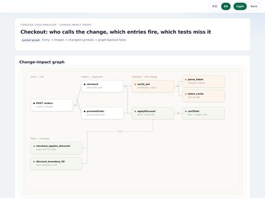

# Awesome Claude Code Skills Collections

[English](README.md)

**Claude Code skill 合集**:一个仓库里装着很多 skill、插件或子 agent,可以一起安装。综合合集、单领域合集、官方与厂商目录,以及最知名的几个 awesome 清单。共 802 个仓库,每个都由 [Agent Skills Hub (agentskillshub.top)](https://agentskillshub.top?utm_source=github&utm_medium=awesome-list) 读过 README 并做了安全评级。

带类型筛选的在线页面:**[https://agentskillshub.top/best/claude-code-skills/](https://agentskillshub.top/best/claude-code-skills/?utm_source=github&utm_medium=awesome-list)** · 每 8 小时刷新

## 到底装哪个

我们数了其中 39 个合集里的每一个 skill 文件,结论如下,[完整体检](#tested)在下面。

- 🥇 **刚开始用: [anthropics/skills](https://github.com/anthropics/skills)**  
  Anthropic 自己的一套，也是格式的参照：20 个 skill，一起装上每个都能保留描述。它的姊妹仓库 claude-plugins-official 是官方的插件目录。
- 🥈 **日常写代码: [mattpocock/skills](https://github.com/mattpocock/skills)**  
  这里星数最高的合集，也是最精简的之一：38 个 skill，38 个全部合规，名字加描述一共约 1,500 个 token。
- 🥉 **只做一个领域，做得干净: [marketingskills](https://github.com/coreyhaines31/marketingskills)**  
  50 个营销 skill，全部合规，没有超过 500 行的，也都不带脚本；它的描述偏长，整包装上可能有几个会丢描述。做安全的话，同样干净的是 trailofbits/skills（85 个全部合规）。

**从里面按名字挑着装，别整包安装:** agentic-awesome-skills (2,675 个不重复的 skill；Claude Code 只会给几十个显示描述，Codex 会把其余大部分隐藏); claude-code-templates (886 个 skill，其中 140 个超过 500 行); Anthropic-Cybersecurity-Skills (818 个 skill，每个都带需要先读的脚本).

不管选哪个：要盯的是体量。我们数过的 36 个合集里，有 8 个大到 Claude Code 只能把大多数 skill 按名字列出；Codex 装到 512 个 skill 时，36 次里只有 17 次打开了正确的那个。

*按 GitHub 星数排列，和页面一致：这是在数每个合集里有什么，不是给 skill 的好坏排名。数字来自各证据页所标 commit 的文件；没有运行任何 skill。*

## 这些合集里有什么

<table>
<tr>
<td align="center" valign="top" width="33%"><b>🧰 综合合集</b> 360 个仓库   一个仓库覆盖多种工作的 skill。 <a href="#type-general"><b>查看列表 →</b></a></td>
<td align="center" valign="top" width="33%"><b>🎯 单领域合集</b> 368 个仓库   只做一个领域的 skill:营销、安全、科研、游戏开发、某个技术栈。 <a href="#type-domain"><b>查看列表 →</b></a></td>
<td align="center" valign="top" width="33%"><b>🏛 官方与厂商</b> 71 个仓库   公司或项目为自家产品发布的 skill。 <a href="#type-official"><b>查看列表 →</b></a></td>
</tr>
<tr>
<td align="center" valign="top" width="33%"><b>🔗 链接清单</b> 3 个仓库  指向别处 skill 的精选链接清单。 <a href="#type-list"><b>查看列表 →</b></a></td>
</tr>
</table>

## 目录

- [🧪 端到端实测](#tested)
- [🧰 综合合集](#type-general) (360)
- [🎯 单领域合集](#type-domain) (368)
- [🏛 官方与厂商](#type-official) (71)
- [🔗 链接清单](#type-list) (3)

## 什么样的仓库能上榜

1. 它是 Claude Code 的 skill 合集:一个仓库里有很多 skill,或是厂商的 skill、插件目录。单个 skill、单个 MCP、只负责安装 skill 的工具不算合集。三个知名的 awesome 清单由维护者指定收录。
2. 它是能安装或运行的软件,不是链接合集或空仓库。
3. 它有 README。没有 README 就没法评级。
4. 50 星及以上只看是否切题;50 星以下还要过 README 质量线(展示效果、一条命令上手、说清产出、文档完整),并且至少 5 星。

这些问题由决策模型逐个读 README 回答,不是人工挑选。卡在线上的仓库可能判到任一边,归错了请提 issue。

## 🧪 合集体检

2026-10-11 我们打开了本页星数最高的 39 个合集，只看文件数了这些：每个仓库有多少 skill、多少个不重复、多少个符合 Agent Skills 格式（名字不超过 64 个小写字母、数字和连字符；描述 1 到 1,024 个字符）、多少个带脚本，以及所有名字和描述加起来有多长（按每 4 个字符 1 个 token 估算）。然后实测了 Claude Code 面对大量安装时怎么做：装 12、112、512 个 skill 时的会话大小。

**发现:** 39 个里有 36 个含 SKILL.md 格式的 skill，另外 3 个是链接清单或子 agent 合集。体量从 5 个 skill 到 2,675 个不等。14,477 个 skill 文件里，有 6,352 个是同一仓库里已有 skill 的副本；有 8 个合集大到 Claude Code 只能把其中大多数 skill 按名字列出。Claude Code 不会为大量安装付全价：装 12 个 skill 时会话起始是 17,781 个 token，112 个是 24,499，512 个是 25,289，因为超出预算后它只按名字列出 skill（按它自己数的，512 个里约 47 个还带描述）。 装多了：在 12 个测试 skill 旁边再装 500 个时，Claude Code 仍有 35/36 次打开了正确的 skill；Codex 去掉所有描述并隐藏 134 个 skill 之后只有 17/36。

| # | 合集 | ★ | 不重复的 skill | 符合格式 | 带脚本 | 名字加描述的长度（token，估算） | 整包装上的话 |  |
|---|---|---|---|---|---|---|---|---|
| 1 | [skills](https://github.com/mattpocock/skills) | 265,786 | 38 | 100% | 2 | 1,468 | 都能保留描述 | [证据](https://agentskillshub.top/best-runs/collections/mattpocock__skills.html) |
| 2 | [skills](https://github.com/anthropics/skills) | 180,369 | 20 | 95% | 8 | 2,415 | 都能保留描述 | [证据](https://agentskillshub.top/best-runs/collections/anthropics__skills.html) |
| 3 | [agent-skills](https://github.com/addyosmani/agent-skills) | 104,575 | 25 | 100% | 1 | 2,316 | 都能保留描述 | [证据](https://agentskillshub.top/best-runs/collections/addyosmani__agent-skills.html) |
| 4 | [awesome-claude-skills](https://github.com/ComposioHQ/awesome-claude-skills) | 76,829 | 864 | 89% | 8 | 27,922 | 大多只剩名字 | [证据](https://agentskillshub.top/best-runs/collections/ComposioHQ__awesome-claude-skills.html) |
| 5 | [marketingskills](https://github.com/coreyhaines31/marketingskills) | 54,098 | 50 | 100% | 0 | 9,696 | 部分会丢描述 | [证据](https://agentskillshub.top/best-runs/collections/coreyhaines31__marketingskills.html) |
| 6 | [academic-research-skills](https://github.com/Imbad0202/academic-research-skills) | 51,227 | 5 | 100% | 1 | 1,194 | 都能保留描述 | [证据](https://agentskillshub.top/best-runs/collections/Imbad0202__academic-research-skills.html) |
| 7 | [obsidian-skills](https://github.com/kepano/obsidian-skills) | 49,365 | 6 | 100% | 0 | 388 | 都能保留描述 | [证据](https://agentskillshub.top/best-runs/collections/kepano__obsidian-skills.html) |
| 8 | [scientific-agent-skills](https://github.com/K-Dense-AI/scientific-agent-skills) | 48,309 | 177 | 100% | 121 | 17,732 | 大多只剩名字 | [证据](https://agentskillshub.top/best-runs/collections/K-Dense-AI__scientific-agent-skills.html) |
| 9 | [agentic-awesome-skills](https://github.com/sickn33/agentic-awesome-skills) | 47,439 | 2,675 | 100% | 371 | 112,112 | 大多只剩名字 | [证据](https://agentskillshub.top/best-runs/collections/sickn33__agentic-awesome-skills.html) |
| 10 | [claude-plugins-official](https://github.com/anthropics/claude-plugins-official) | 37,641 | 29 | 100% | 7 | 2,868 | 都能保留描述 | [证据](https://agentskillshub.top/best-runs/collections/anthropics__claude-plugins-official.html) |
| 11 | [Anthropic-Cybersecurity-Skills](https://github.com/mukul975/Anthropic-Cybersecurity-Skills) | 34,195 | 818 | 100% | 818 | 88,994 | 大多只剩名字 | [证据](https://agentskillshub.top/best-runs/collections/mukul975__Anthropic-Cybersecurity-Skills.html) |
| 12 | [claude-code-templates](https://github.com/davila7/claude-code-templates) | 32,541 | 886 | 94% | 185 | 65,240 | 大多只剩名字 | [证据](https://agentskillshub.top/best-runs/collections/davila7__claude-code-templates.html) |
| 13 | [claude-skills](https://github.com/alirezarezvani/claude-skills) | 27,982 | 443 | 98% | 256 | 48,851 | 大多只剩名字 | [证据](https://agentskillshub.top/best-runs/collections/alirezarezvani__claude-skills.html) |
| 14 | [Claude-Code-Game-Studios](https://github.com/Donchitos/Claude-Code-Game-Studios) | 26,097 | 74 | 100% | 0 | 2,488 | 都能保留描述 | [证据](https://agentskillshub.top/best-runs/collections/Donchitos__Claude-Code-Game-Studios.html) |
| 15 | [khazix-skills](https://github.com/KKKKhazix/khazix-skills) | 21,289 | 6 | 100% | 3 | 637 | 都能保留描述 | [证据](https://agentskillshub.top/best-runs/collections/KKKKhazix__khazix-skills.html) |
| 16 | [Auto-claude-code-research-in-sleep](https://github.com/wanshuiyin/Auto-claude-code-research-in-sleep) | 17,250 | 84 | 100% | 7 | 6,485 | 都能保留描述 | [证据](https://agentskillshub.top/best-runs/collections/wanshuiyin__Auto-claude-code-research-in-sleep.html) |
| 17 | [claude-skills](https://github.com/Jeffallan/claude-skills) | 11,815 | 67 | 100% | 0 | 7,594 | 部分会丢描述 | [证据](https://agentskillshub.top/best-runs/collections/Jeffallan__claude-skills.html) |
| 18 | [skills](https://github.com/slavingia/skills) | 10,461 | 10 | 100% | 0 | 518 | 都能保留描述 | [证据](https://agentskillshub.top/best-runs/collections/slavingia__skills.html) |
| 19 | [superpowers-zh](https://github.com/jnMetaCode/superpowers-zh) | 8,291 | 21 | 100% | 3 | 465 | 都能保留描述 | [证据](https://agentskillshub.top/best-runs/collections/jnMetaCode__superpowers-zh.html) |
| 20 | [skills](https://github.com/jakubkrehel/skills) | 7,725 | 13 | 100% | 0 | 487 | 都能保留描述 | [证据](https://agentskillshub.top/best-runs/collections/jakubkrehel__skills.html) |
| 21 | [skills](https://github.com/trailofbits/skills) | 7,469 | 85 | 100% | 14 | 8,966 | 部分会丢描述 | [证据](https://agentskillshub.top/best-runs/collections/trailofbits__skills.html) |
| 22 | [oh-story-claudecode](https://github.com/zenstory-ai/oh-story-claudecode) | 7,421 | 13 | 100% | 11 | 592 | 都能保留描述 | [证据](https://agentskillshub.top/best-runs/collections/zenstory-ai__oh-story-claudecode.html) |
| 23 | [Claude-Red](https://github.com/SnailSploit/Claude-Red) | 7,399 | 79 | 42% | 0 | 10,166 | 部分会丢描述 | [证据](https://agentskillshub.top/best-runs/collections/SnailSploit__Claude-Red.html) |
| 24 | [Product-Manager-Skills](https://github.com/deanpeters/Product-Manager-Skills) | 7,228 | 77 | 100% | 2 | 3,570 | 都能保留描述 | [证据](https://agentskillshub.top/best-runs/collections/deanpeters__Product-Manager-Skills.html) |
| 25 | [agent-skills](https://github.com/tech-leads-club/agent-skills) | 7,046 | 92 | 100% | 17 | 12,276 | 部分会丢描述 | [证据](https://agentskillshub.top/best-runs/collections/tech-leads-club__agent-skills.html) |
| 26 | [Skills](https://github.com/MengTo/Skills) | 6,706 | 176 | 97% | 30 | 18,302 | 大多只剩名字 | [证据](https://agentskillshub.top/best-runs/collections/MengTo__Skills.html) |
| 27 | [n8n-skills](https://github.com/czlonkowski/n8n-skills) | 6,402 | 15 | 100% | 0 | 2,684 | 都能保留描述 | [证据](https://agentskillshub.top/best-runs/collections/czlonkowski__n8n-skills.html) |
| 28 | [skills](https://github.com/AlphaGBM/skills) | 6,249 | 27 | 100% | 15 | 1,495 | 都能保留描述 | [证据](https://agentskillshub.top/best-runs/collections/AlphaGBM__skills.html) |
| 29 | [skills](https://github.com/remotion-dev/skills) | 5,005 | 12 | 100% | 0 | 147 | 都能保留描述 | [证据](https://agentskillshub.top/best-runs/collections/remotion-dev__skills.html) |
| 30 | [Claude-BugHunter](https://github.com/elementalsouls/Claude-BugHunter) | 4,865 | 83 | 96% | 1 | 13,020 | 部分会丢描述 | [证据](https://agentskillshub.top/best-runs/collections/elementalsouls__Claude-BugHunter.html) |
| 31 | [codex-claude-academic-skills](https://github.com/zLanqing/codex-claude-academic-skills) | 4,725 | 24 | 100% | 13 | 2,651 | 都能保留描述 | [证据](https://agentskillshub.top/best-runs/collections/zLanqing__codex-claude-academic-skills.html) |
| 32 | [open-seo-mcp-skills](https://github.com/Ryze-AI-Adgent/open-seo-mcp-skills) | 4,724 | 8 | 100% | 0 | 536 | 都能保留描述 | [证据](https://agentskillshub.top/best-runs/collections/Ryze-AI-Adgent__open-seo-mcp-skills.html) |
| 33 | [Auto-Empirical-Research-Skills](https://github.com/brycewang-stanford/Auto-Empirical-Research-Skills) | 4,569 | 1,024 | 97% | 39 | 56,439 | 大多只剩名字 | [证据](https://agentskillshub.top/best-runs/collections/brycewang-stanford__Auto-Empirical-Research-Skills.html) |
| 34 | [linkedin-skills](https://github.com/sergebulaev/linkedin-skills) | 4,461 | 13 | 100% | 4 | 1,434 | 都能保留描述 | [证据](https://agentskillshub.top/best-runs/collections/sergebulaev__linkedin-skills.html) |
| 35 | [everything-claude-code](https://github.com/WorldFlowAI/everything-claude-code) | 4,441 | 11 | 73% | 0 | 330 | 都能保留描述 | [证据](https://agentskillshub.top/best-runs/collections/WorldFlowAI__everything-claude-code.html) |
| 36 | [awesome-gamedev-agent-skills](https://github.com/gamedev-skills/awesome-gamedev-agent-skills) | 1,404 | 75 | 100% | 1 | 7,354 | 部分会丢描述 | [证据](https://agentskillshub.top/best-runs/collections/gamedev-skills__awesome-gamedev-agent-skills.html) |

**没有可数的 SKILL.md:** awesome-claude-code (一份指向别处 Claude Code 资源的链接清单：里面没有可安装的 skill。); awesome-claude-code-subagents (这是子 agent 文件的合集，不是 skill：里面没有 SKILL.md 可数。); awesome-claude-skills (一份指向别处 skill 的链接清单：里面没有可安装的 skill。)

[全部结果、提示词和脚本](https://github.com/zhuyansen/agent-skills-hub/blob/main/ops/collections-audit/RESULTS.md) · [https://agentskillshub.top/best/claude-code-skills/#test-results](https://agentskillshub.top/best/claude-code-skills/?utm_source=github&utm_medium=awesome-list#test-results)

## 🧰 综合合集

[在在线页面打开这一类,按星数排序 →](https://agentskillshub.top/best/claude-code-skills/?utm_source=github&utm_medium=awesome-list#type-general)

| 仓库 | 星数 | 做什么 | 安全评级 |
|---|---:|---|---|
| [mattpocock/skills](https://github.com/mattpocock/skills) | 298.2k | 工程师技能，直接来自我的 .claude 目录。 | [SAFE](https://agentskillshub.top/skill/mattpocock/skills/?utm_source=github&utm_medium=awesome-list) |
| [anthropics/skills](https://github.com/anthropics/skills) | 182.4k | Agent Skills 的公开仓库 | [SAFE](https://agentskillshub.top/skill/anthropics/skills/?utm_source=github&utm_medium=awesome-list) |
| [addyosmani/agent-skills](https://github.com/addyosmani/agent-skills) | 108.8k | AI 编程 agent 的生产级工程 skill。 | [SAFE](https://agentskillshub.top/skill/addyosmani/agent-skills/?utm_source=github&utm_medium=awesome-list) |
| [K-Dense-AI/scientific-agent-skills](https://github.com/K-Dense-AI/scientific-agent-skills) | 53.2k | 科学研究 Agent Skills 库，含177个技能和100+数据库，覆盖生物、化学、医学与药物发现，兼容 Cursor、Claude Code、Codex… | [SAFE](https://agentskillshub.top/skill/K-Dense-AI/scientific-agent-skills/?utm_source=github&utm_medium=awesome-list) |
| [kepano/obsidian-skills](https://github.com/kepano/obsidian-skills) | 49.8k | Obsidian 的 agent skill，让 agent 使用 Obsidian CLI 及 Markdown、Bases、JSON Canvas 等开放… | [SAFE](https://agentskillshub.top/skill/kepano/obsidian-skills/?utm_source=github&utm_medium=awesome-list) |
| [sickn33/agentic-awesome-skills](https://github.com/sickn33/agentic-awesome-skills) | 48.0k | AAS Core 是本地 agent 控制平面，支持目录发现、agent 选择、技术栈验证和规划，含 CLI、本地 MCP、catalog、plugins、W… | [SAFE](https://agentskillshub.top/skill/sickn33/agentic-awesome-skills/?utm_source=github&utm_medium=awesome-list) |
| [anthropics/claude-plugins-official](https://github.com/anthropics/claude-plugins-official) | 43.3k | Anthropic 官方维护的 Claude Code 插件目录。 | [SAFE](https://agentskillshub.top/skill/anthropics/claude-plugins-official/?utm_source=github&utm_medium=awesome-list) |
| [davila7/claude-code-templates](https://github.com/davila7/claude-code-templates) | 32.8k | 用于配置和监控 Claude Code 的 CLI 工具 | [SAFE](https://agentskillshub.top/skill/davila7/claude-code-templates/?utm_source=github&utm_medium=awesome-list) |
| [alirezarezvani/claude-skills](https://github.com/alirezarezvani/claude-skills) | 28.4k | 380 个 Claude Code、Codex、Gemini CLI、Cursor 等 agent 的 skill 与插件，涵盖工程、营销、产品等领域。 | [SAFE](https://agentskillshub.top/skill/alirezarezvani/claude-skills/?utm_source=github&utm_medium=awesome-list) |
| [VoltAgent/awesome-claude-code-subagents](https://github.com/VoltAgent/awesome-claude-code-subagents) | 25.9k | 覆盖广泛开发场景的100多个专业 Claude Code 子代理集合 | [SAFE](https://agentskillshub.top/skill/VoltAgent/awesome-claude-code-subagents/?utm_source=github&utm_medium=awesome-list) |
| [KKKKhazix/khazix-skills](https://github.com/KKKKhazix/khazix-skills) | 21.5k | 数字生命卡兹克的 AI Skills合集：leader（定义目标）、neat-freak、hv-analysis、khazix-writer，适用于 Clau… | [SAFE](https://agentskillshub.top/skill/KKKKhazix/khazix-skills/?utm_source=github&utm_medium=awesome-list) |
| [Jeffallan/claude-skills](https://github.com/Jeffallan/claude-skills) | 12.0k | 面向全栈开发者的 67 个 skill，帮助 Claude Code 进行结对编程。 | [SAFE](https://agentskillshub.top/skill/Jeffallan/claude-skills/?utm_source=github&utm_medium=awesome-list) |
| [slavingia/skills](https://github.com/slavingia/skills) | 10.9k | 基于 Sahil Lavingia《The Minimalist Entrepreneur》的 Claude Code skills | [SAFE](https://agentskillshub.top/skill/slavingia/skills/?utm_source=github&utm_medium=awesome-list) |
| [trailofbits/skills](https://github.com/trailofbits/skills) | 7.7k | Trail of Bits 的 Claude Code skill，用于安全研究、漏洞检测和审计流程 | [SAFE](https://agentskillshub.top/skill/trailofbits/skills/?utm_source=github&utm_medium=awesome-list) |
| [SnailSploit/Claude-Red](https://github.com/SnailSploit/Claude-Red) | 7.6k | claude-red 是为 Claude skills system 整理的 offensive security skill 库，涵盖 SQLi、shell… | [SAFE](https://agentskillshub.top/skill/SnailSploit/Claude-Red/?utm_source=github&utm_medium=awesome-list) |
| [tech-leads-club/agent-skills](https://github.com/tech-leads-club/agent-skills) | 7.1k | 面向 AI 编程 agent 的 skill 注册表，支持 Antigravity、Claude Code、Cursor、Copilot 等扩展。 | [SAFE](https://agentskillshub.top/skill/tech-leads-club/agent-skills/?utm_source=github&utm_medium=awesome-list) |
| [MengTo/Skills](https://github.com/MengTo/Skills) | 6.9k | 面向使用 Codex、Claude、Cursor 等 AI coding agents 的设计师和开发者的 agent skills | [SAFE](https://agentskillshub.top/skill/MengTo/Skills/?utm_source=github&utm_medium=awesome-list) |
| [WorldFlowAI/everything-claude-code](https://github.com/WorldFlowAI/everything-claude-code) | 5.1k | Claude Code 工具包：用于 AI 辅助开发的 agents、commands、skills、rules 和 hooks | [SAFE](https://agentskillshub.top/skill/WorldFlowAI/everything-claude-code/?utm_source=github&utm_medium=awesome-list) |
| [browserbase/skills](https://github.com/browserbase/skills) | 3.7k | 用于访问网页的 agent skills 集合 | [CAUTION](https://agentskillshub.top/skill/browserbase/skills/?utm_source=github&utm_medium=awesome-list) |
| [NVIDIA/skills](https://github.com/NVIDIA/skills) | 3.7k | NVIDIA 产品 agent skill，安装到 Claude Code、Codex 等 coding agent，运行 Physical AI、机器人、仿… | [SAFE](https://agentskillshub.top/skill/NVIDIA/skills/?utm_source=github&utm_medium=awesome-list) |
| [Jakeschincariol/replica-skill](https://github.com/Jakeschincariol/replica-skill) | 3.7k | 11 个免费 Claude skill：逆向分析、重建任意应用，测试漏洞并修复用户不满之处。MIT 许可。 | [SAFE](https://agentskillshub.top/skill/Jakeschincariol/replica-skill/?utm_source=github&utm_medium=awesome-list) |
| [davepoon/buildwithclaude](https://github.com/davepoon/buildwithclaude) | 3.7k | 查找Claude Code、Claude Desktop、Agent SDK、OpenClaw的Skills等扩展资源 | [SAFE](https://agentskillshub.top/skill/davepoon/buildwithclaude/?utm_source=github&utm_medium=awesome-list) |
| [ciembor/agent-rules-books](https://github.com/ciembor/agent-rules-books) | 3.1k | 面向 Codex、Cursor 和 Claude Code 的 AGENTS.md 规则与 skill，参考 Clean Code、Refactoring、D… | [SAFE](https://agentskillshub.top/skill/ciembor/agent-rules-books/?utm_source=github&utm_medium=awesome-list) |
| [addyosmani/web-quality-skills](https://github.com/addyosmani/web-quality-skills) | 3.0k | 基于 Lighthouse 和 Core Web Vitals 优化网页质量的 Agent Skills | [SAFE](https://agentskillshub.top/skill/addyosmani/web-quality-skills/?utm_source=github&utm_medium=awesome-list) |
| [rohitg00/pro-workflow](https://github.com/rohitg00/pro-workflow) | 2.9k | Claude Code 会记住纠正，支持跨 50+ 次会话自我修正。包含上下文工程、并行 worktree、agent team 和 17 个 skill。 | [SAFE](https://agentskillshub.top/skill/rohitg00/pro-workflow/?utm_source=github&utm_medium=awesome-list) |
| [jeremylongshore/tons-of-skills-marketplace](https://github.com/jeremylongshore/tons-of-skills-marketplace) | 2.9k | 模型无关的 agent-skills 平台，提供无 harness 的规范层、经验证的适配器和 ccpi 包管理器。 | [SAFE](https://agentskillshub.top/skill/jeremylongshore/tons-of-skills-marketplace/?utm_source=github&utm_medium=awesome-list) |
| [Paramchoudhary/ResumeSkills](https://github.com/Paramchoudhary/ResumeSkills) | 2.8k | 面向求职者、转行者和职场人士的 AI agent skill 集合，支持 Claude Code 进行简历撰写、ATS 优化、面试准备和求职策略制定。 | [SAFE](https://agentskillshub.top/skill/Paramchoudhary/ResumeSkills/?utm_source=github&utm_medium=awesome-list) |
| [rohitg00/awesome-claude-code-toolkit](https://github.com/rohitg00/awesome-claude-code-toolkit) | 2.7k | Claude Code：135 agent、35 skill、42命令、176+插件、20 hook、15规则、7模板、14 MCP配置、26应用、52生态条… | [SAFE](https://agentskillshub.top/skill/rohitg00/awesome-claude-code-toolkit/?utm_source=github&utm_medium=awesome-list) |
| [badlogic/pi-skills](https://github.com/badlogic/pi-skills) | 2.6k | pi coding agent 的 skill（兼容 Claude Code 和 Codex CLI） | [SAFE](https://agentskillshub.top/skill/badlogic/pi-skills/?utm_source=github&utm_medium=awesome-list) |
| [wondelai/skills](https://github.com/wondelai/skills) | 2.5k | Wondel.ai Agent Skills：商业、营销、UX、编程框架；50 skill、12路径，支持Claude Code、Codex、Cursor及a… | [SAFE](https://agentskillshub.top/skill/wondelai/skills/?utm_source=github&utm_medium=awesome-list) |
| [mrgoonie/claudekit-skills](https://github.com/mrgoonie/claudekit-skills) | 2.2k | All powerful skills of ClaudeKit.cc! | [SAFE](https://agentskillshub.top/skill/mrgoonie/claudekit-skills/?utm_source=github&utm_medium=awesome-list) |
| [Leanmcp/gateway-skills](https://github.com/Leanmcp/gateway-skills) | 2.1k | 在仪表板中清晰查看 Claude Code 日志详情 | [SAFE](https://agentskillshub.top/skill/Leanmcp/gateway-skills/?utm_source=github&utm_medium=awesome-list) |
| [cbrock84/headcount](https://github.com/cbrock84/headcount) | 2.1k | 按公司架构组织的 agent：15+ 个部门、125+ 个可独立安装的 skill，引用相关标准和监管机构作为依据。支持 Claude Code 和 Chat… | [SAFE](https://agentskillshub.top/skill/cbrock84/headcount/?utm_source=github&utm_medium=awesome-list) |
| [xu-xiang/everything-claude-code-zh](https://github.com/xu-xiang/everything-claude-code-zh) | 2.0k | Claude Code 中文翻译项目：Claude Code 配置集合（agents、skills、hooks、commands、rules、MCPs）。 | [SAFE](https://agentskillshub.top/skill/xu-xiang/everything-claude-code-zh/?utm_source=github&utm_medium=awesome-list) |
| [alchaincyf/huashu-skills](https://github.com/alchaincyf/huashu-skills) | 1.9k | 花叔开源 Agent Skills 目录：16个、14个人物视角、22个内置，共52个 skill，含分类、安装协议、skills.json 和更新检查 | [SAFE](https://agentskillshub.top/skill/alchaincyf/huashu-skills/?utm_source=github&utm_medium=awesome-list) |
| [ReScienceLab/opc-skills](https://github.com/ReScienceLab/opc-skills) | 1.9k | 个体创业者的 agent 技能 | [SAFE](https://agentskillshub.top/skill/ReScienceLab/opc-skills/?utm_source=github&utm_medium=awesome-list) |
| [NeoLabHQ/context-engineering-kit](https://github.com/NeoLabHQ/context-engineering-kit) | 1.8k | 提升 agent 结果质量的 Claude Code Skills，兼容 OpenCode、Cursor、Antigravity、Gemini CLI 等，含… | [SAFE](https://agentskillshub.top/skill/NeoLabHQ/context-engineering-kit/?utm_source=github&utm_medium=awesome-list) |
| [lst97/claude-code-sub-agents](https://github.com/lst97/claude-code-sub-agents) | 1.7k | 供个人使用的 Claude Code 专用 AI 子代理集合（全栈开发） | [SAFE](https://agentskillshub.top/skill/lst97/claude-code-sub-agents/?utm_source=github&utm_medium=awesome-list) |
| [feiskyer/claude-code-settings](https://github.com/feiskyer/claude-code-settings) | 1.7k | 为 Claude Code 整理的 skill、子 agent 和配置模板，涵盖研究、图像生成、GitHub 自动化等。 | [SAFE](https://agentskillshub.top/skill/feiskyer/claude-code-settings/?utm_source=github&utm_medium=awesome-list) |
| [tjboudreaux/cc-thinking-skills](https://github.com/tjboudreaux/cc-thinking-skills) | 1.7k | 28 个评测驱动思维模型与批判性思维技能，适用于 Claude Code、GitHub Copilot、Codex、Cursor 等 Agent Skills… | [SAFE](https://agentskillshub.top/skill/tjboudreaux/cc-thinking-skills/?utm_source=github&utm_medium=awesome-list) |
| [Pluviobyte/rnskill](https://github.com/Pluviobyte/rnskill) | 1.7k | 雪踏乌云的 AI Agent Skills 集合 | [SAFE](https://agentskillshub.top/skill/Pluviobyte/rnskill/?utm_source=github&utm_medium=awesome-list) |
| [mohitagw15856/pm-claude-skills](https://github.com/mohitagw15856/pm-claude-skills) | 1.5k | 1255 个 Claude、ChatGPT、Gemini、Cursor、Codex 的 Agent skill，MIT，含决策层，支持 npx pm-clau… | [SAFE](https://agentskillshub.top/skill/mohitagw15856/pm-claude-skills/?utm_source=github&utm_medium=awesome-list) |
| [rjs/shaping-skills](https://github.com/rjs/shaping-skills) | 1.4k | 我用 Claude 进行塑造的技能 | [SAFE](https://agentskillshub.top/skill/rjs/shaping-skills/?utm_source=github&utm_medium=awesome-list) |
| [CloudAI-X/claude-workflow-v2](https://github.com/CloudAI-X/claude-workflow-v2) | 1.4k | 通用 Claude Code 工作流插件，包含 agents、skills、hooks 和 commands | [SAFE](https://agentskillshub.top/skill/CloudAI-X/claude-workflow-v2/?utm_source=github&utm_medium=awesome-list) |
| [vibe-motion/skills](https://github.com/vibe-motion/skills) | 1.4k | vibe motion 的 agent skills | [SAFE](https://agentskillshub.top/skill/vibe-motion/skills/?utm_source=github&utm_medium=awesome-list) |
| [dzhng/skills](https://github.com/dzhng/skills) | 1.4k | 面向软件工厂的可复用 AI agent skill：探索想法、编写规格、实现、审查和自主研究，适用于 Claude Code、Codex 及其他兼容 skil… | [SAFE](https://agentskillshub.top/skill/dzhng/skills/?utm_source=github&utm_medium=awesome-list) |
| [kharmanskyi/open-steps](https://github.com/kharmanskyi/open-steps) | 1.4k | Claude Code、Codex、Cursor 和 Gemini CLI 的通俗 agent skills：真实会话报告、直接结论、可执行步骤。MIT。 | [SAFE](https://agentskillshub.top/skill/kharmanskyi/open-steps/?utm_source=github&utm_medium=awesome-list) |
| [michaelshimeles/skills](https://github.com/michaelshimeles/skills) | 1.4k | Agent skills/AGENTS.md：worktree隔离、服务层、证据、前后对比、Greptile循环 Claude Code、Cursor、Cod… | [SAFE](https://agentskillshub.top/skill/michaelshimeles/skills/?utm_source=github&utm_medium=awesome-list) |
| [huytieu/COG-second-brain](https://github.com/huytieu/COG-second-brain) | 1.3k | Self-evolving second brain with 35 AI skills, 10 agents, and people CRM. Closed-loop harness: a V-model verification lifecycle where the worker never… | [SAFE](https://agentskillshub.top/skill/huytieu/COG-second-brain/?utm_source=github&utm_medium=awesome-list) |
| [fivetaku/gptaku_plugins](https://github.com/fivetaku/gptaku_plugins) | 1.2k | 面向希望成为 AI 原生用户的 Claude Code 插件市场 | [SAFE](https://agentskillshub.top/skill/fivetaku/gptaku_plugins/?utm_source=github&utm_medium=awesome-list) |
| [fcakyon/claude-codex-settings](https://github.com/fcakyon/claude-codex-settings) | 1.2k | Claude Code、OpenAI Codex、Cursor 配置、插件、hooks 和 agents，支持 Kimi、MiniMax 和 GLM API。 | [SAFE](https://agentskillshub.top/skill/fcakyon/claude-codex-settings/?utm_source=github&utm_medium=awesome-list) |
| [BagelHole/DevOps-Security-Agent-Skills](https://github.com/BagelHole/DevOps-Security-Agent-Skills) | 1.2k | 面向 agent 的 DevOps 与安全知识库，涵盖 Kubernetes、云、AI 平台、容器、合规和事件响应，含80+ skills及脚本、模板、操作手… | [SAFE](https://agentskillshub.top/skill/BagelHole/DevOps-Security-Agent-Skills/?utm_source=github&utm_medium=awesome-list) |
| [openclaw/agent-skills](https://github.com/openclaw/agent-skills) | 1.1k | 适用于 agent 和 claws 的实用 skill | [SAFE](https://agentskillshub.top/skill/openclaw/agent-skills/?utm_source=github&utm_medium=awesome-list) |
| [forcedotcom/sf-skills](https://github.com/forcedotcom/sf-skills) | 1.1k | Salesforce精选的应用构建agent skill集合，适用于Agentforce Vibes和AI工具。 | [SAFE](https://agentskillshub.top/skill/forcedotcom/sf-skills/?utm_source=github&utm_medium=awesome-list) |
| [jezweb/claude-skills](https://github.com/jezweb/claude-skills) | 1.1k | Claude Code CLI 的 skill，涵盖 Cloudflare 全栈开发、React、Tailwind v4 和 AI 集成。 | [SAFE](https://agentskillshub.top/skill/jezweb/claude-skills/?utm_source=github&utm_medium=awesome-list) |
| [getsentry/skills](https://github.com/getsentry/skills) | 1.1k | Sentry 团队开发使用的 Agent Skills | [SAFE](https://agentskillshub.top/skill/getsentry/skills/?utm_source=github&utm_medium=awesome-list) |
| [numman-ali/n-skills](https://github.com/numman-ali/n-skills) | 1.1k | AI agent 插件市场，支持 Claude Code、Codex 和 openskills | [SAFE](https://agentskillshub.top/skill/numman-ali/n-skills/?utm_source=github&utm_medium=awesome-list) |
| [0xfurai/claude-code-subagents](https://github.com/0xfurai/claude-code-subagents) | 1.0k | Claude Code 的 100+ 个可用于生产的开发子代理集合 | [SAFE](https://agentskillshub.top/skill/0xfurai/claude-code-subagents/?utm_source=github&utm_medium=awesome-list) |
| [rampstackco/claude-skills](https://github.com/rampstackco/claude-skills) | 976 | 不依赖技术栈的 Claude Skills，覆盖网站全生命周期：品牌、设计、内容、SEO、开发、运维、增长和研究。构建、发布、审计、优化。 | [SAFE](https://agentskillshub.top/skill/rampstackco/claude-skills/?utm_source=github&utm_medium=awesome-list) |
| [LeonChaoX/qinyan-academic-skills](https://github.com/LeonChaoX/qinyan-academic-skills) | 967 | 精选的多语言库，含182个可安装AI agent skill，覆盖文献检索、科研写作、基金申请、生物信息学、药物研发、临床研究、机器学习和数据分析。 | [SAFE](https://agentskillshub.top/skill/LeonChaoX/qinyan-academic-skills/?utm_source=github&utm_medium=awesome-list) |
| [borghei/Claude-Skills](https://github.com/borghei/Claude-Skills) | 954 | 385 AI skill、77 agent、900 Python 工具；支持 Claude Code、Cursor、Codex、Gemini、Copilot 等 | [SAFE](https://agentskillshub.top/skill/borghei/Claude-Skills/?utm_source=github&utm_medium=awesome-list) |
| [laolaoshiren/claude-code-skills-zh](https://github.com/laolaoshiren/claude-code-skills-zh) | 894 | 面向中文开发者的 Claude Code Skills、Agents、Plugins 与原创技能库，按场景分类，可复制安装 | [SAFE](https://agentskillshub.top/skill/laolaoshiren/claude-code-skills-zh/?utm_source=github&utm_medium=awesome-list) |
| [coreyhaines31/makerskills](https://github.com/coreyhaines31/makerskills) | 866 | 个人运营者的 AI agent skills：决策、研究、第二大脑、内容轮换、情景建模、创作元技能。支持 Claude Code、Codex、Cursor。 | [SAFE](https://agentskillshub.top/skill/coreyhaines31/makerskills/?utm_source=github&utm_medium=awesome-list) |
| [sangrokjung/claude-forge](https://github.com/sangrokjung/claude-forge) | 862 | Claude Code 的 oh-my-zsh：16agent、35命令、32skill、21安全钩子。v4.0：审查循环，二次agent不看首个推理。MIT。 | [SAFE](https://agentskillshub.top/skill/sangrokjung/claude-forge/?utm_source=github&utm_medium=awesome-list) |
| [coleam00/second-brain-skills](https://github.com/coleam00/second-brain-skills) | 837 | 将 Claude Code 变成第二大脑的 Claude skill 集合 | [SAFE](https://agentskillshub.top/skill/coleam00/second-brain-skills/?utm_source=github&utm_medium=awesome-list) |
| [team-attention/plugins-for-claude-natives](https://github.com/team-attention/plugins-for-claude-natives) | 828 | 面向高级用户的 Claude Code 插件 | [SAFE](https://agentskillshub.top/skill/team-attention/plugins-for-claude-natives/?utm_source=github&utm_medium=awesome-list) |
| [suleimanodetoro/skills](https://github.com/suleimanodetoro/skills) | 787 | 用于界面设计、React、React Native 和软件安全的 agent skill。 | [SAFE](https://agentskillshub.top/skill/suleimanodetoro/skills/?utm_source=github&utm_medium=awesome-list) |
| [yunshu0909/yunshu_skillshub](https://github.com/yunshu0909/yunshu_skillshub) | 784 | Claude Code Skills 集合，用于开发和产品管理。 | [SAFE](https://agentskillshub.top/skill/yunshu0909/yunshu_skillshub/?utm_source=github&utm_medium=awesome-list) |
| [alirezarezvani/claude-code-tresor](https://github.com/alirezarezvani/claude-code-tresor) | 782 | Claude Code 工具集：自主 skill、专家 agent、斜杠命令和提示词，用于开发流程 | [SAFE](https://agentskillshub.top/skill/alirezarezvani/claude-code-tresor/?utm_source=github&utm_medium=awesome-list) |
| [inference-sh/skills](https://github.com/inference-sh/skills) | 773 | inference.sh：使用我们 API 的 agent skill，让 agent 访问数百个应用和其他 agent | [SAFE](https://agentskillshub.top/skill/inference-sh/skills/?utm_source=github&utm_medium=awesome-list) |
| [Archive228/loopkit](https://github.com/Archive228/loopkit) | 755 | 33 个 skill + 适用于任意 coding agent 的精简 .claude harness（Claude Code、Cursor、Codex、Ge… | [SAFE](https://agentskillshub.top/skill/Archive228/loopkit/?utm_source=github&utm_medium=awesome-list) |
| [obra/superpowers-skills](https://github.com/obra/superpowers-skills) | 754 | Claude Code superpowers 插件的社区可编辑 skills | [SAFE](https://agentskillshub.top/skill/obra/superpowers-skills/?utm_source=github&utm_medium=awesome-list) |
| [chujianyun/skills](https://github.com/chujianyun/skills) | 749 | WuMing 的 Claude Skills | [SAFE](https://agentskillshub.top/skill/chujianyun/skills/?utm_source=github&utm_medium=awesome-list) |
| [staruhub/ClaudeSkills](https://github.com/staruhub/ClaudeSkills) | 730 | 13 个 Agent Skills，涵盖研究、产品决策、演示文稿、发布、审计等，可在兼容 skills 的 agents 间移植。 | [SAFE](https://agentskillshub.top/skill/staruhub/ClaudeSkills/?utm_source=github&utm_medium=awesome-list) |
| [coleam00/skills](https://github.com/coleam00/skills) | 711 | 我实际用于通过 coding agents 构建软件的 skills：PIV 循环、规划、worktrees，以及构建自有 AI Layer 的 meta-s… | [SAFE](https://agentskillshub.top/skill/coleam00/skills/?utm_source=github&utm_medium=awesome-list) |
| [ananddtyagi/cc-marketplace](https://github.com/ananddtyagi/cc-marketplace) | 688 | Claude Code 插件市场仓库 | [SAFE](https://agentskillshub.top/skill/ananddtyagi/cc-marketplace/?utm_source=github&utm_medium=awesome-list) |
| [mhattingpete/claude-skills-marketplace](https://github.com/mhattingpete/claude-skills-marketplace) | 683 | Claude Code 的软件工程工作流 skill：Git 自动化、测试和代码审查 | [SAFE](https://agentskillshub.top/skill/mhattingpete/claude-skills-marketplace/?utm_source=github&utm_medium=awesome-list) |
| [kangarooking/kangarooking-skills](https://github.com/kangarooking/kangarooking-skills) | 677 | 我的自定义 AI Agent skills | [SAFE](https://agentskillshub.top/skill/kangarooking/kangarooking-skills/?utm_source=github&utm_medium=awesome-list) |
| [Gentleman-Programming/Gentleman-Skills](https://github.com/Gentleman-Programming/Gentleman-Skills) | 659 | 社区驱动的 AI agent skills，适用于 Claude Code、OpenCode 和其他 AI 助手。精选模式与社区贡献。 | [SAFE](https://agentskillshub.top/skill/Gentleman-Programming/Gentleman-Skills/?utm_source=github&utm_medium=awesome-list) |
| [DannyMac180/skills](https://github.com/DannyMac180/skills) | 641 | 我创建的 AI agent skills：Dan McAteer | [SAFE](https://agentskillshub.top/skill/DannyMac180/skills/?utm_source=github&utm_medium=awesome-list) |
| [AThevon/genjutsu](https://github.com/AThevon/genjutsu) | 598 | Claude Code、claude.ai、Cowork 的创意编程 skill，涵盖动效、微交互和设计系统；编码前确认交互方案，反对 AI 套路。 | [SAFE](https://agentskillshub.top/skill/AThevon/genjutsu/?utm_source=github&utm_medium=awesome-list) |
| [LeastBit/Claude_skills_zh-CN](https://github.com/LeastBit/Claude_skills_zh-CN) | 594 | Anthropics/skills 的中文学习版，来源：https://github.com/anthropics/skills | [SAFE](https://agentskillshub.top/skill/LeastBit/Claude_skills_zh-CN/?utm_source=github&utm_medium=awesome-list) |
| [levnikolaevich/claude-code-skills](https://github.com/levnikolaevich/claude-code-skills) | 582 | 帮助 AI agent 完成任务：解决正确问题，聚焦修改，并展示验证结果。适用于 Claude Code 和 Codex。 | [SAFE](https://agentskillshub.top/skill/levnikolaevich/claude-code-skills/?utm_source=github&utm_medium=awesome-list) |
| [rsmdt/the-startup](https://github.com/rsmdt/the-startup) | 569 | Agentic Startup：Claude Code 命令、skill 和 agent 集合。 | [SAFE](https://agentskillshub.top/skill/rsmdt/the-startup/?utm_source=github&utm_medium=awesome-list) |
| [michalparkola/tapestry-skills](https://github.com/michalparkola/tapestry-skills) | 559 | 用于下载文章、PDF 和 YouTube 视频文字稿的 Claude Code skills | [SAFE](https://agentskillshub.top/skill/michalparkola/tapestry-skills/?utm_source=github&utm_medium=awesome-list) |
| [ognjengt/founder-skills](https://github.com/ognjengt/founder-skills) | 557 | 给创始人的 Claude skills | [SAFE](https://agentskillshub.top/skill/ognjengt/founder-skills/?utm_source=github&utm_medium=awesome-list) |
| [Lifecycle-Innovations-Limited/claude-ops](https://github.com/Lifecycle-Innovations-Limited/claude-ops) | 548 | Claude Code：57 skill、21 agent、daemon；统一收件箱、PR合并、AWS监控、收入、电商、营销、语音、APM、YOLO mode。 | [SAFE](https://agentskillshub.top/skill/Lifecycle-Innovations-Limited/claude-ops/?utm_source=github&utm_medium=awesome-list) |
| [ArtemXTech/personal-os-skills](https://github.com/ArtemXTech/personal-os-skills) | 542 | Claude Code 的 Obsidian skill，Claude Code x Obsidian Lab 5月5日开始 | [SAFE](https://agentskillshub.top/skill/ArtemXTech/personal-os-skills/?utm_source=github&utm_medium=awesome-list) |
| [posit-dev/skills](https://github.com/posit-dev/skills) | 542 | Posit 的 Claude skill 集合 | [SAFE](https://agentskillshub.top/skill/posit-dev/skills/?utm_source=github&utm_medium=awesome-list) |
| [yanliudesign/offer-toolkit-skill](https://github.com/yanliudesign/offer-toolkit-skill) | 539 | 完整求职 Claude skill 套件：职位描述解读、简历构建器（11种模板）和行为面试/故事库。含3个独立子skill及顶层路由器。 | [SAFE](https://agentskillshub.top/skill/yanliudesign/offer-toolkit-skill/?utm_source=github&utm_medium=awesome-list) |
| [vibeeval/vibecosystem](https://github.com/vibeeval/vibecosystem) | 538 | Claude Code 的 AI 软件团队：138 个 agents、295 个 skills、73 个 hooks；支持自学习、多 agent 协作和 sk… | [SAFE](https://agentskillshub.top/skill/vibeeval/vibecosystem/?utm_source=github&utm_medium=awesome-list) |
| [claude-office-skills/skills](https://github.com/claude-office-skills/skills) | 530 | 实用的 Claude Skills 办公任务精选集合 | [SAFE](https://agentskillshub.top/skill/claude-office-skills/skills/?utm_source=github&utm_medium=awesome-list) |
| [ancoleman/ai-design-components](https://github.com/ancoleman/ai-design-components) | 525 | 面向 Claude AI 辅助开发的 UI/UX 与后端组件设计 skill | [SAFE](https://agentskillshub.top/skill/ancoleman/ai-design-components/?utm_source=github&utm_medium=awesome-list) |
| [trailofbits/skills-curated](https://github.com/trailofbits/skills-curated) | 516 | 经社区审核的 Claude Code 插件市场 | [SAFE](https://agentskillshub.top/skill/trailofbits/skills-curated/?utm_source=github&utm_medium=awesome-list) |
| [tryproduck/produck-skills](https://github.com/tryproduck/produck-skills) | 511 | 帮助你构建用户喜爱产品的 agent skill | [SAFE](https://agentskillshub.top/skill/tryproduck/produck-skills/?utm_source=github&utm_medium=awesome-list) |
| [mxyhi/ok-skills](https://github.com/mxyhi/ok-skills) | 501 | 为 Codex、Claude Code、Cursor、OpenClaw 及其他兼容 SKILL.md 的工具整理 AI 编程 agent skill 和 AG… | [SAFE](https://agentskillshub.top/skill/mxyhi/ok-skills/?utm_source=github&utm_medium=awesome-list) |
| [ooiyeefei/ccc](https://github.com/ooiyeefei/ccc) | 496 | Claude Code CLI 的自定义插件 | [SAFE](https://agentskillshub.top/skill/ooiyeefei/ccc/?utm_source=github&utm_medium=awesome-list) |
| [cosmicstack-labs/mercury-agent-skills](https://github.com/cosmicstack-labs/mercury-agent-skills) | 485 | 面向真实开发流程、持久记忆和令牌高效执行的 Mercury Agent、Open Claw 或 Hermes Agent skill 注册表。 | [SAFE](https://agentskillshub.top/skill/cosmicstack-labs/mercury-agent-skills/?utm_source=github&utm_medium=awesome-list) |
| [QuZhan51496/paper2anything](https://github.com/QuZhan51496/paper2anything) | 467 | 将学术论文 PDF 转为幻灯片、海报、网页、小红书笔记或微信文章的 agent skill 包（paper2slides/poster/html/xhs/we… | [SAFE](https://agentskillshub.top/skill/QuZhan51496/paper2anything/?utm_source=github&utm_medium=awesome-list) |
| [bencium/bencium-marketplace](https://github.com/bencium/bencium-marketplace) | 460 | 基于 Anthropic Skills 指南及我们的设计与开发理念的技能集合 | [SAFE](https://agentskillshub.top/skill/bencium/bencium-marketplace/?utm_source=github&utm_medium=awesome-list) |
| [ailabs-393/ai-labs-claude-skills](https://github.com/ailabs-393/ai-labs-claude-skills) | 458 | 用于查找并将 claudeskills 移入用户项目，连接用户使用与 claudeskills。 | [SAFE](https://agentskillshub.top/skill/ailabs-393/ai-labs-claude-skills/?utm_source=github&utm_medium=awesome-list) |
| [aiskillstore/marketplace](https://github.com/aiskillstore/marketplace) | 440 | Security-audited skills for Claude, Codex & Claude Code. One-click install, quality verified. | [SAFE](https://agentskillshub.top/skill/aiskillstore/marketplace/?utm_source=github&utm_medium=awesome-list) |
| [sanjay3290/ai-skills](https://github.com/sanjay3290/ai-skills) | 440 | 24 个跨平台 agent skills，适用于 Claude Code、Cursor、Codex 和 Gemini CLI，涵盖数据库、消息、研究、TTS、… | [SAFE](https://agentskillshub.top/skill/sanjay3290/ai-skills/?utm_source=github&utm_medium=awesome-list) |
| [obra/superpowers-lab](https://github.com/obra/superpowers-lab) | 433 | Claude Code Superpowers 的实验性 skill：新技术和工具 | [SAFE](https://agentskillshub.top/skill/obra/superpowers-lab/?utm_source=github&utm_medium=awesome-list) |
| [briiirussell/cybersecurity-skills](https://github.com/briiirussell/cybersecurity-skills) | 426 | 面向 AI 编程 agent 的网络安全 skill（Claude Code、Cursor、Codex） | [SAFE](https://agentskillshub.top/skill/briiirussell/cybersecurity-skills/?utm_source=github&utm_medium=awesome-list) |
| [chenxiachan/xhs-claude-skills](https://github.com/chenxiachan/xhs-claude-skills) | 425 | 用于将小红书帖子提取为 Obsidian 笔记的 Claude Code slash commands | [SAFE](https://agentskillshub.top/skill/chenxiachan/xhs-claude-skills/?utm_source=github&utm_medium=awesome-list) |
| [cwinvestments/memstack](https://github.com/cwinvestments/memstack) | 425 | Claude Code skill 框架：130 skills、持久记忆、TokenStack 压缩、本地面板、3-agent运行、实时流、MCP 工具 | [SAFE](https://agentskillshub.top/skill/cwinvestments/memstack/?utm_source=github&utm_medium=awesome-list) |
| [scaccogatto/okf-skills](https://github.com/scaccogatto/okf-skills) | 422 | Claude Code 的 OKF 工具包：编写、维护、验证和可视化 Open Knowledge Format bundles，含插件、agent skil… | [SAFE](https://agentskillshub.top/skill/scaccogatto/okf-skills/?utm_source=github&utm_medium=awesome-list) |
| [evanklem/evanflow](https://github.com/evanklem/evanflow) | 418 | 面向软件开发的 TDD 迭代反馈循环。16 个 Claude Code skill 引导想法完成头脑风暴、规划、执行和迭代，并设置检查点。 | [SAFE](https://agentskillshub.top/skill/evanklem/evanflow/?utm_source=github&utm_medium=awesome-list) |
| [owainlewis/blueprint](https://github.com/owainlewis/blueprint) | 417 | The best agent skills in the world for software development. | [SAFE](https://agentskillshub.top/skill/owainlewis/blueprint/?utm_source=github&utm_medium=awesome-list) |
| [boraoztunc/skills](https://github.com/boraoztunc/skills) | 415 | Claude Code 的文案、SEO、设计等 skills | [SAFE](https://agentskillshub.top/skill/boraoztunc/skills/?utm_source=github&utm_medium=awesome-list) |
| [quodsoler/unreal-engine-skills](https://github.com/quodsoler/unreal-engine-skills) | 401 | Unreal Engine C++ 的 27 个 skill，涵盖 gameplay、rendering 等，支持 Claude Code、Cursor、Wi… | [SAFE](https://agentskillshub.top/skill/quodsoler/unreal-engine-skills/?utm_source=github&utm_medium=awesome-list) |
| [glebis/claude-skills](https://github.com/glebis/claude-skills) | 395 | Claude Code skill 集合，用于 AI 工作流 | [SAFE](https://agentskillshub.top/skill/glebis/claude-skills/?utm_source=github&utm_medium=awesome-list) |
| [JetBrains/skills](https://github.com/JetBrains/skills) | 374 | 经 JetBrains 验证的精选 agent skill 集合 | [SAFE](https://agentskillshub.top/skill/JetBrains/skills/?utm_source=github&utm_medium=awesome-list) |
| [arjun988/blender-skills](https://github.com/arjun988/blender-skills) | 367 | 94 个 Blender 专业 skill，适用于 Cursor、Claude Code、Kiro 和 Codex，借助 MCP 实现从初步搭建到引擎导出的生… | [SAFE](https://agentskillshub.top/skill/arjun988/blender-skills/?utm_source=github&utm_medium=awesome-list) |
| [mizchi/skills](https://github.com/mizchi/skills) | 367 | mizchi 的 agent skills，通过 APM 分发 | [SAFE](https://agentskillshub.top/skill/mizchi/skills/?utm_source=github&utm_medium=awesome-list) |
| [giuseppe-trisciuoglio/developer-kit](https://github.com/giuseppe-trisciuoglio/developer-kit) | 360 | 面向 Claude Code 和智能 CLI 的模块化插件市场，提供规范驱动的 skill、agent、命令和工作流，支持 Java、TypeScript、P… | [SAFE](https://agentskillshub.top/skill/giuseppe-trisciuoglio/developer-kit/?utm_source=github&utm_medium=awesome-list) |
| [OneWave-AI/claude-skills](https://github.com/OneWave-AI/claude-skills) | 358 | 200+ 个可用于生产环境的 Claude Code skill，覆盖销售、营销、设计、工程和 AI agent 架构。由 OneWave AI 构建维护。 | [SAFE](https://agentskillshub.top/skill/OneWave-AI/claude-skills/?utm_source=github&utm_medium=awesome-list) |
| [databricks/databricks-agent-skills](https://github.com/databricks/databricks-agent-skills) | 357 | Databricks AI Tools：用于在 Databricks 上构建的 skill 和插件，支持 Claude Code、Cursor、Codex、G… | [SAFE](https://agentskillshub.top/skill/databricks/databricks-agent-skills/?utm_source=github&utm_medium=awesome-list) |
| [NTCoding/claude-skillz](https://github.com/NTCoding/claude-skillz) | 353 | 用于常见简单编程任务的各种 Claude skill | [SAFE](https://agentskillshub.top/skill/NTCoding/claude-skillz/?utm_source=github&utm_medium=awesome-list) |
| [Neeeophytee/finding-unknowns-skills](https://github.com/Neeeophytee/finding-unknowns-skills) | 353 | 为 Claude Code、OpenAI Codex 和 Hermes 提供 14 个可安装 skill：发现未知、澄清需求、管理上下文、检验假设，并用回归证… | [SAFE](https://agentskillshub.top/skill/Neeeophytee/finding-unknowns-skills/?utm_source=github&utm_medium=awesome-list) |
| [athola/claude-night-market](https://github.com/athola/claude-night-market) | 342 | 23个Claude Code插件：TDD钩子/git/PR/规范/审查/周期/修错/维护/上下文优化/研究/LLM委派；186skill、128命令、54ag… | [SAFE](https://agentskillshub.top/skill/athola/claude-night-market/?utm_source=github&utm_medium=awesome-list) |
| [fleurytian/awesome-claude-skills](https://github.com/fleurytian/awesome-claude-skills) | 323 | Claude Skills，面向知识工作者。Fleury：前 McKinsey，现 AI 产品经理。小红书/RedNote@如宝，fleurytian@gma… | [SAFE](https://agentskillshub.top/skill/fleurytian/awesome-claude-skills/?utm_source=github&utm_medium=awesome-list) |
| [modu-ai/cowork-plugins](https://github.com/modu-ai/cowork-plugins) | 309 | MoAI：Claude Cowork、Claude Code 的韩国实务 AI harness/插件市场，含 skill、agent、工作流及 AI-slop… | [SAFE](https://agentskillshub.top/skill/modu-ai/cowork-plugins/?utm_source=github&utm_medium=awesome-list) |
| [imraywang/rayskills](https://github.com/imraywang/rayskills) | 307 | AI Builder Skill 工具箱：10 个可执行、可验证、可恢复的工作流，含 /ray 路由和内容管线，生成公众号与 X Articles 草稿，支持… | [SAFE](https://agentskillshub.top/skill/imraywang/rayskills/?utm_source=github&utm_medium=awesome-list) |
| [hamzafer/claude-code-mods](https://github.com/hamzafer/claude-code-mods) | 303 | Claude Code mods：基于 hooks 的插件，提供实时信息栏、guards、窗格、游戏及 Markdown preview、Spotify no… | [SAFE](https://agentskillshub.top/skill/hamzafer/claude-code-mods/?utm_source=github&utm_medium=awesome-list) |
| [pavel-molyanov/molyanov-ai-dev](https://github.com/pavel-molyanov/molyanov-ai-dev) | 299 | 面向 Claude Code 和 Codex CLI 的 AI 优先开发方法论：规范驱动流程、20+ skills、20+ agents、团队执行 | [SAFE](https://agentskillshub.top/skill/pavel-molyanov/molyanov-ai-dev/?utm_source=github&utm_medium=awesome-list) |
| [yonatangross/orchestkit](https://github.com/yonatangross/orchestkit) | 298 | Claude Code 工具包：106 个 skill、36 个 agent、171 个 hooks。安装 `ork` 使用 v9.x，安装 `ork-alp… | [SAFE](https://agentskillshub.top/skill/yonatangross/orchestkit/?utm_source=github&utm_medium=awesome-list) |
| [intellectronica/agent-skills](https://github.com/intellectronica/agent-skills) | 295 | @intellectronica 的 agent 技能 | [SAFE](https://agentskillshub.top/skill/intellectronica/agent-skills/?utm_source=github&utm_medium=awesome-list) |
| [hoodini/ai-agents-skills](https://github.com/hoodini/ai-agents-skills) | 289 | AI Agent 技能仓库，含 Claude Code、GitHub Copilot、Cursor、Windsurf 的 skill。 | [SAFE](https://agentskillshub.top/skill/hoodini/ai-agents-skills/?utm_source=github&utm_medium=awesome-list) |
| [majiayu000/spellbook](https://github.com/majiayu000/spellbook) | 288 | 适用于 Claude Code、Codex 和多智能体工作流的跨运行时 skill。 | [SAFE](https://agentskillshub.top/skill/majiayu000/spellbook/?utm_source=github&utm_medium=awesome-list) |
| [nicepkg/ai-workflow](https://github.com/nicepkg/ai-workflow) | 288 | 为 Claude Code、Cursor、Codex 及 14+ AI 工具提供预构建 skill，涵盖营销、SEO、交易、视频和项目管理工作流。 | [SAFE](https://agentskillshub.top/skill/nicepkg/ai-workflow/?utm_source=github&utm_medium=awesome-list) |
| [YYH211/Claude-meta-skill](https://github.com/YYH211/Claude-meta-skill) | 285 | Claude Code 可复用 skill 集合，含指南、模板和创建 skill 的最佳实践。 | [SAFE](https://agentskillshub.top/skill/YYH211/Claude-meta-skill/?utm_source=github&utm_medium=awesome-list) |
| [wwwzhouhui/skills_collection](https://github.com/wwwzhouhui/skills_collection) | 284 | 个人开发的 Claude Code Skills 集合，适用于 Claude Code v2.0 及以上版本。 | [SAFE](https://agentskillshub.top/skill/wwwzhouhui/skills_collection/?utm_source=github&utm_medium=awesome-list) |
| [apify/awesome-skills](https://github.com/apify/awesome-skills) | 280 | Apify agent 技能社区集合 | [SAFE](https://agentskillshub.top/skill/apify/awesome-skills/?utm_source=github&utm_medium=awesome-list) |
| [Eigenwise/eigenwise-toolshed](https://github.com/Eigenwise/eigenwise-toolshed) | 279 | 六个 Claude Code 插件，处理反复工作：仓库映射、条件规则、工单并行、额外订阅模型、本地使用指标和引导设置。 | [SAFE](https://agentskillshub.top/skill/Eigenwise/eigenwise-toolshed/?utm_source=github&utm_medium=awesome-list) |
| [Mindrally/skills](https://github.com/Mindrally/skills) | 278 | 265+ 个适用于主流框架和语言的 Claude Code skill。安装：npx skills add Mindrally/skills | [SAFE](https://agentskillshub.top/skill/Mindrally/skills/?utm_source=github&utm_medium=awesome-list) |
| [bidah/skill-set](https://github.com/bidah/skill-set) | 276 | Claude Code 技能集合 | [SAFE](https://agentskillshub.top/skill/bidah/skill-set/?utm_source=github&utm_medium=awesome-list) |
| [gupsammy/Claudest](https://github.com/gupsammy/Claudest) | 275 | 为 Claude Code 扩展功能的插件市场，包含经过验证的 skill 和工具。 | [UNSAFE](https://agentskillshub.top/skill/gupsammy/Claudest/?utm_source=github&utm_medium=awesome-list) |
| [w95/awesome-claude-corporate-skills](https://github.com/w95/awesome-claude-corporate-skills) | 263 | 166 个生产级 Claude AI skill，按企业职能分类：管理层、财务、人力、营销、销售、法务、运营、工程、产品、数据、客户成功、采购与文档处理 | [SAFE](https://agentskillshub.top/skill/w95/awesome-claude-corporate-skills/?utm_source=github&utm_medium=awesome-list) |
| [twhsi/skills](https://github.com/twhsi/skills) | 259 | 中文知识工作者的 AI agent skills：iMandalArt、FIRE、规划与发布工作流，适用于 Claude Code、Codex 和 LLM a… | [SAFE](https://agentskillshub.top/skill/twhsi/skills/?utm_source=github&utm_medium=awesome-list) |
| [ed3dai/ed3d-plugins](https://github.com/ed3dai/ed3d-plugins) | 253 | Ed 的 Claude Code 插件仓库，围绕研究、规划和实现流程，可能有点诡异。 | [SAFE](https://agentskillshub.top/skill/ed3dai/ed3d-plugins/?utm_source=github&utm_medium=awesome-list) |
| [curiositech/some_claude_skills](https://github.com/curiositech/some_claude_skills) | 252 | 让生活更轻松的 Claude skill | [SAFE](https://agentskillshub.top/skill/curiositech/some_claude_skills/?utm_source=github&utm_medium=awesome-list) |
| [intercom/2x-skills](https://github.com/intercom/2x-skills) | 247 | 一组我们认为足够通用、对所有人都有用的 Claude skill | [SAFE](https://agentskillshub.top/skill/intercom/2x-skills/?utm_source=github&utm_medium=awesome-list) |
| [asgard-ai-platform/skills](https://github.com/asgard-ai-platform/skills) | 243 | 覆盖22个领域的301个开源编码 agent skill，包含方法、判断与注意事项，封装为 Asgard AI Platform 的 Claude Agent… | [SAFE](https://agentskillshub.top/skill/asgard-ai-platform/skills/?utm_source=github&utm_medium=awesome-list) |
| [telagod/code-abyss](https://github.com/telagod/code-abyss) | 243 | Claude Code、Codex、Gemini CLI、OpenClaw 的可组合人格、风格和 skill，含 Tech Persona Card v1.0。 | [SAFE](https://agentskillshub.top/skill/telagod/code-abyss/?utm_source=github&utm_medium=awesome-list) |
| [jdrhyne/agent-skills](https://github.com/jdrhyne/agent-skills) | 240 | Clawdbot、Claude Code、Codex 的 AI agent skill 集合 | [SAFE](https://agentskillshub.top/skill/jdrhyne/agent-skills/?utm_source=github&utm_medium=awesome-list) |
| [human-avatar/skills-for-humanity](https://github.com/human-avatar/skills-for-humanity) | 234 | 汇集严谨思想家的结构化推理方法，封装为 Claude Code skill。 | [SAFE](https://agentskillshub.top/skill/human-avatar/skills-for-humanity/?utm_source=github&utm_medium=awesome-list) |
| [secondsky/claude-skills](https://github.com/secondsky/claude-skills) | 231 | Claude Code CLI 的生产环境 skill：Cloudflare、React、Tailwind v4 和 AI 集成 | [SAFE](https://agentskillshub.top/skill/secondsky/claude-skills/?utm_source=github&utm_medium=awesome-list) |
| [serejaris/personal-corp-skills](https://github.com/serejaris/personal-corp-skills) | 231 | 面向个人公司、产品工作、AI 运维和 agent 辅助开发的公开 Claude Code skills | [SAFE](https://agentskillshub.top/skill/serejaris/personal-corp-skills/?utm_source=github&utm_medium=awesome-list) |
| [JohnnyVizz/claude-kit](https://github.com/JohnnyVizz/claude-kit) | 230 | 公开的 Claude Code skills 和 mods | [SAFE](https://agentskillshub.top/skill/JohnnyVizz/claude-kit/?utm_source=github&utm_medium=awesome-list) |
| [scarletkc/agents](https://github.com/scarletkc/agents) | 225 | Claude Code、Codex CLI 及其他 AI 编程 agent 的共享规范和可复用 skill | [SAFE](https://agentskillshub.top/skill/scarletkc/agents/?utm_source=github&utm_medium=awesome-list) |
| [yan-labs/yan-skills](https://github.com/yan-labs/yan-skills) | 224 | Yan 的 agent skills 集合——Google Trends SEO 工作流、AI 新闻、autopilot 等，适用于 Claude Code… | [SAFE](https://agentskillshub.top/skill/yan-labs/yan-skills/?utm_source=github&utm_medium=awesome-list) |
| [AbsolutelySkilled/AbsolutelySkilled](https://github.com/AbsolutelySkilled/AbsolutelySkilled) | 223 | 来自世界各地的 skills | [SAFE](https://agentskillshub.top/skill/AbsolutelySkilled/AbsolutelySkilled/?utm_source=github&utm_medium=awesome-list) |
| [maddhruv/AbsolutelySkilled](https://github.com/maddhruv/AbsolutelySkilled) | 223 | 来自世界各地的 skills | [SAFE](https://agentskillshub.top/skill/maddhruv/AbsolutelySkilled/?utm_source=github&utm_medium=awesome-list) |
| [Lynnouo/yushio](https://github.com/Lynnouo/yushio) | 221 | Yushio (夕潮)：Claude Code 等平台的 AI 协作者 persona，含三层 skill：base、art director、code au… | [SAFE](https://agentskillshub.top/skill/Lynnouo/yushio/?utm_source=github&utm_medium=awesome-list) |
| [seb1n/awesome-ai-agent-skills](https://github.com/seb1n/awesome-ai-agent-skills) | 220 | 103 个 agent skill，适用于 Claude Code 等 Agent Skills 兼容工具，含完整 SKILL.md 工作流，非链接目录。 | [SAFE](https://agentskillshub.top/skill/seb1n/awesome-ai-agent-skills/?utm_source=github&utm_medium=awesome-list) |
| [jamesrochabrun/skills](https://github.com/jamesrochabrun/skills) | 219 | Claude Code Skills | [SAFE](https://agentskillshub.top/skill/jamesrochabrun/skills/?utm_source=github&utm_medium=awesome-list) |
| [LerianStudio/ring](https://github.com/LerianStudio/ring) | 218 | Claude Code 插件市场：89 个 skill 和 38 个专用 agent，涵盖 TDD、系统化调试、并行代码审查和 10 道关卡的开发流程。 | [SAFE](https://agentskillshub.top/skill/LerianStudio/ring/?utm_source=github&utm_medium=awesome-list) |
| [artwist-polyakov/polyakov-claude-skills](https://github.com/artwist-polyakov/polyakov-claude-skills) | 217 | Claude 的 skill 集合 | [SAFE](https://agentskillshub.top/skill/artwist-polyakov/polyakov-claude-skills/?utm_source=github&utm_medium=awesome-list) |
| [pproenca/dot-skills](https://github.com/pproenca/dot-skills) | 217 | 遵循 Agent Skills 开放格式的 AI agent skill 集合 | [SAFE](https://agentskillshub.top/skill/pproenca/dot-skills/?utm_source=github&utm_medium=awesome-list) |
| [NicholasSpisak/claude-code-subagents](https://github.com/NicholasSpisak/claude-code-subagents) | 214 | Claude Code Agent Team：76+个专业AI agent，配合Task工具，覆盖开发、战略、营销和财务分析。 | [SAFE](https://agentskillshub.top/skill/NicholasSpisak/claude-code-subagents/?utm_source=github&utm_medium=awesome-list) |
| [calesthio/generative-media-skills](https://github.com/calesthio/generative-media-skills) | 207 | 面向 AI coding assistants 的研究型 agent skills 与工具，支持图像、视频、音频、语音及生成媒体制作。 | [SAFE](https://agentskillshub.top/skill/calesthio/generative-media-skills/?utm_source=github&utm_medium=awesome-list) |
| [DevelopersGlobal/ai-agent-skills](https://github.com/DevelopersGlobal/ai-agent-skills) | 205 | 面向生产级应用的 AI agent 技能 | [SAFE](https://agentskillshub.top/skill/DevelopersGlobal/ai-agent-skills/?utm_source=github&utm_medium=awesome-list) |
| [SkyworkAI/Skywork-Skills](https://github.com/SkyworkAI/Skywork-Skills) | 204 | Skywork AI 办公 skills，涵盖多种 AI 工具，支持 Claude Code、Codex CLI 和 OpenClaw 等兼容 agent。 | [SAFE](https://agentskillshub.top/skill/SkyworkAI/Skywork-Skills/?utm_source=github&utm_medium=awesome-list) |
| [BioTender-max/awesome-bio-agent-skills](https://github.com/BioTender-max/awesome-bio-agent-skills) | 203 | 生物医学研究 AI agent skill 集合，涵盖基因组学、蛋白质组学、单细胞分析、临床 AI 和蛋白质设计。 | [SAFE](https://agentskillshub.top/skill/BioTender-max/awesome-bio-agent-skills/?utm_source=github&utm_medium=awesome-list) |
| [sandbaseai/sandbase-skills](https://github.com/sandbaseai/sandbase-skills) | 202 | 88 个可安装的开源 Agent Skills，适用于研究、社交情报、营销和业务流程，兼容 Codex、Claude Code、Cursor、Gemini C… | [SAFE](https://agentskillshub.top/skill/sandbaseai/sandbase-skills/?utm_source=github&utm_medium=awesome-list) |
| [julianromli/ai-skills](https://github.com/julianromli/ai-skills) | 192 | Claude Code、Droid 等的 skill 能力 | [SAFE](https://agentskillshub.top/skill/julianromli/ai-skills/?utm_source=github&utm_medium=awesome-list) |
| [ZhanlinCui/Agent-Skills-Hunter](https://github.com/ZhanlinCui/Agent-Skills-Hunter) | 191 | 400+ 个 Agent skill 集合，适用于 Claude AI 的创意、技术和企业工作流 | [SAFE](https://agentskillshub.top/skill/ZhanlinCui/Agent-Skills-Hunter/?utm_source=github&utm_medium=awesome-list) |
| [agent37-platform/agent37-skills-collection](https://github.com/agent37-platform/agent37-skills-collection) | 190 | Claude AI 实用 skills 与命令集合 | [SAFE](https://agentskillshub.top/skill/agent37-platform/agent37-skills-collection/?utm_source=github&utm_medium=awesome-list) |
| [kfchou/wiki-skills](https://github.com/kfchou/wiki-skills) | 190 | Claude Code 的 LLM 维护个人 Wiki skills，实现 Karpathy 的 LLM Wiki 模式 | [SAFE](https://agentskillshub.top/skill/kfchou/wiki-skills/?utm_source=github&utm_medium=awesome-list) |
| [kid-sid/claude-spellbook](https://github.com/kid-sid/claude-spellbook) | 190 | 扩展 Claude 能力的 skill、提示词和工作流集合，用于 AI 开发。 | [SAFE](https://agentskillshub.top/skill/kid-sid/claude-spellbook/?utm_source=github&utm_medium=awesome-list) |
| [littleben/awesomeAgentskills](https://github.com/littleben/awesomeAgentskills) | 190 | 精选的 Claude Code 和其他 AI 智能体技能集合 | [SAFE](https://agentskillshub.top/skill/littleben/awesomeAgentskills/?utm_source=github&utm_medium=awesome-list) |
| [rand/cc-polymath](https://github.com/rand/cc-polymath) | 188 | Claude Code 技能与工作流，优化上下文效率和技能质量，涵盖云基础设施、设计和高等数学等领域。 | [SAFE](https://agentskillshub.top/skill/rand/cc-polymath/?utm_source=github&utm_medium=awesome-list) |
| [treylom/prompt-engineering-skills](https://github.com/treylom/prompt-engineering-skills) | 188 | Claude Code、ChatGPT、Gemini Gems提示词工程，适配Claude Opus 5.5/Fable 5.1、GPT-6 Sol·Luna… | [SAFE](https://agentskillshub.top/skill/treylom/prompt-engineering-skills/?utm_source=github&utm_medium=awesome-list) |
| [SpaceZephyr/design-buddy](https://github.com/SpaceZephyr/design-buddy) | 186 | Design Buddy：用于品牌设计系统、GPT-image-2 图像、图表、信息图、Logo、幻灯片、微信排版和社交图片的视觉制作 Agent Skills | [SAFE](https://agentskillshub.top/skill/SpaceZephyr/design-buddy/?utm_source=github&utm_medium=awesome-list) |
| [boostvolt/claude-code-lsps](https://github.com/boostvolt/claude-code-lsps) | 186 | Claude Code 的多语言 LSP 插件 | [SAFE](https://agentskillshub.top/skill/boostvolt/claude-code-lsps/?utm_source=github&utm_medium=awesome-list) |
| [genkovich/sdd](https://github.com/genkovich/sdd) | 182 | Claude Code 的规范驱动开发：12 个原子化苏格拉底式 skill + TDD 实现引擎（agent-team 和 dynamic-workflow… | [SAFE](https://agentskillshub.top/skill/genkovich/sdd/?utm_source=github&utm_medium=awesome-list) |
| [Jahrome907/minecraft-agent-skills](https://github.com/Jahrome907/minecraft-agent-skills) | 181 | 面向 Codex 和 Claude Code 的 Minecraft AI agent 技能与双目标插件包。 | [SAFE](https://agentskillshub.top/skill/Jahrome907/minecraft-agent-skills/?utm_source=github&utm_medium=awesome-list) |
| [nagisanzenin/production-grade](https://github.com/nagisanzenin/production-grade) | 181 | Claude Code 插件：SaaS 流程，含14个 skill，由 CEO/CTO 命令驱动，单次安装 | [SAFE](https://agentskillshub.top/skill/nagisanzenin/production-grade/?utm_source=github&utm_medium=awesome-list) |
| [dylanfeltus/skills](https://github.com/dylanfeltus/skills) | 179 | 用于研究和设计的 AI agent skill 库 | [SAFE](https://agentskillshub.top/skill/dylanfeltus/skills/?utm_source=github&utm_medium=awesome-list) |
| [datadog-labs/agent-skills](https://github.com/datadog-labs/agent-skills) | 177 | Datadog Agent Skills 的公开仓库 | [SAFE](https://agentskillshub.top/skill/datadog-labs/agent-skills/?utm_source=github&utm_medium=awesome-list) |
| [swyxio/skills](https://github.com/swyxio/skills) | 176 | 供 Claude Code 和其他 AI agent 使用的 skills | [SAFE](https://agentskillshub.top/skill/swyxio/skills/?utm_source=github&utm_medium=awesome-list) |
| [gaasher/Agent-Loop-Skills](https://github.com/gaasher/Agent-Loop-Skills) | 175 | 开放标准 Agent Skills：用于科研、数据、代码/SQL/提示词优化和红队测试的验证式迭代循环；支持 Claude Code、Codex、Cursor | [SAFE](https://agentskillshub.top/skill/gaasher/Agent-Loop-Skills/?utm_source=github&utm_medium=awesome-list) |
| [TerminalSkills/skills](https://github.com/TerminalSkills/skills) | 174 | AI agent 技能开源库——面向 Claude Code、Codex、Gemini CLI、Cursor 的 SKILL.md 文件 | [SAFE](https://agentskillshub.top/skill/TerminalSkills/skills/?utm_source=github&utm_medium=awesome-list) |
| [appautomaton/document-SKILLs](https://github.com/appautomaton/document-SKILLs) | 174 | 用于操作 PDF、Excel、Word 和 PowerPoint 的 Claude Code 与 Codex SKILLs：提取、表单、公式和修订，改编自 A… | [SAFE](https://agentskillshub.top/skill/appautomaton/document-SKILLs/?utm_source=github&utm_medium=awesome-list) |
| [ascend-ai-coding/awesome-ascend-skills](https://github.com/ascend-ai-coding/awesome-ascend-skills) | 174 | 面向华为 Ascend NPU 开发的知识库，以分布式 Agent Skills 组织。 | [SAFE](https://agentskillshub.top/skill/ascend-ai-coding/awesome-ascend-skills/?utm_source=github&utm_medium=awesome-list) |
| [mathbullet/skills](https://github.com/mathbullet/skills) | 174 | mathbullet Agent Skills | [SAFE](https://agentskillshub.top/skill/mathbullet/skills/?utm_source=github&utm_medium=awesome-list) |
| [atelier-fashion/adlc-toolkit](https://github.com/atelier-fashion/adlc-toolkit) | 173 | Claude Code 共享的 SDLC skill 和模板 | [SAFE](https://agentskillshub.top/skill/atelier-fashion/adlc-toolkit/?utm_source=github&utm_medium=awesome-list) |
| [JayZeeDesign/awesome-claude-skills](https://github.com/JayZeeDesign/awesome-claude-skills) | 172 | Anthropic 官方仓库的 fork，新增 Skills，用于按需加载指令、脚本和资源执行特定任务。 | [SAFE](https://agentskillshub.top/skill/JayZeeDesign/awesome-claude-skills/?utm_source=github&utm_medium=awesome-list) |
| [will-ness-ai/skills](https://github.com/will-ness-ai/skills) | 171 | 直接来自我的 .claude 目录的工程师技能。 | [SAFE](https://agentskillshub.top/skill/will-ness-ai/skills/?utm_source=github&utm_medium=awesome-list) |
| [liigoQi/defficiency-skills](https://github.com/liigoQi/defficiency-skills) | 170 | 降低 Claude Code Agent 工作效率的 skill 集合，支持 ADHD 和 ASD 模式。 | [SAFE](https://agentskillshub.top/skill/liigoQi/defficiency-skills/?utm_source=github&utm_medium=awesome-list) |
| [lyndonkl/claude](https://github.com/lyndonkl/claude) | 170 | 用于 Claude 的 agents、skills 及其他内容 | [SAFE](https://agentskillshub.top/skill/lyndonkl/claude/?utm_source=github&utm_medium=awesome-list) |
| [trilwu/secskills](https://github.com/trilwu/secskills) | 168 | 将 Claude Code 用作个人渗透测试助手，配备安全 skill 和 AI agent。 | [SAFE](https://agentskillshub.top/skill/trilwu/secskills/?utm_source=github&utm_medium=awesome-list) |
| [apple-ouyang/book-to-skill](https://github.com/apple-ouyang/book-to-skill) | 167 | 将书籍转化为 AI Agent 可执行的 Skill，辅助决策 | [SAFE](https://agentskillshub.top/skill/apple-ouyang/book-to-skill/?utm_source=github&utm_medium=awesome-list) |
| [ravila4/claude-adhd-skills](https://github.com/ravila4/claude-adhd-skills) | 166 | 用于保持 AI agents 有序的 Claude Code skills 和 hooks | [SAFE](https://agentskillshub.top/skill/ravila4/claude-adhd-skills/?utm_source=github&utm_medium=awesome-list) |
| [ash1794/vibe-engineering](https://github.com/ash1794/vibe-engineering) | 164 | 面向 Claude Code、OpenAI Codex 和 Gemini CLI 的 33 个工程规范 skills，以及用于 CI/CD 检查的 CLI，源… | [SAFE](https://agentskillshub.top/skill/ash1794/vibe-engineering/?utm_source=github&utm_medium=awesome-list) |
| [NVIDIA-AI-IOT/jetson-device-skills](https://github.com/NVIDIA-AI-IOT/jetson-device-skills) | 163 | 面向 NVIDIA Jetson 设备的基础 agent 技能 | [SAFE](https://agentskillshub.top/skill/NVIDIA-AI-IOT/jetson-device-skills/?utm_source=github&utm_medium=awesome-list) |
| [TheCraigHewitt/skills](https://github.com/TheCraigHewitt/skills) | 163 | 面向创始人、销售团队和创作者，含四类47个skill：CEO、Sales、YouTube、General；支持Claude Code、Cursor、Codex… | [SAFE](https://agentskillshub.top/skill/TheCraigHewitt/skills/?utm_source=github&utm_medium=awesome-list) |
| [aahl/skills](https://github.com/aahl/skills) | 163 | AAHL's Agent Skills：支持Home Assistant、Edge TTS、GLM-TTS、DuckDuckGo、DeepWiki、天气、La… | [SAFE](https://agentskillshub.top/skill/aahl/skills/?utm_source=github&utm_medium=awesome-list) |
| [diegosouzapw/awesome-omni-skills](https://github.com/diegosouzapw/awesome-omni-skills) | 162 | AI 编程 skill、改进的最佳实践 skill 及 CLI、API、MCP、A2A 运行时接口的公开仓库 | [SAFE](https://agentskillshub.top/skill/diegosouzapw/awesome-omni-skills/?utm_source=github&utm_medium=awesome-list) |
| [davidYichengWei/agentic-engineering-framework](https://github.com/davidYichengWei/agentic-engineering-framework) | 159 | 可按项目定制的 AI Coding Agent Skills 框架，提供 Workflow、项目知识、自我学习和问题排查能力，兼容各类技术栈与 Coding… | [SAFE](https://agentskillshub.top/skill/davidYichengWei/agentic-engineering-framework/?utm_source=github&utm_medium=awesome-list) |
| [JoasASantos/ClaudeAdvancedPlugins](https://github.com/JoasASantos/ClaudeAdvancedPlugins) | 158 | Claude Code 高级插件 | [SAFE](https://agentskillshub.top/skill/JoasASantos/ClaudeAdvancedPlugins/?utm_source=github&utm_medium=awesome-list) |
| [oaustegard/claude-skills](https://github.com/oaustegard/claude-skills) | 154 | 我的 Claude skills 集合 | [SAFE](https://agentskillshub.top/skill/oaustegard/claude-skills/?utm_source=github&utm_medium=awesome-list) |
| [alexknowshtml/claude-skills](https://github.com/alexknowshtml/claude-skills) | 153 | 为专业 AI 辅助工作流整理的 Claude Code 斜杠命令 | [SAFE](https://agentskillshub.top/skill/alexknowshtml/claude-skills/?utm_source=github&utm_medium=awesome-list) |
| [sruthir28/enterprise-ai-skills](https://github.com/sruthir28/enterprise-ai-skills) | 153 | 面向企业专业人士的开源 AI skill，含 McKinsey 咨询框架、PM 工作流和实用工具；现支持 Claude，并扩展至其他 LLM。 | [SAFE](https://agentskillshub.top/skill/sruthir28/enterprise-ai-skills/?utm_source=github&utm_medium=awesome-list) |
| [sundial-org/skills](https://github.com/sundial-org/skills) | 153 | Sundial 的 Claude Code Skills | [SAFE](https://agentskillshub.top/skill/sundial-org/skills/?utm_source=github&utm_medium=awesome-list) |
| [yzlnew/infra-skills](https://github.com/yzlnew/infra-skills) | 152 | 面向 AI 基础设施开发的专业 agent skill 集合，支持 Claude Code 编写、优化和调试高性能系统。 | [SAFE](https://agentskillshub.top/skill/yzlnew/infra-skills/?utm_source=github&utm_medium=awesome-list) |
| [mblode/agent-skills](https://github.com/mblode/agent-skills) | 151 | 没人会故意发布 AI 垃圾内容。这些 skill 确保你不会。 | [SAFE](https://agentskillshub.top/skill/mblode/agent-skills/?utm_source=github&utm_medium=awesome-list) |
| [serpro69/claude-toolbox](https://github.com/serpro69/claude-toolbox) | 151 | 用于 Claude Code 开发工作流的配置与插件集合：MCP、configs、skills、agents 等。 | [SAFE](https://agentskillshub.top/skill/serpro69/claude-toolbox/?utm_source=github&utm_medium=awesome-list) |
| [tryopendata/skills](https://github.com/tryopendata/skills) | 144 | OpenData 平台的官方 Agent Skills | [SAFE](https://agentskillshub.top/skill/tryopendata/skills/?utm_source=github&utm_medium=awesome-list) |
| [isjiamu/jiamu-skills](https://github.com/isjiamu/jiamu-skills) | 140 | 甲木的 Agent Skills 集合，涵盖日常工作流技能扩展。 | [SAFE](https://agentskillshub.top/skill/isjiamu/jiamu-skills/?utm_source=github&utm_medium=awesome-list) |
| [happycapy-ai/Happycapy-skills](https://github.com/happycapy-ai/Happycapy-skills) | 137 | Claude Code skills 集合，帮助改进开发流程 | [SAFE](https://agentskillshub.top/skill/happycapy-ai/Happycapy-skills/?utm_source=github&utm_medium=awesome-list) |
| [sugarforever/01coder-agent-skills](https://github.com/sugarforever/01coder-agent-skills) | 137 | 01coder Agent Skills：VerySmallWoods 的 agent skill 市场，涵盖创作、发布、分析和安全扫描，支持 Claude… | [SAFE](https://agentskillshub.top/skill/sugarforever/01coder-agent-skills/?utm_source=github&utm_medium=awesome-list) |
| [techwolf-ai/ai-first-toolkit](https://github.com/techwolf-ai/ai-first-toolkit) | 135 | 面向 AI-first 工作的开源 Claude Code skills 和 Codex skills。用 AI-first 设计原则审计、重构并初始化项目。 | [SAFE](https://agentskillshub.top/skill/techwolf-ai/ai-first-toolkit/?utm_source=github&utm_medium=awesome-list) |
| [AlexAI-MCP/hermes-CCC](https://github.com/AlexAI-MCP/hermes-CCC) | 134 | Hermes Agent 移植至 Claude Code Channel：46 个原生 skill，无 OAuth、无外部进程 | [SAFE](https://agentskillshub.top/skill/AlexAI-MCP/hermes-CCC/?utm_source=github&utm_medium=awesome-list) |
| [YiShu5/claude-skills](https://github.com/YiShu5/claude-skills) | 132 | 适用于产品、内容、写作、演示文稿和工作流自动化的 coding-agent skills。 | [SAFE](https://agentskillshub.top/skill/YiShu5/claude-skills/?utm_source=github&utm_medium=awesome-list) |
| [appautomaton/agent-designer](https://github.com/appautomaton/agent-designer) | 132 | Claude Code、Codex 和 Gemini 的便携式 SKILLs 工作区，支持 issue 驱动工作流、跨 agent 协作和会话延续。 | [SAFE](https://agentskillshub.top/skill/appautomaton/agent-designer/?utm_source=github&utm_medium=awesome-list) |
| [JasonColapietro/suede-creator-skills](https://github.com/JasonColapietro/suede-creator-skills) | 128 | 面向SEO、AI搜索可见性、转化文案、营销策略和业务运营的开源AI skill；提供Claude Code和Codex可复用工作流，以及代码审查、应用交付和创… | [SAFE](https://agentskillshub.top/skill/JasonColapietro/suede-creator-skills/?utm_source=github&utm_medium=awesome-list) |
| [robertguss/claude-code-toolkit](https://github.com/robertguss/claude-code-toolkit) | 128 | 扩展 Claude 能力的一组自定义 skill，包含专门的工作流、方法和领域知识。 | [SAFE](https://agentskillshub.top/skill/robertguss/claude-code-toolkit/?utm_source=github&utm_medium=awesome-list) |
| [Soul-Brews-Studio/arra-oracle-skills-cli](https://github.com/Soul-Brews-Studio/arra-oracle-skills-cli) | 125 | 将 Oracle skills 安装到 Claude Code、OpenCode、Cursor 和 12+ 个 AI 编程代理 | [SAFE](https://agentskillshub.top/skill/Soul-Brews-Studio/arra-oracle-skills-cli/?utm_source=github&utm_medium=awesome-list) |
| [Houseofmvps/ultraship](https://github.com/Houseofmvps/ultraship) | 123 | ULTRASHIP Claude Code插件：39skill、33工具、11agent，涵盖安全、监控、SEO/AI检查和事件响应；1依赖、180测试、MIT | [SAFE](https://agentskillshub.top/skill/Houseofmvps/ultraship/?utm_source=github&utm_medium=awesome-list) |
| [agent-skills-hub/agent-skills-hub](https://github.com/agent-skills-hub/agent-skills-hub) | 122 | AI agent 技能库，适用于 OpenClaw、Claude Code、Gemini、Cursor、Antigravity 等平台。 | [SAFE](https://agentskillshub.top/skill/agent-skills-hub/agent-skills-hub/?utm_source=github&utm_medium=awesome-list) |
| [stvlynn/dingtalk-wukong-skills](https://github.com/stvlynn/dingtalk-wukong-skills) | 121 | 钉钉与专业文档处理的 Agent 技能集合。 | [SAFE](https://agentskillshub.top/skill/stvlynn/dingtalk-wukong-skills/?utm_source=github&utm_medium=awesome-list) |
| [neurofoo/agent-skills](https://github.com/neurofoo/agent-skills) | 120 | 适用于 Claude Code 和 OpenCode 的 agent 技能 | [SAFE](https://agentskillshub.top/skill/neurofoo/agent-skills/?utm_source=github&utm_medium=awesome-list) |
| [Aedelon/claude-code-blueprint](https://github.com/Aedelon/claude-code-blueprint) | 119 | 生产级 Claude Code 配置：skills、agents、hooks、rules 和 permissions 协同工作。 | [SAFE](https://agentskillshub.top/skill/Aedelon/claude-code-blueprint/?utm_source=github&utm_medium=awesome-list) |
| [LearnPrompt/andrej-karpathy-skills](https://github.com/LearnPrompt/andrej-karpathy-skills) | 116 | 受 Karpathy 启发的 Agent Skills 集合 | [SAFE](https://agentskillshub.top/skill/LearnPrompt/andrej-karpathy-skills/?utm_source=github&utm_medium=awesome-list) |
| [fabricioctelles/skills](https://github.com/fabricioctelles/skills) | 114 | AI agent 的 skill 集合，支持 Kiro、Cursor、Windsurf、Claude Code 等，帮助 agent 按上下文、结构和最佳实践… | [SAFE](https://agentskillshub.top/skill/fabricioctelles/skills/?utm_source=github&utm_medium=awesome-list) |
| [pawbytes/skill-suites](https://github.com/pawbytes/skill-suites) | 114 | 面向营销自动化、AI创意机构和开发效率的50+个Claude、Codex、OpenClaw等AI agent skill | [SAFE](https://agentskillshub.top/skill/pawbytes/skill-suites/?utm_source=github&utm_medium=awesome-list) |
| [EliasOulkadi/shokunin](https://github.com/EliasOulkadi/shokunin) | 113 | Shokunin：适用于 OpenCode、Claude Code、Cursor、Windsurf 的62个 AI agent skill，支持 Chroma… | [CAUTION](https://agentskillshub.top/skill/EliasOulkadi/shokunin/?utm_source=github&utm_medium=awesome-list) |
| [carson2222/skills](https://github.com/carson2222/skills) | 112 | 面向 AI 编程 agent 的 skill，兼容 Claude Code、Cursor、Copilot、Windsurf 等支持 skill 的 agent。 | [SAFE](https://agentskillshub.top/skill/carson2222/skills/?utm_source=github&utm_medium=awesome-list) |
| [crafter-station/skills](https://github.com/crafter-station/skills) | 112 | 从实际工作中提炼的 agent skills，每个 skill 都交付过成果。 | [SAFE](https://agentskillshub.top/skill/crafter-station/skills/?utm_source=github&utm_medium=awesome-list) |
| [FAIRY123456789/human-edge-agent-skills](https://github.com/FAIRY123456789/human-edge-agent-skills) | 109 | 18 个可移植 Agent Skills，涵盖语音原生 AI、人类判断、微型投注、社交分寸、写作、生活系统和安全部署。 | [SAFE](https://agentskillshub.top/skill/FAIRY123456789/human-edge-agent-skills/?utm_source=github&utm_medium=awesome-list) |
| [dmccreary/claude-skills](https://github.com/dmccreary/claude-skills) | 108 | 用 SKILL.md 工作流构建交互式教育教材，支持 Claude Code、OpenAI Codex、Gemini、Cursor。 | [SAFE](https://agentskillshub.top/skill/dmccreary/claude-skills/?utm_source=github&utm_medium=awesome-list) |
| [jdevalk/skills](https://github.com/jdevalk/skills) | 108 | Claude Code 的 GitHub 仓库和个人资料、WordPress 与 EmDash 插件、Astro SEO 及内容可读性 skills | [SAFE](https://agentskillshub.top/skill/jdevalk/skills/?utm_source=github&utm_medium=awesome-list) |
| [312362115/claude](https://github.com/312362115/claude) | 107 | Claude Code skill | [SAFE](https://agentskillshub.top/skill/312362115/claude/?utm_source=github&utm_medium=awesome-list) |
| [tonylofgren/aurora-smart-home](https://github.com/tonylofgren/aurora-smart-home) | 107 | 面向整个智能家居的独立 Claude skill：Home Assistant、ESPHome、Node-RED、自定义集成、仪表盘和可生产硬件设计。 | [SAFE](https://agentskillshub.top/skill/tonylofgren/aurora-smart-home/?utm_source=github&utm_medium=awesome-list) |
| [iurykrieger/claude-bedrock](https://github.com/iurykrieger/claude-bedrock) | 106 | Obsidian 知识库第二大脑自动化：通过 Claude Code skills 管理实体、导入、压缩和同步 | [SAFE](https://agentskillshub.top/skill/iurykrieger/claude-bedrock/?utm_source=github&utm_medium=awesome-list) |
| [hardw00t/ai-security-arsenal](https://github.com/hardw00t/ai-security-arsenal) | 105 | 面向安全研究人员的 skill、agent、命令和工作流集合，兼容 Claude Code、Claude Desktop、OpenCode 及其他 AI 编程… | [SAFE](https://agentskillshub.top/skill/hardw00t/ai-security-arsenal/?utm_source=github&utm_medium=awesome-list) |
| [travisjneuman/.claude](https://github.com/travisjneuman/.claude) | 105 | The Ultimate Claude Code Toolkit: 180 skills, 10 agents, 29 commands, 7 hooks, and 81 marketplace repos (11,000+ community skills). Drop-in ~/.claude… | [SAFE](https://agentskillshub.top/skill/travisjneuman/.claude/?utm_source=github&utm_medium=awesome-list) |
| [rshah515/claude-code-subagents](https://github.com/rshah515/claude-code-subagents) | 104 | Claude Code 的 133+ 个专用 AI 子 agent，覆盖整个软件开发生命周期 | [SAFE](https://agentskillshub.top/skill/rshah515/claude-code-subagents/?utm_source=github&utm_medium=awesome-list) |
| [wdm0006/python-skills](https://github.com/wdm0006/python-skills) | 104 | 基于 mcginniscommawill.com 文章的一组 Python 开发等 Claude skill | [SAFE](https://agentskillshub.top/skill/wdm0006/python-skills/?utm_source=github&utm_medium=awesome-list) |
| [nathankim0/clean-architecture-skills](https://github.com/nathankim0/clean-architecture-skills) | 103 | 用于依据 Clean Architecture 原则审查和设计代码的 Claude Code skill | [SAFE](https://agentskillshub.top/skill/nathankim0/clean-architecture-skills/?utm_source=github&utm_medium=awesome-list) |
| [vasilyu1983/AI-Agents-public](https://github.com/vasilyu1983/AI-Agents-public) | 102 | 面向 ChatGPT、Claude Code 和 Codex 的 agent skills 与 Custom GPT prompts。140 个 skills… | [SAFE](https://agentskillshub.top/skill/vasilyu1983/AI-Agents-public/?utm_source=github&utm_medium=awesome-list) |
| [PaulRBerg/agent-skills](https://github.com/PaulRBerg/agent-skills) | 101 | PRB 的 agent skills 集合 | [SAFE](https://agentskillshub.top/skill/PaulRBerg/agent-skills/?utm_source=github&utm_medium=awesome-list) |
| [thiientv/godmode](https://github.com/thiientv/godmode) | 99 | 面向 AI 编程 agent 的 Agent Skills：用于规划、TDD、调试、审查、UI/UX、发布、事故处理和评测的可组合工作流。 | [SAFE](https://agentskillshub.top/skill/thiientv/godmode/?utm_source=github&utm_medium=awesome-list) |
| [obie/skills](https://github.com/obie/skills) | 98 | Claude Code skill 市场：用于开发工作流的 skill | [SAFE](https://agentskillshub.top/skill/obie/skills/?utm_source=github&utm_medium=awesome-list) |
| [2389-research/claude-plugins](https://github.com/2389-research/claude-plugins) | 97 | 28 个 Claude Code 插件和 MCP 服务器：TDD、多 agent 编排、迭代优化、二进制逆向、结构化决策。一条命令安装任意 skill。 | [SAFE](https://agentskillshub.top/skill/2389-research/claude-plugins/?utm_source=github&utm_medium=awesome-list) |
| [Job-Yang/jobyang-ai-skills](https://github.com/Job-Yang/jobyang-ai-skills) | 96 | Job Yang 的 AI Agent skill：写作、视频阅读和可复用的 agent 工作流。 | [SAFE](https://agentskillshub.top/skill/Job-Yang/jobyang-ai-skills/?utm_source=github&utm_medium=awesome-list) |
| [ThendCN/ai-team-skills](https://github.com/ThendCN/ai-team-skills) | 95 | Claude Code 的 AI 团队技能：Gemini（UI 设计）+ Codex（代码实现） | [SAFE](https://agentskillshub.top/skill/ThendCN/ai-team-skills/?utm_source=github&utm_medium=awesome-list) |
| [avenoxai/avenoxskills](https://github.com/avenoxai/avenoxskills) | 95 | 适用于 Claude Code、Cursor 和任意 SKILL.md harness 的 agent skill：Codex 集群、视频流水线、monore… | [SAFE](https://agentskillshub.top/skill/avenoxai/avenoxskills/?utm_source=github&utm_medium=awesome-list) |
| [devbrother2024/skills](https://github.com/devbrother2024/skills) | 95 | 用于 AI 编程工作流的可复用 Agent Skills | [SAFE](https://agentskillshub.top/skill/devbrother2024/skills/?utm_source=github&utm_medium=awesome-list) |
| [thedesignproject/agent-skills](https://github.com/thedesignproject/agent-skills) | 95 | 社区维护的 skills、prompts 和 workflows 集合，帮助构建者使用 Claude Code 和其他 AI agent。 | [SAFE](https://agentskillshub.top/skill/thedesignproject/agent-skills/?utm_source=github&utm_medium=awesome-list) |
| [escapeboy/claude-code-kit](https://github.com/escapeboy/claude-code-kit) | 94 | Claude Code 的 skill、mod、subagent、hook、slash command 和指南，可由 agent 安装（见 INSTALL.m… | [SAFE](https://agentskillshub.top/skill/escapeboy/claude-code-kit/?utm_source=github&utm_medium=awesome-list) |
| [legioncodeinc/vibe-coding-tools](https://github.com/legioncodeinc/vibe-coding-tools) | 94 | Wasp Nest：Claude Code、Codex、Cursor、ZCode、Cowork 的 AI 编程 agent、skill 和工作流插件市场，含… | [SAFE](https://agentskillshub.top/skill/legioncodeinc/vibe-coding-tools/?utm_source=github&utm_medium=awesome-list) |
| [simota/agent-skills](https://github.com/simota/agent-skills) | 94 | 90 specialist AI agents + 3 project-local extensions for Claude Code / Codex CLI / Antigravity CLI (agy). Anthropic Agent Skills spec-aligned, hub-sp… | [SAFE](https://agentskillshub.top/skill/simota/agent-skills/?utm_source=github&utm_medium=awesome-list) |
| [wquguru/skills](https://github.com/wquguru/skills) | 94 | 实用 Agent skill：工程师英语辅导、Pi Agent 设置等。通过 npx skills add 安装 | [SAFE](https://agentskillshub.top/skill/wquguru/skills/?utm_source=github&utm_medium=awesome-list) |
| [youdotcom-oss/agent-skills](https://github.com/youdotcom-oss/agent-skills) | 93 | You.com 的 skills 和 plugins，支持网页搜索、内容提取、研究、金融和集成发现，为 AI agent 提供最新网页信息。 | [SAFE](https://agentskillshub.top/skill/youdotcom-oss/agent-skills/?utm_source=github&utm_medium=awesome-list) |
| [henkisdabro/wookstar-claude-plugins](https://github.com/henkisdabro/wookstar-claude-plugins) | 92 | Claude Code Plugin Pack：skill、agent、Hook、MCP；Codex、Gemini“外包”；Google Analytics。 | [SAFE](https://agentskillshub.top/skill/henkisdabro/wookstar-claude-plugins/?utm_source=github&utm_medium=awesome-list) |
| [walidboulanouar/Ay-Skills](https://github.com/walidboulanouar/Ay-Skills) | 92 | AY Automate 开源的 Claude Code skill | [SAFE](https://agentskillshub.top/skill/walidboulanouar/Ay-Skills/?utm_source=github&utm_medium=awesome-list) |
| [AsyrafHussin/agent-skills](https://github.com/AsyrafHussin/agent-skills) | 90 | AI coding agents 的 skill：Laravel、PHP、React、TypeScript、测试、安全和代码质量。 | [SAFE](https://agentskillshub.top/skill/AsyrafHussin/agent-skills/?utm_source=github&utm_medium=awesome-list) |
| [jparkerweb/ai-assist-skills](https://github.com/jparkerweb/ai-assist-skills) | 90 | 一组可安装到多个 AI 编程助手中的 AI agent skill，用于自动化重复的工程工作流。 | [SAFE](https://agentskillshub.top/skill/jparkerweb/ai-assist-skills/?utm_source=github&utm_medium=awesome-list) |
| [phaseddd/PhasedddSkill](https://github.com/phaseddd/PhasedddSkill) | 89 | 我个人收集的开源 Claude Code skills | [SAFE](https://agentskillshub.top/skill/phaseddd/PhasedddSkill/?utm_source=github&utm_medium=awesome-list) |
| [trussary/vietnamese-language-skill](https://github.com/trussary/vietnamese-language-skill) | 89 | 让 Claude 写出越南专业人士会真正交付的越南语 Agent Skills | [SAFE](https://agentskillshub.top/skill/trussary/vietnamese-language-skill/?utm_source=github&utm_medium=awesome-list) |
| [Agents365-ai/365-skills](https://github.com/Agents365-ai/365-skills) | 87 | 日常使用的 agent skill | [SAFE](https://agentskillshub.top/skill/Agents365-ai/365-skills/?utm_source=github&utm_medium=awesome-list) |
| [reason-machines/trending-skills](https://github.com/reason-machines/trending-skills) | 87 | 热门 Claude Code skills | [SAFE](https://agentskillshub.top/skill/reason-machines/trending-skills/?utm_source=github&utm_medium=awesome-list) |
| [Gingiris-1031/gingiris-skills](https://github.com/Gingiris-1031/gingiris-skills) | 86 | 面向 AI 初创公司运营者的可复用 Claude Code skills。开源，采用 MIT 许可证。 | [SAFE](https://agentskillshub.top/skill/Gingiris-1031/gingiris-skills/?utm_source=github&utm_medium=awesome-list) |
| [Rune-kit/rune](https://github.com/Rune-kit/rune) | 86 | 更少的 skill，更深的连接。面向 Claude Code 的精简互联 skill 生态。 | [SAFE](https://agentskillshub.top/skill/Rune-kit/rune/?utm_source=github&utm_medium=awesome-list) |
| [didixuxu/didi-skills](https://github.com/didixuxu/didi-skills) | 86 | Claude Code skill：竞争分析、市场规模估算和学术论文阅读 | [SAFE](https://agentskillshub.top/skill/didixuxu/didi-skills/?utm_source=github&utm_medium=awesome-list) |
| [jmagar/claude-homelab](https://github.com/jmagar/claude-homelab) | 86 | 用于家庭实验室服务管理的代理、命令、钩子和技能：媒体自动化、基础设施监控、文档管理等 | [SAFE](https://agentskillshub.top/skill/jmagar/claude-homelab/?utm_source=github&utm_medium=awesome-list) |
| [SpaceZephyr/read-buddy](https://github.com/SpaceZephyr/read-buddy) | 85 | Read Buddy：用于阅读网页、RSS、YouTube、X、飞书文档、OCR、播客、主题和个人知识源的 agent skills | [SAFE](https://agentskillshub.top/skill/SpaceZephyr/read-buddy/?utm_source=github&utm_medium=awesome-list) |
| [existential-birds/beagle](https://github.com/existential-birds/beagle) | 84 | Agent Skills：多语言/框架代码审查、文档、测试计划、AI写作检测、架构分析、Git工作流，支持 Claude Code、Codex 等 agent | [SAFE](https://agentskillshub.top/skill/existential-birds/beagle/?utm_source=github&utm_medium=awesome-list) |
| [tronghieu/agent-skills](https://github.com/tronghieu/agent-skills) | 84 | 知识工作方法驱动的 agent skills：策略、研究、批判性思维、数据分析、文档、幻灯片；支持 Claude Code、Codex、Cursor 及兼容… | [SAFE](https://agentskillshub.top/skill/tronghieu/agent-skills/?utm_source=github&utm_medium=awesome-list) |
| [GulajavaMinistudio/awesome-copilot-id](https://github.com/GulajavaMinistudio/awesome-copilot-id) | 83 | A curated collection of custom agents, skills, rules, and prompts for GitHub Copilot, Google Antigravity, OpenCode, ChatGPT Codex, and Oh My Pi. Tail… | [SAFE](https://agentskillshub.top/skill/GulajavaMinistudio/awesome-copilot-id/?utm_source=github&utm_medium=awesome-list) |
| [ericgandrade/claude-superskills](https://github.com/ericgandrade/claude-superskills) | 83 | 18个通用 AI skill，适用于 Claude Code、GitHub Copilot 及另外6个平台，涵盖元编排、规划、研究和内容。 | [SAFE](https://agentskillshub.top/skill/ericgandrade/claude-superskills/?utm_source=github&utm_medium=awesome-list) |
| [xiaolai/claude-plugin-marketplace](https://github.com/xiaolai/claude-plugin-marketplace) | 83 | Claude Code 插件市场，作者：xiaolai | [SAFE](https://agentskillshub.top/skill/xiaolai/claude-plugin-marketplace/?utm_source=github&utm_medium=awesome-list) |
| [TestAny-io/testany-agent-skills](https://github.com/TestAny-io/testany-agent-skills) | 82 | Testany 的开源 agent skill：工程、提示词、内容、测试，以及用于可视化管理 Codex skill 的 SkillDock。 | [SAFE](https://agentskillshub.top/skill/TestAny-io/testany-agent-skills/?utm_source=github&utm_medium=awesome-list) |
| [longranger2/claude-gpt-workflow](https://github.com/longranger2/claude-gpt-workflow) | 81 | Claude Code skills：Claude 与 GPT 协作，计划审查、编排代码执行与迭代优化 | [SAFE](https://agentskillshub.top/skill/longranger2/claude-gpt-workflow/?utm_source=github&utm_medium=awesome-list) |
| [LOGIN-TB/claude-skills](https://github.com/LOGIN-TB/claude-skills) | 80 | LOGIN 提供的免费 Agent Skills，适用于 Claude Code、Claude-App 和 API 的 SKILL.md 格式 | [SAFE](https://agentskillshub.top/skill/LOGIN-TB/claude-skills/?utm_source=github&utm_medium=awesome-list) |
| [bi-boo/claude-model-fingerprint](https://github.com/bi-boo/claude-model-fingerprint) | 80 | Claude Code 的 8 个 Skill：公众号文章、会议方法论提炼、多视角对话素材、文字稿润色等 | [SAFE](https://agentskillshub.top/skill/bi-boo/claude-model-fingerprint/?utm_source=github&utm_medium=awesome-list) |
| [ojiudezue/productmind-skills](https://github.com/ojiudezue/productmind-skills) | 80 | 结合产品思维与工程严谨性的开源 Claude Code skills，面向多技能构建者。 | [SAFE](https://agentskillshub.top/skill/ojiudezue/productmind-skills/?utm_source=github&utm_medium=awesome-list) |
| [KerberosClaw/kc_ai_skills](https://github.com/KerberosClaw/kc_ai_skills) | 79 | 中文优先的 Claude Code / Codex agent skills 合集，可复用于任何 LLM 工作流 | [SAFE](https://agentskillshub.top/skill/KerberosClaw/kc_ai_skills/?utm_source=github&utm_medium=awesome-list) |
| [xixu-me/skills](https://github.com/xixu-me/skills) | 79 | 我维护的实用工程 Agent Skills | [SAFE](https://agentskillshub.top/skill/xixu-me/skills/?utm_source=github&utm_medium=awesome-list) |
| [TencentCloudBase/skills](https://github.com/TencentCloudBase/skills) | 78 | 生产级后端开发（CloudBase）Agent Skills | [SAFE](https://agentskillshub.top/skill/TencentCloudBase/skills/?utm_source=github&utm_medium=awesome-list) |
| [AlterLab-IEU/AlterLab-Academic-Skills](https://github.com/AlterLab-IEU/AlterLab-Academic-Skills) | 77 | 242项Claude/agent skill覆盖18领域，含可执行eval、引文验证、研究写作审阅流程及7种多agent工作流，支持Claude Code等客… | [SAFE](https://agentskillshub.top/skill/AlterLab-IEU/AlterLab-Academic-Skills/?utm_source=github&utm_medium=awesome-list) |
| [bobmatnyc/claude-mpm-skills](https://github.com/bobmatnyc/claude-mpm-skills) | 77 | 用于智能项目开发的 Claude Code skill 集合，支持渐进式加载和工具链检测 | [SAFE](https://agentskillshub.top/skill/bobmatnyc/claude-mpm-skills/?utm_source=github&utm_medium=awesome-list) |
| [mfwarren/entrepreneur-claude-skills](https://github.com/mfwarren/entrepreneur-claude-skills) | 77 | Claude Code 的创业技能，涵盖营销、销售、运营、财务和领导力。由创始人为创始人打造的 24 项技能。 | [SAFE](https://agentskillshub.top/skill/mfwarren/entrepreneur-claude-skills/?utm_source=github&utm_medium=awesome-list) |
| [sneg55/agent-starter](https://github.com/sneg55/agent-starter) | 76 | 用于搭建适配 AI agent 的项目的 skill、模板和指南，基于 Anthropic 的 Claude Code 工程模式，并扩展了项目级自我改进循环。 | [SAFE](https://agentskillshub.top/skill/sneg55/agent-starter/?utm_source=github&utm_medium=awesome-list) |
| [YouMind-OpenLab/skills](https://github.com/YouMind-OpenLab/skills) | 73 | Claude Code 的 YouMind skills | [SAFE](https://agentskillshub.top/skill/YouMind-OpenLab/skills/?utm_source=github&utm_medium=awesome-list) |
| [mukiwu/muki-ai-plugins](https://github.com/mukiwu/muki-ai-plugins) | 73 | 用于质量保证的 Claude Code 插件市场：视觉回归测试和测试审查。 | [SAFE](https://agentskillshub.top/skill/mukiwu/muki-ai-plugins/?utm_source=github&utm_medium=awesome-list) |
| [richtabor/agent-skills](https://github.com/richtabor/agent-skills) | 73 | 我每天使用的 agent skill。 | [SAFE](https://agentskillshub.top/skill/richtabor/agent-skills/?utm_source=github&utm_medium=awesome-list) |
| [seaworld008/Commonly-used-high-value-skills](https://github.com/seaworld008/Commonly-used-high-value-skills) | 73 | AI skill 库，涵盖 Codex、Claude Code、OpenClaw、agent、提示词和自动化工作流。 | [SAFE](https://agentskillshub.top/skill/seaworld008/Commonly-used-high-value-skills/?utm_source=github&utm_medium=awesome-list) |
| [fvadicamo/dev-agent-skills](https://github.com/fvadicamo/dev-agent-skills) | 72 | Claude Code 的 Git、GitHub 和 skill 编写工作流插件 | [SAFE](https://agentskillshub.top/skill/fvadicamo/dev-agent-skills/?utm_source=github&utm_medium=awesome-list) |
| [liangdabiao/skill-ten-prompt-generator](https://github.com/liangdabiao/skill-ten-prompt-generator) | 72 | 基于 Claude Code Agent Skills 的提示词生成系统，支持10个场景专家自动路由生成提示词 | [SAFE](https://agentskillshub.top/skill/liangdabiao/skill-ten-prompt-generator/?utm_source=github&utm_medium=awesome-list) |
| [thienanblog/awesome-ai-agent-skills](https://github.com/thienanblog/awesome-ai-agent-skills) | 70 | 构建和增强 AI agent 的技能、工具和资源精选列表。 | [SAFE](https://agentskillshub.top/skill/thienanblog/awesome-ai-agent-skills/?utm_source=github&utm_medium=awesome-list) |
| [ursisterbtw/ccprompts](https://github.com/ursisterbtw/ccprompts) | 70 | 实用的 Claude Code 命令和子代理 | [SAFE](https://agentskillshub.top/skill/ursisterbtw/ccprompts/?utm_source=github&utm_medium=awesome-list) |
| [TaylorHuston/local-life-manager](https://github.com/TaylorHuston/local-life-manager) | 69 | 可定制的 Claude Code 生活管理框架，包含个人效率所需的 skills、agents 和工作流 | [SAFE](https://agentskillshub.top/skill/TaylorHuston/local-life-manager/?utm_source=github&utm_medium=awesome-list) |
| [bitsky-tech/AmphiLoop](https://github.com/bitsky-tech/AmphiLoop) | 69 | 基于 Bridgic 的公开 agent skills | [SAFE](https://agentskillshub.top/skill/bitsky-tech/AmphiLoop/?utm_source=github&utm_medium=awesome-list) |
| [0xDarkMatter/claude-mods](https://github.com/0xDarkMatter/claude-mods) | 68 | Claude Code 的 skills、agents、commands、rules、hooks 与输出风格，支持会话连续性和现代 CLI 工具，用于开发流程 | [SAFE](https://agentskillshub.top/skill/0xDarkMatter/claude-mods/?utm_source=github&utm_medium=awesome-list) |
| [Filip-Podstavec/claude-leverage](https://github.com/Filip-Podstavec/claude-leverage) | 68 | 让任意仓库支持 AI：编写可维护代码，或重构旧代码以适配 agent 开发。Claude Code 的 subagents、slash commands、ho… | [SAFE](https://agentskillshub.top/skill/Filip-Podstavec/claude-leverage/?utm_source=github&utm_medium=awesome-list) |
| [anchildress1/awesome-ai](https://github.com/anchildress1/awesome-ai) | 68 | 持续更新中的 WIP：AI 提示词、自定义 agent、skill 和指令，由我及 Copilot、ChatGPT、Claude 整理。 | [SAFE](https://agentskillshub.top/skill/anchildress1/awesome-ai/?utm_source=github&utm_medium=awesome-list) |
| [devfullcycle/claude-mkt-place](https://github.com/devfullcycle/claude-mkt-place) | 68 | 提示词与 Claude Code 插件 | [SAFE](https://agentskillshub.top/skill/devfullcycle/claude-mkt-place/?utm_source=github&utm_medium=awesome-list) |
| [modu-ai/cc-plugins](https://github.com/modu-ai/cc-plugins) | 68 | 用于多个领域的 Claude Code 插件集合：Auth0 安全、多因素认证、令牌安全、合规 | [SAFE](https://agentskillshub.top/skill/modu-ai/cc-plugins/?utm_source=github&utm_medium=awesome-list) |
| [GadaaLabs/claude-code-on-steroids](https://github.com/GadaaLabs/claude-code-on-steroids) | 67 | obra/superpowers extended：14→24 个 skill、6 项 GadaaLabs 工程改进、覆盖基础设施、一键安装 | [SAFE](https://agentskillshub.top/skill/GadaaLabs/claude-code-on-steroids/?utm_source=github&utm_medium=awesome-list) |
| [Jamie-BitFlight/claude_skills](https://github.com/Jamie-BitFlight/claude_skills) | 67 | Anthropic 的 Claude Code、Codex、Cursor 等插件 | [SAFE](https://agentskillshub.top/skill/Jamie-BitFlight/claude_skills/?utm_source=github&utm_medium=awesome-list) |
| [JeredBlu/jeredblu-marketplace](https://github.com/JeredBlu/jeredblu-marketplace) | 66 | JeredBlu 的 YouTube 频道中的 Claude Code 自定义资源：skill、命令和工具 | [SAFE](https://agentskillshub.top/skill/JeredBlu/jeredblu-marketplace/?utm_source=github&utm_medium=awesome-list) |
| [aparente/claude-skills](https://github.com/aparente/claude-skills) | 66 | Claude Code 可复用技能 | [SAFE](https://agentskillshub.top/skill/aparente/claude-skills/?utm_source=github&utm_medium=awesome-list) |
| [duncan-buildroom/freeskills](https://github.com/duncan-buildroom/freeskills) | 66 | 面向构建者的免费 Claude Code Club skills | [SAFE](https://agentskillshub.top/skill/duncan-buildroom/freeskills/?utm_source=github&utm_medium=awesome-list) |
| [tommy-ca/notion-skills](https://github.com/tommy-ca/notion-skills) | 66 | Notion 工作流的 Claude skill 市场：知识捕获、会议智能、研究文档和从规范到实现的规划 | [SAFE](https://agentskillshub.top/skill/tommy-ca/notion-skills/?utm_source=github&utm_medium=awesome-list) |
| [Dianel555/DSkills](https://github.com/Dianel555/DSkills) | 65 | AI 编程助手的 CLI 工具 skill（Claude Code、Codex、Antigravity CLI） | [SAFE](https://agentskillshub.top/skill/Dianel555/DSkills/?utm_source=github&utm_medium=awesome-list) |
| [LegalQuants/lq-skills](https://github.com/LegalQuants/lq-skills) | 65 | Legal Quants agent skills：来自17多个司法辖区律师开发者的精选技能集合 | [SAFE](https://agentskillshub.top/skill/LegalQuants/lq-skills/?utm_source=github&utm_medium=awesome-list) |
| [jordanrubin/FUTURE_TOKENS](https://github.com/jordanrubin/FUTURE_TOKENS) | 65 | Claude 的可组合推理 skills：antithesize、excavate、metaphorize、synthesize 等。 | [SAFE](https://agentskillshub.top/skill/jordanrubin/FUTURE_TOKENS/?utm_source=github&utm_medium=awesome-list) |
| [netresearch/claude-code-marketplace](https://github.com/netresearch/claude-code-marketplace) | 64 | AI辅助开发的精选Agent Skills集合。开放标准：agentskills.io。支持Claude Code、Cursor、Copilot、Codex、… | [SAFE](https://agentskillshub.top/skill/netresearch/claude-code-marketplace/?utm_source=github&utm_medium=awesome-list) |
| [paulinevos/claude-stuff](https://github.com/paulinevos/claude-stuff) | 64 | 我的 Claude 内容（skills、agents 等） | [SAFE](https://agentskillshub.top/skill/paulinevos/claude-stuff/?utm_source=github&utm_medium=awesome-list) |
| [ryanthedev/oberskills](https://github.com/ryanthedev/oberskills) | 64 | Claude Code 的规范插件：提示工程、agent 调度、写作与搜索 | [SAFE](https://agentskillshub.top/skill/ryanthedev/oberskills/?utm_source=github&utm_medium=awesome-list) |
| [Yrzhe/claude-skills](https://github.com/Yrzhe/claude-skills) | 63 | Claude Code 技能和插件集合，包含具备自学习能力的网页抓取工具。 | [SAFE](https://agentskillshub.top/skill/Yrzhe/claude-skills/?utm_source=github&utm_medium=awesome-list) |
| [bighardperson/computer-science-skills-collection](https://github.com/bighardperson/computer-science-skills-collection) | 62 | 610 个 Claude Code / OpenClaw 风格 skills，涵盖编程、前后端、云平台、AI Agent、科研、自动化与安全审计。 | [SAFE](https://agentskillshub.top/skill/bighardperson/computer-science-skills-collection/?utm_source=github&utm_medium=awesome-list) |
| [manutej/luxor-claude-marketplace](https://github.com/manutej/luxor-claude-marketplace) | 62 | Claude Code 开发工具市场，含 67 个 skill、28 个 command、30 个 agent、15 个 workflow | [SAFE](https://agentskillshub.top/skill/manutej/luxor-claude-marketplace/?utm_source=github&utm_medium=awesome-list) |
| [tomascortereal/claude-code-setup](https://github.com/tomascortereal/claude-code-setup) | 62 | 完整的 Claude Code 配置：agents、skills、hooks、plugins 和全局指令 | [SAFE](https://agentskillshub.top/skill/tomascortereal/claude-code-setup/?utm_source=github&utm_medium=awesome-list) |
| [ElliotJLT/Claude-Skill-Potions](https://github.com/ElliotJLT/Claude-Skill-Potions) | 61 | 我整理的一组 Claude skill，用于优化运维和产品工作流。 | [SAFE](https://agentskillshub.top/skill/ElliotJLT/Claude-Skill-Potions/?utm_source=github&utm_medium=awesome-list) |
| [dgriffith/bad-daves-robot-army](https://github.com/dgriffith/bad-daves-robot-army) | 61 | Claude Code 工件仓库，包含子代理、斜杠命令和钩子 | [SAFE](https://agentskillshub.top/skill/dgriffith/bad-daves-robot-army/?utm_source=github&utm_medium=awesome-list) |
| [NanmiCoder/claude-code-skills](https://github.com/NanmiCoder/claude-code-skills) | 60 | Claude Code skills 集合：slides-generator 等 | [SAFE](https://agentskillshub.top/skill/NanmiCoder/claude-code-skills/?utm_source=github&utm_medium=awesome-list) |
| [Nimbleway/agent-skills](https://github.com/Nimbleway/agent-skills) | 60 | 为AI agent提供网页搜索、抓取和结构化提取，支持Claude Code、Cursor、Codex、Grok的plugin和MCP server。 | [SAFE](https://agentskillshub.top/skill/Nimbleway/agent-skills/?utm_source=github&utm_medium=awesome-list) |
| [hAcKlyc/MyAgents_skills](https://github.com/hAcKlyc/MyAgents_skills) | 60 | 为 AI agent 精选的开源 skill（兼容 Claude Code） | [SAFE](https://agentskillshub.top/skill/hAcKlyc/MyAgents_skills/?utm_source=github&utm_medium=awesome-list) |
| [laurigates/claude-plugins](https://github.com/laurigates/claude-plugins) | 60 | 用于开发工作流的 Claude Code 插件 | [SAFE](https://agentskillshub.top/skill/laurigates/claude-plugins/?utm_source=github&utm_medium=awesome-list) |
| [matyasstoch/david-skills](https://github.com/matyasstoch/david-skills) | 60 | David 的 agent 技能公开存档 | [SAFE](https://agentskillshub.top/skill/matyasstoch/david-skills/?utm_source=github&utm_medium=awesome-list) |
| [EricTechPro/startup-claude-skills](https://github.com/EricTechPro/startup-claude-skills) | 59 | 用于启动和运营科技初创公司的 Claude Code skills。放入任意项目的 .claude/skills/ 目录。 | [SAFE](https://agentskillshub.top/skill/EricTechPro/startup-claude-skills/?utm_source=github&utm_medium=awesome-list) |
| [chaterm/terminal-skills](https://github.com/chaterm/terminal-skills) | 59 | 终端和 Kubernetes 的公开 Agent Skills | [SAFE](https://agentskillshub.top/skill/chaterm/terminal-skills/?utm_source=github&utm_medium=awesome-list) |
| [Boom-Vitt/claude-thai-skills](https://github.com/Boom-Vitt/claude-thai-skills) | 58 | 面向泰国人的 Claude Code skills：翻译、字幕、简历、公文、PDPA、税务发票、PromptPay、身份证号、佛历日期等，共 12 个 ski… | [SAFE](https://agentskillshub.top/skill/Boom-Vitt/claude-thai-skills/?utm_source=github&utm_medium=awesome-list) |
| [diegomarino/claude-toolshed](https://github.com/diegomarino/claude-toolshed) | 58 | Claude Code 插件市场：提供图表、代码审计、开发服务器和 Markdown 优化 skill。 | [SAFE](https://agentskillshub.top/skill/diegomarino/claude-toolshed/?utm_source=github&utm_medium=awesome-list) |
| [stvlynn/skills](https://github.com/stvlynn/skills) | 58 | OpenClaw Agent 技能 | [SAFE](https://agentskillshub.top/skill/stvlynn/skills/?utm_source=github&utm_medium=awesome-list) |
| [c-kick/hnl-agent-skills](https://github.com/c-kick/hnl-agent-skills) | 56 | 适用于 Claude Code 和 Codex 的可复用 agent skill 注册库 | [SAFE](https://agentskillshub.top/skill/c-kick/hnl-agent-skills/?utm_source=github&utm_medium=awesome-list) |
| [joshuadavidthomas/agent-skills](https://github.com/joshuadavidthomas/agent-skills) | 56 | 面向智能体 LLM 工具的 skill 集合 | [SAFE](https://agentskillshub.top/skill/joshuadavidthomas/agent-skills/?utm_source=github&utm_medium=awesome-list) |
| [marvec/rock-star-skills](https://github.com/marvec/rock-star-skills) | 56 | Claude Code 技能集合 | [SAFE](https://agentskillshub.top/skill/marvec/rock-star-skills/?utm_source=github&utm_medium=awesome-list) |
| [DizzyMii/fable-skills](https://github.com/DizzyMii/fable-skills) | 55 | 六个 Claude Code skill，强化 Opus 4.8 的行为能力。Fable 5 编写，在目标模型上测试，附带对话记录。 | [SAFE](https://agentskillshub.top/skill/DizzyMii/fable-skills/?utm_source=github&utm_medium=awesome-list) |
| [SkeneTechnologies/skene-cookbook](https://github.com/SkeneTechnologies/skene-cookbook) | 55 | 700+ 个适用于 Claude 和 Cursor 的 AI skill，涵盖 PLG、营销、安全、DevEx 等。一条命令安装。 | [SAFE](https://agentskillshub.top/skill/SkeneTechnologies/skene-cookbook/?utm_source=github&utm_medium=awesome-list) |
| [jpcaparas/skills](https://github.com/jpcaparas/skills) | 55 | 我整理的 agent skills | [SAFE](https://agentskillshub.top/skill/jpcaparas/skills/?utm_source=github&utm_medium=awesome-list) |
| [agentskillexchange/skills](https://github.com/agentskillexchange/skills) | 54 | 面向 OpenClaw、Claude Code、Codex 等的可信 AI agent skill 开放目录，支持浏览、安装和验证可复用工作流。 | [SAFE](https://agentskillshub.top/skill/agentskillexchange/skills/?utm_source=github&utm_medium=awesome-list) |
| [dengyie/awesome-skills](https://github.com/dengyie/awesome-skills) | 54 | 模块化 Agent Skills，涵盖软件工程、代码质量审查、网络隧道和 UI 组件。兼容 Claude Code、Codex 和 Cursor。 | [SAFE](https://agentskillshub.top/skill/dengyie/awesome-skills/?utm_source=github&utm_medium=awesome-list) |
| [Rtur2003/Claude-Code-Promts-Skills](https://github.com/Rtur2003/Claude-Code-Promts-Skills) | 53 | Claude coding agents 的生产就绪提示词库，含 APEI 方法、约35个专业提示词、当前 Claude Code 覆盖及 /find-pro… | [SAFE](https://agentskillshub.top/skill/Rtur2003/Claude-Code-Promts-Skills/?utm_source=github&utm_medium=awesome-list) |
| [aws-samples/sample-agent-skills-for-builders](https://github.com/aws-samples/sample-agent-skills-for-builders) | 53 | 精选可直接使用的 agent skill，涵盖 AWS 开发、安全扫描、测试和 AI 编码工作流。 | [SAFE](https://agentskillshub.top/skill/aws-samples/sample-agent-skills-for-builders/?utm_source=github&utm_medium=awesome-list) |
| [LeeJuOh/claude-code-zero](https://github.com/LeeJuOh/claude-code-zero) | 52 | Claude Code 插件市场，包含 agents、skills、hooks、commands、rules 和 MCPs。 | [SAFE](https://agentskillshub.top/skill/LeeJuOh/claude-code-zero/?utm_source=github&utm_medium=awesome-list) |
| [eric861129/SKILLS_All-in-one](https://github.com/eric861129/SKILLS_All-in-one) | 52 | 面向 Claude Code、ChatGPT 和 MCP 工作流的开源 AI agent skill 库，提供可下载的 skill。 | [SAFE](https://agentskillshub.top/skill/eric861129/SKILLS_All-in-one/?utm_source=github&utm_medium=awesome-list) |
| [liqiongyu/lenny_skills_plus](https://github.com/liqiongyu/lenny_skills_plus) | 52 | 86个可由agent执行的skill包，由RefoundAI的Lenny skills转换而来（非官方）。支持Codex和Claude Code。 | [SAFE](https://agentskillshub.top/skill/liqiongyu/lenny_skills_plus/?utm_source=github&utm_medium=awesome-list) |
| [simonmesmith/agent-skills](https://github.com/simonmesmith/agent-skills) | 51 | 存储和分享实用 agent skill 的地方 | [SAFE](https://agentskillshub.top/skill/simonmesmith/agent-skills/?utm_source=github&utm_medium=awesome-list) |
| [ChamHerry/claude-code-third-party-plugins](https://github.com/ChamHerry/claude-code-third-party-plugins) | 50 | Claude Code 社区插件集合，包含命令、代理、钩子和 MCP 服务器插件。 | [SAFE](https://agentskillshub.top/skill/ChamHerry/claude-code-third-party-plugins/?utm_source=github&utm_medium=awesome-list) |
| [metabase/agent-skills](https://github.com/metabase/agent-skills) | 50 | Metabase 产品的 Agent skill 集合 | [SAFE](https://agentskillshub.top/skill/metabase/agent-skills/?utm_source=github&utm_medium=awesome-list) |
| [mldogs/skill-factory](https://github.com/mldogs/skill-factory) | 46 | Claude Code 技能精选集合，按类别整理 | [SAFE](https://agentskillshub.top/skill/mldogs/skill-factory/?utm_source=github&utm_medium=awesome-list) |
| [TheStack-ai/swing-skills](https://github.com/TheStack-ai/swing-skills) | 41 | 开源 Claude Code skill：6 个认知防火墙阻止 AI 幻觉、偏见和草率推理。npx skills add | [SAFE](https://agentskillshub.top/skill/TheStack-ai/swing-skills/?utm_source=github&utm_medium=awesome-list) |
| [bookforge-ai/bookforge-skills](https://github.com/bookforge-ai/bookforge-skills) | 40 | 从非虚构书籍中提炼的 agent skills，适用于 Claude Code、Codex、Gemini CLI、Cursor、Copilot 等 20 多个… | [SAFE](https://agentskillshub.top/skill/bookforge-ai/bookforge-skills/?utm_source=github&utm_medium=awesome-list) |
| [Mikefluff/skills](https://github.com/Mikefluff/skills) | 25 | 43 个 Claude Code skill：离线润色、40+模型提示词与一键执行，编排研究至发布轮播、短视频或提案；俄语优先，全文英语。 | [SAFE](https://agentskillshub.top/skill/Mikefluff/skills/?utm_source=github&utm_medium=awesome-list) |
| [product-on-purpose/thinking-framework-skills](https://github.com/product-on-purpose/thinking-framework-skills) | 21 | 证据分级、可执行的思维方法skill：63个框架提炼为机制，诚实分级并产出具体成果；含4个工具、9个适用于Claude Code、Codex等AI agent… | [SAFE](https://agentskillshub.top/skill/product-on-purpose/thinking-framework-skills/?utm_source=github&utm_medium=awesome-list) |
| [livlign/claude-skills](https://github.com/livlign/claude-skills) | 20 | 面向开源维护者的 Claude Code 插件市场：README 首屏、审查和 .NET 测试覆盖率补全。 | [SAFE](https://agentskillshub.top/skill/livlign/claude-skills/?utm_source=github&utm_medium=awesome-list) |
| [repowise-dev/modpack](https://github.com/repowise-dev/modpack) | 19 | 15 个改变 agent 思考、调试和代码审查方式的 Claude Code skill，一条命令安装 | [SAFE](https://agentskillshub.top/skill/repowise-dev/modpack/?utm_source=github&utm_medium=awesome-list) |
| [rodbv/socratic-skills](https://github.com/rodbv/socratic-skills) | 19 | Claude Code skill：在提交前就代码差异、规格和计划提问以确认理解 | [SAFE](https://agentskillshub.top/skill/rodbv/socratic-skills/?utm_source=github&utm_medium=awesome-list) |
| [fortunto2/solo-factory](https://github.com/fortunto2/solo-factory) | 18 | 45 个 skill、3 个 agent 和 Claude Code 传感器工具链，支持 13 种技术栈的项目研究、规划、交付和验证 | [SAFE](https://agentskillshub.top/skill/fortunto2/solo-factory/?utm_source=github&utm_medium=awesome-list) |
| [jongio/skills](https://github.com/jongio/skills) | 18 | 面向 GitHub Copilot、Claude 和 Codex 的跨 agent skill 插件，可用 skills CLI（npx skills add… | [SAFE](https://agentskillshub.top/skill/jongio/skills/?utm_source=github&utm_medium=awesome-list) |
| [quysto/QUYQUY-AntigravityAwesomeSkills-GodVersion-bumbum](https://github.com/quysto/QUYQUY-AntigravityAwesomeSkills-GodVersion-bumbum) | 17 | GitHub 库：1,500+ 个 Claude Code、Cursor、Codex CLI、Gemini CLI、Antigravity skill及插件、… | [SAFE](https://agentskillshub.top/skill/quysto/QUYQUY-AntigravityAwesomeSkills-GodVersion-bumbum/?utm_source=github&utm_medium=awesome-list) |
| [Montimage/skills](https://github.com/Montimage/skills) | 9 | Montimage整理的Agent Skills集合，为开发任务提供专用工作流，适用于Claude Code、Codex、OpenClaw等AI工具。 | [SAFE](https://agentskillshub.top/skill/Montimage/skills/?utm_source=github&utm_medium=awesome-list) |
| [kensaurus/skills](https://github.com/kensaurus/skills) | 9 | 161 agent skills+63 slash commands：Claude Code/Cursor/Codex/Gemini CLI；React/Ne… | [SAFE](https://agentskillshub.top/skill/kensaurus/skills/?utm_source=github&utm_medium=awesome-list) |

## 🎯 单领域合集

[在在线页面打开这一类,按星数排序 →](https://agentskillshub.top/best/claude-code-skills/?utm_source=github&utm_medium=awesome-list#type-domain)

<table><tr>
<td align="center" valign="top"> <a href="https://github.com/zenstory-ai/video-recap-skills">zenstory-ai/video-recap-skills</a></td>
<td align="center" valign="top"> <a href="https://github.com/charlie947/motion-graphics-skills">charlie947/motion-graphics-skills</a></td>
</tr></table>

| 仓库 | 星数 | 做什么 | 安全评级 |
|---|---:|---|---|
| [coreyhaines31/marketingskills](https://github.com/coreyhaines31/marketingskills) | 55.6k | Claude Code 和 AI agents 的营销 skills，涵盖 CRO、文案、SEO、分析和增长工程。 | [SAFE](https://agentskillshub.top/skill/coreyhaines31/marketingskills/?utm_source=github&utm_medium=awesome-list) |
| [Imbad0202/academic-research-skills](https://github.com/Imbad0202/academic-research-skills) | 53.1k | Claude Code 学术研究技能：研究 → 写作 → 审阅 → 修改 → 定稿 | [SAFE](https://agentskillshub.top/skill/Imbad0202/academic-research-skills/?utm_source=github&utm_medium=awesome-list) |
| [mukul975/Anthropic-Cybersecurity-Skills](https://github.com/mukul975/Anthropic-Cybersecurity-Skills) | 34.8k | 817项AI agents网络安全skill，映射6个框架，支持Claude Code、Codex CLI等平台，Apache 2.0 | [SAFE](https://agentskillshub.top/skill/mukul975/Anthropic-Cybersecurity-Skills/?utm_source=github&utm_medium=awesome-list) |
| [Donchitos/Claude-Code-Game-Studios](https://github.com/Donchitos/Claude-Code-Game-Studios) | 26.9k | 将 Claude Code 用于游戏开发，包含 49 个 AI agents、72 个 workflow skills，以及模拟真实工作室层级的协作系统。 | [SAFE](https://agentskillshub.top/skill/Donchitos/Claude-Code-Game-Studios/?utm_source=github&utm_medium=awesome-list) |
| [wanshuiyin/Auto-claude-code-research-in-sleep](https://github.com/wanshuiyin/Auto-claude-code-research-in-sleep) | 17.8k | ARIS：Markdown skills，自主ML研究、跨模型评审、想法发现和实验自动化；支持Claude Code、Codex、OpenClaw等agent。 | [SAFE](https://agentskillshub.top/skill/wanshuiyin/Auto-claude-code-research-in-sleep/?utm_source=github&utm_medium=awesome-list) |
| [jnMetaCode/superpowers-zh](https://github.com/jnMetaCode/superpowers-zh) | 8.3k | superpowers 中文版，含 4 个中文 skills，支持 26 款 AI 编程工具 | [SAFE](https://agentskillshub.top/skill/jnMetaCode/superpowers-zh/?utm_source=github&utm_medium=awesome-list) |
| [jakubkrehel/skills](https://github.com/jakubkrehel/skills) | 8.1k | 帮助你构建界面的一组 agent skill | [SAFE](https://agentskillshub.top/skill/jakubkrehel/skills/?utm_source=github&utm_medium=awesome-list) |
| [zenstory-ai/oh-story-claudecode](https://github.com/zenstory-ai/oh-story-claudecode) | 7.8k | Claude Code、Codex、OpenCode 的网文写作 agent skills：扫榜、拆文、写作、去AI味、封面，支持长短篇；13个含文件式连贯性… | [SAFE](https://agentskillshub.top/skill/zenstory-ai/oh-story-claudecode/?utm_source=github&utm_medium=awesome-list) |
| [deanpeters/Product-Manager-Skills](https://github.com/deanpeters/Product-Manager-Skills) | 7.5k | 基于实战验证方法的产品管理 skill 框架，适用于 Claude Code、Cowork、Codex 和 AI agents。 | [SAFE](https://agentskillshub.top/skill/deanpeters/Product-Manager-Skills/?utm_source=github&utm_medium=awesome-list) |
| [czlonkowski/n8n-skills](https://github.com/czlonkowski/n8n-skills) | 6.5k | Claude Code 的 n8n skillset，用于构建 n8n 工作流 | [SAFE](https://agentskillshub.top/skill/czlonkowski/n8n-skills/?utm_source=github&utm_medium=awesome-list) |
| [Ryze-AI-Adgent/open-seo-mcp-skills](https://github.com/Ryze-AI-Adgent/open-seo-mcp-skills) | 6.2k | 开源 SEO MCP server 与 SEO、GEO skills，支持 Claude 进行关键词研究、排名跟踪、审计、反向链接及基于真实 GSC/GA4/… | [SAFE](https://agentskillshub.top/skill/Ryze-AI-Adgent/open-seo-mcp-skills/?utm_source=github&utm_medium=awesome-list) |
| [elementalsouls/Claude-BugHunter](https://github.com/elementalsouls/Claude-BugHunter) | 5.2k | 用于漏洞搜寻和外部红队的 Claude Code skill：82个skill、15个斜杠命令、681个已披露报告模式、覆盖24类漏洞及企业身份和基础设施攻击… | [SAFE](https://agentskillshub.top/skill/elementalsouls/Claude-BugHunter/?utm_source=github&utm_medium=awesome-list) |
| [zLanqing/codex-claude-academic-skills](https://github.com/zLanqing/codex-claude-academic-skills) | 5.1k | 包含三个面向科研人员的 Skill：论文阅读、写作、审稿回复及 MATLAB/Python 科学计算，支持 Claude Code 和 Codex。 | [SAFE](https://agentskillshub.top/skill/zLanqing/codex-claude-academic-skills/?utm_source=github&utm_medium=awesome-list) |
| [irinabuht12-oss/marketing-skills](https://github.com/irinabuht12-oss/marketing-skills) | 5.1k | Claude 营销 skill：49 个，支持 Claude Code、claude.ai，涵盖 Google Ads、Meta Ads、SEO、AI vis… | [SAFE](https://agentskillshub.top/skill/irinabuht12-oss/marketing-skills/?utm_source=github&utm_medium=awesome-list) |
| [sergebulaev/linkedin-skills](https://github.com/sergebulaev/linkedin-skills) | 5.0k | LinkedIn 用 Claude skill：11 个 Claude Code 和 Codex skill，用终端写帖子和评论、分析信息流、制定发布节奏。C… | [SAFE](https://agentskillshub.top/skill/sergebulaev/linkedin-skills/?utm_source=github&utm_medium=awesome-list) |
| [eternityspring/shuohao-skills](https://github.com/eternityspring/shuohao-skills) | 4.9k | AI短剧制作 skill 集合：角色设定、改编大纲、美术设定、剧本、分镜，支持 Claude Code 和 codex | [SAFE](https://agentskillshub.top/skill/eternityspring/shuohao-skills/?utm_source=github&utm_medium=awesome-list) |
| [brycewang-stanford/Auto-Empirical-Research-Skills](https://github.com/brycewang-stanford/Auto-Empirical-Research-Skills) | 4.7k | 23,000+个AI Agent技能，覆盖8个社会科学学科的实证研究；CoPaper.AI支持生成可复现实证论文和上传Skills，源自Stanford RE… | [SAFE](https://agentskillshub.top/skill/brycewang-stanford/Auto-Empirical-Research-Skills/?utm_source=github&utm_medium=awesome-list) |
| [ScrapeCreators/social-media-research-skills](https://github.com/ScrapeCreators/social-media-research-skills) | 4.3k | 社媒研究AI agent skill：帖子、评论、竞品、广告库、趋势；支持TikTok等平台及Claude Code、Cursor、Codex、Gemini… | [SAFE](https://agentskillshub.top/skill/ScrapeCreators/social-media-research-skills/?utm_source=github&utm_medium=awesome-list) |
| [nowork-studio/toprank](https://github.com/nowork-studio/toprank) | 4.0k | 用于 SEO、GEO、Google Ads、Meta Ads 的开源 Claude Code skills | [SAFE](https://agentskillshub.top/skill/nowork-studio/toprank/?utm_source=github&utm_medium=awesome-list) |
| [plannotator/effective-html](https://github.com/plannotator/effective-html) | 3.7k | 用于创建 HTML 制品、线框图、交互式原型、计划和图表的 agent skill | [SAFE](https://agentskillshub.top/skill/plannotator/effective-html/?utm_source=github&utm_medium=awesome-list) |
| [ericosiu/ai-marketing-skills](https://github.com/ericosiu/ai-marketing-skills) | 3.7k | Claude Code 的开源 AI 营销 skill：增长实验、销售管道、内容运营、外联、SEO 和财务自动化 | [SAFE](https://agentskillshub.top/skill/ericosiu/ai-marketing-skills/?utm_source=github&utm_medium=awesome-list) |
| [AlphaGBM/skills](https://github.com/AlphaGBM/skills) | 3.6k | 将实时市场数据和研究工作流引入 Claude Code、Cursor 等工具，提供29个开源skill，支持股票、期权和大宗商品。 | [SAFE](https://agentskillshub.top/skill/AlphaGBM/skills/?utm_source=github&utm_medium=awesome-list) |
| [ljagiello/ctf-skills](https://github.com/ljagiello/ctf-skills) | 3.5k | 用于解决 CTF 挑战的 agent skill：Web 漏洞利用、二进制攻防、密码学、逆向、取证、OSINT 等 | [SAFE](https://agentskillshub.top/skill/ljagiello/ctf-skills/?utm_source=github&utm_medium=awesome-list) |
| [jherrodthomas/automotive-skills-suite](https://github.com/jherrodthomas/automotive-skills-suite) | 3.3k | 100+ Claude skill涵盖汽车工程标准；builder配确认审核者。 | [SAFE](https://agentskillshub.top/skill/jherrodthomas/automotive-skills-suite/?utm_source=github&utm_medium=awesome-list) |
| [zenstory-ai/drama-skills](https://github.com/zenstory-ai/drama-skills) | 3.1k | 开源 AI 短剧/漫剧创作 skill：剧本、角色资产、分镜、图片/视频提示词、审查，适配 Claude Code、Codex。MIT。 | [SAFE](https://agentskillshub.top/skill/zenstory-ai/drama-skills/?utm_source=github&utm_medium=awesome-list) |
| [RKiding/Awesome-finance-skills](https://github.com/RKiding/Awesome-finance-skills) | 3.1k | 一系列开源金融分析 Agent Skills | [SAFE](https://agentskillshub.top/skill/RKiding/Awesome-finance-skills/?utm_source=github&utm_medium=awesome-list) |
| [tradermonty/claude-trading-skills](https://github.com/tradermonty/claude-trading-skills) | 3.1k | 面向股票投资者和交易者的 Claude Code skill：市场分析、技术图表、经济日历、筛选器和交易策略开发。 | [SAFE](https://agentskillshub.top/skill/tradermonty/claude-trading-skills/?utm_source=github&utm_medium=awesome-list) |
| [vuejs-ai/skills](https://github.com/vuejs-ai/skills) | 3.0k | 用于 Vue 3 开发的 agent skill | [SAFE](https://agentskillshub.top/skill/vuejs-ai/skills/?utm_source=github&utm_medium=awesome-list) |
| [elementalsouls/Claude-OSINT](https://github.com/elementalsouls/Claude-OSINT) | 2.8k | 8个Claude skill、100+侦察能力、80个正则、80+dork、9个只读凭据验证器、27个攻击路径模板、约1万行技战术；用于授权红队和漏洞赏金外部… | [SAFE](https://agentskillshub.top/skill/elementalsouls/Claude-OSINT/?utm_source=github&utm_medium=awesome-list) |
| [brennercruvinel/CCPlugins](https://github.com/brennercruvinel/CCPlugins) | 2.8k | 节省时间的 Claude Code 框架。由一名厌倦每次输入“请像资深工程师一样行动”的开发者构建。 | [SAFE](https://agentskillshub.top/skill/brennercruvinel/CCPlugins/?utm_source=github&utm_medium=awesome-list) |
| [zubair-trabzada/ai-marketing-claude](https://github.com/zubair-trabzada/ai-marketing-claude) | 2.8k | Claude Code 营销套件：15 个营销 skill，配合并行 subagent，支持网站审计、文案、邮件序列、广告、内容日历、竞品情报和客户 PDF… | [SAFE](https://agentskillshub.top/skill/zubair-trabzada/ai-marketing-claude/?utm_source=github&utm_medium=awesome-list) |
| [majidmanzarpour/threejs-game-skills](https://github.com/majidmanzarpour/threejs-game-skills) | 2.6k | 用于构建可玩、精致的 Three.js 浏览器游戏的 agent skills，涵盖玩法、AAA 风格图形、UI、QA，以及可选的 AI 生成 3D、图像和音… | [SAFE](https://agentskillshub.top/skill/majidmanzarpour/threejs-game-skills/?utm_source=github&utm_medium=awesome-list) |
| [AgriciDaniel/claude-blog](https://github.com/AgriciDaniel/claude-blog) | 2.4k | Claude Code 博客技能套件：30 子技能，5 个 agent，5-gate v1.9.0，支持谷歌排名和 AI 引用，持续开发中。 | [SAFE](https://agentskillshub.top/skill/AgriciDaniel/claude-blog/?utm_source=github&utm_medium=awesome-list) |
| [Jakeschincariol/linkedin-agent-skill](https://github.com/Jakeschincariol/linkedin-agent-skill) | 2.4k | 11个 Claude skill：管理 LinkedIn 账号，按21个开头公式发帖、评论和回复，评估资料、制定周计划，并在发布前去除AI痕迹和评分草稿。 | [SAFE](https://agentskillshub.top/skill/Jakeschincariol/linkedin-agent-skill/?utm_source=github&utm_medium=awesome-list) |
| [0xSteph/pentest-ai-agents](https://github.com/0xSteph/pentest-ai-agents) | 2.4k | 将 Claude Code 用作进攻性安全研究助手：AI 子代理可规划授权渗透测试、分析侦察、研究漏洞利用、构建检测、审计 STIG 并撰写报告。 | [SAFE](https://agentskillshub.top/skill/0xSteph/pentest-ai-agents/?utm_source=github&utm_medium=awesome-list) |
| [P4nda0s/reverse-skills](https://github.com/P4nda0s/reverse-skills) | 2.3k | Claude Code 逆向工程 skill 插件 | [SAFE](https://agentskillshub.top/skill/P4nda0s/reverse-skills/?utm_source=github&utm_medium=awesome-list) |
| [appeeky/aso-skills](https://github.com/appeeky/aso-skills) | 2.2k | 用于 ASO 和应用营销的 AI agent skills，支持 Cursor、Claude Code 进行关键词研究、元数据优化、竞品分析和应用增长。 | [SAFE](https://agentskillshub.top/skill/appeeky/aso-skills/?utm_source=github&utm_medium=awesome-list) |
| [Jakeschincariol/instagram-agent-skill](https://github.com/Jakeschincariol/instagram-agent-skill) | 2.1k | 13 个用于运营 Instagram 账号的 Claude skill：Reels 使用 26 个评分钩子公式，含研究 skill、caption linte… | [SAFE](https://agentskillshub.top/skill/Jakeschincariol/instagram-agent-skill/?utm_source=github&utm_medium=awesome-list) |
| [Jakeschincariol/youtube-agent-skill](https://github.com/Jakeschincariol/youtube-agent-skill) | 2.0k | 11 个 Claude skill 用于 YouTube 频道：21 种开场公式、评分钩子、标题缩略图检查、剪辑清单、流失分析、Shorts 裁剪、传播引擎，… | [SAFE](https://agentskillshub.top/skill/Jakeschincariol/youtube-agent-skill/?utm_source=github&utm_medium=awesome-list) |
| [aipoch/medical-research-skills](https://github.com/aipoch/medical-research-skills) | 2.0k | 数百个医学研究 agent skill，涵盖方案设计、数据分析、证据洞察和学术写作。 | [SAFE](https://agentskillshub.top/skill/aipoch/medical-research-skills/?utm_source=github&utm_medium=awesome-list) |
| [zubair-trabzada/ai-legal-claude](https://github.com/zubair-trabzada/ai-legal-claude) | 1.8k | Claude Code 法律助手 skill：合同审查、风险分析、NDA 生成、合规审计、谈判策略和 PDF 报告；含 14 个 skill、5 个并行 ag… | [SAFE](https://agentskillshub.top/skill/zubair-trabzada/ai-legal-claude/?utm_source=github&utm_medium=awesome-list) |
| [gamedev-skills/awesome-gamedev-agent-skills](https://github.com/gamedev-skills/awesome-gamedev-agent-skills) | 1.8k | 74 个游戏开发 skill，含 router 和 SKILL.md，支持 Claude Code、Codex 等。 | [SAFE](https://agentskillshub.top/skill/gamedev-skills/awesome-gamedev-agent-skills/?utm_source=github&utm_medium=awesome-list) |
| [jtydhr88/screenwriting-skills](https://github.com/jtydhr88/screenwriting-skills) | 1.7k | 编剧、电视剧写作与戏剧构作的 26 个专业 agent skill，适用于 Claude Code 和 Codex | [SAFE](https://agentskillshub.top/skill/jtydhr88/screenwriting-skills/?utm_source=github&utm_medium=awesome-list) |
| [SpaceZephyr/creator-buddy](https://github.com/SpaceZephyr/creator-buddy) | 1.7k | Creator Buddy：用于跨平台内容搜索、创作者分析和热门趋势研究的编排式 Agent Skills | [SAFE](https://agentskillshub.top/skill/SpaceZephyr/creator-buddy/?utm_source=github&utm_medium=awesome-list) |
| [callstackincubator/agent-skills](https://github.com/callstackincubator/agent-skills) | 1.7k | 面向 agent 优化的 React Native skill 集合，供 AI 编程助手使用。 | [SAFE](https://agentskillshub.top/skill/callstackincubator/agent-skills/?utm_source=github&utm_medium=awesome-list) |
| [krusemediallc/arcads-claude-code](https://github.com/krusemediallc/arcads-claude-code) | 1.6k | Arcads 外部 API：agent skills、提示词库和 Cursor/Claude 工作区 | [SAFE](https://agentskillshub.top/skill/krusemediallc/arcads-claude-code/?utm_source=github&utm_medium=awesome-list) |
| [maxrave-dev/kotlin-footguns](https://github.com/maxrave-dev/kotlin-footguns) | 1.5k | 来自生产音乐应用的 agent skill，梳理 Kotlin、Compose Multiplatform 和桌面 JVM 的常见陷阱，不依赖文档。 | [SAFE](https://agentskillshub.top/skill/maxrave-dev/kotlin-footguns/?utm_source=github&utm_medium=awesome-list) |
| [zubair-trabzada/ai-sales-team-claude](https://github.com/zubair-trabzada/ai-sales-team-claude) | 1.4k | Claude Code：研究潜客、BANT+MEDDIC筛选、找决策者、触达序列、备会、写提案、出PDF管道报告；14 skill，5并行agent。 | [SAFE](https://agentskillshub.top/skill/zubair-trabzada/ai-sales-team-claude/?utm_source=github&utm_medium=awesome-list) |
| [RefoundAI/lenny-skills](https://github.com/RefoundAI/lenny-skills) | 1.4k | Lenny's Podcast 的 86 个产品管理 skills，适用于 Claude Code 和 AI agents，涵盖招聘、用户研究、战略、发布等。 | [SAFE](https://agentskillshub.top/skill/RefoundAI/lenny-skills/?utm_source=github&utm_medium=awesome-list) |
| [zsyggg/paper-craft-skills](https://github.com/zsyggg/paper-craft-skills) | 1.4k | Claude Code 论文 skills：深度解读、漫画生成、摘要总结 | [SAFE](https://agentskillshub.top/skill/zsyggg/paper-craft-skills/?utm_source=github&utm_medium=awesome-list) |
| [utkusen/sast-skills](https://github.com/utkusen/sast-skills) | 1.3k | 用于发现 Web/移动应用漏洞的 agent skills 集合 | [SAFE](https://agentskillshub.top/skill/utkusen/sast-skills/?utm_source=github&utm_medium=awesome-list) |
| [onvoyage-ai/gtm-engineer-skills](https://github.com/onvoyage-ai/gtm-engineer-skills) | 1.3k | 提升网站 AEO 和 GEO 评分的 Claude Code skill：16 项基础检查、6 个智能维度、框架适配修复 | [SAFE](https://agentskillshub.top/skill/onvoyage-ai/gtm-engineer-skills/?utm_source=github&utm_medium=awesome-list) |
| [brycewang-stanford/Awesome-Journal-Skills](https://github.com/brycewang-stanford/Awesome-Journal-Skills) | 1.3k | Claude Code/Codex期刊skill包，覆盖AER、QJE、Nature、Cell、管理世界、经济研究等200+期刊，涵盖选题、识别策略、表格规范… | [SAFE](https://agentskillshub.top/skill/brycewang-stanford/Awesome-Journal-Skills/?utm_source=github&utm_medium=awesome-list) |
| [Aaronontheweb/dotnet-skills](https://github.com/Aaronontheweb/dotnet-skills) | 1.2k | 面向 .NET 开发者的 Claude Code skills 和子代理 | [SAFE](https://agentskillshub.top/skill/Aaronontheweb/dotnet-skills/?utm_source=github&utm_medium=awesome-list) |
| [CharlesWiltgen/Axiom](https://github.com/CharlesWiltgen/Axiom) | 1.2k | 用于现代 xOS（iOS、iPadOS、watchOS、tvOS）开发的 Claude Code skill | [SAFE](https://agentskillshub.top/skill/CharlesWiltgen/Axiom/?utm_source=github&utm_medium=awesome-list) |
| [dpearson2699/swift-ios-skills](https://github.com/dpearson2699/swift-ios-skills) | 1.2k | 面向 iOS 26+、Swift 6.3、SwiftUI 和现代 Apple 框架的 Agent Skills | [SAFE](https://agentskillshub.top/skill/dpearson2699/swift-ios-skills/?utm_source=github&utm_medium=awesome-list) |
| [ferdinandobons/startup-skill](https://github.com/ferdinandobons/startup-skill) | 1.2k | 用于创业验证、竞争情报和规划的 AI agent skills | [SAFE](https://agentskillshub.top/skill/ferdinandobons/startup-skill/?utm_source=github&utm_medium=awesome-list) |
| [itsmostafa/aws-agent-skills](https://github.com/itsmostafa/aws-agent-skills) | 1.2k | 面向 Agent 的 AWS skill | [SAFE](https://agentskillshub.top/skill/itsmostafa/aws-agent-skills/?utm_source=github&utm_medium=awesome-list) |
| [Jakeschincariol/founder-skill](https://github.com/Jakeschincariol/founder-skill) | 1.1k | 11个Claude skill：上线前测试业务，含Hormozi、Thiel和Jobs训练的董事会、营销总监、CFO及100名买方代理组成的消费者小组，MIT… | [SAFE](https://agentskillshub.top/skill/Jakeschincariol/founder-skill/?utm_source=github&utm_medium=awesome-list) |
| [freshtechbro/claudedesignskills](https://github.com/freshtechbro/claudedesignskills) | 1.1k | Claude Code 现代 Web 开发技能集合，专注于 3D 图形、动画和交互式 Web 体验。 | [SAFE](https://agentskillshub.top/skill/freshtechbro/claudedesignskills/?utm_source=github&utm_medium=awesome-list) |
| [Kotlin/kotlin-agent-skills](https://github.com/Kotlin/kotlin-agent-skills) | 1.1k | 一组适用于 Kotlin 项目的 AI agent skills | [SAFE](https://agentskillshub.top/skill/Kotlin/kotlin-agent-skills/?utm_source=github&utm_medium=awesome-list) |
| [data-goblin/power-bi-agentic-development](https://github.com/data-goblin/power-bi-agentic-development) | 1.1k | Claude Code 和 GitHub Copilot 的 Power BI skill/agent 插件，支持语义模型、DAX、TMDL、报表、AI 仪表… | [SAFE](https://agentskillshub.top/skill/data-goblin/power-bi-agentic-development/?utm_source=github&utm_medium=awesome-list) |
| [zhnnky329/MathModeling-skills](https://github.com/zhnnky329/MathModeling-skills) | 1.1k | 面向数学建模竞赛的 Claude Code / Codex Skills，支持分阶段建模及 Python、MATLAB/北太天元代码分支。 | [SAFE](https://agentskillshub.top/skill/zhnnky329/MathModeling-skills/?utm_source=github&utm_medium=awesome-list) |
| [kostja94/marketing-skills](https://github.com/kostja94/marketing-skills) | 1.1k | 营销用160+开源 skill：SEO、内容、40+页面、付费广告、渠道策略；支持 Cursor、Claude Code、OpenClaw。 | [SAFE](https://agentskillshub.top/skill/kostja94/marketing-skills/?utm_source=github&utm_medium=awesome-list) |
| [cookjohn/cnki-skills](https://github.com/cookjohn/cnki-skills) | 1.0k | CNKI（中国知网）Claude Code skills：搜索、浏览期刊、下载 PDF，通过 Chrome DevTools MCP 导出到 Zotero | [SAFE](https://agentskillshub.top/skill/cookjohn/cnki-skills/?utm_source=github&utm_medium=awesome-list) |
| [new-silvermoon/awesome-android-agent-skills](https://github.com/new-silvermoon/awesome-android-agent-skills) | 982 | 一组标准化 Agent Skills，帮助 GitHub Copilot、Claude、Gemini 和 Cursor 学习现代 Android 开发（Kot… | [SAFE](https://agentskillshub.top/skill/new-silvermoon/awesome-android-agent-skills/?utm_source=github&utm_medium=awesome-list) |
| [Sushegaad/Claude-Skills-Governance-Risk-and-Compliance](https://github.com/Sushegaad/Claude-Skills-Governance-Risk-and-Compliance) | 969 | Claude Skills：GRC合规指导，涵盖ISO 27001、SOC 2、FedRAMP、GDPR等多项标准，每月更新。 | [SAFE](https://agentskillshub.top/skill/Sushegaad/Claude-Skills-Governance-Risk-and-Compliance/?utm_source=github&utm_medium=awesome-list) |
| [zenstory-ai/novel-to-game](https://github.com/zenstory-ai/novel-to-game) | 901 | 小说改编游戏agent skills：引用设计文档、目标运行时构建、基于证据的QA；含三个浏览器示例，适用于Claude Code、Codex、Kimi Co… | [SAFE](https://agentskillshub.top/skill/zenstory-ai/novel-to-game/?utm_source=github&utm_medium=awesome-list) |
| [GarethManning/education-agent-skills](https://github.com/GarethManning/education-agent-skills) | 884 | 面向教师、学校领导和EdTech开发者的165项循证AI skill，涵盖教育学、学习科学、课程、评估与再生。Claude、Codex和Hermes。 | [SAFE](https://agentskillshub.top/skill/GarethManning/education-agent-skills/?utm_source=github&utm_medium=awesome-list) |
| [luwill/research-skills](https://github.com/luwill/research-skills) | 872 | 将一些常用的研究经验和流程封装为 Agent skill。 | [CAUTION](https://agentskillshub.top/skill/luwill/research-skills/?utm_source=github&utm_medium=awesome-list) |
| [jame581/GodotPrompter](https://github.com/jame581/GodotPrompter) | 854 | 面向 Godot 4.x 的 agent skill 框架，为 AI coding agents 提供领域专用 skill（Claude Code、Copil… | [SAFE](https://agentskillshub.top/skill/jame581/GodotPrompter/?utm_source=github&utm_medium=awesome-list) |
| [jwangkun/claude-for-financial-services-cn](https://github.com/jwangkun/claude-for-financial-services-cn) | 840 | 63 个 Claude Skills，面向 A 股金融从业者，基于 claude-for-financial-services 适配国内市场，已开源。 | [SAFE](https://agentskillshub.top/skill/jwangkun/claude-for-financial-services-cn/?utm_source=github&utm_medium=awesome-list) |
| [tfriedel/claude-office-skills](https://github.com/tfriedel/claude-office-skills) | 839 | Claude Code 的办公文档创建与编辑技能，支持 PPTX、DOCX、XLSX 和 PDF 自动化流程 | [SAFE](https://agentskillshub.top/skill/tfriedel/claude-office-skills/?utm_source=github&utm_medium=awesome-list) |
| [rshankras/claude-code-apple-skills](https://github.com/rshankras/claude-code-apple-skills) | 814 | Apple 平台开发的 Claude Code skill：产品验证、代码生成、App Store 优化 | [SAFE](https://agentskillshub.top/skill/rshankras/claude-code-apple-skills/?utm_source=github&utm_medium=awesome-list) |
| [bioMate-AI/biomate-bioconductor-kb](https://github.com/bioMate-AI/biomate-bioconductor-kb) | 797 | BioMate-KB Bioconductor Skills：200个包（下载量前100个和100个上升项目）的基于vignette的Claude/agent… | [SAFE](https://agentskillshub.top/skill/bioMate-AI/biomate-bioconductor-kb/?utm_source=github&utm_medium=awesome-list) |
| [MicrosoftDocs/Agent-Skills](https://github.com/MicrosoftDocs/Agent-Skills) | 787 | Microsoft 与 Azure 精选 Agent Skills：为 AI 编程助手提供来自 Microsoft Learn 文档的结构化实时知识 | [SAFE](https://agentskillshub.top/skill/MicrosoftDocs/Agent-Skills/?utm_source=github&utm_medium=awesome-list) |
| [nexscope-ai/Amazon-Skills](https://github.com/nexscope-ai/Amazon-Skills) | 785 | Amazon 卖家 AI agent skill：关键词研究、竞品分析、listing 审核等。支持 OpenClaw、Claude Code、Cursor、… | [SAFE](https://agentskillshub.top/skill/nexscope-ai/Amazon-Skills/?utm_source=github&utm_medium=awesome-list) |
| [growthenginenowoslawski/coldoutboundskills](https://github.com/growthenginenowoslawski/coldoutboundskills) | 772 | 开源 Claude Code skills，支持冷邮件和外呼销售：评估活动、导出 Prospeo 搜索、抓取 Google Maps。 | [SAFE](https://agentskillshub.top/skill/growthenginenowoslawski/coldoutboundskills/?utm_source=github&utm_medium=awesome-list) |
| [realkimbarrett/advertising-skills](https://github.com/realkimbarrett/advertising-skills) | 767 | 面向 Open Claw、Claude Code 和 AI agent 的广告 skill：直效广告、付费投放、漏斗和文案系统。 | [SAFE](https://agentskillshub.top/skill/realkimbarrett/advertising-skills/?utm_source=github&utm_medium=awesome-list) |
| [arnabbagxd/Brand-building-skills](https://github.com/arnabbagxd/Brand-building-skills) | 765 | Claude Code 和 AI agents 的品牌建设技能：策略、命名、品牌识别、语调、定位、信息传达、审计和发布 | [SAFE](https://agentskillshub.top/skill/arnabbagxd/Brand-building-skills/?utm_source=github&utm_medium=awesome-list) |
| [getagentseal/founder-playbook](https://github.com/getagentseal/founder-playbook) | 761 | 将15本商业书籍提炼为 AI 原生 skill，适用于 Claude Code、ChatGPT、Gemini、Cursor。 | [SAFE](https://agentskillshub.top/skill/getagentseal/founder-playbook/?utm_source=github&utm_medium=awesome-list) |
| [Barty-Bart/motion-graphics](https://github.com/Barty-Bart/motion-graphics) | 759 | Claude Code 和 Codex 的动态图形制作技能。 | [SAFE](https://agentskillshub.top/skill/Barty-Bart/motion-graphics/?utm_source=github&utm_medium=awesome-list) |
| [zhinkgit/embeddedskills](https://github.com/zhinkgit/embeddedskills) | 756 | 面向 Claude Code、Copilot、TRAE 等支持 Skill 协议的 AI 编程助手的开源嵌入式开发与调试 skill 集合，可操作编译器、调试… | [SAFE](https://agentskillshub.top/skill/zhinkgit/embeddedskills/?utm_source=github&utm_medium=awesome-list) |
| [Affitor/affiliate-skills](https://github.com/Affitor/affiliate-skills) | 733 | 50 个联盟营销 AI agent skill：研究趋势、写数据文章、生成信息图、构建部署落地页，结合社交数据。支持 Claude Code、Pi、ChatG… | [SAFE](https://agentskillshub.top/skill/Affitor/affiliate-skills/?utm_source=github&utm_medium=awesome-list) |
| [marckohlbrugge/37signals-skills](https://github.com/marckohlbrugge/37signals-skills) | 727 | 非官方 agent skills + 参考指南，教 AI coding assistants 按 37signals 方式编写 Rails，内容来自 Fizz… | [SAFE](https://agentskillshub.top/skill/marckohlbrugge/37signals-skills/?utm_source=github&utm_medium=awesome-list) |
| [OpenClaudia/openclaudia-skills](https://github.com/OpenClaudia/openclaudia-skills) | 718 | 77 个开源营销 skill，适用于 Claude Code、Codex 和其他 AI 编程 agent，涵盖 SEO、内容、邮件、广告、分析和增长。 | [SAFE](https://agentskillshub.top/skill/OpenClaudia/openclaudia-skills/?utm_source=github&utm_medium=awesome-list) |
| [SeanJ1ang/design-judge-skills](https://github.com/SeanJ1ang/design-judge-skills) | 712 | 基于证据的 Agent skill，用于设计奖项研究、评估、匹配、参赛文案和提交准备。 | [SAFE](https://agentskillshub.top/skill/SeanJ1ang/design-judge-skills/?utm_source=github&utm_medium=awesome-list) |
| [Nikolay-Shirokov/cc-1c-skills](https://github.com/Nikolay-Shirokov/cc-1c-skills) | 708 | 面向 Claude Code、Cursor、Codex 等 agent 的 1C:Enterprise 8.3 开发技能，支持 XML、CLI 配置器及 We… | [SAFE](https://agentskillshub.top/skill/Nikolay-Shirokov/cc-1c-skills/?utm_source=github&utm_medium=awesome-list) |
| [borski/travel-hacking-toolkit](https://github.com/borski/travel-hacking-toolkit) | 706 | AI 旅行攻略与搜索，支持现金、积分、里程和奖励机票。为 Claude、Codex 和 OpenCode 提供 skill 和 MCP servers。 | [SAFE](https://agentskillshub.top/skill/borski/travel-hacking-toolkit/?utm_source=github&utm_medium=awesome-list) |
| [aiworkskills/wechat-article-skills](https://github.com/aiworkskills/wechat-article-skills) | 702 | 微信公众号运营助手：选题、写稿、审稿、排版、配图、发布全流程 skill，支持 OpenClaw、Claude Code、Cursor、Codex | [SAFE](https://agentskillshub.top/skill/aiworkskills/wechat-article-skills/?utm_source=github&utm_medium=awesome-list) |
| [Ar9av/PaperOrchestra](https://github.com/Ar9av/PaperOrchestra) | 683 | 基于 Google PaperOrchestra 的 AI 研究论文写作者，含 skill、benchmark 和 autorater，支持 Claude C… | [SAFE](https://agentskillshub.top/skill/Ar9av/PaperOrchestra/?utm_source=github&utm_medium=awesome-list) |
| [fayazara/macos-app-skills](https://github.com/fayazara/macos-app-skills) | 681 | 用于构建、发布和维护原生 macOS 应用的 AI coding agent skills | [SAFE](https://agentskillshub.top/skill/fayazara/macos-app-skills/?utm_source=github&utm_medium=awesome-list) |
| [emotixco/claude-skills-founder](https://github.com/emotixco/claude-skills-founder) | 676 | 面向创业者的 Claude Code skills：终端生成产品简报、竞品分析、定价策略、路演稿和 GTM 计划 | [SAFE](https://agentskillshub.top/skill/emotixco/claude-skills-founder/?utm_source=github&utm_medium=awesome-list) |
| [evanca/flutter-ai-rules](https://github.com/evanca/flutter-ai-rules) | 653 | 适用于 Claude、Codex、Cursor 及其他 AI IDE 的 Flutter skill 和规则 | [SAFE](https://agentskillshub.top/skill/evanca/flutter-ai-rules/?utm_source=github&utm_medium=awesome-list) |
| [minhnv0807/ai-business-skills](https://github.com/minhnv0807/ai-business-skills) | 620 | 138个双语AI营销skill（69越南+69全球），适用于Claude Code、OpenCode、Codex、VS Code；含4类角色SOP及策略等。配… | [SAFE](https://agentskillshub.top/skill/minhnv0807/ai-business-skills/?utm_source=github&utm_medium=awesome-list) |
| [Boom5426/Nature-Paper-Skills](https://github.com/Boom5426/Nature-Paper-Skills) | 601 | AI科学写作工作流：用于起草、修改、审查和重新投稿Nature风格期刊论文的Agent skills | [SAFE](https://agentskillshub.top/skill/Boom5426/Nature-Paper-Skills/?utm_source=github&utm_medium=awesome-list) |
| [unifapi-agent/skills](https://github.com/unifapi-agent/skills) | 595 | 用于 UnifAPI MCP 和公共数据工作流的 AI agent skills | [SAFE](https://agentskillshub.top/skill/unifapi-agent/skills/?utm_source=github&utm_medium=awesome-list) |
| [julianoczkowski/designer-skills](https://github.com/julianoczkowski/designer-skills) | 590 | 面向使用 AI 编程工具进行原型设计和构建的设计师的 agent skill 集合，编码设计流程，让 AI 遵循结构化路径而非随机输出。 | [SAFE](https://agentskillshub.top/skill/julianoczkowski/designer-skills/?utm_source=github&utm_medium=awesome-list) |
| [chenjin-cmd/agent-skills-launch-pack_](https://github.com/chenjin-cmd/agent-skills-launch-pack_) | 587 | 面向中文内容运营的 agent skills，覆盖微信公众号、小红书、抖音、视频号和 X/Twitter 的合规起号、定位、选题、内容计划与复盘。 | [SAFE](https://agentskillshub.top/skill/chenjin-cmd/agent-skills-launch-pack_/?utm_source=github&utm_medium=awesome-list) |
| [transilienceai/communitytools](https://github.com/transilienceai/communitytools) | 582 | Claude Code 的开源 skills、agents 和斜杠命令，用于 AI 渗透测试、漏洞赏金和安全研究 | [SAFE](https://agentskillshub.top/skill/transilienceai/communitytools/?utm_source=github&utm_medium=awesome-list) |
| [zenstory-ai/video-recap-skills](https://github.com/zenstory-ai/video-recap-skills) | 582 | 用 Claude Code skills 把视频做成中文解说成片，可选一键导出可编辑剪映草稿 | [SAFE](https://agentskillshub.top/skill/zenstory-ai/video-recap-skills/?utm_source=github&utm_medium=awesome-list) |
| [blacktwist/social-media-skills](https://github.com/blacktwist/social-media-skills) | 580 | 面向社交媒体内容策略、创作与分析的 AI agent 技能 | [SAFE](https://agentskillshub.top/skill/blacktwist/social-media-skills/?utm_source=github&utm_medium=awesome-list) |
| [bitwize-music-studio/claude-ai-music-skills](https://github.com/bitwize-music-studio/claude-ai-music-skills) | 573 | 面向 Suno 的人机协同音乐制作流程：技能、模板和工具 | [SAFE](https://agentskillshub.top/skill/bitwize-music-studio/claude-ai-music-skills/?utm_source=github&utm_medium=awesome-list) |
| [Illyism/seo-skills](https://github.com/Illyism/seo-skills) | 546 | Claude Code、Cursor 和 Codex 的 SEO skill：自动化、标题标签、博客更新、反向链接、客户旅程、视频转录和文案。 | [SAFE](https://agentskillshub.top/skill/Illyism/seo-skills/?utm_source=github&utm_medium=awesome-list) |
| [cookjohn/gs-skills](https://github.com/cookjohn/gs-skills) | 530 | Google Scholar skills for Claude Code：通过 Chrome DevTools MCP 搜索、追踪引文、访问全文并导出至 Z… | [SAFE](https://agentskillshub.top/skill/cookjohn/gs-skills/?utm_source=github&utm_medium=awesome-list) |
| [sergebulaev/instagram-skills](https://github.com/sergebulaev/instagram-skills) | 527 | Claude Code 和 Codex 的 Instagram 内容 skill：文案、轮播、钩子、标签策略、周计划；通过 Publora 起草、润色并发布。… | [SAFE](https://agentskillshub.top/skill/sergebulaev/instagram-skills/?utm_source=github&utm_medium=awesome-list) |
| [haowjy/creative-writing-skills](https://github.com/haowjy/creative-writing-skills) | 526 | 专注于创意写作的 Claude skill | [SAFE](https://agentskillshub.top/skill/haowjy/creative-writing-skills/?utm_source=github&utm_medium=awesome-list) |
| [skydoves/compose-performance-skills](https://github.com/skydoves/compose-performance-skills) | 516 | 专注于 Jetpack Compose 性能的 Agent Skills 库。 | [SAFE](https://agentskillshub.top/skill/skydoves/compose-performance-skills/?utm_source=github&utm_medium=awesome-list) |
| [claesbackman/AI-research-feedback](https://github.com/claesbackman/AI-research-feedback) | 505 | 用于学术研究综述的 Claude Code skill 集合，由 Claes Bäckman 开发。 | [SAFE](https://agentskillshub.top/skill/claesbackman/AI-research-feedback/?utm_source=github&utm_medium=awesome-list) |
| [vivy-yi/xiaohongshu-skills](https://github.com/vivy-yi/xiaohongshu-skills) | 496 | 139个小红书运营技能的 Claude Code 插件系统，涵盖内容创作、账号运营、互动运营、数据分析、电商转化、平台规则、工具、营销推广、增长策略 | [SAFE](https://agentskillshub.top/skill/vivy-yi/xiaohongshu-skills/?utm_source=github&utm_medium=awesome-list) |
| [Masriyan/Claude-Code-CyberSecurity-Skill](https://github.com/Masriyan/Claude-Code-CyberSecurity-Skill) | 491 | 22 个生产级 Claude Code skill，涵盖网络安全攻防、逆向、威胁狩猎、情报、紫队、CSOC、AI/LLM、移动、OT/ICS、GRC 和软件供… | [SAFE](https://agentskillshub.top/skill/Masriyan/Claude-Code-CyberSecurity-Skill/?utm_source=github&utm_medium=awesome-list) |
| [nimrodfisher/data-analytics-skills](https://github.com/nimrodfisher/data-analytics-skills) | 482 | Claude 和 Codex 的数据分析技能列表 | [SAFE](https://agentskillshub.top/skill/nimrodfisher/data-analytics-skills/?utm_source=github&utm_medium=awesome-list) |
| [gnurio/refactoring-ui-plugin](https://github.com/gnurio/refactoring-ui-plugin) | 447 | 10 个用于 Claude Code 和 Cursor 的 skill，将 Refactoring UI 原则转化为结构化的 AI 辅助设计评审 | [SAFE](https://agentskillshub.top/skill/gnurio/refactoring-ui-plugin/?utm_source=github&utm_medium=awesome-list) |
| [lzwme/finance-quant-skills](https://github.com/lzwme/finance-quant-skills) | 446 | 面向 A 股量化交易的 Agent Skills 技能维护仓库。 | [SAFE](https://agentskillshub.top/skill/lzwme/finance-quant-skills/?utm_source=github&utm_medium=awesome-list) |
| [menkesu/awesome-pm-skills](https://github.com/menkesu/awesome-pm-skills) | 446 | 基于 Lenny's Podcast 的产品管理工作流，适用于 Claude Code、Codex 和 Cursor。 | [SAFE](https://agentskillshub.top/skill/menkesu/awesome-pm-skills/?utm_source=github&utm_medium=awesome-list) |
| [BrianRWagner/ai-marketing-claude-code-skills](https://github.com/BrianRWagner/ai-marketing-claude-code-skills) | 445 | AI 实际执行的营销框架。为 Claude Code 设计，也可用于 OpenClaw 等。 | [SAFE](https://agentskillshub.top/skill/BrianRWagner/ai-marketing-claude-code-skills/?utm_source=github&utm_medium=awesome-list) |
| [AKCodez/higgsfield-claude-skills](https://github.com/AKCodez/higgsfield-claude-skills) | 444 | 19个Higgsfield AI Claude Code skills：用Playwright自动化图像生成、Seedance 2.0视频制作及完整UGC广告… | [SAFE](https://agentskillshub.top/skill/AKCodez/higgsfield-claude-skills/?utm_source=github&utm_medium=awesome-list) |
| [zamesin/Next-Move-Theory-Canon-and-Skills](https://github.com/zamesin/Next-Move-Theory-Canon-and-Skills) | 437 | Claude Code产品研究、价值主张、PRD、GTM skills，开放的AJTBD Next Move Theory及/ask-nmt产品顾问 | [SAFE](https://agentskillshub.top/skill/zamesin/Next-Move-Theory-Canon-and-Skills/?utm_source=github&utm_medium=awesome-list) |
| [jamditis/claude-skills-journalism](https://github.com/jamditis/claude-skills-journalism) | 427 | Claude Code 的新闻、媒体和学术 skills——核查、FOIA、数据新闻、学术写作等 | [SAFE](https://agentskillshub.top/skill/jamditis/claude-skills-journalism/?utm_source=github&utm_medium=awesome-list) |
| [agiprolabs/claude-trading-skills](https://github.com/agiprolabs/claude-trading-skills) | 426 | 67个交易、DeFi和量化金融Agent Skills，适用于Claude Code、Cursor、Codex、Gemini CLI及30多种工具。 | [SAFE](https://agentskillshub.top/skill/agiprolabs/claude-trading-skills/?utm_source=github&utm_medium=awesome-list) |
| [fcakyon/phd-skills](https://github.com/fcakyon/phd-skills) | 425 | Claude Code 的博士研究技能：论文复现、实验设计、论文评审、结果比较等。 | [SAFE](https://agentskillshub.top/skill/fcakyon/phd-skills/?utm_source=github&utm_medium=awesome-list) |
| [rediumvex/ai-video-generator-claude](https://github.com/rediumvex/ai-video-generator-claude) | 425 | 10 个 Claude skill，为 Higgsfield 上的 Seedance 2.0 生成 AI 视频提示词，涵盖 SaaS 演示、个人品牌、无脸内容… | [SAFE](https://agentskillshub.top/skill/rediumvex/ai-video-generator-claude/?utm_source=github&utm_medium=awesome-list) |
| [BZDmathclub/bzd-math-modeling-skills](https://github.com/BZDmathclub/bzd-math-modeling-skills) | 424 | 数学建模竞赛论文智能评审 Skill，支持 Codex 与 Claude Code，依据近五年国赛评阅资料复刻评审流程，帮助定位论文水平。 | [SAFE](https://agentskillshub.top/skill/BZDmathclub/bzd-math-modeling-skills/?utm_source=github&utm_medium=awesome-list) |
| [Jaganpro/sf-skills](https://github.com/Jaganpro/sf-skills) | 424 | Salesforce skills：支持 Claude Code 的 Apex、Flow、LWC、SOQL、Agentforce 等，含14个 skill、4… | [SAFE](https://agentskillshub.top/skill/Jaganpro/sf-skills/?utm_source=github&utm_medium=awesome-list) |
| [GRCEngClub/claude-grc-engineering](https://github.com/GRCEngClub/claude-grc-engineering) | 423 | GRC Engineering Club 的开源 GRC 工具包：用于证据收集、SCF 交叉映射、多框架差距报告和 OSCAL 工作流的 Claude Cod… | [SAFE](https://agentskillshub.top/skill/GRCEngClub/claude-grc-engineering/?utm_source=github&utm_medium=awesome-list) |
| [waynesutton/builder-skills](https://github.com/waynesutton/builder-skills) | 406 | Convex 应用构建 skill，含 Convex patterns 及适用于 Claude Code、Codex、Cursor 和 OpenCode 的… | [SAFE](https://agentskillshub.top/skill/waynesutton/builder-skills/?utm_source=github&utm_medium=awesome-list) |
| [Eyadkelleh/awesome-skills-security](https://github.com/Eyadkelleh/awesome-skills-security) | 392 | AI Agent 安全测试工具包：精选 SecLists 字典、注入载荷和专家 agent，用于授权渗透测试、CTF 和漏洞赏金。 | [SAFE](https://agentskillshub.top/skill/Eyadkelleh/awesome-skills-security/?utm_source=github&utm_medium=awesome-list) |
| [WenyuChiou/ai-research-skills](https://github.com/WenyuChiou/ai-research-skills) | 391 | 研究 SKILL.md：综述、设计、项目记忆、写作、跨agent委派；Claude Code、Codex、Gemini、Cursor、OpenClaw、通用AI | [SAFE](https://agentskillshub.top/skill/WenyuChiou/ai-research-skills/?utm_source=github&utm_medium=awesome-list) |
| [jaechang-hits/SciAgent-Skills](https://github.com/jaechang-hits/SciAgent-Skills) | 381 | 面向 Claude Code 和 AI agents 的197项生物信息学与生命科学 skill，BixBench准确率92.0%，涵盖 RNA-seq、单细… | [SAFE](https://agentskillshub.top/skill/jaechang-hits/SciAgent-Skills/?utm_source=github&utm_medium=awesome-list) |
| [arpitg1304/robotics-agent-skills](https://github.com/arpitg1304/robotics-agent-skills) | 380 | 帮助 Claude Code、Cursor、Copilot 等 SKILL.md 兼容 agent 编写生产级机器人软件，涵盖 ROS1、ROS2、设计模式、… | [SAFE](https://agentskillshub.top/skill/arpitg1304/robotics-agent-skills/?utm_source=github&utm_medium=awesome-list) |
| [zxkane/aws-skills](https://github.com/zxkane/aws-skills) | 368 | Claude Code 插件和 agent skills，支持 AWS 开发：IaC（CDK/SST）、serverless、成本运营和 Bedrock Ag… | [SAFE](https://agentskillshub.top/skill/zxkane/aws-skills/?utm_source=github&utm_medium=awesome-list) |
| [inhouseseo/superseo-skills](https://github.com/inhouseseo/superseo-skills) | 362 | 11 个 SEO Claude skill：页面、链接、文章、E-E-A-T、语义差距审计；方法来自 Koray Tuğberk、Kyle Roof、Lily… | [SAFE](https://agentskillshub.top/skill/inhouseseo/superseo-skills/?utm_source=github&utm_medium=awesome-list) |
| [mysticaltech/marketingskills](https://github.com/mysticaltech/marketingskills) | 359 | 面向 AI agents 的营销 skills（Agent Skills 规范）。coreyhaines31/marketingskills 的分支，含预构建… | [SAFE](https://agentskillshub.top/skill/mysticaltech/marketingskills/?utm_source=github&utm_medium=awesome-list) |
| [datadrivenconstruction/DDC_Skills_for_AI_Agents_in_Construction](https://github.com/datadrivenconstruction/DDC_Skills_for_AI_Agents_in_Construction) | 358 | 建筑行业的221项AI skill：BIM分析、成本估算、进度计划、文档管理及Claude Code自动化 | [SAFE](https://agentskillshub.top/skill/datadrivenconstruction/DDC_Skills_for_AI_Agents_in_Construction/?utm_source=github&utm_medium=awesome-list) |
| [superagents-lab/xcode27-skills](https://github.com/superagents-lab/xcode27-skills) | 351 | Apple 官方从 Xcode 27 导出的 Agent Skills，涵盖 SwiftUI、UIKit 现代化、Swift Testing、C 边界安全和… | [SAFE](https://agentskillshub.top/skill/superagents-lab/xcode27-skills/?utm_source=github&utm_medium=awesome-list) |
| [charlie947/motion-graphics-skills](https://github.com/charlie947/motion-graphics-skills) | 350 | 13 个发布级动效 Claude Code skill,每一帧都是代码,不用 AE 和视频生成模型 | [SAFE](https://agentskillshub.top/skill/charlie947/motion-graphics-skills/?utm_source=github&utm_medium=awesome-list) |
| [Prisma-Labs-Dev/apple-skills](https://github.com/Prisma-Labs-Dev/apple-skills) | 347 | 面向 Claude Code 和 Codex 的 Apple 开发 skill：iOS 26+ API、SwiftUI、Liquid Glass 等 | [SAFE](https://agentskillshub.top/skill/Prisma-Labs-Dev/apple-skills/?utm_source=github&utm_medium=awesome-list) |
| [Aperivue/medsci-skills](https://github.com/Aperivue/medsci-skills) | 346 | 医学研究 Agent Skills：文献检索、报告指南与引文核查、统计、论文图表及投稿。支持 Claude Code、Codex、Cursor 和 GitHu… | [SAFE](https://agentskillshub.top/skill/Aperivue/medsci-skills/?utm_source=github&utm_medium=awesome-list) |
| [akin-ozer/cc-devops-skills](https://github.com/akin-ozer/cc-devops-skills) | 325 | Claude Code 和 Codex 的 DevOps 技能。 | [SAFE](https://agentskillshub.top/skill/akin-ozer/cc-devops-skills/?utm_source=github&utm_medium=awesome-list) |
| [JDArmy/Evasion-SubAgents](https://github.com/JDArmy/Evasion-SubAgents) | 324 | Claude Code 免杀 SubAgents | [SAFE](https://agentskillshub.top/skill/JDArmy/Evasion-SubAgents/?utm_source=github&utm_medium=awesome-list) |
| [YANZHANLIN/ielts-claude-skills](https://github.com/YANZHANLIN/ielts-claude-skills) | 323 | 雅思备考 AI 教练：Claude Code 的 4 个无状态 skill，训练写作、阅读和口语 | [SAFE](https://agentskillshub.top/skill/YANZHANLIN/ielts-claude-skills/?utm_source=github&utm_medium=awesome-list) |
| [AIDevGTM/gtm-cofounder](https://github.com/AIDevGTM/gtm-cofounder) | 321 | 面向开发者工具和 AI 产品的开源 GTM agent skills：定位、首批用户、发布、定价。MIT许可证。 | [SAFE](https://agentskillshub.top/skill/AIDevGTM/gtm-cofounder/?utm_source=github&utm_medium=awesome-list) |
| [rrezartprebreza/spring-boot-skills](https://github.com/rrezartprebreza/spring-boot-skills) | 316 | 面向 Spring Boot 开发者的 Claude Code 和 Codex skill | [SAFE](https://agentskillshub.top/skill/rrezartprebreza/spring-boot-skills/?utm_source=github&utm_medium=awesome-list) |
| [sweetcornna/mathodology](https://github.com/sweetcornna/mathodology) | 311 | 面向 MCM/ICM、CUMCM、华数杯、M3、HiMCM 的数学建模竞赛 Agent Skills，适用于 Claude Code 与 Codex。 | [SAFE](https://agentskillshub.top/skill/sweetcornna/mathodology/?utm_source=github&utm_medium=awesome-list) |
| [Cold-IQ/ColdIQ-s-GTM-Skills](https://github.com/Cold-IQ/ColdIQ-s-GTM-Skills) | 304 | Claude Code 的 Go-To-Market skills：137 个销售触发器、34 个邮件模板、11 个 GTM 策略和 Clay enrichm… | [SAFE](https://agentskillshub.top/skill/Cold-IQ/ColdIQ-s-GTM-Skills/?utm_source=github&utm_medium=awesome-list) |
| [jtydhr88/comfyui-custom-node-skills](https://github.com/jtydhr88/comfyui-custom-node-skills) | 301 | 精选 Claude Code skill 集合，用于开发 ComfyUI 自定义节点，涵盖 V3（推荐）和 V1（旧版）API。 | [SAFE](https://agentskillshub.top/skill/jtydhr88/comfyui-custom-node-skills/?utm_source=github&utm_medium=awesome-list) |
| [liangdabiao/Claude-Code-Deep-Research-main](https://github.com/liangdabiao/Claude-Code-Deep-Research-main) | 290 | 用Claude Code agent框架逐步实现deep research，介绍其skill并对比不同框架实现。 | [SAFE](https://agentskillshub.top/skill/liangdabiao/Claude-Code-Deep-Research-main/?utm_source=github&utm_medium=awesome-list) |
| [ivangfalco/ads-skills](https://github.com/ivangfalco/ads-skills) | 282 | Ivan Falco 的 Claude Code 广告 skill，涵盖 LinkedIn、Meta 和 Google Ads。40+ 个策略文件，39 个… | [SAFE](https://agentskillshub.top/skill/ivangfalco/ads-skills/?utm_source=github&utm_medium=awesome-list) |
| [intertwine/dspy-agent-skills](https://github.com/intertwine/dspy-agent-skills) | 278 | DSPy 3.2.x agent skills及经验证的Claude Code和Codex CLI端到端示例：基础、评估、GEPA、BetterTogethe… | [SAFE](https://agentskillshub.top/skill/intertwine/dspy-agent-skills/?utm_source=github&utm_medium=awesome-list) |
| [tommyjepsen/awesome-ux-skills](https://github.com/tommyjepsen/awesome-ux-skills) | 274 | 面向 Claude、Codex 等的 UX 与 AI 产品设计 skill | [SAFE](https://agentskillshub.top/skill/tommyjepsen/awesome-ux-skills/?utm_source=github&utm_medium=awesome-list) |
| [naodeng/awesome-qa-skills](https://github.com/naodeng/awesome-qa-skills) | 273 | Awesome QA Skills 是开源的 AI 原生质量工程 skill 系统，帮助团队在整个 SDLC 中分析、设计、执行、评估并持续改进软件质量。 | [SAFE](https://agentskillshub.top/skill/naodeng/awesome-qa-skills/?utm_source=github&utm_medium=awesome-list) |
| [explorium-ai/gtm-skills](https://github.com/explorium-ai/gtm-skills) | 272 | Claude 和 Codex 的 GTM skill | [SAFE](https://agentskillshub.top/skill/explorium-ai/gtm-skills/?utm_source=github&utm_medium=awesome-list) |
| [honnibal/claude-skills](https://github.com/honnibal/claude-skills) | 270 | 我正在试验的 Claude skills。使用前请仔细检查。 | [SAFE](https://agentskillshub.top/skill/honnibal/claude-skills/?utm_source=github&utm_medium=awesome-list) |
| [tuzhechen2005/opus-video-skills](https://github.com/tuzhechen2005/opus-video-skills) | 265 | 用 Claude Opus 5.5 以代码制作视频的 skill 合集，每种风格一个 skill，如手绘动画、动态排版短片 | [SAFE](https://agentskillshub.top/skill/tuzhechen2005/opus-video-skills/?utm_source=github&utm_medium=awesome-list) |
| [ArabelaTso/Skills-4-SE](https://github.com/ArabelaTso/Skills-4-SE) | 257 | 180+ 个 Claude Skills 及用于定制软件工程 AI 工作流的资源清单 | [SAFE](https://agentskillshub.top/skill/ArabelaTso/Skills-4-SE/?utm_source=github&utm_medium=awesome-list) |
| [stevenflanagan1/social-ai-team](https://github.com/stevenflanagan1/social-ai-team) | 251 | 面向中小企业的 Claude Code 社交媒体 skill：品牌设置、内容日历、文案、创意和效果复盘。 | [SAFE](https://agentskillshub.top/skill/stevenflanagan1/social-ai-team/?utm_source=github&utm_medium=awesome-list) |
| [gauss314/skills](https://github.com/gauss314/skills) | 250 | 适用于 Claude Code 和 AI agents 的金融市场数据使用 skills | [SAFE](https://agentskillshub.top/skill/gauss314/skills/?utm_source=github&utm_medium=awesome-list) |
| [SuperMe-AI-Skills/niw-skill-suite](https://github.com/SuperMe-AI-Skills/niw-skill-suite) | 249 | 面向 Claude 的 EB-2 NIW 申请准备开源 AI skill，7 个 skill 覆盖评估至 RFE 回复，基于 5,000+ 份 AAO 决定。 | [SAFE](https://agentskillshub.top/skill/SuperMe-AI-Skills/niw-skill-suite/?utm_source=github&utm_medium=awesome-list) |
| [VeraSuperHub/niw-skill-suite](https://github.com/VeraSuperHub/niw-skill-suite) | 249 | 用于 EB-2 NIW 申请准备的开源 AI skill：7 个 skill 覆盖评估至 RFE 回复，基于 5,000+ 份 AAO 决定，适用于 Clau… | [SAFE](https://agentskillshub.top/skill/VeraSuperHub/niw-skill-suite/?utm_source=github&utm_medium=awesome-list) |
| [jherrodthomas/robotics-skills-suite](https://github.com/jherrodthomas/robotics-skills-suite) | 249 | 76个可审计Claude skill覆盖机器人、ROS2、AI/ML和IEC62443生命周期；38对builder/reviewer依据ISO标准。 | [SAFE](https://agentskillshub.top/skill/jherrodthomas/robotics-skills-suite/?utm_source=github&utm_medium=awesome-list) |
| [ai4s-research/ai4s-skills](https://github.com/ai4s-research/ai4s-skills) | 247 | 面向 AI for Science 的开源 agent skills：主题探索、文献调研、实验、论文写作和学术诚信审查，由任意 coding agent 驱动 | [SAFE](https://agentskillshub.top/skill/ai4s-research/ai4s-skills/?utm_source=github&utm_medium=awesome-list) |
| [elvismdev/claude-wordpress-skills](https://github.com/elvismdev/claude-wordpress-skills) | 236 | Claude Code 的 WordPress 工程技能：性能优化、安全审计、Gutenberg 区块开发及主题/插件最佳实践。 | [SAFE](https://agentskillshub.top/skill/elvismdev/claude-wordpress-skills/?utm_source=github&utm_medium=awesome-list) |
| [LLMQuant/skills](https://github.com/LLMQuant/skills) | 234 | Reusable Skills for LLMQuant Agent, Claude Code, Claude.ai, Cursor, Hermes Agent, OpenClaw and Codex, grounded in LLMQuant Data | [SAFE](https://agentskillshub.top/skill/LLMQuant/skills/?utm_source=github&utm_medium=awesome-list) |
| [johnrogers/claude-swift-engineering](https://github.com/johnrogers/claude-swift-engineering) | 232 | 用于 Swift/TCA 代码规划、实现、文档编写和测试的 agent 与 skill 集合。 | [SAFE](https://agentskillshub.top/skill/johnrogers/claude-swift-engineering/?utm_source=github&utm_medium=awesome-list) |
| [Fokkyp/claude-skills](https://github.com/Fokkyp/claude-skills) | 231 | 面向产品经理的自建 Claude skills 仓库，包含竞品分析Skill、需求文档Skill等。 | [SAFE](https://agentskillshub.top/skill/Fokkyp/claude-skills/?utm_source=github&utm_medium=awesome-list) |
| [Ootto-AI/claude-content-skills](https://github.com/Ootto-AI/claude-content-skills) | 230 | 免费、可复制粘贴的 Claude skill：将创意和 NotebookLM 记忆制作成 Instagram reels。Ootto 制作 | [SAFE](https://agentskillshub.top/skill/Ootto-AI/claude-content-skills/?utm_source=github&utm_medium=awesome-list) |
| [zach22-1999/amazon-skills](https://github.com/zach22-1999/amazon-skills) | 230 | 面向亚马逊卖家的开源 Agent Skills：产品调研、功能验证、Listing 审核、广告搜索词分析和 CVR 诊断。 | [SAFE](https://agentskillshub.top/skill/zach22-1999/amazon-skills/?utm_source=github&utm_medium=awesome-list) |
| [dev-toolings/superpowers-symfony](https://github.com/dev-toolings/superpowers-symfony) | 226 | Symfony 7.4 LTS/8.x 的 Claude Code 插件：44 skill、7 AI subagent、13 command，支持 API P… | [SAFE](https://agentskillshub.top/skill/dev-toolings/superpowers-symfony/?utm_source=github&utm_medium=awesome-list) |
| [AgentSecOps/SecOpsAgentKit](https://github.com/AgentSecOps/SecOpsAgentKit) | 225 | 面向 AI 编码 agent 的安全运营工具包，为 Claude Code 提供 25+ 个 skill，自动发现漏洞、扫描容器、检测机密并执行策略。 | [SAFE](https://agentskillshub.top/skill/AgentSecOps/SecOpsAgentKit/?utm_source=github&utm_medium=awesome-list) |
| [franklee16/academic-research-skills](https://github.com/franklee16/academic-research-skills) | 224 | Claude Code 学术研究 skill 综合集合，涵盖经济学、金融和社会科学 | [SAFE](https://agentskillshub.top/skill/franklee16/academic-research-skills/?utm_source=github&utm_medium=awesome-list) |
| [JoelLewis/finance_skills](https://github.com/JoelLewis/finance_skills) | 215 | 面向金融服务的 Claude Code skill 插件，7 个领域插件共 81 个 skill，涵盖投资管理、合规、顾问业务、交易和运营。 | [SAFE](https://agentskillshub.top/skill/JoelLewis/finance_skills/?utm_source=github&utm_medium=awesome-list) |
| [ADScanPro/Claude-AD](https://github.com/ADScanPro/Claude-AD) | 212 | Claude Code：AD渗透skill、agent、命令；netexec、impacket、certipy、bloodyAD、BloodHound CE | [SAFE](https://agentskillshub.top/skill/ADScanPro/Claude-AD/?utm_source=github&utm_medium=awesome-list) |
| [Automattic/agent-skills](https://github.com/Automattic/agent-skills) | 211 | WordPress 的 Agent Skills：包含说明、脚本和资源的文件夹 | [SAFE](https://agentskillshub.top/skill/Automattic/agent-skills/?utm_source=github&utm_medium=awesome-list) |
| [kangarooking/director-skills](https://github.com/kangarooking/director-skills) | 211 | 导演 Skill：面向 AI 视频创作的开源 Agent Skills | [SAFE](https://agentskillshub.top/skill/kangarooking/director-skills/?utm_source=github&utm_medium=awesome-list) |
| [dariushoule/x64dbg-skills](https://github.com/dariushoule/x64dbg-skills) | 210 | 为 Claude Code 提供 x64dbg 调试器自动化技能的插件 | [SAFE](https://agentskillshub.top/skill/dariushoule/x64dbg-skills/?utm_source=github&utm_medium=awesome-list) |
| [KarlRaf/gtm-starter-kit](https://github.com/KarlRaf/gtm-starter-kit) | 209 | 面向 GTM 团队的 Claude Code 仓库，包含上下文模板、skills、工作流和完整示例，可通过单个提示词执行 GTM 任务。 | [SAFE](https://agentskillshub.top/skill/KarlRaf/gtm-starter-kit/?utm_source=github&utm_medium=awesome-list) |
| [ab604/claude-code-r-skills](https://github.com/ab604/claude-code-r-skills) | 209 | 用于 R 开发的 Claude Code 配置 | [SAFE](https://agentskillshub.top/skill/ab604/claude-code-r-skills/?utm_source=github&utm_medium=awesome-list) |
| [murphytrueman/design-system-ops](https://github.com/murphytrueman/design-system-ops) | 208 | 让设计系统持续运转的 Claude Code skills | [SAFE](https://agentskillshub.top/skill/murphytrueman/design-system-ops/?utm_source=github&utm_medium=awesome-list) |
| [Cesarjoquin/Marketing-Skills](https://github.com/Cesarjoquin/Marketing-Skills) | 207 | Claude Code 和 AI agents 的营销 skills，涵盖 CRO、文案、SEO、分析与增长工程 | [SAFE](https://agentskillshub.top/skill/Cesarjoquin/Marketing-Skills/?utm_source=github&utm_medium=awesome-list) |
| [senlindesign/claude2figma](https://github.com/senlindesign/claude2figma) | 206 | Claude Code + Figma 的约束层：4 个 skill 让 AI 遵循你的 Design System。组件保持关联，tokens 保持绑定，不… | [SAFE](https://agentskillshub.top/skill/senlindesign/claude2figma/?utm_source=github&utm_medium=awesome-list) |
| [ahmedasmar/devops-claude-skills](https://github.com/ahmedasmar/devops-claude-skills) | 204 | 面向 DevOps 工作流的 Claude Code skill 市场 | [SAFE](https://agentskillshub.top/skill/ahmedasmar/devops-claude-skills/?utm_source=github&utm_medium=awesome-list) |
| [40RTY-ai/shopify-admin-skills](https://github.com/40RTY-ai/shopify-admin-skills) | 198 | 社区维护的 Shopify 商店运营 AI agent skill：工作流、优化、报告等 | [SAFE](https://agentskillshub.top/skill/40RTY-ai/shopify-admin-skills/?utm_source=github&utm_medium=awesome-list) |
| [Impertio-Studio/Frappe_Claude_Skill_Package](https://github.com/Impertio-Studio/Frappe_Claude_Skill_Package) | 194 | 60 个用于 Frappe Framework 与 ERPNext v14-v16 开发和运维的确定性 Claude AI skill | [SAFE](https://agentskillshub.top/skill/Impertio-Studio/Frappe_Claude_Skill_Package/?utm_source=github&utm_medium=awesome-list) |
| [sivaprasadreddy/sivalabs-agent-skills](https://github.com/sivaprasadreddy/sivalabs-agent-skills) | 189 | 供 AI 编程 agent 使用的 Spring Boot skill | [SAFE](https://agentskillshub.top/skill/sivaprasadreddy/sivalabs-agent-skills/?utm_source=github&utm_medium=awesome-list) |
| [rohasnagpal/legal-ai-skills](https://github.com/rohasnagpal/legal-ai-skills) | 184 | 160+ 个适用于 ChatGPT、Claude、Grok、Cursor 和 Gemini 的法律 AI skill集合 | [SAFE](https://agentskillshub.top/skill/rohasnagpal/legal-ai-skills/?utm_source=github&utm_medium=awesome-list) |
| [skilld-dev/vue-ecosystem-skills](https://github.com/skilld-dev/vue-ecosystem-skills) | 184 | 基于当前文档、问题和版本发布编写的 Vue 生态 Agent Skills | [SAFE](https://agentskillshub.top/skill/skilld-dev/vue-ecosystem-skills/?utm_source=github&utm_medium=awesome-list) |
| [Calix-L/awesome-latex-skills](https://github.com/Calix-L/awesome-latex-skills) | 183 | 使用五个 agent skill 的 LaTeX 稿件工作流，含项目诊断、可复现构建和离线变更审查。 | [SAFE](https://agentskillshub.top/skill/Calix-L/awesome-latex-skills/?utm_source=github&utm_medium=awesome-list) |
| [cxuu/golang-skills](https://github.com/cxuu/golang-skills) | 180 | 面向惯用且可用于生产的 Go 代码的 AI Agent skills，源自 Google、Uber 和社区 | [SAFE](https://agentskillshub.top/skill/cxuu/golang-skills/?utm_source=github&utm_medium=awesome-list) |
| [smnandre/symfony-ux-skills](https://github.com/smnandre/symfony-ux-skills) | 180 | 适用于 Claude、Gemini、Codex 等的 Symfony UX skill：Live Component、Twig Component、Turbo… | [SAFE](https://agentskillshub.top/skill/smnandre/symfony-ux-skills/?utm_source=github&utm_medium=awesome-list) |
| [seranking/seo-skills](https://github.com/seranking/seo-skills) | 178 | Claude SEO Skills：用于 SE Ranking MCP server，涵盖内容简报、审计、关键词集群和 GEO。 | [SAFE](https://agentskillshub.top/skill/seranking/seo-skills/?utm_source=github&utm_medium=awesome-list) |
| [N1arko/redaktura-skills](https://github.com/N1arko/redaktura-skills) | 177 | 用于俄语编辑、写作、编辑政策、宣传文案、帖子和 UX 文案的 Agent Skills。 | [SAFE](https://agentskillshub.top/skill/N1arko/redaktura-skills/?utm_source=github&utm_medium=awesome-list) |
| [davidortinau/maui-skills](https://github.com/davidortinau/maui-skills) | 175 | 面向 GitHub Copilot 和 Claude Code 的 .NET MAUI skill | [SAFE](https://agentskillshub.top/skill/davidortinau/maui-skills/?utm_source=github&utm_medium=awesome-list) |
| [zh-xx/legal-assistant-skills](https://github.com/zh-xx/legal-assistant-skills) | 175 | 面向法律工作的 AI 助手技能，兼容 Claude Code、Codex 及其他平台。 | [SAFE](https://agentskillshub.top/skill/zh-xx/legal-assistant-skills/?utm_source=github&utm_medium=awesome-list) |
| [social-media-skills/skills](https://github.com/social-media-skills/skills) | 174 | 106 项社交媒体 skill，涵盖策略、写作、视频、设计、平台增长、发布和分析，支持 Claude、Cursor、OpenClaw、Hermes 及 40+… | [SAFE](https://agentskillshub.top/skill/social-media-skills/skills/?utm_source=github&utm_medium=awesome-list) |
| [luoling8192/ai-coding-principles](https://github.com/luoling8192/ai-coding-principles) | 172 | 一组 Claude Code skills，用于规范编码并避免常见的 AI 编码反模式。 | [SAFE](https://agentskillshub.top/skill/luoling8192/ai-coding-principles/?utm_source=github&utm_medium=awesome-list) |
| [mirzaaghazadeh/iphone-duo-skills](https://github.com/mirzaaghazadeh/iphone-duo-skills) | 170 | 在 iPhone Duo 上构建 iOS 应用的 agent skill：自适应布局、竖栏、铰链与场景、相机和设计评审 | [SAFE](https://agentskillshub.top/skill/mirzaaghazadeh/iphone-duo-skills/?utm_source=github&utm_medium=awesome-list) |
| [adaptyvbio/protein-design-skills](https://github.com/adaptyvbio/protein-design-skills) | 169 | 用于蛋白质设计的 Claude Code skills | [SAFE](https://agentskillshub.top/skill/adaptyvbio/protein-design-skills/?utm_source=github&utm_medium=awesome-list) |
| [zubair-trabzada/dataforseo-claude](https://github.com/zubair-trabzada/dataforseo-claude) | 169 | Claude Code 的 SEO 工具，基于 DataForSEO。13 个 skill、5 个 subagent，支持关键词、排名、反向链接、技术爬取、竞… | [SAFE](https://agentskillshub.top/skill/zubair-trabzada/dataforseo-claude/?utm_source=github&utm_medium=awesome-list) |
| [jtydhr88/music-composition-skills](https://github.com/jtydhr88/music-composition-skills) | 168 | 专业的流行音乐创作与编曲 agent skills | [SAFE](https://agentskillshub.top/skill/jtydhr88/music-composition-skills/?utm_source=github&utm_medium=awesome-list) |
| [CodeAlive-AI/ai-driven-development](https://github.com/CodeAlive-AI/ai-driven-development) | 163 | AI 驱动软件开发的实践、协议与 skill，为相关 agent 提供 skill 与安全钩子。 | [SAFE](https://agentskillshub.top/skill/CodeAlive-AI/ai-driven-development/?utm_source=github&utm_medium=awesome-list) |
| [rcosteira79/android-skills](https://github.com/rcosteira79/android-skills) | 162 | 用于 Android 和 KMP 开发的 Claude Code skill。 | [SAFE](https://agentskillshub.top/skill/rcosteira79/android-skills/?utm_source=github&utm_medium=awesome-list) |
| [aspi6246/Claude-Code-Skills-for-Academics](https://github.com/aspi6246/Claude-Code-Skills-for-Academics) | 160 | 面向学术人员的 skill 集合。 | [SAFE](https://agentskillshub.top/skill/aspi6246/Claude-Code-Skills-for-Academics/?utm_source=github&utm_medium=awesome-list) |
| [bradfeld/ceos](https://github.com/bradfeld/ceos) | 157 | Claude Code 的 EOS（企业家运营系统）技能，用 AI 按 EOS 运营企业。 | [SAFE](https://agentskillshub.top/skill/bradfeld/ceos/?utm_source=github&utm_medium=awesome-list) |
| [jpcaparas/superpowers-laravel](https://github.com/jpcaparas/superpowers-laravel) | 157 | Claude Code 的 Laravel Superpowers 插件：核心 skill 库 | [SAFE](https://agentskillshub.top/skill/jpcaparas/superpowers-laravel/?utm_source=github&utm_medium=awesome-list) |
| [forefy/.context](https://github.com/forefy/.context) | 154 | 用于安全审计、渗透测试和研究的 AI Agent skills、目标与动态工作流 | [SAFE](https://agentskillshub.top/skill/forefy/.context/?utm_source=github&utm_medium=awesome-list) |
| [frappe/skills](https://github.com/frappe/skills) | 154 | 用于 Frappe App 开发的 agent skills | [SAFE](https://agentskillshub.top/skill/frappe/skills/?utm_source=github&utm_medium=awesome-list) |
| [machina-exm/film-studio-skills](https://github.com/machina-exm/film-studio-skills) | 154 | 7 个可安装的 agent skill，运行 AI 视频制作流程：从脚本到可生成的镜头提示词。Claude Code、Codex、Hermes、OpenCode | [SAFE](https://agentskillshub.top/skill/machina-exm/film-studio-skills/?utm_source=github&utm_medium=awesome-list) |
| [chongdashu/vibejam-starter-pack](https://github.com/chongdashu/vibejam-starter-pack) | 152 | Vibe Jam 入门包：ThreeJS 和 Phaser 的 agent skill、起始项目与提示词。 | [SAFE](https://agentskillshub.top/skill/chongdashu/vibejam-starter-pack/?utm_source=github&utm_medium=awesome-list) |
| [simulink/skills](https://github.com/simulink/skills) | 152 | Guy on Simulink 为 Claude Code 和 Amp 等 AI agent 提供的 skill 集合 | [SAFE](https://agentskillshub.top/skill/simulink/skills/?utm_source=github&utm_medium=awesome-list) |
| [angieruiz17/claude-fintech-skills](https://github.com/angieruiz17/claude-fintech-skills) | 149 | Claude 金融科技技能：在生产环境运行金融基础设施、交易平台和经纪商端系统 | [SAFE](https://agentskillshub.top/skill/angieruiz17/claude-fintech-skills/?utm_source=github&utm_medium=awesome-list) |
| [undeadlist/claude-code-agents](https://github.com/undeadlist/claude-code-agents) | 149 | Claude Code Agents：Claude Code 子代理系统的 Prompt 模板，支持并行代码审查、自动修复和复审，适用于 Task 工具；不是… | [SAFE](https://agentskillshub.top/skill/undeadlist/claude-code-agents/?utm_source=github&utm_medium=awesome-list) |
| [flonat/claude-research](https://github.com/flonat/claude-research) | 147 | 面向博士研究者的可共享 Claude Code 基础设施，包含学术工作流的 skill、agent、hooks 和 rules | [CAUTION](https://agentskillshub.top/skill/flonat/claude-research/?utm_source=github&utm_medium=awesome-list) |
| [sergebulaev/x-skills](https://github.com/sergebulaev/x-skills) | 147 | Claude Code/Codex的X skill：写推文、串文、回复，去AI痕迹并经Publora发布；开源MIT；Creative Content Cra… | [SAFE](https://agentskillshub.top/skill/sergebulaev/x-skills/?utm_source=github&utm_medium=awesome-list) |
| [iart-ai/motion-design-skills](https://github.com/iart-ai/motion-design-skills) | 143 | 可安装的 Claude Code skills，涵盖动效设计基础、引擎和品牌元素，含 After Effects、Remotion 等 | [SAFE](https://agentskillshub.top/skill/iart-ai/motion-design-skills/?utm_source=github&utm_medium=awesome-list) |
| [AlexZio00/sovereign-skills](https://github.com/AlexZio00/sovereign-skills) | 142 | 20个AI coding agent技能，含质量审计（eval-leakage、doc-drift），支持Claude Code、Codex、Cursor。 | [SAFE](https://agentskillshub.top/skill/AlexZio00/sovereign-skills/?utm_source=github&utm_medium=awesome-list) |
| [Infrasity-Labs/dev-gtm-claude-skills](https://github.com/Infrasity-Labs/dev-gtm-claude-skills) | 142 | 面向 GEO、AI 可发现性和开发者 GTM 流程的开源 Claude skills，帮助文档被 AI 系统发现、解析和引用。 | [SAFE](https://agentskillshub.top/skill/Infrasity-Labs/dev-gtm-claude-skills/?utm_source=github&utm_medium=awesome-list) |
| [probabl-ai/skills](https://github.com/probabl-ai/skills) | 142 | 面向 Claude Code 等 AI agent 的数据科学 skill | [SAFE](https://agentskillshub.top/skill/probabl-ai/skills/?utm_source=github&utm_medium=awesome-list) |
| [Yila-AI/awesome-research-skills](https://github.com/Yila-AI/awesome-research-skills) | 138 | 开源 Agent Skills，用于规划、起草、修改和润色 SCI/SSCI 论文，保留证据、引文和论断强度。 | [SAFE](https://agentskillshub.top/skill/Yila-AI/awesome-research-skills/?utm_source=github&utm_medium=awesome-list) |
| [jianshuo/claude-skills](https://github.com/jianshuo/claude-skills) | 137 | 13 个 Claude Code 视频制作 skill（转录/翻译/配音/多机位/字幕/重构画幅）+ 微信发布。兼容 Claude Code、OpenAI C… | [SAFE](https://agentskillshub.top/skill/jianshuo/claude-skills/?utm_source=github&utm_medium=awesome-list) |
| [poemswe/co-researcher](https://github.com/poemswe/co-researcher) | 134 | Claude Code、Gemini CLI 和 Codex 的插件与技能 | [SAFE](https://agentskillshub.top/skill/poemswe/co-researcher/?utm_source=github&utm_medium=awesome-list) |
| [SkylarKitchen/skills](https://github.com/SkylarKitchen/skills) | 131 | 用于设计工作的 agent skills：3D 构建指南等。 | [SAFE](https://agentskillshub.top/skill/SkylarKitchen/skills/?utm_source=github&utm_medium=awesome-list) |
| [lukasreese/powerbi-claude-skills](https://github.com/lukasreese/powerbi-claude-skills) | 131 | 存放所有与 Power BI 相关的 skill 的仓库 | [SAFE](https://agentskillshub.top/skill/lukasreese/powerbi-claude-skills/?utm_source=github&utm_medium=awesome-list) |
| [OctagonAI/skills](https://github.com/OctagonAI/skills) | 130 | Octagon 的 Claude 金融研究 agent skill 集合 | [SAFE](https://agentskillshub.top/skill/OctagonAI/skills/?utm_source=github&utm_medium=awesome-list) |
| [galleonlabs/hypergrok-trading-desk](https://github.com/galleonlabs/hypergrok-trading-desk) | 130 | 面向 Grok Bot、Claude Code 和 Cursor 的开源 7-agent Hyperliquid 交易台：角色、系统提示词及 17 个用于研究… | [SAFE](https://agentskillshub.top/skill/galleonlabs/hypergrok-trading-desk/?utm_source=github&utm_medium=awesome-list) |
| [AltimateAI/data-engineering-skills](https://github.com/AltimateAI/data-engineering-skills) | 129 | Claude Code 的数据工程相关 skill | [SAFE](https://agentskillshub.top/skill/AltimateAI/data-engineering-skills/?utm_source=github&utm_medium=awesome-list) |
| [garrettjsmith/localseoskills](https://github.com/garrettjsmith/localseoskills) | 129 | 开源 Claude 本地 SEO 工具，提供 skills、工具集成和自动化模板 | [SAFE](https://agentskillshub.top/skill/garrettjsmith/localseoskills/?utm_source=github&utm_medium=awesome-list) |
| [cookjohn/wos-skills](https://github.com/cookjohn/wos-skills) | 127 | Claude Code 的 Web of Science skill：通过 Chrome DevTools MCP 搜索、浏览、导出和下载学术论文 | [SAFE](https://agentskillshub.top/skill/cookjohn/wos-skills/?utm_source=github&utm_medium=awesome-list) |
| [Miint-Sunny/nai5-prompting](https://github.com/Miint-Sunny/nai5-prompting) | 126 | 教 AI 编写 NovelAI Diffusion V5 提示词的 skill：构思与写法，基于 2226 张图库和 962 条提示词，按 Agent Ski… | [SAFE](https://agentskillshub.top/skill/Miint-Sunny/nai5-prompting/?utm_source=github&utm_medium=awesome-list) |
| [gnurio/nurijanian-skills](https://github.com/gnurio/nurijanian-skills) | 126 | 面向产品经理的 Claude Code 和 Cursor skill：PM 辅导、口述采样、技术解读等。 | [SAFE](https://agentskillshub.top/skill/gnurio/nurijanian-skills/?utm_source=github&utm_medium=awesome-list) |
| [rubenzantingh/claude-code-magento-agents](https://github.com/rubenzantingh/claude-code-magento-agents) | 125 | 用于 Magento (2) 开发的 Claude Code 子代理集合。 | [SAFE](https://agentskillshub.top/skill/rubenzantingh/claude-code-magento-agents/?utm_source=github&utm_medium=awesome-list) |
| [st0012/ruby-skills](https://github.com/st0012/ruby-skills) | 125 | 用于 Ruby 开发的 Claude Code 插件。 | [SAFE](https://agentskillshub.top/skill/st0012/ruby-skills/?utm_source=github&utm_medium=awesome-list) |
| [OmidZamani/dspy-skills](https://github.com/OmidZamani/dspy-skills) | 124 | DSPy 框架的 Claude Skills：系统化编程语言模型、优化提示词并构建 RAG 流程 | [SAFE](https://agentskillshub.top/skill/OmidZamani/dspy-skills/?utm_source=github&utm_medium=awesome-list) |
| [growthack88/growth-marketing-os](https://github.com/growthack88/growth-marketing-os) | 123 | Growth Marketing OS，Mahmoud Omar：开源 AI 营销提示词、Claude skills、agent 与增长手册（EN + AR） | [SAFE](https://agentskillshub.top/skill/growthack88/growth-marketing-os/?utm_source=github&utm_medium=awesome-list) |
| [HexRaysSA/claude-marketplace](https://github.com/HexRaysSA/claude-marketplace) | 121 | IDA 的 Claude Code 插件 | [SAFE](https://agentskillshub.top/skill/HexRaysSA/claude-marketplace/?utm_source=github&utm_medium=awesome-list) |
| [abullaisi/upwork-skills](https://github.com/abullaisi/upwork-skills) | 121 | 面向 Upwork 自由职业者的 AI agent skills，源自 Top Rated Plus 实战指南。免费、开放、社区编写。与 Upwork 无关。 | [SAFE](https://agentskillshub.top/skill/abullaisi/upwork-skills/?utm_source=github&utm_medium=awesome-list) |
| [ahacker-1/cre-agent-skills](https://github.com/ahacker-1/cre-agent-skills) | 121 | 商业地产 AI agent skills：承保、尽调、融资、经纪、法律及交割；适用于 Claude Code、ChatGPT、Cursor 等 LLM 的独立… | [SAFE](https://agentskillshub.top/skill/ahacker-1/cre-agent-skills/?utm_source=github&utm_medium=awesome-list) |
| [zhaji2333/CkSKILLS](https://github.com/zhaji2333/CkSKILLS) | 121 | Claude Code / Codex 的 SRC 漏洞挖掘 Agent：系统提示词与 14 个安全测试 Skill 知识库 | [SAFE](https://agentskillshub.top/skill/zhaji2333/CkSKILLS/?utm_source=github&utm_medium=awesome-list) |
| [RTFM-IT-Services-LLC/msp-claude-skills](https://github.com/RTFM-IT-Services-LLC/msp-claude-skills) | 120 | 面向 MSP 的 MSP Claude skill 集合 | [SAFE](https://agentskillshub.top/skill/RTFM-IT-Services-LLC/msp-claude-skills/?utm_source=github&utm_medium=awesome-list) |
| [cuic19053-hue/awesome-student-ai-skills](https://github.com/cuic19053-hue/awesome-student-ai-skills) | 120 | 35个大学生申报书与申请书AI skill，涵盖大创、挑战杯、互联网+、奖学金、保研及社会实践报告，支持生成Word文档，遵循Agent Skills标准 | [SAFE](https://agentskillshub.top/skill/cuic19053-hue/awesome-student-ai-skills/?utm_source=github&utm_medium=awesome-list) |
| [haikow/claude-reverse-skills](https://github.com/haikow/claude-reverse-skills) | 120 | Claude Code 逆向工程 skill 集合（apk/IDA/radare2/js），支持 IDA MCP，跨平台 Linux/Mac/Windows | [SAFE](https://agentskillshub.top/skill/haikow/claude-reverse-skills/?utm_source=github&utm_medium=awesome-list) |
| [HermeticOrmus/LibreUIUX-Claude-Code](https://github.com/HermeticOrmus/LibreUIUX-Claude-Code) | 118 | Claude Code 的 UI/UX 系统：71 个插件、93 个 agent、74 个 skill，涵盖设计、无障碍和前端工作流。 | [SAFE](https://agentskillshub.top/skill/HermeticOrmus/LibreUIUX-Claude-Code/?utm_source=github&utm_medium=awesome-list) |
| [Livsy90/iOS-Performance-Agent-Skills](https://github.com/Livsy90/iOS-Performance-Agent-Skills) | 117 | 用于审查、诊断和改进 iOS 应用性能的 AI agent skills 集合。 | [SAFE](https://agentskillshub.top/skill/Livsy90/iOS-Performance-Agent-Skills/?utm_source=github&utm_medium=awesome-list) |
| [flysheep-ai/education-skills](https://github.com/flysheep-ai/education-skills) | 116 | Claude Code 教育类 Skills 集合，提供教学辅导和学习支持工具。 | [SAFE](https://agentskillshub.top/skill/flysheep-ai/education-skills/?utm_source=github&utm_medium=awesome-list) |
| [jtydhr88/lyric-writing-skills](https://github.com/jtydhr88/lyric-writing-skills) | 116 | 用于创作歌曲歌词的专业 agent skill | [SAFE](https://agentskillshub.top/skill/jtydhr88/lyric-writing-skills/?utm_source=github&utm_medium=awesome-list) |
| [aakashg/pm-claude-skills](https://github.com/aakashg/pm-claude-skills) | 112 | 面向产品经理的 5 个 Claude Code skill。放入 .claude/skills/ 文件夹即可使用。 | [SAFE](https://agentskillshub.top/skill/aakashg/pm-claude-skills/?utm_source=github&utm_medium=awesome-list) |
| [ollygarden/opentelemetry-agent-skills](https://github.com/ollygarden/opentelemetry-agent-skills) | 112 | 面向 Claude Code、Cursor、Codex 等 AI 编程 agent 的厂商中立 OpenTelemetry skill，基于上游资料 | [SAFE](https://agentskillshub.top/skill/ollygarden/opentelemetry-agent-skills/?utm_source=github&utm_medium=awesome-list) |
| [akunikkola/claude-for-legal-finland](https://github.com/akunikkola/claude-for-legal-finland) | 110 | 用于芬兰法律工作的 Claude 开源 skill 和插件（Finlex、oik.ai、KKO/KHO） | [SAFE](https://agentskillshub.top/skill/akunikkola/claude-for-legal-finland/?utm_source=github&utm_medium=awesome-list) |
| [RobLe3/cc-blender-skill](https://github.com/RobLe3/cc-blender-skill) | 109 | Claude Code skill：用自然语言驱动 Blender 5.x，含10个可链式加载 skill，覆盖建模、材质、灯光等，已验证6类场景。 | [SAFE](https://agentskillshub.top/skill/RobLe3/cc-blender-skill/?utm_source=github&utm_medium=awesome-list) |
| [solanabr/ai-kit](https://github.com/solanabr/ai-kit) | 109 | 面向 Solana 专家开发者的 Claude Code / Codex / AI 配置，涵盖 Web、Anchor、Pinnochio、Unity、Mobi… | [SAFE](https://agentskillshub.top/skill/solanabr/ai-kit/?utm_source=github&utm_medium=awesome-list) |
| [cognyai/claude-code-marketing-skills](https://github.com/cognyai/claude-code-marketing-skills) | 107 | Claude Code 的营销 skills：SEO 审计与实施、广告分析和优化。免费 skills 无需账号；$9/月获取实时 Search Console… | [SAFE](https://agentskillshub.top/skill/cognyai/claude-code-marketing-skills/?utm_source=github&utm_medium=awesome-list) |
| [cuellarfr/design-skills](https://github.com/cuellarfr/design-skills) | 107 | Claude Code 的用户体验与设计 skill：研究、评审、无障碍、用户旅程地图等。 | [SAFE](https://agentskillshub.top/skill/cuellarfr/design-skills/?utm_source=github&utm_medium=awesome-list) |
| [bluzir/claude-code-design](https://github.com/bluzir/claude-code-design) | 106 | 为 Claude Code 复现 Claude Design：用 skills、starters 和 Chrome DevTools MCP 创建 HTML… | [SAFE](https://agentskillshub.top/skill/bluzir/claude-code-design/?utm_source=github&utm_medium=awesome-list) |
| [hassancs91/claude-image-generation](https://github.com/hassancs91/claude-image-generation) | 105 | 用 Agent Skills 连接 Claude 与图像生成：代码设计引擎、Three.js 3D 渲染器和 Cloudflare 扩散模型；AI Story… | [SAFE](https://agentskillshub.top/skill/hassancs91/claude-image-generation/?utm_source=github&utm_medium=awesome-list) |
| [QiushenZou/cn-investment-banking-skills](https://github.com/QiushenZou/cn-investment-banking-skills) | 102 | 面向中国IPO保荐执行的Agent Skills：尽调、申报材料制作、提交前质检、监管问询及申报材料更新 | [SAFE](https://agentskillshub.top/skill/QiushenZou/cn-investment-banking-skills/?utm_source=github&utm_medium=awesome-list) |
| [kangise/ecommerce-ai-skills](https://github.com/kangise/ecommerce-ai-skills) | 101 | 跨境电商AI知识库：69三语指南、878提示词、100实体/322约束本体、9个skill，Claude Code插件或MCP；事实标日期并CI验证，CC0。 | [SAFE](https://agentskillshub.top/skill/kangise/ecommerce-ai-skills/?utm_source=github&utm_medium=awesome-list) |
| [erp-mafia/accounted-skills](https://github.com/erp-mafia/accounted-skills) | 100 | 用于瑞典会计合规的 Claude Skills | [SAFE](https://agentskillshub.top/skill/erp-mafia/accounted-skills/?utm_source=github&utm_medium=awesome-list) |
| [xianyu110/ecommerce-image-skills](https://github.com/xianyu110/ecommerce-image-skills) | 99 | 电商出图 skill：Claude Code、Codex、Cursor；GPT Image 2.5（Flare/Sunburst）用于Amazon主图等电商素材 | [SAFE](https://agentskillshub.top/skill/xianyu110/ecommerce-image-skills/?utm_source=github&utm_medium=awesome-list) |
| [Dev-GOM/claude-code-marketplace](https://github.com/Dev-GOM/claude-code-marketplace) | 97 | Claude Code 插件和扩展：用于开发者效率与工作流自动化的 Hooks、commands 和 agents | [SAFE](https://agentskillshub.top/skill/Dev-GOM/claude-code-marketplace/?utm_source=github&utm_medium=awesome-list) |
| [iPlug3/audio-plugin-dev-skills](https://github.com/iPlug3/audio-plugin-dev-skills) | 97 | Claude Code 音频插件开发 skill 市场 | [SAFE](https://agentskillshub.top/skill/iPlug3/audio-plugin-dev-skills/?utm_source=github&utm_medium=awesome-list) |
| [rstackjs/agent-skills](https://github.com/rstackjs/agent-skills) | 96 | Rstack 的 Agent Skills 集合 | [SAFE](https://agentskillshub.top/skill/rstackjs/agent-skills/?utm_source=github&utm_medium=awesome-list) |
| [madguyevans-creator/resale-agent-skill-hub](https://github.com/madguyevans-creator/resale-agent-skill-hub) | 95 | 多平台 C2C 二手转售工具包：8 个 Claude Code skill 和 MCP server，用于自动化二手交易 | [SAFE](https://agentskillshub.top/skill/madguyevans-creator/resale-agent-skill-hub/?utm_source=github&utm_medium=awesome-list) |
| [SciMate-AI/HPC-Skills](https://github.com/SciMate-AI/HPC-Skills) | 94 | 适用于OpenFOAM、SU2、LS-DYNA、FEniCS等HPC工作流的agent skills，支持MPI、GPU、Spack、可复现工具链与集群编排。 | [SAFE](https://agentskillshub.top/skill/SciMate-AI/HPC-Skills/?utm_source=github&utm_medium=awesome-list) |
| [proyecto26/system-design-skills](https://github.com/proyecto26/system-design-skills) | 94 | Claude Code 的分治式系统设计技能百科，推理可扩展系统而非死记架构。 | [SAFE](https://agentskillshub.top/skill/proyecto26/system-design-skills/?utm_source=github&utm_medium=awesome-list) |
| [spences10/svelte-skills-kit](https://github.com/spences10/svelte-skills-kit) | 94 | 用于 Svelte 和 SvelteKit 的 Claude Code skill | [SAFE](https://agentskillshub.top/skill/spences10/svelte-skills-kit/?utm_source=github&utm_medium=awesome-list) |
| [MCKRUZ/ComfyUI-Expert](https://github.com/MCKRUZ/ComfyUI-Expert) | 92 | 面向 ComfyUI 视频制作的会话级 Claude Code agent，含12项专用skill，涵盖图像生成、视频、声音克隆、LoRA训练和发布 | [SAFE](https://agentskillshub.top/skill/MCKRUZ/ComfyUI-Expert/?utm_source=github&utm_medium=awesome-list) |
| [Weaverse/shopify-hydrogen-skills](https://github.com/Weaverse/shopify-hydrogen-skills) | 92 | 用于构建、升级和维护 Shopify Hydrogen 店铺的专用 agent skills，支持 Claude、Cursor、Copilot 等。 | [SAFE](https://agentskillshub.top/skill/Weaverse/shopify-hydrogen-skills/?utm_source=github&utm_medium=awesome-list) |
| [hookdeck/webhook-skills](https://github.com/hookdeck/webhook-skills) | 92 | Webhook skill，支持 Claude Code、Cursor、Copilot，涵盖 Stripe、Shopify、GitHub 等接收器配置、签名验… | [SAFE](https://agentskillshub.top/skill/hookdeck/webhook-skills/?utm_source=github&utm_medium=awesome-list) |
| [nealcaren/social-data-analysis](https://github.com/nealcaren/social-data-analysis) | 90 | 用于定量和定性社会学研究的 Claude Code 插件 | [SAFE](https://agentskillshub.top/skill/nealcaren/social-data-analysis/?utm_source=github&utm_medium=awesome-list) |
| [tance-mang/chinese-webnovel-skills](https://github.com/tance-mang/chinese-webnovel-skills) | 88 | 中文网文写作工具包（23 个 skill）—Claude Code 插件，也可用于 ChatGPT、DeepSeek、Gemini | [SAFE](https://agentskillshub.top/skill/tance-mang/chinese-webnovel-skills/?utm_source=github&utm_medium=awesome-list) |
| [xianyu110/ecommerce-video-skills](https://github.com/xianyu110/ecommerce-video-skills) | 88 | 电商短视频 Agent Skills：钩子、分镜、图生视频、edge-tts、ffmpeg；Claude Code/Codex/Cursor | [SAFE](https://agentskillshub.top/skill/xianyu110/ecommerce-video-skills/?utm_source=github&utm_medium=awesome-list) |
| [jonathimer/devmarketing-skills](https://github.com/jonathimer/devmarketing-skills) | 87 | 用于开发者营销的 Claude Code 和 AI agent skill | [SAFE](https://agentskillshub.top/skill/jonathimer/devmarketing-skills/?utm_source=github&utm_medium=awesome-list) |
| [morankor/theorist-toolbox](https://github.com/morankor/theorist-toolbox) | 87 | 用 LLMs 做经济理论的 Claude Code skill：math-proof、codex-math、co-math，含 VCG-for-grade-i… | [SAFE](https://agentskillshub.top/skill/morankor/theorist-toolbox/?utm_source=github&utm_medium=awesome-list) |
| [cookjohn/sd-skills](https://github.com/cookjohn/sd-skills) | 86 | ScienceDirect 的 Claude Code skill：通过 Chrome DevTools MCP 搜索、浏览、导出和下载学术论文 | [SAFE](https://agentskillshub.top/skill/cookjohn/sd-skills/?utm_source=github&utm_medium=awesome-list) |
| [instavm/security-skills](https://github.com/instavm/security-skills) | 86 | 4000 份安全报告转化为可在 Claude Code、Gemini CLI 等工具中使用的 skill | [SAFE](https://agentskillshub.top/skill/instavm/security-skills/?utm_source=github&utm_medium=awesome-list) |
| [michtio/craftcms-claude-skills](https://github.com/michtio/craftcms-claude-skills) | 86 | 用于 Craft CMS 5 开发的 Claude Code skills、agents 和项目模板 | [SAFE](https://agentskillshub.top/skill/michtio/craftcms-claude-skills/?utm_source=github&utm_medium=awesome-list) |
| [mmiani/kotlin-kmp-claude-agent-skills](https://github.com/mmiani/kotlin-kmp-claude-agent-skills) | 86 | 面向 Kotlin Multiplatform 项目的公开 AI agent skills，基于官方 Android、Kotlin Multiplatform… | [SAFE](https://agentskillshub.top/skill/mmiani/kotlin-kmp-claude-agent-skills/?utm_source=github&utm_medium=awesome-list) |
| [Desko77/claude-code-skills-1c](https://github.com/Desko77/claude-code-skills-1c) | 82 | Claude Code 的121个skill和40条规则：agent 用紧凑JSON汇总还原1C源码，基础操作无需Конфигуратор。 | [SAFE](https://agentskillshub.top/skill/Desko77/claude-code-skills-1c/?utm_source=github&utm_medium=awesome-list) |
| [Tyche-MKR/scientific-agent-skills](https://github.com/Tyche-MKR/scientific-agent-skills) | 81 | 用于科研的AI agent技能库，含165个经验证skill和100+科学数据库，覆盖生物、化学、医学及药物发现。 | [SAFE](https://agentskillshub.top/skill/Tyche-MKR/scientific-agent-skills/?utm_source=github&utm_medium=awesome-list) |
| [grasmash/drupal-claude-skills](https://github.com/grasmash/drupal-claude-skills) | 81 | Drupal Claude Skills：用于 Drupal 开发的 Claude Code skills 和 agent 集合，涵盖配置管理、模块更新、安全… | [SAFE](https://agentskillshub.top/skill/grasmash/drupal-claude-skills/?utm_source=github&utm_medium=awesome-list) |
| [Security-Phoenix-demo/security-skills-claude-code](https://github.com/Security-Phoenix-demo/security-skills-claude-code) | 80 | Phoenix Security 工程与安全工程团队为 Claude Code 开源的 skill、插件和自动化流水线集合，面向安全与 DevSecOps 团队 | [SAFE](https://agentskillshub.top/skill/Security-Phoenix-demo/security-skills-claude-code/?utm_source=github&utm_medium=awesome-list) |
| [a-pavithraa/springboot-skills-marketplace](https://github.com/a-pavithraa/springboot-skills-marketplace) | 80 | 适用于 Claude Code 和 Codex 的 Spring Boot skill | [SAFE](https://agentskillshub.top/skill/a-pavithraa/springboot-skills-marketplace/?utm_source=github&utm_medium=awesome-list) |
| [kishorkukreja/awesome-supply-chain](https://github.com/kishorkukreja/awesome-supply-chain) | 80 | 供应链技能、实现、论文和代理集合 | [SAFE](https://agentskillshub.top/skill/kishorkukreja/awesome-supply-chain/?utm_source=github&utm_medium=awesome-list) |
| [sergebulaev/tiktok-skills](https://github.com/sergebulaev/tiktok-skills) | 80 | Claude Code、Codex 的 TikTok 营销 skill：开头、字幕、趋势、周计划；起草、润色并通过 Publora 发布。MIT。 | [SAFE](https://agentskillshub.top/skill/sergebulaev/tiktok-skills/?utm_source=github&utm_medium=awesome-list) |
| [MinhLN1234/Claude-Cowork-Game-Studio](https://github.com/MinhLN1234/Claude-Cowork-Game-Studio) | 77 | 为 Claude 定制的 skill 支持独立游戏工作室开发，旨在解决“模糊需求→60%质量产出→反复沟通”循环，基于 Claude Projects（Cla… | [SAFE](https://agentskillshub.top/skill/MinhLN1234/Claude-Cowork-Game-Studio/?utm_source=github&utm_medium=awesome-list) |
| [TomGranot/hubspot-admin-skills](https://github.com/TomGranot/hubspot-admin-skills) | 77 | 用于审计、清理、丰富和自动化 HubSpot CRM 的 Claude Code skills | [SAFE](https://agentskillshub.top/skill/TomGranot/hubspot-admin-skills/?utm_source=github&utm_medium=awesome-list) |
| [fourteenwm/ppc-ai-skills](https://github.com/fourteenwm/ppc-ai-skills) | 77 | 可直接用于任意 AI harness 的免费 PPC AI skill 集合，最初为 Claude Code 构建。 | [SAFE](https://agentskillshub.top/skill/fourteenwm/ppc-ai-skills/?utm_source=github&utm_medium=awesome-list) |
| [ahmed-lakosha/odoo-plugins](https://github.com/ahmed-lakosha/odoo-plugins) | 76 | Claude Code 的 Odoo ERP 升级 skill，自动迁移 Odoo 14-19 版本并检测修复模式 | [CAUTION](https://agentskillshub.top/skill/ahmed-lakosha/odoo-plugins/?utm_source=github&utm_medium=awesome-list) |
| [fagemx/gstack-game](https://github.com/fagemx/gstack-game) | 76 | Claude Code 的游戏制作流程：从概念到发布构建的 27 个 skill，涵盖设计评审、原型规划、游戏手感诊断、可玩性评估、QA 修复循环和发布。基于… | [SAFE](https://agentskillshub.top/skill/fagemx/gstack-game/?utm_source=github&utm_medium=awesome-list) |
| [ronnythedev/dotnet-clean-architecture-skills](https://github.com/ronnythedev/dotnet-clean-architecture-skills) | 76 | 27 个生产级 .NET skill：Clean Architecture、CQRS、DDD；支持 Claude Code、GitHub Copilot、Cu… | [SAFE](https://agentskillshub.top/skill/ronnythedev/dotnet-clean-architecture-skills/?utm_source=github&utm_medium=awesome-list) |
| [HeshamFS/materials-simulation-skills](https://github.com/HeshamFS/materials-simulation-skills) | 75 | 计算材料科学的 Agent Skills：数值稳定性、求解器、网格划分、收敛与仿真流程。 | [SAFE](https://agentskillshub.top/skill/HeshamFS/materials-simulation-skills/?utm_source=github&utm_medium=awesome-list) |
| [arsallls/claude-network-skills](https://github.com/arsallls/claude-network-skills) | 74 | 面向网络工程师和家庭实验室爱好者的 Claude Code skills 和 agents，涵盖 BGP、Cisco IOS、SSH 自动化等。 | [SAFE](https://agentskillshub.top/skill/arsallls/claude-network-skills/?utm_source=github&utm_medium=awesome-list) |
| [Power-Agent/PowerSkills](https://github.com/Power-Agent/PowerSkills) | 73 | PowerSkills 是用于电力系统分析的 Agent Skills，帮助 AI agents 使用多种软件进行仿真、分析和优化。 | [SAFE](https://agentskillshub.top/skill/Power-Agent/PowerSkills/?utm_source=github&utm_medium=awesome-list) |
| [afu-it/malaysia-payment-gateway](https://github.com/afu-it/malaysia-payment-gateway) | 73 | 用于实现马来西亚支付网关集成的 agent skills | [SAFE](https://agentskillshub.top/skill/afu-it/malaysia-payment-gateway/?utm_source=github&utm_medium=awesome-list) |
| [jxtse/scientific-research-skills](https://github.com/jxtse/scientific-research-skills) | 73 | 为 LLM agent（如 Claude Code、Openclaw）提供科研 skills 和工具 | [SAFE](https://agentskillshub.top/skill/jxtse/scientific-research-skills/?utm_source=github&utm_medium=awesome-list) |
| [superamped/ai-marketing-skills](https://github.com/superamped/ai-marketing-skills) | 73 | 面向 Claude Code、Cursor、Codex 等 coding agent 的开源 AI 营销 skills，支持 SEO、文案、竞品调研、广告活动… | [SAFE](https://agentskillshub.top/skill/superamped/ai-marketing-skills/?utm_source=github&utm_medium=awesome-list) |
| [HermeticOrmus/claude-code-game-development](https://github.com/HermeticOrmus/claude-code-game-development) | 72 | Claude Code 游戏开发：22 个游戏插件（Godot、Unity、Unreal、多人游戏、音频、着色器）、65 个通用开发插件、81 页游戏开发手册… | [SAFE](https://agentskillshub.top/skill/HermeticOrmus/claude-code-game-development/?utm_source=github&utm_medium=awesome-list) |
| [edutrul/drupal-ai](https://github.com/edutrul/drupal-ai) | 72 | 面向 claude、codex 等的 Drupal AI skills、agents、rules、hooks 和 commands。 | [SAFE](https://agentskillshub.top/skill/edutrul/drupal-ai/?utm_source=github&utm_medium=awesome-list) |
| [fivetaku/claude-office-skills](https://github.com/fivetaku/claude-office-skills) | 72 | Claude in Excel 和 Claude in PowerPoint skill，还原为 Claude Code 的 SKILL.md，支持 DCF、… | [SAFE](https://agentskillshub.top/skill/fivetaku/claude-office-skills/?utm_source=github&utm_medium=awesome-list) |
| [keinsaasforever/gtm-pipeline-skills](https://github.com/keinsaasforever/gtm-pipeline-skills) | 72 | 面向 B2B 销售的 Claude skill | [SAFE](https://agentskillshub.top/skill/keinsaasforever/gtm-pipeline-skills/?utm_source=github&utm_medium=awesome-list) |
| [SteadfastAsArt/geoscience-skills](https://github.com/SteadfastAsArt/geoscience-skills) | 70 | 30个AI地学 skill，适用于 Claude Code、Cursor 和 GitHub Copilot，涵盖地震、测井、3D建模、反演、地质统计、空间回归… | [SAFE](https://agentskillshub.top/skill/SteadfastAsArt/geoscience-skills/?utm_source=github&utm_medium=awesome-list) |
| [beriberikix/zephyr-agent-skills](https://github.com/beriberikix/zephyr-agent-skills) | 70 | Zephyr RTOS 开发的 Agent Skills 完整目录。 | [SAFE](https://agentskillshub.top/skill/beriberikix/zephyr-agent-skills/?utm_source=github&utm_medium=awesome-list) |
| [kangarooking/X-growth-skills](https://github.com/kangarooking/X-growth-skills) | 70 | 15 个用于启动、增长和变现 X 账号的实用 Agent skill | [SAFE](https://agentskillshub.top/skill/kangarooking/X-growth-skills/?utm_source=github&utm_medium=awesome-list) |
| [laguagu/claude-code-nextjs-skills](https://github.com/laguagu/claude-code-nextjs-skills) | 70 | 面向 AI 应用的 Claude Code skills • Next.js 16 • AI SDK 7 • pgvector • bun | [SAFE](https://agentskillshub.top/skill/laguagu/claude-code-nextjs-skills/?utm_source=github&utm_medium=awesome-list) |
| [yoanbernabeu/supabase-pentest-skills](https://github.com/yoanbernabeu/supabase-pentest-skills) | 70 | Supabase 安全审计的 24 个 AI agent skill：检测、密钥提取、RLS、存储审计、IDOR 与报告。支持 Claude Code、Cur… | [SAFE](https://agentskillshub.top/skill/yoanbernabeu/supabase-pentest-skills/?utm_source=github&utm_medium=awesome-list) |
| [catalystbyzoho/agent-skills](https://github.com/catalystbyzoho/agent-skills) | 69 | Zoho Catalyst 的 AI agent skill：让 Claude、Gemini、Cursor、Copilot 和 Windsurf 编写可部署代… | [SAFE](https://agentskillshub.top/skill/catalystbyzoho/agent-skills/?utm_source=github&utm_medium=awesome-list) |
| [getaero-io/gtm-eng-skills](https://github.com/getaero-io/gtm-eng-skills) | 69 | Claude Code 的10个 AI agent skill：邮件补全、TAM构建、信号发现、职位变动检测和外联自动化。基于 Deepline CLI，接入… | [SAFE](https://agentskillshub.top/skill/getaero-io/gtm-eng-skills/?utm_source=github&utm_medium=awesome-list) |
| [likweitan/abap-skills](https://github.com/likweitan/abap-skills) | 69 | ABAP 开发者的 Agent Skills | [SAFE](https://agentskillshub.top/skill/likweitan/abap-skills/?utm_source=github&utm_medium=awesome-list) |
| [scdenney/open-science-skills](https://github.com/scdenney/open-science-skills) | 69 | 基于已发表社会科学方法资料构建的 Claude Code 和 Codex agent skills，涵盖实验设计、计算文本分析、手稿质检和透明报告。 | [SAFE](https://agentskillshub.top/skill/scdenney/open-science-skills/?utm_source=github&utm_medium=awesome-list) |
| [sunnnybala/Rstack](https://github.com/sunnnybala/Rstack) | 69 | Claude Code 的研究自动化 skill。一次完成从想法到可投稿论文。 | [SAFE](https://agentskillshub.top/skill/sunnnybala/Rstack/?utm_source=github&utm_medium=awesome-list) |
| [kaivyy/perseus](https://github.com/kaivyy/perseus) | 68 | 为代码库提供 AI 驱动的安全评估 skill，支持 JS、Go、Python、Rust、Java、PHP、Ruby、C#，适用于 Claude Code、C… | [SAFE](https://agentskillshub.top/skill/kaivyy/perseus/?utm_source=github&utm_medium=awesome-list) |
| [NEU-ZHA/legal-ai-skills](https://github.com/NEU-ZHA/legal-ai-skills) | 67 | 用于 PKULaw、引文和 DOCX 工作流的开源法律 AI agent skill | [SAFE](https://agentskillshub.top/skill/NEU-ZHA/legal-ai-skills/?utm_source=github&utm_medium=awesome-list) |
| [lubusIN/frappe-skills](https://github.com/lubusIN/frappe-skills) | 67 | Frappe Agent Skills 为 AI 编程助手提供 Frappe 知识，涵盖 DocTypes、API、Desk 定制、前端应用、报表、测试和生产… | [SAFE](https://agentskillshub.top/skill/lubusIN/frappe-skills/?utm_source=github&utm_medium=awesome-list) |
| [Harishwarrior/flutter-claude-skills](https://github.com/Harishwarrior/flutter-claude-skills) | 66 | Flutter 的 Claude skill！ | [SAFE](https://agentskillshub.top/skill/Harishwarrior/flutter-claude-skills/?utm_source=github&utm_medium=awesome-list) |
| [realjaymes/marketingagentskills](https://github.com/realjaymes/marketingagentskills) | 66 | 为 Claude Code 等 AI 编程助手构建的 32 个营销任务 agent skill | [SAFE](https://agentskillshub.top/skill/realjaymes/marketingagentskills/?utm_source=github&utm_medium=awesome-list) |
| [DanielKerridge/claude-code-power-platform-skills](https://github.com/DanielKerridge/claude-code-power-platform-skills) | 65 | Claude Code 的 Power Platform skill：规划、构建、部署和测试 Power Apps、Dataverse、插件、PCF 控件等。 | [SAFE](https://agentskillshub.top/skill/DanielKerridge/claude-code-power-platform-skills/?utm_source=github&utm_medium=awesome-list) |
| [lensesio/agentic-engineering-for-apache-kafka](https://github.com/lensesio/agentic-engineering-for-apache-kafka) | 65 | 用于构建、运行和排查 Apache Kafka 应用的 AI agent skills：主题审计、消费者延迟、Schema 审查、安全、连接器和 DLQ | [SAFE](https://agentskillshub.top/skill/lensesio/agentic-engineering-for-apache-kafka/?utm_source=github&utm_medium=awesome-list) |
| [TsCarpe/claude-sdlc-skills](https://github.com/TsCarpe/claude-sdlc-skills) | 64 | Claude Code 的 AI 原生 SDLC skill：需求接收与审计、对抗性评审门禁、AI 测试编排、决策复核、发布配置审计 | [SAFE](https://agentskillshub.top/skill/TsCarpe/claude-sdlc-skills/?utm_source=github&utm_medium=awesome-list) |
| [califio/skills](https://github.com/califio/skills) | 64 | Calif.io 提供的 Claude Code 插件和 Codex skills，用于 AI 辅助安全研究与代码审计 | [SAFE](https://agentskillshub.top/skill/califio/skills/?utm_source=github&utm_medium=awesome-list) |
| [sergebulaev/youtube-skills](https://github.com/sergebulaev/youtube-skills) | 64 | Claude Code 和 Codex 的 YouTube 与 YouTube Shorts skill：高点击率标题、SEO 描述、留存钩子、缩略图和内容计… | [SAFE](https://agentskillshub.top/skill/sergebulaev/youtube-skills/?utm_source=github&utm_medium=awesome-list) |
| [appautomaton/presentation](https://github.com/appautomaton/presentation) | 63 | 输入业务问题，生成演示文稿。Claude Code 和 Codex 的四种可组合 skill：战略分镜、品牌识别、像素级 PDF、原生可编辑 PPTX。 | [SAFE](https://agentskillshub.top/skill/appautomaton/presentation/?utm_source=github&utm_medium=awesome-list) |
| [genli-ai/market-research-skills](https://github.com/genli-ai/market-research-skills) | 63 | 让 Claude 成为严谨的研究分析师：用一手来源核实事实，撰写主题简报和报告；可单用或串联，跨 LLM 终端运行。 | [SAFE](https://agentskillshub.top/skill/genli-ai/market-research-skills/?utm_source=github&utm_medium=awesome-list) |
| [liqianiiii/Awesome-ielts-claude-skills](https://github.com/liqianiiii/Awesome-ielts-claude-skills) | 63 | 基于 Claude Code 的雅思备考系统，含数据持久化、8 个 Skill 和 React Dashboard。 | [SAFE](https://agentskillshub.top/skill/liqianiiii/Awesome-ielts-claude-skills/?utm_source=github&utm_medium=awesome-list) |
| [sergebulaev/facebook-skills](https://github.com/sergebulaev/facebook-skills) | 62 | Claude Code、Codex 的 Facebook Pages 营销 skill：高分享帖、钩子、回复、周计划；Publora 发布，MIT 开源。 | [SAFE](https://agentskillshub.top/skill/sergebulaev/facebook-skills/?utm_source=github&utm_medium=awesome-list) |
| [wendylabsinc/claude-skills](https://github.com/wendylabsinc/claude-skills) | 62 | Swift Server 开发的 Claude skills，以及执行最佳实践的 lint 工具 | [SAFE](https://agentskillshub.top/skill/wendylabsinc/claude-skills/?utm_source=github&utm_medium=awesome-list) |
| [legalopsconsulting/lpm-skills](https://github.com/legalopsconsulting/lpm-skills) | 61 | 面向 Claude 的法律项目管理方法论 AI skill | [SAFE](https://agentskillshub.top/skill/legalopsconsulting/lpm-skills/?utm_source=github&utm_medium=awesome-list) |
| [naiersaidane/claude-mastery](https://github.com/naiersaidane/claude-mastery) | 61 | Claude Mastery 培训的 Claude Code skills：提问、界定、规划、设计、调查、绘图 | [SAFE](https://agentskillshub.top/skill/naiersaidane/claude-mastery/?utm_source=github&utm_medium=awesome-list) |
| [masuP9/a11y-specialist-skills](https://github.com/masuP9/a11y-specialist-skills) | 60 | 面向 Claude Code 的无障碍专业 skill 插件 | [SAFE](https://agentskillshub.top/skill/masuP9/a11y-specialist-skills/?utm_source=github&utm_medium=awesome-list) |
| [Othmane-Khadri/gtm-engineer-playbook](https://github.com/Othmane-Khadri/gtm-engineer-playbook) | 59 | 10 个可安装的 Claude Code skill，将终端变成 GTM 中心：ICP 构建、信号扫描、线索评分、外联序列和竞品对战卡。 | [SAFE](https://agentskillshub.top/skill/Othmane-Khadri/gtm-engineer-playbook/?utm_source=github&utm_medium=awesome-list) |
| [processmission/oh-my-qemu](https://github.com/processmission/oh-my-qemu) | 59 | 用于 QEMU 硬件建模的 AI agent skills 集合 | [SAFE](https://agentskillshub.top/skill/processmission/oh-my-qemu/?utm_source=github&utm_medium=awesome-list) |
| [cgallic/kai-cmo-harness](https://github.com/cgallic/kai-cmo-harness) | 58 | Claude Code 和 Codex 的开源营销工具，提供 SEO、内容、邮件、广告、发布、CRO 和 AI 搜索可见性 skills，由 Talk To… | [SAFE](https://agentskillshub.top/skill/cgallic/kai-cmo-harness/?utm_source=github&utm_medium=awesome-list) |
| [eth0izzle/security-skills](https://github.com/eth0izzle/security-skills) | 58 | 帮助安全团队保障安全的 Claude Code skill 集合 | [SAFE](https://agentskillshub.top/skill/eth0izzle/security-skills/?utm_source=github&utm_medium=awesome-list) |
| [j1ngg/tech-marketing-framework](https://github.com/j1ngg/tech-marketing-framework) | 58 | Claude Code 和 Codex 的开发者工具营销框架，用于内容生成、消息研讨和 skill 自主优化的可复用 skill。 | [SAFE](https://agentskillshub.top/skill/j1ngg/tech-marketing-framework/?utm_source=github&utm_medium=awesome-list) |
| [ysyecust/everything-claude-code](https://github.com/ysyecust/everything-claude-code) | 58 | Claude Code C++20 HPC 开发配置：agents、skills、hooks、commands 和 rules | [SAFE](https://agentskillshub.top/skill/ysyecust/everything-claude-code/?utm_source=github&utm_medium=awesome-list) |
| [BIAsia/c2d2c](https://github.com/BIAsia/c2d2c) | 57 | 代码→设计→代码：Claude Code skills 连接 Figma 与生产代码库：d2c / c2d / ds-govern。安装：npx skills… | [SAFE](https://agentskillshub.top/skill/BIAsia/c2d2c/?utm_source=github&utm_medium=awesome-list) |
| [Gravityaespot/r16-voltagent-awesome-agent-skills-seo](https://github.com/Gravityaespot/r16-voltagent-awesome-agent-skills-seo) | 57 | 📈 SEO 与内容营销 skill 套件，源自 VoltAgent/awesome-agent-skills。 | [SAFE](https://agentskillshub.top/skill/Gravityaespot/r16-voltagent-awesome-agent-skills-seo/?utm_source=github&utm_medium=awesome-list) |
| [mastepanoski/claude-skills](https://github.com/mastepanoski/claude-skills) | 57 | AI coding assistants 的 UX/UI 评估、AI 治理与安全 skill；用 Nielsen heuristics、WCAG、Don No… | [SAFE](https://agentskillshub.top/skill/mastepanoski/claude-skills/?utm_source=github&utm_medium=awesome-list) |
| [timenavigatorrage/r16-voltagent-awesome-agent-skills-security](https://github.com/timenavigatorrage/r16-voltagent-awesome-agent-skills-security) | 57 | 基于 VoltAgent/awesome-agent-skills 的安全与合规 skill 套件。 | [SAFE](https://agentskillshub.top/skill/timenavigatorrage/r16-voltagent-awesome-agent-skills-security/?utm_source=github&utm_medium=awesome-list) |
| [Winnershitram/r17-behisecc-awesome-claude-skills-datascience](https://github.com/Winnershitram/r17-behisecc-awesome-claude-skills-datascience) | 56 | 🤖 基于 BehiSecc/awesome-claude-skills 的数据科学与 AI/ML skill 套件。 | [SAFE](https://agentskillshub.top/skill/Winnershitram/r17-behisecc-awesome-claude-skills-datascience/?utm_source=github&utm_medium=awesome-list) |
| [phazurlabs/sumi](https://github.com/phazurlabs/sumi) | 56 | Sumi——Claude Code 的 UX/UI 设计知识库：43 个 skill、168 份参考、37 个命令，反低质设计并提供可审计引用链。使用 /su… | [SAFE](https://agentskillshub.top/skill/phazurlabs/sumi/?utm_source=github&utm_medium=awesome-list) |
| [askjohngeorge/askjg-claude-agents](https://github.com/askjohngeorge/askjg-claude-agents) | 55 | 我在 AI 辅助开发流程中使用的 Claude 子代理和自定义命令示例 | [SAFE](https://agentskillshub.top/skill/askjohngeorge/askjg-claude-agents/?utm_source=github&utm_medium=awesome-list) |
| [NEON-Rutger/B2B-revops-skills](https://github.com/NEON-Rutger/B2B-revops-skills) | 54 | 面向 Claude 的开源收入运营层：为 B2B 收入和 RevOps 团队提供 45 个 skill。 | [SAFE](https://agentskillshub.top/skill/NEON-Rutger/B2B-revops-skills/?utm_source=github&utm_medium=awesome-list) |
| [tkcostello/pastor-ai-skills](https://github.com/tkcostello/pastor-ai-skills) | 54 | 为牧师打造的 13 个 AI 工作流 skill，适用于 Claude Code。 | [SAFE](https://agentskillshub.top/skill/tkcostello/pastor-ai-skills/?utm_source=github&utm_medium=awesome-list) |
| [nesbo/dotnet-claude-code-skills](https://github.com/nesbo/dotnet-claude-code-skills) | 53 | 面向 .NET 开发者的 Claude Code skill。 | [SAFE](https://agentskillshub.top/skill/nesbo/dotnet-claude-code-skills/?utm_source=github&utm_medium=awesome-list) |
| [ngerakines/atproto-skills](https://github.com/ngerakines/atproto-skills) | 52 | 一组 ATProtocol agent skill | [SAFE](https://agentskillshub.top/skill/ngerakines/atproto-skills/?utm_source=github&utm_medium=awesome-list) |
| [HermeticOrmus/LibreEmbed-Claude-Code](https://github.com/HermeticOrmus/LibreEmbed-Claude-Code) | 51 | 15 个用于嵌入式系统、固件和 IoT 开发的 Claude Code 插件 | [SAFE](https://agentskillshub.top/skill/HermeticOrmus/LibreEmbed-Claude-Code/?utm_source=github&utm_medium=awesome-list) |
| [OrdinaryChart/r08-composiohq-awesome-claude-skills-ecommerce](https://github.com/OrdinaryChart/r08-composiohq-awesome-claude-skills-ecommerce) | 51 | 电商与零售 skill 套件，源自 ComposioHQ/awesome-claude-skills。 | [SAFE](https://agentskillshub.top/skill/OrdinaryChart/r08-composiohq-awesome-claude-skills-ecommerce/?utm_source=github&utm_medium=awesome-list) |
| [UseOSINT/Skills](https://github.com/UseOSINT/Skills) | 51 | 28 个 OSINT agent skill，涵盖侦察、归因、GEOINT、泄露检查与尽调。合乎伦理、有来源、优先被动方式。 | [SAFE](https://agentskillshub.top/skill/UseOSINT/Skills/?utm_source=github&utm_medium=awesome-list) |
| [agencia-conversion/agentic-seo-skills](https://github.com/agencia-conversion/agentic-seo-skills) | 51 | Claude Code 插件形式的 Agentic SEO 操作系统：项目 Wiki、DataForSEO 工作流、内容简报、技术 SEO 和人工审批关卡。 | [SAFE](https://agentskillshub.top/skill/agencia-conversion/agentic-seo-skills/?utm_source=github&utm_medium=awesome-list) |
| [regimentpebblehearth/r09-travisvn-awesome-claude-skills-security](https://github.com/regimentpebblehearth/r09-travisvn-awesome-claude-skills-security) | 51 | 源自 travisvn/awesome-claude-skills 的安全与合规 skill 套件。 | [SAFE](https://agentskillshub.top/skill/regimentpebblehearth/r09-travisvn-awesome-claude-skills-security/?utm_source=github&utm_medium=awesome-list) |
| [ColonyShopkeeper/r08-composiohq-awesome-claude-skills-seo](https://github.com/ColonyShopkeeper/r08-composiohq-awesome-claude-skills-seo) | 50 | 源自 ComposioHQ/awesome-claude-skills 的 SEO 与内容营销 skill 套件。 | [SAFE](https://agentskillshub.top/skill/ColonyShopkeeper/r08-composiohq-awesome-claude-skills-seo/?utm_source=github&utm_medium=awesome-list) |
| [Tameoltreasure34/r08-composiohq-awesome-claude-skills-datascience](https://github.com/Tameoltreasure34/r08-composiohq-awesome-claude-skills-datascience) | 50 | 🤖 数据科学与 AI/ML skill 套件，源自 ComposioHQ/awesome-claude-skills。 | [SAFE](https://agentskillshub.top/skill/Tameoltreasure34/r08-composiohq-awesome-claude-skills-datascience/?utm_source=github&utm_medium=awesome-list) |
| [WireTarantulaKnife/r09-travisvn-awesome-claude-skills-datascience](https://github.com/WireTarantulaKnife/r09-travisvn-awesome-claude-skills-datascience) | 50 | 数据科学与 AI/ML skill 套件，源自 travisvn/awesome-claude-skills。 | [SAFE](https://agentskillshub.top/skill/WireTarantulaKnife/r09-travisvn-awesome-claude-skills-datascience/?utm_source=github&utm_medium=awesome-list) |
| [lintsinghua/paint-mv-skills](https://github.com/lintsinghua/paint-mv-skills) | 42 | 把一首歌和歌词做成手绘水彩音乐视频的 agent skill,沿用 PDoomVideo 的流程 | [SAFE](https://agentskillshub.top/skill/lintsinghua/paint-mv-skills/?utm_source=github&utm_medium=awesome-list) |
| [freewaychameleonnode/r17-behisecc-awesome-claude-skills-security](https://github.com/freewaychameleonnode/r17-behisecc-awesome-claude-skills-security) | 38 | 🔒 源自 BehiSecc/awesome-claude-skills 的安全与合规 skill 套件。 | [SAFE](https://agentskillshub.top/skill/freewaychameleonnode/r17-behisecc-awesome-claude-skills-security/?utm_source=github&utm_medium=awesome-list) |
| [masteranime/n8n-claude-skills](https://github.com/masteranime/n8n-claude-skills) | 33 | Production Claude Code skills for n8n from a Verified Creator's 100+ workflows | [SAFE](https://agentskillshub.top/skill/masteranime/n8n-claude-skills/?utm_source=github&utm_medium=awesome-list) |
| [tjboudreaux/cc-skills-vc-fundraising](https://github.com/tjboudreaux/cc-skills-vc-fundraising) | 30 | 面向创业者的 AI 路演分析、融资策略与投资者关系 Claude Code 插件，基于 Sequoia、a16z、Benchmark 和 YC 的第一性原理 | [SAFE](https://agentskillshub.top/skill/tjboudreaux/cc-skills-vc-fundraising/?utm_source=github&utm_medium=awesome-list) |
| [yayashuxue/solo-founder-playbook](https://github.com/yayashuxue/solo-founder-playbook) | 28 | 6个 Claude Code skill：创意、增长、诊断、点评，有数据。试用：solo-founder-playbook.vercel.app/try | [SAFE](https://agentskillshub.top/skill/yayashuxue/solo-founder-playbook/?utm_source=github&utm_medium=awesome-list) |
| [samyakjain0606/awesome-stock-skills](https://github.com/samyakjain0606/awesome-stock-skills) | 25 | 精选的 Claude Code skills，用于印度股市研究：业绩会文字稿、股票分析等。 | [SAFE](https://agentskillshub.top/skill/samyakjain0606/awesome-stock-skills/?utm_source=github&utm_medium=awesome-list) |
| [fanchengchen1-collab/super-director](https://github.com/fanchengchen1-collab/super-director) | 23 | Claude导演系统：涵盖光影、分镜、调度、节奏与美学，输出六段式视频提示词；含13个skill、11种导演风格，支持中英双语。 | [SAFE](https://agentskillshub.top/skill/fanchengchen1-collab/super-director/?utm_source=github&utm_medium=awesome-list) |
| [whystrohm/shotkit](https://github.com/whystrohm/shotkit) | 22 | 5 个 Claude skill：将简报转为品牌分镜、10 种图像和视频生成器的提示词及哈希锁定的审计记录 | [SAFE](https://agentskillshub.top/skill/whystrohm/shotkit/?utm_source=github&utm_medium=awesome-list) |
| [cruisediary/apple-app-review-skills](https://github.com/cruisediary/apple-app-review-skills) | 19 | Claude Code skills 与 agents，减少 App Store 被拒；覆盖 App Store Review Guidelines 五个部分… | [SAFE](https://agentskillshub.top/skill/cruisediary/apple-app-review-skills/?utm_source=github&utm_medium=awesome-list) |
| [akovalion/paranoid-qa](https://github.com/akovalion/paranoid-qa) | 16 | 将 AI agent 变成严谨 QA 工程师的 Claude Code skills。有证据才算发生。 | [SAFE](https://agentskillshub.top/skill/akovalion/paranoid-qa/?utm_source=github&utm_medium=awesome-list) |
| [timscheuerai/gtm-architecture-template](https://github.com/timscheuerai/gtm-architecture-template) | 15 | 一套 GTM 起步套件：51 个 agent skill、13 个 OXYGEN 函数模板、公司背景信息和免账号演示。 | [SAFE](https://agentskillshub.top/skill/timscheuerai/gtm-architecture-template/?utm_source=github&utm_medium=awesome-list) |
| [hwl668/Scientific-learning-skills-](https://github.com/hwl668/Scientific-learning-skills-) | 14 | 诊断优先的 Agent skill，让 AI 从答题工具变成学习辅导工具。 | [SAFE](https://agentskillshub.top/skill/hwl668/Scientific-learning-skills-/?utm_source=github&utm_medium=awesome-list) |
| [TheProsperityAgent/prosperity-real-estate-skills](https://github.com/TheProsperityAgent/prosperity-real-estate-skills) | 11 | 面向房地产经纪人的符合公平住房要求的Claude skill：房源文案、MLS与Claude Code集成、合规、快速入门。作者：Al与Victoria Pi… | [SAFE](https://agentskillshub.top/skill/TheProsperityAgent/prosperity-real-estate-skills/?utm_source=github&utm_medium=awesome-list) |
| [thiagoxikota/figma-maxxing](https://github.com/thiagoxikota/figma-maxxing) | 10 | 真实 Figma 文件的 8 个 agent skill，适用于 Claude Code、Codex、Copilot CLI 和 Gemini CLI：90… | [SAFE](https://agentskillshub.top/skill/thiagoxikota/figma-maxxing/?utm_source=github&utm_medium=awesome-list) |
| [victorperez22/marketing-claude-code](https://github.com/victorperez22/marketing-claude-code) | 10 | Claude Code 的 AI 营销套件，含 14 个配有西班牙语并行 agent 的 skill | [SAFE](https://agentskillshub.top/skill/victorperez22/marketing-claude-code/?utm_source=github&utm_medium=awesome-list) |
| [EdgeCaser/shipwright](https://github.com/EdgeCaser/shipwright) | 7 | Claude Code 的产品管理框架、agent 和工作流集合。40+ 个 skill 覆盖从探索到发布，6 个专用 agent 和一个工作编排器。 | [SAFE](https://agentskillshub.top/skill/EdgeCaser/shipwright/?utm_source=github&utm_medium=awesome-list) |

## 🏛 官方与厂商

[在在线页面打开这一类,按星数排序 →](https://agentskillshub.top/best/claude-code-skills/?utm_source=github&utm_medium=awesome-list#type-official)

| 仓库 | 星数 | 做什么 | 安全评级 |
|---|---:|---|---|
| [remotion-dev/skills](https://github.com/remotion-dev/skills) | 5.4k | Agent Skills 合集 | [SAFE](https://agentskillshub.top/skill/remotion-dev/skills/?utm_source=github&utm_medium=awesome-list) |
| [apify/agent-skills](https://github.com/apify/agent-skills) | 2.4k | Apify agent skill 集合 | [SAFE](https://agentskillshub.top/skill/apify/agent-skills/?utm_source=github&utm_medium=awesome-list) |
| [gooseworks-ai/goose-skills](https://github.com/gooseworks-ai/goose-skills) | 1.3k | 面向 Claude Code、Codex、Cursor 的增长与GTM skill及数据API库，用于广告、社媒、内容、获客、SEO和数据抓取 | [SAFE](https://agentskillshub.top/skill/gooseworks-ai/goose-skills/?utm_source=github&utm_medium=awesome-list) |
| [microsoft/power-platform-skills](https://github.com/microsoft/power-platform-skills) | 1.0k | Claude Code/GitHub Copilot 插件市场，提供 Power Platform 开发插件，包括用于构建和部署解决方案的可复用 skill、… | [SAFE](https://agentskillshub.top/skill/microsoft/power-platform-skills/?utm_source=github&utm_medium=awesome-list) |
| [hashicorp/agent-skills](https://github.com/hashicorp/agent-skills) | 902 | 一组用于 HashiCorp 产品的 Agent skills 和 Claude Code 插件。 | [SAFE](https://agentskillshub.top/skill/hashicorp/agent-skills/?utm_source=github&utm_medium=awesome-list) |
| [oxylabs/agent-skills](https://github.com/oxylabs/agent-skills) | 876 | Oxylabs 产品的官方 Agent skills | [SAFE](https://agentskillshub.top/skill/oxylabs/agent-skills/?utm_source=github&utm_medium=awesome-list) |
| [dbt-labs/dbt-agent-skills](https://github.com/dbt-labs/dbt-agent-skills) | 743 | 用于 dbt 的 Agent Skills，帮助 AI agents 更好地理解和执行 dbt 工作流。 | [SAFE](https://agentskillshub.top/skill/dbt-labs/dbt-agent-skills/?utm_source=github&utm_medium=awesome-list) |
| [laravel/agent-skills](https://github.com/laravel/agent-skills) | 729 | Laravel 官方 agent skill 集合 | [SAFE](https://agentskillshub.top/skill/laravel/agent-skills/?utm_source=github&utm_medium=awesome-list) |
| [TheQtCompanyRnD/agent-skills](https://github.com/TheQtCompanyRnD/agent-skills) | 489 | 适用于 Claude Code、Codex、Copilot、Gemini 等 AI 编程工具的 Qt 工程 skill | [SAFE](https://agentskillshub.top/skill/TheQtCompanyRnD/agent-skills/?utm_source=github&utm_medium=awesome-list) |
| [sno-ai/sno-station-skills](https://github.com/sno-ai/sno-station-skills) | 484 | Sno Station Skills：31 个 skill，协同 Claude Code 与 Codex，支持互审、配额交接、晨报、工单和会话学习；sno s… | [SAFE](https://agentskillshub.top/skill/sno-ai/sno-station-skills/?utm_source=github&utm_medium=awesome-list) |
| [microsoft/win-dev-skills](https://github.com/microsoft/win-dev-skills) | 475 | 使用 GitHub Copilot、Claude Code、OpenAI Codex 等构建 Windows 应用的 agent 插件 | [SAFE](https://agentskillshub.top/skill/microsoft/win-dev-skills/?utm_source=github&utm_medium=awesome-list) |
| [proficientlyjobs/proficiently-claude-skills](https://github.com/proficientlyjobs/proficiently-claude-skills) | 428 | 用于 AI 求职、简历定制和求职信写作的 Claude Code skills | [SAFE](https://agentskillshub.top/skill/proficientlyjobs/proficiently-claude-skills/?utm_source=github&utm_medium=awesome-list) |
| [amd/skills](https://github.com/amd/skills) | 424 | AMD AI agent skills 官方目录，使用 AMD 优化的软件栈。 | [SAFE](https://agentskillshub.top/skill/amd/skills/?utm_source=github&utm_medium=awesome-list) |
| [gtmagents/gtm-agents](https://github.com/gtmagents/gtm-agents) | 423 | 面向 Claude Code 的 GTM agent 与专业 skill 集合，涵盖销售、营销、客户成功和收入运营流程。 | [SAFE](https://agentskillshub.top/skill/gtmagents/gtm-agents/?utm_source=github&utm_medium=awesome-list) |
| [AlpacaLabsLLC/skills-for-architects](https://github.com/AlpacaLabsLLC/skills-for-architects) | 383 | 面向建筑、房地产和办公场所策略的 Claude Code skills。输入 /skill-name 即可使用。 | [SAFE](https://agentskillshub.top/skill/AlpacaLabsLLC/skills-for-architects/?utm_source=github&utm_medium=awesome-list) |
| [readwiseio/readwise-skills](https://github.com/readwiseio/readwise-skills) | 322 | 用于 Readwise 和 Reader 数据的 agent skills，由 Readwise MCP server/CLI 支持：整理收件箱、自测阅读内容… | [SAFE](https://agentskillshub.top/skill/readwiseio/readwise-skills/?utm_source=github&utm_medium=awesome-list) |
| [MadAppGang/claude-code](https://github.com/MadAppGang/claude-code) | 286 | Claude Code 插件市场 | [SAFE](https://agentskillshub.top/skill/MadAppGang/claude-code/?utm_source=github&utm_medium=awesome-list) |
| [qdrant/skills](https://github.com/qdrant/skills) | 260 | Qdrant 向量搜索 agent skills：扩展、性能优化、搜索质量、监控、部署、模型迁移、版本升级及多语言 SDK 用法 | [SAFE](https://agentskillshub.top/skill/qdrant/skills/?utm_source=github&utm_medium=awesome-list) |
| [osovv/grace-marketplace](https://github.com/osovv/grace-marketplace) | 253 | GRACE：开放 Agent skill，结合契约、语义标记和知识图谱生成代码，支持 Claude Code、Codex CLI、Kilo Code | [SAFE](https://agentskillshub.top/skill/osovv/grace-marketplace/?utm_source=github&utm_medium=awesome-list) |
| [machina-sports/sports-skills](https://github.com/machina-sports/sports-skills) | 250 | 面向实时体育数据和预测市场的开源 agent skill。足球、F1、Kalshi、Polymarket。无需 API 密钥。SKILL.md 格式。 | [SAFE](https://agentskillshub.top/skill/machina-sports/sports-skills/?utm_source=github&utm_medium=awesome-list) |
| [jeecgboot/skills](https://github.com/jeecgboot/skills) | 242 | JeecgBoot Skills：在 Claude Code 中生成代码、表单、流程、报表、图表、大屏和仪表盘，覆盖 JeecgBoot 与 JimuRepo… | [SAFE](https://agentskillshub.top/skill/jeecgboot/skills/?utm_source=github&utm_medium=awesome-list) |
| [medusajs/medusa-agent-skills](https://github.com/medusajs/medusa-agent-skills) | 234 | 用于遵循 Medusa 最佳实践和规范的 agent skill 与命令。 | [SAFE](https://agentskillshub.top/skill/medusajs/medusa-agent-skills/?utm_source=github&utm_medium=awesome-list) |
| [openqa-cn/codexqa](https://github.com/openqa-cn/codexqa) | 225 | 11个Agent Skills：Cursor、Claude Code、Codex、OpenClaw；变更分析、AI审查、缺陷扫描、用例生成、浏览回放、RCA。 | [SAFE](https://agentskillshub.top/skill/openqa-cn/codexqa/?utm_source=github&utm_medium=awesome-list) |
| [meta-quest/agentic-tools](https://github.com/meta-quest/agentic-tools) | 224 | 面向 Meta Quest/Horizon OS VR 开发的 Agent Skills | [SAFE](https://agentskillshub.top/skill/meta-quest/agentic-tools/?utm_source=github&utm_medium=awesome-list) |
| [OpenZeppelin/openzeppelin-skills](https://github.com/OpenZeppelin/openzeppelin-skills) | 219 | 使用 OpenZeppelin Contracts 库开发安全智能合约的 agent skills | [SAFE](https://agentskillshub.top/skill/OpenZeppelin/openzeppelin-skills/?utm_source=github&utm_medium=awesome-list) |
| [CSS-Electronics/can-bus-reverse-engineering-skills](https://github.com/CSS-Electronics/can-bus-reverse-engineering-skills) | 209 | 使用 Claude Code skill 通过 CANsub CAN 总线接口逆向工程 CAN 总线信号并生成 DBC 文件 | [SAFE](https://agentskillshub.top/skill/CSS-Electronics/can-bus-reverse-engineering-skills/?utm_source=github&utm_medium=awesome-list) |
| [molly554/replycueai_public](https://github.com/molly554/replycueai_public) | 208 | ReplyCue AI 开发的 Claude Skills：YouTube 评论分析、品牌相关性评分、智能回复、KOL ROI 报告、威胁检测和关键词提取 | [SAFE](https://agentskillshub.top/skill/molly554/replycueai_public/?utm_source=github&utm_medium=awesome-list) |
| [agentii-ai/agentii-investment-intelligence](https://github.com/agentii-ai/agentii-investment-intelligence) | 207 | 机构股票研究：25个AI agent skills，涵盖SEC filings、XBRL、DCF/comps/LBO和PPT生成。 | [SAFE](https://agentskillshub.top/skill/agentii-ai/agentii-investment-intelligence/?utm_source=github&utm_medium=awesome-list) |
| [modular/skills](https://github.com/modular/skills) | 204 | 用于 Mojo 和 MAX 开发的 agent skill | [SAFE](https://agentskillshub.top/skill/modular/skills/?utm_source=github&utm_medium=awesome-list) |
| [resend/resend-skills](https://github.com/resend/resend-skills) | 203 | 使用 Resend 收发邮件的 Agent Skills | [SAFE](https://agentskillshub.top/skill/resend/resend-skills/?utm_source=github&utm_medium=awesome-list) |
| [Blotato-Inc/blotato-skills](https://github.com/Blotato-Inc/blotato-skills) | 193 | Blotato Claude skills 插件市场。安装：/plugin marketplace add Blotato-Inc/blotato-skills | [SAFE](https://agentskillshub.top/skill/Blotato-Inc/blotato-skills/?utm_source=github&utm_medium=awesome-list) |
| [CesiumGS/cesiumjs-skills](https://github.com/CesiumGS/cesiumjs-skills) | 191 | 为 CesiumJS 开发整理的 agent skill | [SAFE](https://agentskillshub.top/skill/CesiumGS/cesiumjs-skills/?utm_source=github&utm_medium=awesome-list) |
| [redis/agent-skills](https://github.com/redis/agent-skills) | 167 | Redis 官方 agent skills 集合 | [SAFE](https://agentskillshub.top/skill/redis/agent-skills/?utm_source=github&utm_medium=awesome-list) |
| [alpacahq/alpaca-skills](https://github.com/alpacahq/alpaca-skills) | 156 | Alpaca Trading API 和 Broker API 的 agent skill：可直接使用的 SKILL.md 文件，适用于 AI 编程助手 | [SAFE](https://agentskillshub.top/skill/alpacahq/alpaca-skills/?utm_source=github&utm_medium=awesome-list) |
| [cometchat/cometchat-skills](https://github.com/cometchat/cometchat-skills) | 150 | 为 React、Next.js 等项目接入 CometChat 聊天、消息及语音视频通话，支持 Claude Code、Cursor 等50+ agent。 | [SAFE](https://agentskillshub.top/skill/cometchat/cometchat-skills/?utm_source=github&utm_medium=awesome-list) |
| [buildatscale-tv/claude-code-plugins](https://github.com/buildatscale-tv/claude-code-plugins) | 139 | BuildAtScale YouTube Channel 的 Claude Code 插件市场 | [SAFE](https://agentskillshub.top/skill/buildatscale-tv/claude-code-plugins/?utm_source=github&utm_medium=awesome-list) |
| [replicate/skills](https://github.com/replicate/skills) | 135 | 用于构建 AI 应用的 Agent Skills 集合 | [SAFE](https://agentskillshub.top/skill/replicate/skills/?utm_source=github&utm_medium=awesome-list) |
| [black-forest-labs/skills](https://github.com/black-forest-labs/skills) | 134 | Black Forest Labs 的 FLUX 图像和视频生成 skill，含提示词指南及 API 集成模式，适用于 Claude Code、Codex 和… | [SAFE](https://agentskillshub.top/skill/black-forest-labs/skills/?utm_source=github&utm_medium=awesome-list) |
| [zai-org/zai-coding-plugins](https://github.com/zai-org/zai-coding-plugins) | 130 | Claude Code 中的 Z.ai 编程插件市场 | [SAFE](https://agentskillshub.top/skill/zai-org/zai-coding-plugins/?utm_source=github&utm_medium=awesome-list) |
| [closedloop-ai/claude-plugins](https://github.com/closedloop-ai/claude-plugins) | 122 | Claude Code 开源插件：多智能体交付、先规划的 SDLC、代码审查、LLM 质量评估与代码库自学习。Bootstrap、Plan、Ship。 | [SAFE](https://agentskillshub.top/skill/closedloop-ai/claude-plugins/?utm_source=github&utm_medium=awesome-list) |
| [harness/harness-skills](https://github.com/harness/harness-skills) | 120 | 结构化 AI agent skill，让 Claude Code、Cursor、GitHub Copilot 等通过自然语言创建、运行、调试和管理 Harne… | [SAFE](https://agentskillshub.top/skill/harness/harness-skills/?utm_source=github&utm_medium=awesome-list) |
| [apollographql/skills](https://github.com/apollographql/skills) | 117 | Apollo GraphQL agent 技能 | [SAFE](https://agentskillshub.top/skill/apollographql/skills/?utm_source=github&utm_medium=awesome-list) |
| [Habitat-Thinking/ai-literacy-superpowers](https://github.com/Habitat-Thinking/ai-literacy-superpowers) | 116 | Claude Code 和 GitHub Copilot 插件，提供 AI Literacy 框架开发流程：harness engineering、agent… | [SAFE](https://agentskillshub.top/skill/Habitat-Thinking/ai-literacy-superpowers/?utm_source=github&utm_medium=awesome-list) |
| [sonilo-ai/skills](https://github.com/sonilo-ai/skills) | 116 | Sonilo 授权音乐、音效、配音和音量闪避 API 的 agent 技能 | [SAFE](https://agentskillshub.top/skill/sonilo-ai/skills/?utm_source=github&utm_medium=awesome-list) |
| [unlearndev/skills](https://github.com/unlearndev/skills) | 104 | unlearn.dev 提供的一组用于产品开发流程的 Claude Code skill | [SAFE](https://agentskillshub.top/skill/unlearndev/skills/?utm_source=github&utm_medium=awesome-list) |
| [weaviate/agent-skills](https://github.com/weaviate/agent-skills) | 104 | 面向使用 Weaviate 构建 AI 应用的开发者的 Agent Skills | [SAFE](https://agentskillshub.top/skill/weaviate/agent-skills/?utm_source=github&utm_medium=awesome-list) |
| [vllm-project/vllm-skills](https://github.com/vllm-project/vllm-skills) | 102 | vLLM 的 agent skill | [SAFE](https://agentskillshub.top/skill/vllm-project/vllm-skills/?utm_source=github&utm_medium=awesome-list) |
| [Shopify/agent-skills](https://github.com/Shopify/agent-skills) | 93 | 用于 agent 协作的 Shopify skills | [SAFE](https://agentskillshub.top/skill/Shopify/agent-skills/?utm_source=github&utm_medium=awesome-list) |
| [monte-carlo-data/mc-agent-toolkit](https://github.com/monte-carlo-data/mc-agent-toolkit) | 93 | 面向 AI 编程 agent 的 Monte Carlo 工具包，为 Claude Code、Cursor 等提供数据与 agent 可观测性、监控、分诊、排… | [SAFE](https://agentskillshub.top/skill/monte-carlo-data/mc-agent-toolkit/?utm_source=github&utm_medium=awesome-list) |
| [parallel-web/parallel-agent-skills](https://github.com/parallel-web/parallel-agent-skills) | 89 | Parallel 为 AI coding agents 提供网页搜索、页面抓取和 Agent Skills，支持深度研究、数据丰富、实体发现与监控。 | [SAFE](https://agentskillshub.top/skill/parallel-web/parallel-agent-skills/?utm_source=github&utm_medium=awesome-list) |
| [render-oss/skills](https://github.com/render-oss/skills) | 87 | 渲染 Agent 技能 | [SAFE](https://agentskillshub.top/skill/render-oss/skills/?utm_source=github&utm_medium=awesome-list) |
| [BankrBot/claude-plugins](https://github.com/BankrBot/claude-plugins) | 86 | 面向 Web3 开发的公开 Claude Code 插件，基于 Bankr 的多链 DeFi 基础设施。 | [SAFE](https://agentskillshub.top/skill/BankrBot/claude-plugins/?utm_source=github&utm_medium=awesome-list) |
| [mapbox/mapbox-agent-skills](https://github.com/mapbox/mapbox-agent-skills) | 82 | Mapbox Agent Skills：指导 AI 助手在 Web、iOS、Android、Flutter 上开发 Mapbox 应用，涵盖性能、制图、集成、… | [SAFE](https://agentskillshub.top/skill/mapbox/mapbox-agent-skills/?utm_source=github&utm_medium=awesome-list) |
| [etherscan/skills](https://github.com/etherscan/skills) | 78 | 用于处理 Etherscan 和链上数据的 agent skills，将 API 响应转为可验证输出。 | [SAFE](https://agentskillshub.top/skill/etherscan/skills/?utm_source=github&utm_medium=awesome-list) |
| [pulumi/agent-skills](https://github.com/pulumi/agent-skills) | 78 | Pulumi 官方 Agent Skills：用 AI 编程 agent 编写、迁移和运维基础设施 | [SAFE](https://agentskillshub.top/skill/pulumi/agent-skills/?utm_source=github&utm_medium=awesome-list) |
| [livekit/agent-skills](https://github.com/livekit/agent-skills) | 71 | 用于使用 LiveKit 构建、测试和发布语音 agent 的 Agent Skills 与 Claude Code 插件 | [SAFE](https://agentskillshub.top/skill/livekit/agent-skills/?utm_source=github&utm_medium=awesome-list) |
| [Bria-AI/bria-skill](https://github.com/Bria-AI/bria-skill) | 70 | Bria AI 的 Claude Code skill：用 Fibo、RMBG-2.0 和 VGL 结构化提示词生成、编辑和转换图像 | [SAFE](https://agentskillshub.top/skill/Bria-AI/bria-skill/?utm_source=github&utm_medium=awesome-list) |
| [wandb/skills](https://github.com/wandb/skills) | 70 | Weights & Biases Models 和 Weave 的官方 Agent Skills | [SAFE](https://agentskillshub.top/skill/wandb/skills/?utm_source=github&utm_medium=awesome-list) |
| [LeadMagic/gtm-skills](https://github.com/LeadMagic/gtm-skills) | 65 | GTM agent 技能，适用于 Claude Code、Codex 和 GitHub Copilot：销售、营销、SEO、RevOps、客户研究手册及模板 | [SAFE](https://agentskillshub.top/skill/LeadMagic/gtm-skills/?utm_source=github&utm_medium=awesome-list) |
| [autodesk-platform-services/skills](https://github.com/autodesk-platform-services/skills) | 64 | 适用于 Autodesk Platform Services、Flow、Forma 和 Fusion 等 Autodesk 行业云的可复用 AI agent… | [SAFE](https://agentskillshub.top/skill/autodesk-platform-services/skills/?utm_source=github&utm_medium=awesome-list) |
| [PixVerseAI/skills](https://github.com/PixVerseAI/skills) | 62 | PixVerse CLI 的 agent skill 库，供Claude Code、Cursor、Codex等agent通过结构化可组合工作流生成视频和图片。 | [SAFE](https://agentskillshub.top/skill/PixVerseAI/skills/?utm_source=github&utm_medium=awesome-list) |
| [motherduckdb/agent-skills](https://github.com/motherduckdb/agent-skills) | 62 | 用于使用 MotherDuck 构建应用的 AI agent skill | [SAFE](https://agentskillshub.top/skill/motherduckdb/agent-skills/?utm_source=github&utm_medium=awesome-list) |
| [Servosity/msp-skills](https://github.com/Servosity/msp-skills) | 61 | MSP 工具的 MCP servers 和 Claude Code Skills：PSA、RMM、备份、M365。本地优先：数据不离开你的网络。 | [SAFE](https://agentskillshub.top/skill/Servosity/msp-skills/?utm_source=github&utm_medium=awesome-list) |
| [opensearch-project/opensearch-agent-skills](https://github.com/opensearch-project/opensearch-agent-skills) | 60 | 使用 OpenSearch 构建搜索应用并分析可观测性数据的 Agent Skills 集合 | [SAFE](https://agentskillshub.top/skill/opensearch-project/opensearch-agent-skills/?utm_source=github&utm_medium=awesome-list) |
| [confluentinc/agent-skills](https://github.com/confluentinc/agent-skills) | 59 | 用于流处理和事件流的 AI agent 技能 | [SAFE](https://agentskillshub.top/skill/confluentinc/agent-skills/?utm_source=github&utm_medium=awesome-list) |
| [VictoriaMetrics/skills](https://github.com/VictoriaMetrics/skills) | 58 | VictoriaMetrics 产品的官方 Agent Skills | [SAFE](https://agentskillshub.top/skill/VictoriaMetrics/skills/?utm_source=github&utm_medium=awesome-list) |
| [Agile-V/agile_v_skills](https://github.com/Agile-V/agile_v_skills) | 54 | 可追溯需求、独立验证、人工审批、可审计 AI 工程的 agent skill；支持 Claude Code、Cursor、VS Code、GitHub Cop… | [SAFE](https://agentskillshub.top/skill/Agile-V/agile_v_skills/?utm_source=github&utm_medium=awesome-list) |
| [joomcode/joompulse-skills](https://github.com/joomcode/joompulse-skills) | 54 | 将 JoomPulse 数据转为 Mercado Livre 卖家工作流的公开 Claude agent skills：市场研究、竞品跟踪、产品发现。需要 J… | [SAFE](https://agentskillshub.top/skill/joomcode/joompulse-skills/?utm_source=github&utm_medium=awesome-list) |
| [Salesably/salesably-marketplace](https://github.com/Salesably/salesably-marketplace) | 53 | 面向销售和营销团队的 Claude Code 插件。由 Salesably.ai 开发。 | [SAFE](https://agentskillshub.top/skill/Salesably/salesably-marketplace/?utm_source=github&utm_medium=awesome-list) |
| [panaversity/agentfactory-business-plugins](https://github.com/panaversity/agentfactory-business-plugins) | 36 | AI agent 专用插件市场（Cowork、Claude Code、OpenClaw）。用模块化 agent skill 和命令构建财务、银行、法律运营及销… | [SAFE](https://agentskillshub.top/skill/panaversity/agentfactory-business-plugins/?utm_source=github&utm_medium=awesome-list) |
| [PrunaAI/pruna-skills](https://github.com/PrunaAI/pruna-skills) | 20 | 为 agents 提供访问 Pruna API 和生成工作流的 skills 和 plugins。 | [SAFE](https://agentskillshub.top/skill/PrunaAI/pruna-skills/?utm_source=github&utm_medium=awesome-list) |

## 🔗 链接清单

[在在线页面打开这一类,按星数排序 →](https://agentskillshub.top/best/claude-code-skills/?utm_source=github&utm_medium=awesome-list#type-list)

| 仓库 | 星数 | 做什么 | 安全评级 |
|---|---:|---|---|
| [ComposioHQ/awesome-claude-skills](https://github.com/ComposioHQ/awesome-claude-skills) | 77.5k | Claude Skills、资源和工具精选列表，用于定制 Claude AI 工作流 | [SAFE](https://agentskillshub.top/skill/ComposioHQ/awesome-claude-skills/?utm_source=github&utm_medium=awesome-list) |
| [hesreallyhim/awesome-claude-code](https://github.com/hesreallyhim/awesome-claude-code) | 56.1k | Claude Code 资源合集：skill、agent、状态栏、开发工具和插件（与 Anthropic PBC 无关联） | [SAFE](https://agentskillshub.top/skill/hesreallyhim/awesome-claude-code/?utm_source=github&utm_medium=awesome-list) |
| [travisvn/awesome-claude-skills](https://github.com/travisvn/awesome-claude-skills) | 15.5k | Claude Skills、资源和工具精选，用于定制 Claude AI 工作流，尤其适用于 Claude Code | [SAFE](https://agentskillshub.top/skill/travisvn/awesome-claude-skills/?utm_source=github&utm_medium=awesome-list) |

**安全评级**是 Agent Skills Hub 对仓库 README 和安装步骤的评级。*待评级*表示目录还没评到它。

预览图是各项目 README 里图片的缩小副本,只收录采用宽松许可证的项目,版权归原作者所有。来源和许可证见 [assets/previews/NOTICE.md](assets/previews/NOTICE.md)。如需移除请提 issue。

## 相关合集

- [zhuyansen/awesome-claude-video-skills](https://github.com/zhuyansen/awesome-claude-video-skills), [zhuyansen/awesome-codex-ppt-skills](https://github.com/zhuyansen/awesome-codex-ppt-skills) —— 同样做法的合集。

## 推荐仓库

提一个 issue 附上 GitHub 链接。它会走和每个条目一样的评审;决定上不上榜的是上面的规则,不是星数。

---

机器可读版本:[`data/skills.json`](data/skills.json)。生成于 2026-10-20。
